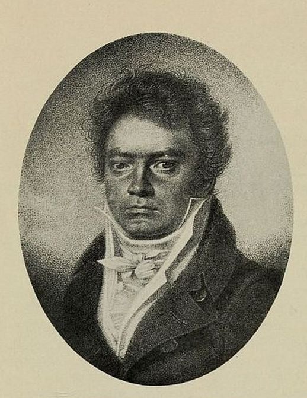

# 베토벤의 생애 — 들리는 세계가 달라져도 작업은 이어졌다

*본에서 빈으로, 청력의 어려움과 작품을 만들어 가는 시간*

Culture · Music

> 출처 대조와 공개 게시 승인을 마친 이야기입니다. 실제 게시 여부는 사이트 배포 상태를 따릅니다.

*루이 레트론 드로잉을 바탕으로 블라지우스 회펠이 제작한 베토벤 초상 · 롤랑 전기 수록 도판 · Project Gutenberg*

[이미지 출처·제작 근거](https://raw.githubusercontent.com/GITenberg/Beethoven_55941/master/55941-h/images/ilo_pag64.jpg) · 퍼블릭 도메인 원작의 역사적 재현 자료 · Project Gutenberg 수록본

베토벤을 떠올리면 강한 표정의 얼굴과 웅장한 음악, 들을 수 없게 된 작곡가라는 이야기가 함께 나온다. 그런데 그 몇 가지 이미지로는 한 사람이 어떻게 배우고 일하며 작품을 다듬었는지 알기 어렵다. 삶을 음악의 비극적인 배경 하나로만 만들지 않고 따라가 볼 필요가 있다.

그는 1770년 본에서 태어나 1827년 빈에서 세상을 떠났다. 그 사이에는 피아노를 연주하던 청년과 새로운 작품을 쓰던 작곡가, 청력의 어려움과 사람들과의 관계를 감당하던 생활인이 있었다.

## 1. 본에서 시작된 배움과 일

어린 베토벤은 본에서 음악을 배웠다. 가족의 환경과 생계, 연주를 익혀야 하는 시간이 함께 있었다. 훗날의 작품 이름만 보면 어린 시절부터 자기 음악을 모두 알고 있던 사람처럼 상상하기 쉽지만, 그에게도 배워야 할 기술과 처음 만나는 기회가 있었다.

재능을 발견하는 극적인 일화 하나보다 계속 악기를 다루고 음악을 익히는 시간을 생각해 보자. 눈에 띄는 능력과 그것을 일로 이어 가는 생활은 다르다. 음악가의 생애에서도 연습과 환경, 도움을 주는 사람들이 구체적인 자리를 차지한다.

## 2. 1792년, 빈에서 넓어진 세계

1792년 그는 빈으로 옮겨 활동한다. 새로운 도시에서 배우고 연주하며 사람들을 만난다. 연주자로 알려지는 일과 자기 작품을 작곡가로 내놓는 일이 이어지는 시기다. 빈은 그에게 이미 완성된 명성을 확인하는 무대만은 아니었다.

도시의 청중과 음악가, 후원자와 출판의 조건 속에서 자신의 자리를 만들어야 했다. 스스로의 개성을 지키려는 태도도 이런 관계와 떨어져 있지 않다. 독립적인 예술가라는 말을 모든 도움과 현실의 조건을 벗어난 사람이라는 뜻으로 받아들이지는 않는 편이 좋다.

## 3. 청력의 어려움은 소리만의 문제가 아니었다

청력이 나빠지는 과정은 연주와 일뿐 아니라 사람을 만나는 생활에도 영향을 미쳤다. 로맹 롤랑의 전기에 수록된 편지와 문서에는 그 어려움을 어떻게 설명해야 할지 고민하는 목소리가 남아 있다. 다른 사람에게 무뚝뚝하게 보이는 모습 뒤에 알리지 못한 사정이 있을 수 있었다.

이 기록을 읽으면 성격에 대한 단정이 조금 늦어진다. 늘 화를 내는 천재라는 익숙한 인상만으로 관계 전체를 설명하기 어렵다. 그렇다고 모든 갈등이 청력 하나 때문에 일어났다고 정리할 수도 없다. 여러 조건이 한 사람의 일상을 함께 만든다.

## 4. 1802년의 문서가 전하는 마음

하일리겐슈타트에서 쓴 1802년의 유서는 자신의 고통과 오해, 앞으로의 삶에 관한 생각을 전한다. 작품을 들으며 막연히 상상했던 어려움이 실제 글의 형태로 남아 있다는 점에서 중요한 자료다. 화려한 성공담만으로는 알기 힘든 목소리다.

여기서 고통이 훌륭한 작품을 자동으로 만들어 주었다는 공식을 세울 필요는 없다. 어려움을 겪는 동안에도 어떻게 살아가고 작업할지 고민했다는 점을 읽는 편이 낫다. 예술을 이해하려고 한 사람의 아픔을 감동적인 장식으로 소비하지 않는 태도도 중요하다.

## 5. 영감과 함께 남은 수정의 흔적

작곡가의 음악은 종종 머릿속에서 완성되어 한 번에 종이로 나오는 것처럼 이야기된다. 하지만 남은 원고와 여러 자료를 보면 무엇을 선택하고 다듬을지 고민하는 시간이 있었다. 하나의 선율을 만든 뒤 전체의 관계를 짜는 일은 다른 종류의 작업이다.

작품을 들을 때도 유명한 주제만 따로 아는 것에서 조금 더 나아갈 수 있다. 앞의 음악이 뒤에서 어떻게 돌아오는지, 어떤 악장이 서로 대비되는지 들어 보는 것이다. 한 번의 영감과 긴 구성의 시간을 함께 생각하면 음악가의 노동이 조금 구체적으로 보인다.

## 6. 큰 작품 곁에도 생활의 문제가 있었다

전기와 편지에는 후원과 돈, 가족과 거처 같은 문제가 등장한다. 위대한 작품을 쓴다고 일상의 사정이 사라지는 것은 아니었다. 작품을 내고 연주하고 생활을 유지하는 일이 서로 얽혔다. 음악의 역사와 생활의 역사는 같은 생애 안에 있다.

이를 알면 작품을 듣는 즐거움이 꼭 줄어드는 것은 아니다. 오히려 완성된 음악을 남기기 위해 어떤 조건을 감당했는지 생각하게 한다. 작곡가를 완벽한 성인으로 만들거나 반대로 사생활의 갈등으로 작품 전체를 판결할 필요도 없다.

## 7. 후기의 음악은 한 가지 표정으로 끝나지 않는다

교향곡 제9번을 비롯한 후기 작업에서는 목소리와 악기, 큰 형식과 세밀한 움직임이 여러 방식으로 나타난다. 청력이 크게 손상된 시기에도 작업이 이어졌다는 사실은 중요하다. 그러나 모든 작품을 같은 고통의 고백으로만 듣는다면 서로 다른 음악의 성격이 사라진다.

앞서 만난 〈전원〉의 시냇가와 다른 작품의 긴장, 노래하는 선율과 강한 리듬을 비교해 보자. 한 작곡가 안에도 다양한 표정이 있다. 생애의 큰 사실을 알아 둔 뒤에는 다시 실제로 이어지는 음과 구조에 귀를 돌리는 것이 도움이 된다.

## 8. 초상 뒤에서 일하던 사람을 보기

함께 실은 이미지는 루이 레트론의 1814년 드로잉을 바탕으로 한 블라지우스 회펠의 역사적 초상 판화다. 오늘 떠올리는 베토벤의 얼굴을 전하는 자료 중 하나지만, 그 표정만으로 매일의 감정을 진단할 수는 없다.

베토벤의 삶을 알았다는 것은 청력과 죽음의 연도를 외웠다는 뜻에 머물지 않는다. 배우고 이동하고, 문서를 쓰고, 원고를 고치며 일을 이어 간 사람을 함께 기억하는 것이다. 다음에 익숙한 곡을 만나면 천재라는 말에 가려졌던 긴 작업의 시간을 조금 떠올려 보아도 좋겠다.

## 이야기의 바탕이 된 자료

- [로맹 롤랑 — Beethoven, 역사적 전기와 문서](https://raw.githubusercontent.com/GITenberg/Beethoven_55941/master/55941-0.txt) · 확인일 2026-10-30
  - 확인 내용: 1770년 본 출생·1792년 빈 이주·배움과 연주·1827년 사망 / 청력 저하와 1802년 하일리겐슈타트 유서·편지 / 작곡과 수정·후원·생활의 어려움·교향곡 제9번 등 후기 작업
- [Beethoven — 작품·문서·초상 도판의 판본](https://raw.githubusercontent.com/GITenberg/Beethoven_55941/master/55941-h/55941-h.htm) · 확인일 2026-10-30
  - 확인 내용: 1814년 루이 레트론 드로잉을 바탕으로 한 블라지우스 회펠 판화 캡션

---

[같은 소주제의 이야기](README.md) · [전체 서가](../../README.md)
