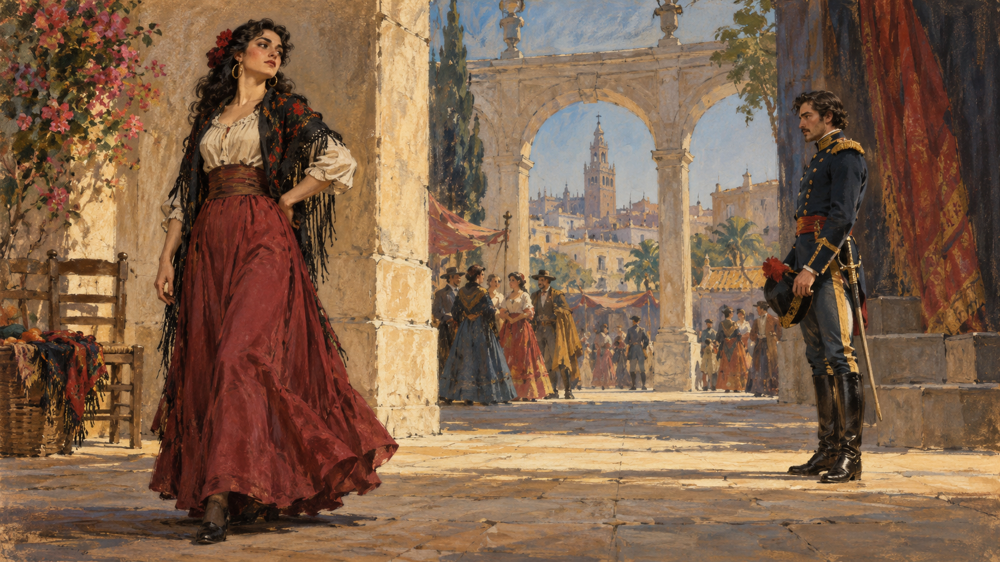

# 카르멘 — 익숙한 노래 뒤에는 어떤 이야기가 있을까

*비제의 오페라에서 사랑의 호소와 선택의 거절을 듣기*

Culture · Music

> 출처 대조와 공개 게시 승인을 마친 이야기입니다. 실제 게시 여부는 사이트 배포 상태를 따릅니다.

*AI 관련 장면 삽화 · 상상한 오페라 분위기입니다. 1875년 초연의 무대·가수·의상이나 특정 현대 공연의 장면을 복제한 자료가 아닙니다.*

광고와 공연에서 한 번쯤 들었을 선율이 있다. 비제의 오페라 『카르멘』에 나오는 하바네라와 투우사의 노래다. 멜로디만 들으면 화려한 축제처럼 느껴지지만 무대의 이야기는 사랑과 질투, 거절과 폭력으로 흘러간다.

파리에서 1875년 처음 공연된 이 작품의 배경은 스페인의 세비야다. 원작 소설을 바탕으로 하되 오페라의 인물과 구성이 더해졌다. 아래에는 주요 줄거리와 비극적인 결말이 포함되어 있다.

## 1. 광장에서 서로 다른 길이 만났다

첫 막에서 병사들과 담배 공장 노동자들이 오간다. 미카엘라는 돈 호세에게 어머니의 소식을 전하러 온다. 카르멘은 호세에게 관심을 보이며 꽃을 던진다. 익숙한 고향의 관계와 낯선 끌림이 그의 앞에서 만난다.

공장에서 다툼이 벌어진 뒤 카르멘은 붙잡힌다. 호세는 그녀를 호송하는 임무를 맡지만 결국 탈출을 돕는다. 그 선택의 대가는 자신의 처벌이다. 사랑의 시작은 이미 군인의 의무와 개인의 욕망이 충돌하는 사건이 된다.

## 2. 하바네라는 등장인물의 선언이다

카르멘이 처음 부르는 하바네라는 사랑을 명령하거나 붙들기 어렵다는 태도를 전한다. 반복되는 반주와 유연하게 움직이는 선율은 쉽게 귀에 남는다. 그러나 노래는 관객을 즐겁게 하는 장식에 그치지 않는다.

그녀가 어떤 방식으로 사랑을 말하는지 먼저 알려 준다. 앞으로도 사랑을 영원한 복종의 약속으로 생각하지 않으리라는 단서다. 익숙한 선율을 인물의 말로 들으면 이후 호세와의 갈등이 조금 더 분명해진다.

## 3. 술집에 나타난 또 다른 인기인

두 번째 막에서는 사람들이 모여 노래하고 춤추는 공간에 투우사 에스카미요가 등장한다. 그의 노래에는 관중의 환호와 명성, 경기장의 흥분이 담겨 있다. 사적인 감정과는 다른 공개적인 자신감이 무대를 채운다.

투우사의 노래가 이야기 밖에서도 유명한 이유를 짐작할 수 있다. 여럿이 따라 부르기 좋은 선명한 선율과 힘찬 분위기가 있다. 작품 안에서는 카르멘에게 관심을 보이는 또 한 사람의 존재를 관객에게 강하게 각인한다.

## 4. 꽃노래에서 들리는 호세의 마음

호세는 카르멘이 준 꽃을 간직해 왔다고 노래한다. 꽃노래는 하바네라와 다른 방식으로 사랑을 들려준다. 그에게 꽃은 갇혀 지낸 시간에도 버리지 못한 감정의 표식이었다.

그 진심을 듣는다고 두 사람의 생각이 같아지는 것은 아니다. 카르멘은 호세가 자신의 생활과 자유에 함께하기를 원하고, 호세는 군인의 의무와 그녀 사이에서 흔들린다. 아름다운 사랑의 노래와 관계가 지속될 조건은 서로 다를 수 있었다.

## 5. 산으로 간 뒤에도 갈등은 남았다

호세는 결국 밀수꾼들과 함께 산으로 간다. 그러나 카르멘의 마음은 달라지고 두 사람의 관계는 거칠어진다. 에스카미요가 찾아오자 호세의 질투는 더 커진다. 장소를 옮겼다고 서로 다른 기대가 해결되지 않았다.

미카엘라는 위험한 곳까지 와서 어머니의 소식을 전한다. 호세가 떠나온 삶을 다시 떠올리게 하는 인물이다. 그녀를 단지 착한 여성의 비교 대상으로만 보기보다, 두려움을 무릅쓰고 행동하는 사람으로 살펴볼 수 있다.

## 6. 카드가 드러내는 어두운 분위기

카르멘과 동료들이 카드를 보는 장면은 앞선 춤과 노래의 들뜬 분위기에서 벗어난다. 죽음의 예감이 무대에 들어온다. 관객은 인물보다 먼저 다가올 비극을 느끼면서도 사건을 멈출 수 없다.

음악은 같은 작품 안에서 이처럼 장면의 온도를 바꾼다. 유명한 몇 곡만 골라 들을 때 놓치기 쉬운 부분이다. 노래 사이의 변화와 인물들의 대답까지 따라가면 밝은 선율이 비극을 더 선명하게 만드는 방식도 들린다.

## 7. 경기장 안의 환호와 밖의 대면

마지막 막에서 카르멘은 에스카미요와 함께 투우장에 온다. 호세가 자신을 찾고 있다는 경고를 듣지만 피하지 않는다. 경기장 안에서 환호가 이어지는 동안 바깥에서는 호세와 카르멘의 대화가 막다른 길로 향한다.

호세는 돌아오라고 호소하고 카르멘은 거절한다. 그가 그녀를 살해하면서 비극이 끝난다. 사랑이 깊었다는 말로 이 폭력을 정당화할 수는 없다. 상대의 선택을 받아들일 수 없는 감정이 어떻게 파괴로 변하는지가 무대에 남는다.

## 8. 카르멘을 한 무리의 얼굴로 읽지 않기

이 오페라에는 19세기 프랑스가 상상한 스페인과 로마니 인물의 이미지가 들어 있다. 낯선 세계를 매력적이거나 위험하게 그리는 시선도 있다. 무대의 인물을 실제 민족과 여성 전체의 성격으로 받아들이지 않도록 주의할 대목이다.

오래된 해설은 카르멘을 냉혹한 유혹자로 쉽게 규정하기도 한다. 그러나 작품을 읽는 길은 하나가 아니다. 그녀의 자유와 거절, 호세의 집착을 중심에 놓으면 이미 알고 있던 줄거리도 다르게 들릴 수 있다.

## 9. 유명한 선율을 다시 듣는 방법

먼저 하바네라와 투우사의 노래를 듣고, 꽃노래와 마지막 대면을 이어 들어 보자. 같은 사랑이라는 말이 인물마다 다른 뜻으로 쓰인다. 반복되는 선율도 누구의 어떤 상황에 돌아오는지에 따라 느낌이 달라진다.

가수의 표현과 무대 해석에 따라 관객이 받는 인상도 바뀐다. 『카르멘』을 오래 듣게 만드는 것은 친숙한 멜로디와 함께 남는 불편한 질문이다. 사랑한다고 말하는 것과 상대를 자기 뜻대로 움직이려는 것은 어디에서 갈라질까.

## 이야기의 바탕이 된 자료

- [George P. Upton, The Standard Operas, 12th edition — Bizet/Carmen 절](https://raw.githubusercontent.com/GITenberg/The-Standard-Operas--12th-edition---13-Their-Plots-Their-Music-and-Their-Composers_14968/master/14968-8.txt) · 확인일 2026-10-31
  - 확인 내용: 1875년 3월 3일 파리 초연·소설의 오페라 각색·네 막의 줄거리 / 하바네라·투우사의 노래·꽃노래·카드 장면과 마지막 대면. 당대 해설의 가치판단과 오류는 구별

---

[같은 소주제의 이야기](README.md) · [전체 서가](../../README.md)
