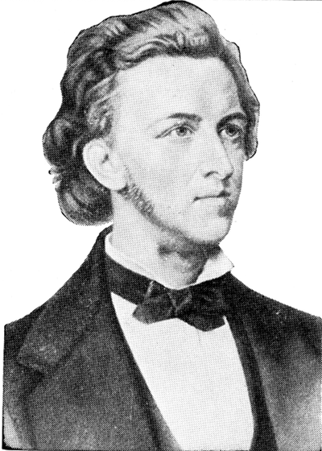

# 쇼팽의 생애 — 떠나온 나라가 피아노에 남을 때

*바르샤바에서 파리로, 춤의 리듬과 노래하는 건반을 따라*

Culture · Music

> 자료 대조를 마친 검토용 이야기입니다. 공개 게시 승인은 아직 받지 않았습니다.

*쇼팽의 역사적 초상 재현 도판 · Thomas Tapper의 음악 안내서 수록 · Project Gutenberg*

[이미지 출처·제작 근거](https://raw.githubusercontent.com/GITenberg/Chopin---The-Story-of-the-Boy-Who-Made-Beautiful-Melodies_35013/master/35013-h/images/illus01.png) · 퍼블릭 도메인 원작·역사적 재현 자료 · Project Gutenberg 수록본

쇼팽의 음악을 들으면 피아노가 노래하는 것처럼 느껴질 때가 있다. 멜로디가 한숨처럼 길어졌다가 장식음이 가볍게 흩어지고, 다른 곡에서는 춤의 걸음이 또렷하게 살아난다. 이런 표정들을 연약함이나 슬픔 한 가지로만 묶기는 어렵다.

프레데리크 쇼팽은 1810년에 태어나 1849년에 세상을 떠난 폴란드 작곡가이자 피아니스트다. 짧은 생애를 천재의 비극으로만 따라가기보다, 배움과 이주, 교습과 작곡이 어떻게 한 악기의 세계를 넓혔는지 살펴보자.

## 1. 바르샤바에서 배운 것

쇼팽은 바르샤바 근처에서 태어나 어린 시절부터 음악을 배우고 연주했다. 바르샤바에서 성장하며 엘스네르 같은 스승에게 배웠고, 또래와 가족의 생활 속에서 음악을 익혔다. 이미 완성된 피아노의 시인이 어느 날 등장했다기보다 배움과 기회가 쌓인 시간이었다.

이 시기에 만난 폴란드의 춤과 노래는 이후 작품을 이해하는 배경이 된다. 다만 그가 들은 모든 민속 선율을 그대로 악보에 옮겼다고 생각할 필요는 없다. 익숙한 리듬과 몸의 감각을 자기 작품의 언어로 바꾸어 갔다고 보는 편이 좋다.

## 2. 1830년의 떠남은 가벼운 여행으로 끝나지 않았다

쇼팽은 1830년 바르샤바를 떠났고, 1831년에는 파리에서 생활하게 된다. 그 사이 폴란드의 정치적 격변이 이어졌다. 가족과 익숙한 도시를 잠시 떠나는 것과, 쉽게 돌아갈 수 없는 생활을 시작하는 것은 같은 경험이 아니었다.

작품을 모두 고향을 그리워한 암호로 해독할 필요는 없다. 그러나 춤의 리듬과 폴란드의 이름이 그의 음악에서 계속 중요하다는 사실을 생애와 함께 볼 수는 있다. 이주한 사람에게 고향은 풍경의 기억뿐 아니라 몸에 익은 걸음과 말투로 남기도 한다.

## 3. 파리의 음악가는 무대 밖에서도 일했다

파리는 여러 음악가와 작가, 후원자가 만나는 도시였다. 쇼팽은 그곳에서 연주하고 작품을 내며 학생들을 가르쳤다. 대규모 무대의 열광만으로 생활한 예술가라고 보면 교습과 살롱, 일상적인 관계가 차지한 자리를 놓친다.

누군가의 손가락과 소리를 가까이 살피는 교습은 작곡가의 생활과도 연결된다. 그의 음악에는 피아노가 어떤 울림을 낼 수 있고 손이 어떻게 움직일 수 있는지에 대한 세밀한 관심이 들어 있다. 멜로디의 아름다움과 악기의 구체적인 조건을 따로 떼기 어렵다.

## 4. 야상곡에서는 피아노가 노래를 배운다

야상곡이라는 이름은 밤의 분위기를 떠올리게 한다. 쇼팽이 이 장르를 혼자 처음 발명했다고 말하는 것은 정확하지 않다. 휴너커의 전기도 존 필드와의 관계를 짚는다. 쇼팽은 이미 존재하던 장르 안에서 자기만의 노래와 긴장, 장식을 발전시켰다.

들어 볼 때는 위쪽의 노래와 아래쪽의 반주를 따로 따라가 보자. 반주가 바탕을 만들고 선율은 그 위에서 조금 더 유연하게 움직이는 듯 들릴 수 있다. 슬프다는 단어 하나로 정리하기보다 노래가 어디에서 쉬고 어디에서 길어지는지 느끼면 음악의 표정이 세분된다.

## 5. 마주르카와 폴로네즈에 남은 춤의 걸음

마주르카와 폴로네즈는 폴란드의 춤과 연결된 이름이다. 쇼팽의 작품에서는 실제 춤의 자리를 넘어 피아노로 듣는 음악의 세계가 된다. 춤에서 출발했다고 해서 언제나 무도장에서 똑같이 추도록 만들어진 곡만은 아니다.

박자마다 무게가 똑같은지, 어떤 부분에서 발걸음이 걸리는 듯 느껴지는지 들어 보자. 큰 감정만 따라갈 때보다 리듬의 특징이 가까워진다. 고향의 흔적은 특정 선율의 인용만이 아니라 이런 무게와 움직임의 방식에도 남을 수 있다.

## 6. 루바토는 마음대로 흐트러뜨리라는 말일까

쇼팽을 설명할 때 루바토라는 말을 자주 만난다. 시간을 조금 늘이거나 당기며 표현하는 연주와 관련된 말이다. 그러나 아무 곳에서나 멈추고 전체 박자를 잃어도 된다는 허가증은 아니다. 흐름을 유지하면서 소리의 말투를 세심하게 조절하는 문제에 가깝다.

우리가 문장을 읽을 때 모든 음절을 같은 길이로 말하지 않는 것에 비유할 수 있다. 그렇다고 문장이 어디로 향하는지 잊는 것은 아니다. 연주 두 개를 비교해 보면 같은 선율도 숨을 쉬는 위치와 움직임이 다르게 느껴질 수 있다. 이를 모두 작곡가의 한 가지 감정으로 환원할 필요는 없다.

## 7. 조르주 상드와 함께한 시간

작가 조르주 상드와의 관계는 쇼팽의 생애에서 큰 비중을 차지한다. 마요르카 체류와 프랑스 노앙에서의 시간에는 건강의 어려움과 생활, 작곡이 함께 있었다. 두 사람의 관계를 낭만적인 사랑 이야기만으로 보거나, 반대로 누가 누구의 예술을 망쳤다는 판정으로 끝내기는 어렵다.

오래된 전기에는 상드와 쇼팽을 평가하는 강한 편견도 섞여 있다. 그런 인물평을 그대로 받아들이기보다 어디에서 함께 지냈고 어떤 작업과 어려움이 있었는지 구분해 읽는 편이 좋다. 사생활은 작품을 만나는 한 배경이지만 음악의 가치를 대신 판결하지는 않는다.

## 8. 1849년 이후에도 남은 여러 표정

건강이 악화된 쇼팽은 1849년에 세상을 떠났다. 피아노를 중심으로 남긴 작품들은 노래하는 선율과 춤의 리듬, 정교한 움직임을 서로 다른 방식으로 이어 간다. 듣기 편한 야상곡 하나와 힘 있는 폴로네즈 하나를 비교하는 것만으로도 한 작곡가의 폭넓은 표정을 만날 수 있다.

함께 실은 것은 옛 음악 안내서에 실린 쇼팽의 역사적 초상 재현 도판이다. 얼굴만으로 그의 건강이나 성격을 판단하기보다 음악으로 돌아갈 출발점으로 보면 좋다. 바르샤바에서 배운 청년, 파리에서 가르치던 음악가, 한 악기를 깊게 탐구한 작곡가를 함께 기억하면 익숙한 이름 뒤의 삶이 조금 더 입체적으로 들린다.

## 이야기의 바탕이 된 자료

- [제임스 휴너커 — Chopin: The Man and His Music](https://raw.githubusercontent.com/GITenberg/Chopin---the-Man-and-His-Music_4939/master/4939.txt) · 확인일 2026-10-29
  - 확인 내용: 바르샤바의 성장·엘스네르·1830년 떠남과 1831년 파리 정착 / 교습과 사교·피아노 표현·마주르카·폴로네즈·야상곡·루바토 / 조르주 상드·마요르카·노앙·건강의 어려움과 1849년 죽음
- [쇼팽 전기 서지 정보 — 표준 인물 식별](https://raw.githubusercontent.com/GITenberg/Chopin---the-Man-and-His-Music_4939/master/metadata.yaml) · 확인일 2026-10-29
  - 확인 내용: 주제 표목 Chopin, Frédéric, 1810–1849; 옛 전기 본문의 출생연도 논쟁과 구별
- [토머스 태퍼 — Chopin, 초상 도판이 있는 역사적 음악 안내서](https://raw.githubusercontent.com/GITenberg/Chopin---The-Story-of-the-Boy-Who-Made-Beautiful-Melodies_35013/master/35013-h/35013-h.htm) · 확인일 2026-10-29
  - 확인 내용: 인물 초상으로 식별된 illus01 도판의 성격; 본문의 낡은 출생연도는 사용하지 않음

---

[같은 소주제의 이야기](README.md) · [전체 서가](../../README.md)
