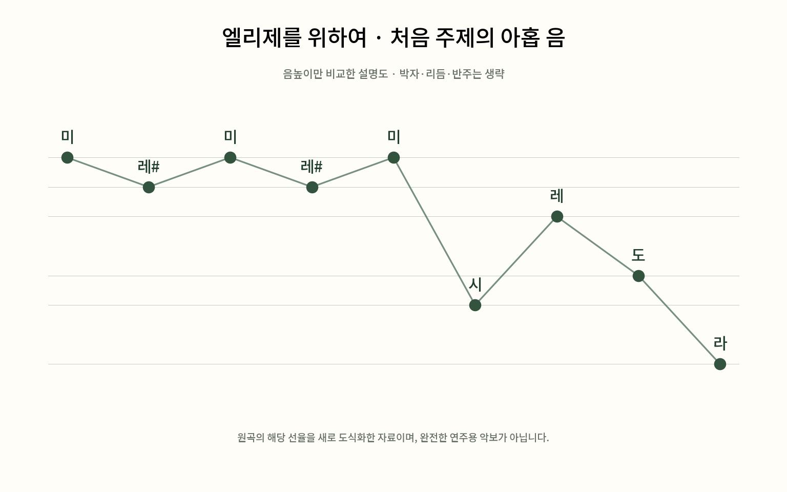

# 엘리제를 위하여 — 익숙한 선율 앞에 남은 이름

*제목이 말해 주는 것과 말해 주지 않는 것*

Culture · Music

> 자료 대조를 마친 검토용 이야기입니다. 공개 게시 승인은 아직 받지 않았습니다.

*KnowledgeWalk 제작 · 작품 원문·악보에 근거한 읽기·감상 길잡이. 원본 표지·역사적 자료·완전한 연주용 악보를 복제한 이미지가 아닙니다.*

[이미지 출처·제작 근거](https://raw.githubusercontent.com/MutopiaProject/MutopiaProject/master/ftp/BeethovenLv/WoO59/fur_Elise_WoO59/fur_Elise_WoO59.ly) · KnowledgeWalk 직접 제작 설명도

미, 레 샵, 미, 레 샵. 짧은 시작만으로 곡을 알아듣는 사람이 많다. 베토벤의 〈엘리제를 위하여〉는 피아노를 배우던 기억이나 일상에서 흘러나오던 소리와 함께 익숙해진 작품이다. 그런데 처음의 몇 음을 안다는 것과 곡 전체를 들어 보았다는 것은 조금 다르다.

이 작품을 두 개의 길로 만나 보자. 먼저 제목이 무엇을 알려 주는지 살펴보고, 다음에는 익숙한 선율이 낯선 구간을 지나 어떻게 돌아오는지 들어 보는 것이다. 악보를 읽지 못해도 따라갈 수 있다.

## 1. ‘엘리제를 위하여’라는 이름이 알려 주는 것

독일어 Für Elise는 ‘엘리제를 위하여’라는 뜻이다. 누군가를 향한 표제가 붙어 있으니 이름의 주인이 궁금해지는 것은 자연스럽다. 그러나 제목 하나가 그 사람의 신원과 작곡가의 연애사를 전부 증명해 주지는 않는다.

이번에 대조한 악보는 이 곡을 베토벤의 피아노곡, 가단조, WoO 59로 제시하고 1810년을 표기한다. 반면 엘리제의 신원이나 헌정의 경위를 설명하는 근거는 제공하지 않는다. 따라서 여기서는 특정 인물을 주인공으로 한 고백 이야기를 확정해서 들려주지 않는다. 제목의 뜻은 분명히 설명하되, 사연을 확인하지 못한 곳은 남겨 두는 편이 작품을 이해하는 데도 정직하다.

## 2. WoO 59는 무슨 뜻일까

클래식 곡에는 작품번호가 붙는 경우가 많다. 이 곡의 WoO는 독일어 ‘작품번호 없는 작품들’이라는 분류를 줄인 표기다. 베토벤의 음악을 정리하는 목록 안에서 이 곡을 찾게 해 주는 주소라고 생각하면 된다. 숫자가 작다고 초보자용이라는 뜻도, 59번째로 작곡했다는 뜻도 아니다.

같은 제목의 편곡과 짧게 잘라 낸 음원이 많을 때 ‘베토벤, WoO 59, 피아노 독주’를 함께 확인하면 어떤 곡인지 구분하기 쉽다. 여기서 읽은 것은 1888년 출판 악보를 바탕으로 현대에 새로 조판한 자료다. 오늘 보는 악보와 작곡가가 종이에 처음 적었던 원고를 같은 물건으로 소개하지는 않는다.

## 3. 첫 선율은 왜 쉽게 기억될까

시작 부분은 미와 그 바로 아래의 레 샵을 오가며 망설이는 듯 움직인다. 두 음의 거리는 피아노 건반에서 바로 이웃한 반음이다. 큰 폭으로 뛰어오르는 대신 좁은 곳을 반복해서 건드리므로, 짧은 움직임 자체가 곡의 얼굴이 된다. 이어 시, 레, 도, 라로 길이 열리며 우리가 기억하는 첫 구절이 만들어진다.

오른손의 선율 아래에서는 왼손이 화음의 음들을 차례로 펼쳐 놓는다. 여러 음을 한꺼번에 누르지 않고 나누어 울리는 반주다. 익숙한 멜로디만 따라 부르던 사람도 낮은 쪽의 움직임을 함께 들으면 음악이 한 줄로만 진행되지 않는다는 것을 느낄 수 있다.

## 4. 익숙한 부분이 다시 찾아오는 구조

곡의 흐름을 간단히 적으면 ‘처음 선율 — 다른 장면 — 처음 선율 — 또 다른 장면 — 처음 선율’처럼 들을 수 있다. 음악에서 이런 반복과 대비를 설명할 때 론도라는 말을 쓴다. 어려운 형식 이름보다 집으로 돌아오는 길을 떠올려도 좋다. 같은 문을 다시 열어도, 그 사이 어디를 다녀왔느냐에 따라 돌아온 느낌은 달라진다.

반복되는 첫 선율을 A라고 마음속으로 표시해 보자. A가 아닌 부분이 나오면 모르는 곡으로 바뀌었다고 생각하기보다, 익숙한 선율과 무엇이 다른지 들어 보면 된다. 악보의 모든 반복 기호를 계산하지 않아도 귀로 큰 구조를 잡을 수 있는 방법이다.

## 5. 첫 번째 다른 장면에서는 손이 바빠진다

처음 선율을 벗어나면 음들이 더 촘촘하게 움직이고 음악의 표정이 밝아지는 구간이 나타난다. 처음의 조심스러운 물음표에서 조금 더 넓고 유연한 움직임으로 나아가는 듯 들을 수 있다. 이는 감상을 돕기 위한 비유이며 작곡가가 정해 둔 줄거리는 아니다.

피아노를 막 배우는 사람이 첫 부분을 연주할 수 있다고 해서 곡 전체가 같은 난이도로 이어지는 것은 아니다. 이 구간에서는 빠르게 이어지는 음들과 손의 이동이 필요하다. 처음 몇 마디만으로 ‘쉬운 소품’이라고 판단하면 음악이 감추고 있던 다른 표정을 놓친다.

## 6. 낮은 음이 반복될 때 분위기가 바뀐다

뒤쪽의 또 다른 구간에서는 낮은 음의 반복이 귀에 들어온다. 그 위의 화음과 선율이 움직이면서 처음보다 긴장된 느낌을 만든다. 처음에 가까운 두 음을 오가던 섬세함과는 다른, 조금 더 단단하고 다급한 추진력을 들을 수 있다.

그 긴장이 지난 뒤 처음의 선율이 돌아오면 곡의 시작과 끝이 연결된다. 같은 음이 돌아와도 이미 다른 장면을 거쳤기 때문에 단순한 되풀이로만 들리지 않을 수 있다. 이번에는 반주를, 다음에는 선율을 따라가며 두 번 들어 보면 이런 변화가 더 분명해진다.

## 7. 제목의 사연과 소리의 경험을 함께 두기

먼저 곡 전체를 끝까지 한 번 들어 보자. 두 번째에는 첫 선율이 돌아오는 순간을 찾고, 세 번째에는 가운데 두 구간의 차이를 들어 보아도 좋다. 모든 것을 한꺼번에 알아내려고 하지 않으면 익숙한 음악도 새롭게 들을 여유가 생긴다.

함께 실은 그림은 첫 아홉 음의 높낮이를 정리한 자체 설명도이며 리듬과 반주를 모두 담은 연주용 악보는 아니다. 엘리제가 누구였는지 궁금해하는 마음과, 실제로 들리는 음을 즐기는 마음은 함께 갈 수 있다. 확정되지 않은 로맨스를 채워 넣지 않아도 이 짧은 곡 안에는 반복, 대비, 긴장과 귀환이라는 꽤 풍부한 시간이 들어 있다.

## 이야기의 바탕이 된 자료

- [Mutopia — Für Elise, WoO 59, 공개 악보](https://raw.githubusercontent.com/MutopiaProject/MutopiaProject/master/ftp/BeethovenLv/WoO59/fur_Elise_WoO59/fur_Elise_WoO59.ly) · 확인일 2026-10-29
  - 확인 내용: Für Elise라는 표제·Beethoven·WoO 59·가단조·1810년 표기 / 1888년 Breitkopf & Härtel 출처와 현 조판자의 Public Domain 선언 / 악보 첫 아홉 음의 순서와 뒤에 반복되는 주제·빠른 음형 / 해당 악보 자료에는 헌정 인물의 신원을 확인하는 설명이 없음 / 첫 음형·가단조·펼친 반주·주제 귀환과 대비 구간 / 첫 대비 구간의 촘촘한 움직임과 뒤 대비 구간의 낮은 반복음

---

[같은 소주제의 이야기](README.md) · [전체 서가](../../README.md)
