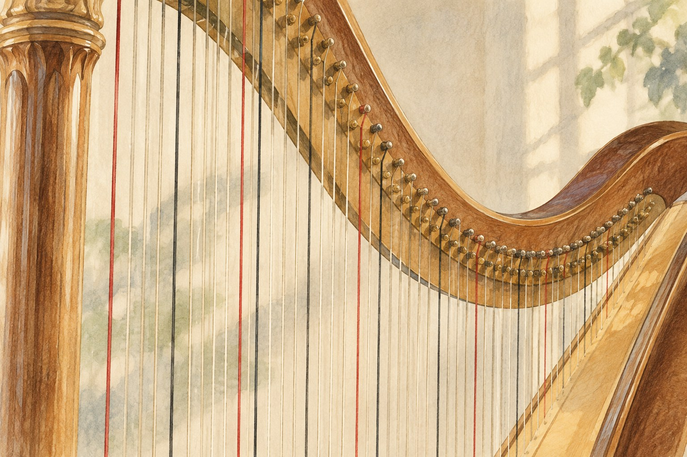

# 하프 줄에는 왜 빨간색이 섞여 있을까

*수많은 현 사이에서 길을 찾는 색깔*

Culture · Music

> 출처 대조와 공개 게시 승인을 마친 이야기입니다. 실제 게시 여부는 사이트 배포 상태를 따릅니다.

*KnowledgeWalk 제작 · AI 설명용 삽화. 실제 유물·제품·연주 기구·동물의 생김새를 정확하게 재현한 자료나 실험 결과가 아닙니다.*

하프를 보면 먼저 줄의 수에 압도된다. 길고 짧은 줄이 나란히 서 있어서, 어디를 짚어야 원하는 소리가 나는지 잠깐 막막해진다.

그런데 가까이 보면 모든 줄이 같은 색은 아니다. 빨간 줄이 섞여 있고 어두운 줄도 보인다. 장식으로 색을 넣은 것 같지만, 연주자가 줄을 찾는 데 도움을 주는 표시다.

## 1. 줄 사이의 작은 이정표

필하모니아 오케스트라의 하프 안내는 도에 해당하는 C 줄을 빨간색, 파에 해당하는 F 줄을 검은색으로 소개한다. 빽빽한 줄 사이에 알아보기 쉬운 기준점을 둔 것이다.

이야기의 대상은 오케스트라에서 사용하는 현대적인 페달 하프다. 안내에 따르면 이 하프에는 47개의 줄이 있다. 줄마다 손글씨 이름표를 달기보다 색으로 자리를 구분하면 연주 중에도 눈에 빨리 들어온다.

우리도 비슷한 표시를 쓴다. 자주 찾는 책에 색깔 쪽지를 붙이거나, 비슷한 열쇠를 구분하려 고리를 달 때가 있다. 하프의 줄에서는 색이 그 작은 길잡이 역할을 한다.

## 2. 손이 바쁜 동안 발도 움직인다

하프를 보는 시선은 보통 손에 머문다. 하지만 아래에는 일곱 개의 페달도 있다. 이 페달은 같은 이름의 음에 해당하는 줄들의 음높이를 바꾸는 데 쓰인다.

필하모니아는 C 페달을 바꾸면 여러 높이에 있는 C 줄들이 함께 영향을 받는다고 설명한다. 줄 하나마다 발판 하나가 있는 구조는 아닌 것이다.

그래서 연주자는 손으로 줄을 뜯는 동안에도 발밑의 상태를 살핀다. 쉬는 구간이 보인다고 완전히 할 일이 없는 것은 아니다. 다음에 필요한 소리를 위해 페달을 바꾸는 시간일 수도 있다.

## 3. 줄이 많아질수록 찾는 일이 중요해진다

47개의 줄 앞에서 연주자는 지금 필요한 음의 자리를 빠르게 알아보아야 한다. 모든 줄이 똑같이 보인다면 손의 이동을 확인하는 일도 어려워질 수 있다. 빨간 C와 검은 F는 여러 높이에 걸쳐 반복되는 기준점이다. 색이 소리를 직접 만들어 내는 것이 아니라, 연주할 위치를 찾는 사람을 돕는 표시라는 점이 중요하다.

악보의 음과 실제 줄 사이를 연결하는 일에는 눈과 손이 함께 쓰인다. 색을 아는 관람자라면 연주자의 손이 어느 구역을 오가는지 조금 더 구체적으로 볼 수 있다. 다만 모든 하프가 같은 줄 수와 색을 가진다고 일반화하지는 않는다. 이 글에서 설명하는 현대 페달 하프의 구성이라는 범위를 기억하면 된다.

## 4. 같은 이름의 음을 묶는 발밑의 장치

피아노에서 서로 다른 높이의 도가 반복되듯 하프에도 같은 이름을 가진 여러 줄이 있다. 안내는 C 페달을 움직이면 여러 높이의 C 줄에 함께 영향을 준다고 설명한다. 줄의 총개수와 페달의 개수가 일치하지 않는 까닭이다. 발 하나가 물건 하나만 맡는 구조가 아니라 음의 이름을 기준으로 묶인 조절을 하는 셈이다.

이 관계를 알고 보면 하프를 단순히 줄을 많이 단 악기로 기억하기 어렵다. 손은 어떤 줄을 언제 뜯을지 다루고 발은 필요한 음높이의 상태를 준비한다. 물론 실제 연주의 모든 조작을 두 문장으로 요약할 수는 없다. 다만 눈에 보이는 손의 동작 뒤에 다른 준비가 있다는 점이 공연의 풍경을 바꿔 준다.

## 5. 쉬는 순간에도 다음 소리를 준비한다

선율이 잠시 끊겨도 연주자가 페달을 바꾸거나 손을 옮기는 모습을 볼 수 있다. 음악은 지금 울리는 소리뿐 아니라 곧 울릴 소리의 조건도 필요하기 때문이다. 관객에게 조용한 구간이 연주자에게는 다음 장면의 준비 시간이 될 수 있다. 쉼을 아무 활동도 없는 빈칸으로만 보지 않게 되는 대목이다.

하프만의 특별한 마법이라기보다 합주에서 만나는 준비의 한 사례다. 현을 고르고 몸의 위치를 잡는 일이 관람자에게 모두 크게 드러나지는 않는다. 그래서 공연을 볼 때 한 번은 선율을 듣고 다른 한 번은 준비 동작을 따라가도 좋다. 정확히 어떤 페달을 밟는지 알아맞힐 필요 없이도 음악을 만드는 움직임이 보인다.

## 6. 색을 알면 듣는 방법도 넓어질까

줄의 색을 알았다고 곧바로 음을 귀로 구분하는 능력이 생기는 것은 아니다. 그래도 복잡해 보이던 악기에 눈이 머물 표지가 생긴다. 음악을 배우는 입구가 악보와 음이름의 암기 하나로만 정해져 있지 않다는 뜻이다. 구조의 작은 단서가 낯선 악기를 다시 보고 싶게 만들 수 있다.

다음 합주 영상에서 하프를 찾았다면 먼저 색이 반복되는 구간을 보고, 손과 발의 움직임을 번갈아 살펴보자. 소리가 보이는 자리와 보이지 않는 조절이 어떻게 나뉘는지 생각할 수 있다. 빛나는 많은 줄 가운데 빨간색 몇 가닥이 단순한 장식에서 연주를 돕는 길잡이로 바뀌는 순간이다.

## 7. 아름다운 모양 속의 사용법

하프의 곡선과 줄은 멀리서도 아름답다. 가까이에서는 그 아름다운 모습 안에 연주를 돕는 장치가 들어 있다는 것이 보인다. 색깔은 위치를, 페달은 음의 변화를 다룬다.

필하모니아는 하프 연주자들이 공연 전에 여러 줄을 조율하는 모습도 소개한다. 반짝이는 줄이 많이 있다는 것은, 그만큼 미리 확인해야 할 소리도 많다는 뜻이다.

다음에 하프를 만나면 줄을 하나씩 세려고 애쓰지 않아도 좋다. 먼저 빨간 줄을 찾아보자. 아름다운 악기 안에서 연주자가 길을 잃지 않도록 마련한 작은 표지가 보일 것이다.

## 이야기의 바탕이 된 자료

- [Philharmonia — Harp](https://philharmonia.co.uk/resources/instruments/harp/) · 확인일 2026-10-27
  - 확인 내용: 현대 페달 하프의 47개 줄과 일곱 페달 / C 줄의 빨간색·F 줄의 검은색 표지 / 같은 음 이름의 줄들에 작용하는 페달과 공연 전 조율

---

[같은 소주제의 이야기](README.md) · [전체 서가](../../README.md)
