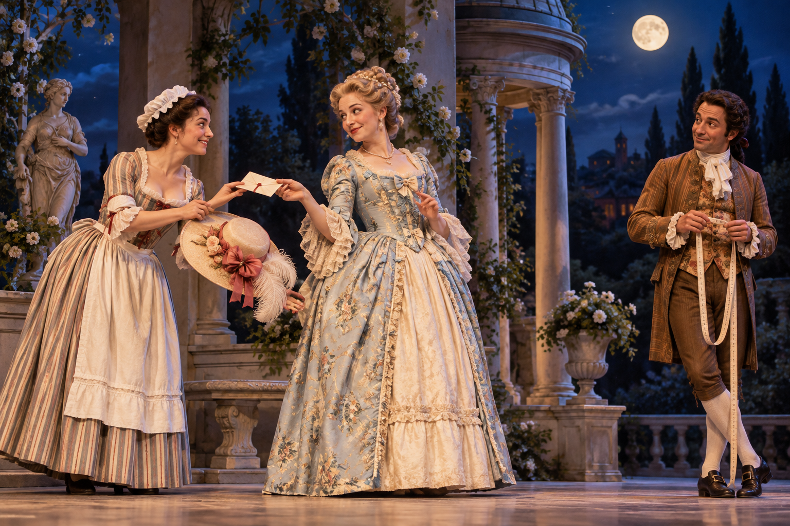

# 『피가로의 결혼』 — 결혼식 날 가장 바쁜 것은 누구일까

*방을 재던 하인이 주인의 권력을 되묻는 하루*

Culture · Music

> 자료 대조를 마친 검토용 이야기입니다. 공개 게시 승인은 아직 받지 않았습니다.

*AI 이야기 장면 삽화 · 오페라의 편지와 변장을 떠올린 독립 삽화이며 실제 초연의 무대·배우·의상을 고증한 자료가 아닙니다.*

## 소제목 바로가기

- [01. 이발사였던 피가로가 하인이 되었다](#user-content-part-1)
- [02. 신부가 알고 신랑이 몰랐던 것](#user-content-part-2)
- [03. 사랑이 어디로 가는지 모르는 소년](#user-content-part-3)
- [04. 닫힌 문 뒤의 사람은 누구일까](#user-content-part-4)
- [05. 결혼 계약이 다른 관계를 드러낸다](#user-content-part-5)
- [06. 편지를 함께 쓰는 두 목소리](#user-content-part-6)
- [07. 정원에서는 옷이 얼굴을 대신한다](#user-content-part-7)
- [08. 용서는 자동적인 결말일까](#user-content-part-8)

결혼을 앞둔 피가로가 방의 치수를 잰다. 신부 수잔나는 그 방이 왜 자신들에게 주어졌는지 다른 생각을 한다. 주인인 백작이 쉽게 찾아올 수 있는 위치라는 것이다. 『피가로의 결혼』은 작은 방 하나에서도 서로 다른 계산이 이루어진다는 사실을 노래하며 시작한다.

모차르트가 작곡하고 로렌초 다 폰테가 대본을 쓴 오페라로 1786년 빈에서 초연되었다. 인물들의 사연은 보마르셰의 희극에 뿌리를 둔다. 이 글은 주요 줄거리와 마지막의 화해를 함께 소개한다.

## 01. 이발사였던 피가로가 하인이 되었다

『세비야의 이발사』에서 연인의 만남을 도왔던 피가로와 알마비바 백작이 다시 등장한다. 다만 모차르트의 오페라가 로시니의 곡을 듣고 만든 속편은 아니다. 모차르트의 작품이 먼저 나왔고 두 작품이 바탕으로 삼은 연극들의 인물과 사연이 이어지는 것이다.

백작은 로지나와 결혼했고, 피가로는 그의 집에서 일하며 수잔나와 결혼하려 한다. 그런데 예전에 사랑을 위해 지혜를 빌렸던 백작이 이제는 하녀에게 접근한다. 관계의 위치가 바뀌자 익숙한 인물도 달라 보인다. 새 이야기의 핵심은 누가 누구의 뜻을 함부로 넘으려 하는지에 있다.

## 02. 신부가 알고 신랑이 몰랐던 것

수잔나는 백작의 의도를 알아차린다. 방을 선물처럼 받아들이던 피가로도 상황을 알고 태도를 바꾼다. 「백작님, 춤추고 싶으시다면」이라는 아리아에서는 상대가 마음대로 이끌게 두지 않겠다는 기세가 들린다. 하인의 목소리가 주인의 계획에 맞서는 순간이다.

하지만 피가로가 모든 것을 알고 지휘하는 유일한 해결사는 아니다. 수잔나와 백작부인 역시 판단하고 작전을 세운다. 남성들 사이의 신경전만 따라가면 이 작품의 중심적인 협력이 작아진다. 집 안의 사정을 누구보다 잘 아는 여성들의 대화가 사건을 움직인다.

## 03. 사랑이 어디로 가는지 모르는 소년

소년 시종 케루비노는 자기 마음을 설명하기 어렵다. 여러 사람에게 끌리고, 어른들의 방 안에 나타나면 상황을 복잡하게 만든다. 「사랑이 어떤 것인지 아시는 그대들은」에서 그는 사랑을 아는 사람들에게 자신의 상태를 물으려 한다. 확신에 찬 유혹보다 아직 자기 감정을 모르는 질문이다.

이 역할을 여성 가수가 맡아 노래하는 관습도 무대의 독특한 재미를 만든다. 이어지는 변장은 줄거리 안의 성별 표현까지 겹치게 한다. 모든 장치를 미리 해석하려 애쓰기보다 누가 자신을 어떻게 보이게 하려 하는지 살피면 좋다. 이 집에서는 옷이 정보와 오해를 함께 만든다.

## 04. 닫힌 문 뒤의 사람은 누구일까

백작부인의 방에서 소동이 벌어진다. 수상하게 여긴 백작은 안을 확인하려 하고, 케루비노는 창문으로 빠져나가며 수잔나가 대신 나타난다. 백작이 확신한 설명과 실제 방 안의 사정이 어긋난다. 관객은 인물들보다 더 많이 알고 있어 그 차이를 즐긴다.

하지만 창밖의 화단이 망가졌다는 정원사의 말이 들어오면 비밀은 다시 위험해진다. 피가로는 자기가 뛰어내렸다고 나서고, 남겨진 문서가 또 질문을 만든다. 한 가지 거짓말이 성공했다고 작전이 끝나지 않는다. 모차르트는 사람이 더 들어올수록 음악도 겹쳐 복잡해지는 상황을 들려준다.

## 05. 결혼 계약이 다른 관계를 드러낸다

마르첼리나는 피가로에게 예전 약속을 이행하라고 요구하고 바르톨로도 그 일에 끼어든다. 백작은 피가로의 결혼이 막히는 상황을 자신에게 유리하게 본다. 그런데 출생에 관한 사정이 드러나면서 피가로가 두 사람의 아들이라는 사실이 밝혀진다. 연애의 장애물처럼 보였던 관계가 가족의 발견으로 바뀐다.

오늘의 감각으로는 우연이 지나치게 편리해 보일 수도 있다. 희극은 이런 급격한 전환으로 막힌 상황을 새롭게 배치한다. 다만 이 소동이 없애 주는 것은 한 문제일 뿐이다. 백작의 행동과 부부 사이의 불신은 남아 있다. 그래서 이야기는 더 큰 집단적인 작전으로 이어진다.

## 06. 편지를 함께 쓰는 두 목소리

백작부인과 수잔나는 정원의 만남을 약속하는 편지를 준비한다. 「산들바람은 부드럽게」로 알려진 이중창에서는 한 사람이 말을 주고 다른 사람이 받아 적는 장면이 아름답게 이어진다. 계획을 세우는 일인데도 음악은 공격적인 승부보다 신뢰와 협력을 느끼게 한다.

두 여성은 주인과 하녀라는 다른 위치에 있지만 같은 문제 앞에서 힘을 합친다. 그렇다고 신분의 차이가 순식간에 사라지는 것은 아니다. 다른 자리에 있는 사람들이 잠시 같은 목적을 향할 수 있다는 장면이다. 익숙한 선율의 아름다움에 이런 대화의 상황까지 알면 노래가 더 가까워진다.

## 07. 정원에서는 옷이 얼굴을 대신한다

밤의 정원에서 수잔나와 백작부인은 서로의 옷차림을 바꾼다. 백작은 자신이 원하던 상대를 만난다고 믿고, 피가로에게도 의심과 오해가 생긴다. 불빛이 적은 곳에서 사람들은 보이는 단서와 자기 욕망을 합쳐 타인을 판단한다. 어두운 정원은 마음속의 확신을 비추는 무대가 된다.

마침내 사람들이 모이고 정체가 드러난다. 아내를 의심하던 백작은 자신의 행동을 보게 된다. 강하게 명령하던 목소리가 용서를 구하는 목소리로 바뀐다. 복잡한 설명과 빠른 움직임이 이어지던 음악도 이 순간 다른 숨을 쉰다. 멈춤이 있어서 소동의 무게가 드러난다.

## 08. 용서는 자동적인 결말일까

백작부인은 용서하고 결혼의 축제가 이어진다. 그렇다고 백작이 이후 영원히 달라졌다고 소설 밖의 사실처럼 단정할 수는 없다. 무대가 보여 주는 것은 지금 이 순간의 청원과 응답이다. 피해를 받은 사람이 언제나 용서해야 한다는 일반적인 요구로 바꿀 필요도 없다.

『피가로의 결혼』은 마지막에 누가 가장 영리했는지 시상하는 이야기만은 아니다. 같은 집에서 권력과 감정이 어떻게 부딪치는지 들려주는 하루다. 처음 방의 길이를 재던 피가로는 결혼할 공간을 찾고 있었다. 하루가 끝날 때 관객은 그 공간에서 서로의 뜻을 얼마나 존중할 수 있는지까지 묻게 된다.

## 이야기의 바탕이 된 자료

- [George P. Upton, The Standard Operas, 12th edition — Marriage of Figaro / Don Giovanni](https://raw.githubusercontent.com/GITenberg/The-Standard-Operas--12th-edition---13-Their-Plots-Their-Music-and-Their-Composers_14968/master/14968-8.txt) · 확인일 2026-11-01
  - 확인 내용: 1786 빈/1787 프라하·다 폰테·피가로와 백작의 관계·대표 아리아/편지 이중창 / 돈 조반니의 기사장 살해·엘비라·레포렐로의 목록·체를리나의 이중창·석상 초대와 거부. 부정확한 초연 배역과 일화/세부 줄거리를 채택하지 않음
- [Charles Annesley, The Standard Operaglass — Le nozze di Figaro / Don Juan](https://raw.githubusercontent.com/GITenberg/The-Standard-OperaglassDetailed-Plots-of-One-Hundred-and-Fifty-one-Celebrated-Operas_24647/master/24647-8.txt) · 확인일 2026-11-01
  - 확인 내용: 수잔나/백작부인/피가로·케루비노의 변장과 창·문서·마르첼리나/바르톨로·정원과 용서 / 돈나 안나/기사장·엘비라/레포렐로·체를리나/마제토·기념 석상과 결말. 원저자의 여성 평가·피해자 비난을 반복하지 않음

---

[같은 소주제의 이야기](README.md) · [전체 서가](../../README.md)
