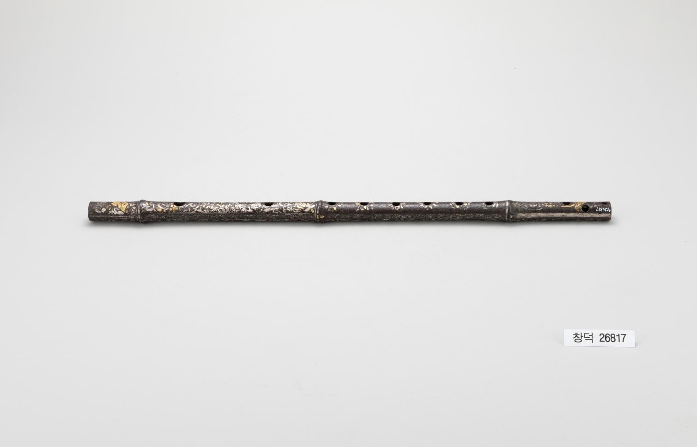

# 대금에도 반짝이는 꽃무늬가 있었다

*소리를 내는 긴 관에 더한 장식*

Culture · Music

> 출처 대조와 공개 게시 승인을 마친 이야기입니다. 실제 게시 여부는 사이트 배포 상태를 따릅니다.

*철제금은입사대금 · 국립고궁박물관 소장·제공. 전체 사진을 자르지 않고 사용했습니다.*

[이미지 출처·제작 근거](https://www.gogung.go.kr/gogung/pgm/psgudMng/view.do?menuNo=800065&psgudSn=432873) · 공공누리 제1유형(출처표시)

대금이라는 이름을 들으면 길쭉한 대나무 악기가 떠오른다. 그런데 국립고궁박물관의 철제금은입사대금은 이름부터 조금 다르다. 금속으로 만든 악기에 꽃과 학 무늬까지 더했다.

전체 사진에서는 가느다란 선처럼 보여서 장식이 쉽게 눈에 들어오지 않을 수 있다. 악기라는 사실을 확인한 뒤, 이번에는 어디에 어떤 무늬를 놓았는지 설명을 길잡이 삼아 천천히 살펴보자.

## 1. 구멍만 있는 관이 아니다

박물관은 이 악기를 가로로 연주하는 관악기로 소개하고, 몸체에 구멍이 열두 개 뚫려 있다고 설명한다. 길게 뻗은 관과 구멍은 소리를 내는 악기의 특징을 보여 주는 부분이다.

거기에 금은입사 기법으로 꽃무늬와 꽃덩굴무늬를 더했다고 한다. 연주 도구의 표면에 장식의 자리가 함께 마련된 것이다. 구멍을 모두 같은 용도의 손가락 구멍이라고 단정할 필요는 없다. 여기서는 박물관이 알려 주는 전체 개수로 읽으면 된다.

## 2. 양끝에는 학이 있다

양끝에는 같은 기법으로 학 무늬를 표현했다. 몸통의 꽃과 끝부분의 새를 나누어 놓은 구성이 보인다. 가운데와 끝을 따로 살피는 것만으로도 긴 물건을 보는 순서가 생긴다.

사진에서 작은 무늬가 선명하지 않을 때는 확대해 보되 보이지 않는 선을 억지로 읽어낼 필요는 없다. 악기의 장식에 관한 정보는 사진과 함께 제공되는 소장품 설명에서 확인할 수 있다.

## 3. 길게 놓인 물건은 보는 순서도 길다

대금의 사진을 볼 때 한가운데만 확대하면 긴 관 전체의 구성을 놓칠 수 있다. 먼저 끝에서 끝까지 이어지는 형태를 보고 다음에 구멍과 표면의 무늬를 살펴보자. 소리를 만드는 구조와 장식이 같은 길이 안에 나란히 놓인다. 어느 한쪽을 부수적인 것으로 지우지 않아도 악기를 이해할 수 있다.

관악기라는 이름을 들었다고 눈앞의 모든 구멍을 같은 용도로 묶어서는 안 된다. 자료는 전체 구멍의 개수를 알려 주지만, 각각의 기능을 설명 없이 새로 나누어 주지는 않는다. 연주 구조의 세부는 다른 악기 자료와 함께 확인할 문제다. 유물의 설명이 제공하는 범위 안에서도 모양과 장식의 배치를 볼 단서는 충분하다.

## 4. 입사는 표면에 다른 금속을 더하는 손일이다

금은입사라는 말은 금과 은을 이용해 무늬를 표현한 제작을 가리킨다. 장식된 선이 있다는 결과만 보기보다 서로 다른 재료를 표면에 정교하게 배치했다는 수고를 떠올릴 수 있다. 꽃과 덩굴의 반복은 긴 관을 따라 시선을 움직이게 한다. 소리를 듣기 전부터 눈으로 따라갈 리듬이 있는 셈이다.

다만 사진의 반짝임을 근거로 재료의 정확한 비율이나 모든 가공 단계를 판정할 수는 없다. 여기서는 박물관이 확인한 기법과 무늬를 기준으로 읽는다. 옛 장인의 기술이 궁금해지더라도 비슷한 공예품에서 본 공정을 이 한 점에 모두 대입하지 않는 편이 좋다. 설명된 사실과 감상의 범위를 나누면 물건이 더 또렷해진다.

## 5. 연주하는 도구가 격식을 갖춘 물건이 된다

박물관은 조선시대 대금이 제례악과 연례악의 편성에 쓰였다는 배경도 소개한다. 음악이 어떤 자리에서 연주되었는지 알면 악기의 장식이 사치라는 한마디로만 정리되지 않는다. 의례와 연회에서는 듣는 경험뿐 아니라 공간과 사람, 물건이 함께 만드는 격식도 중요했을 수 있다.

그렇다고 이 한 점이 어느 의식에서 누구의 손에 들렸는지까지 확인한 것은 아니다. 악기의 일반적인 역사와 개별 유물의 사용 이력은 다르다. 여기서는 음악을 이루는 도구가 동시에 공예품이라는 점을 살펴본다. 공연의 소리가 사라진 뒤에도 재료와 무늬는 당시 악기를 대하던 태도를 생각하게 한다.

## 6. 사진은 소리를 전부 보존하지는 않는다

사진에는 관의 형태와 표면은 남지만 실제 음색과 연주 조건은 들리지 않는다. 반대로 악기 소리만 들어서는 금은입사의 선을 알아볼 수 없다. 서로 다른 자료가 악기의 다른 면을 전한다. 전시 사진을 보고 실제 연주 자료를 찾아보는 일이 이어질 수 있지만 둘을 같은 정보로 취급하지 않아야 한다.

이 물건에서 출발해 대금 소리를 듣게 된다면 반짝이는 무늬가 어떤 특정한 음을 만들었다고 생각할 필요는 없다. 구조와 장식은 관계가 있더라도 같은 역할을 하는 것은 아니다. 보기와 듣기가 각자의 몫을 가질 때 악기를 만나는 경험이 넓어진다. 길게 뻗은 관 위의 꽃 한 줄이 음악 밖으로도 이어지는 이야기를 열어 준다.

## 7. 소리 없는 사진에서 악기 보기

박물관은 조선시대 대금이 제례악과 연례악의 여러 편성에서 연주되었다고 소개한다. 다만 사진의 이 유물이 어떤 날 어떤 곡을 연주했는지까지 알려 주는 것은 아니다.

오늘 사진으로 알 수 없는 것은 실제 음색이다. 대신 남아 있는 것은 긴 관과 구멍, 금속 표면과 장식이다. 음악을 듣지 못하는 자리에서도 악기를 보는 재미는 있다. 소리를 만들던 물건에 꽃과 학을 더하고 싶었던 선택이 그 한 가지다.

## 이야기의 바탕이 된 자료

- [국립고궁박물관 — 철제금은입사대금](https://www.gogung.go.kr/gogung/pgm/psgudMng/view.do?menuNo=800065&psgudSn=432873) · 확인일 2026-10-28
  - 확인 내용: 가로 연주 관악기와 구멍 열두 개 / 금은입사 꽃·꽃덩굴·양끝 학 무늬 / 조선시대 대금의 제례악·연례악 편성에 관한 해설

---

[같은 소주제의 이야기](README.md) · [전체 서가](../../README.md)
