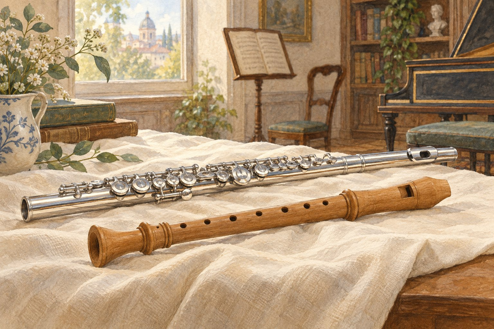

# 금속으로 만든 플루트는 왜 목관악기일까

*이름 속 재료와 지금의 모습을 나누어 보기*

Culture · Music

> 출처 대조와 공개 게시 승인을 마친 이야기입니다. 실제 게시 여부는 사이트 배포 상태를 따릅니다.

*KnowledgeWalk 제작 · AI 설명용 삽화. 실제 사물의 정확한 구조·규격·역사적 장면을 재현한 자료가 아닙니다.*

무대의 플루트는 반짝이는 금속 악기처럼 보인다. 그런데 오케스트라에서는 목관악기라고 부른다. 나무를 뜻하는 이름과 눈앞의 재료가 맞지 않는 것처럼 느껴질 수 있다.

영국 필하모니아 오케스트라의 안내는 옛 플루트는 나무로 만들었지만 현대 플루트의 대부분은 금속이라고 설명한다. 분류의 이름만 보고 지금 쓰는 악기의 재료를 정하면 생기는 작은 어긋남이다.

## 1. 지금의 재료가 이름 전부는 아니다

악기의 이름과 분류에는 지나온 시간이 남아 있다. 오늘의 플루트가 금속이라고 해서 목관악기라는 이름을 재료 검사표처럼 읽을 수는 없는 것이다.

필하모니아는 피콜로는 지금도 대체로 나무로 만든다고 덧붙인다. 가까운 악기 가족 안에서도 재료가 모두 같지는 않다. 반짝이는 것과 검게 보이는 것을 함께 볼 때 이 차이를 떠올려도 좋겠다.

## 2. 손가락이 닿는 금속 장치

19세기에 플루트의 연주 기법이 크게 발전하는 데에는 표면의 금속 키와 패드 체계도 중요했다고 안내는 설명한다. 손이 직접 모든 구멍을 막는 모습만 상상했다면 작은 장치들을 다시 볼 이유가 생긴다.

이 장치들은 더 복잡한 음악을 연주할 수 있도록 도왔다. 악기를 만드는 일이 재료를 고르는 데에서 끝나지 않고, 연주자의 손과 원하는 소리 사이를 연결하는 일이라는 점이 보인다.

## 3. 분류 이름은 현재 재료만 설명하지 않는다

목관이라는 이름을 곧 나무로 만든 모든 악기라는 뜻으로 읽으면 금속 플루트가 예외처럼 보인다. 그러나 분류에는 악기가 이어 온 역사와 연주 방식이 함께 들어 있다. 현재의 재료를 한 번 확인하는 일만으로 그 이름의 모든 이유를 설명할 수는 없다. 물건의 변화가 분류의 말보다 빠르게 느껴지는 사례다.

비슷한 일은 일상의 여러 이름에서도 만난다. 처음의 재료나 형태에서 생긴 말이 물건의 변화 뒤에도 남을 수 있다. 그렇다고 모든 악기군을 재료와 무관한 임의의 묶음으로 보자는 뜻은 아니다. 이 글에서는 공식 안내가 플루트를 목관악기로 소개하면서 과거의 목제와 현대의 금속제를 함께 설명한다는 점을 따라간다.

## 4. 반짝이는 키는 손의 일을 이어 준다

플루트의 표면에는 여러 키와 패드가 놓여 있다. 손가락을 어디에 대는지와 어떤 구멍이 열리고 닫히는지가 장치를 통해 연결된다. 손이 닿는 위치와 소리를 만드는 조건 사이에 기계적인 도움을 마련한 셈이다. 악기를 만드는 사람의 선택이 연주할 수 있는 음악의 범위와 관계되는 이유다.

기관은 19세기에 발전한 체계를 더 복잡한 음악을 연주하는 조건과 연결해 소개한다. 한 사람의 손이 모든 자리를 직접 막는 모습을 떠올리기보다 조작을 전달하는 장치가 있다는 점을 보면 된다. 다만 본문의 그림을 정확한 운지표로 사용하거나 키 하나마다 특정한 음을 바로 대응시키지는 않는다. 실제 연주법은 별도의 자료가 필요한 영역이다.

## 5. 같은 가족 안에서 크기도 달라진다

일반적인 C 플루트 옆에는 작은 피콜로와 알토, 베이스 플루트 같은 종류가 있다. 악기군 안에서 서로 다른 높이의 소리를 맡을 수 있는 구성이다. 그중 피콜로는 대체로 목제로 만든다는 설명도 있어, 플루트 가족을 모두 같은 재료와 크기의 물건으로 생각하기 어렵게 한다.

연주 영상을 볼 때 가장 작게 보이는 악기와 익숙한 크기의 플루트를 비교해도 재미있다. 다만 화면의 크기만으로 정확한 종류를 판정하기보다는 안내와 함께 확인하는 편이 좋다. 음악의 가족이라는 말은 다 똑같다는 뜻보다 공통된 관계 안에서 차이가 있다는 뜻으로 이해하면 더 풍부해진다.

## 6. 보는 정보가 들을 질문을 만든다

재료를 보았다면 다음에는 소리의 어느 부분을 듣고 싶은지 생각해 볼 수 있다. 반짝이는 외형이 언제나 같은 음색을 보장하지는 않는다. 음역과 연주 방식, 다른 악기와의 관계에 따라 인상은 달라진다. 재료의 이름만으로 따뜻하다거나 차갑다는 감상을 미리 정할 필요도 없다.

플루트의 이야기는 소리를 만드는 물건이 오랫동안 바뀌어 왔다는 사실을 보여 준다. 연주자의 손을 돕는 장치와 재료의 선택이 함께 발전했다. 목관이라는 익숙한 분류 앞에서 잠깐 멈추면, 한 이름이 서로 다른 시대의 물건들을 어떻게 이어 주는지 생각하게 된다. 악기 이름을 외우는 일에서 그 변화의 시간을 읽는 일로 넘어가는 작은 계기다.

## 7. 가족 안의 여러 크기

오케스트라에서는 일반적인 C 플루트 외에 피콜로와 알토 플루트, 때로는 베이스 플루트도 쓴다. 플루트라는 이름 아래에도 크기와 역할이 다른 악기들이 있다.

오늘은 모든 종류를 외우기보다 은빛 표면과 목관악기라는 이름 사이의 간격만 기억해 보자. 물건의 지금 모습과 그 물건을 부르는 말이 꼭 같은 시기의 이야기만 담고 있는 것은 아니다. 작은 악기 하나에도 그런 시간이 겹친다.

## 이야기의 바탕이 된 자료

- [필하모니아 오케스트라 — Flute](https://philharmonia.co.uk/resources/instruments/flute/) · 확인일 2026-10-28
  - 확인 내용: 옛 플루트는 나무·현대 다수는 금속·피콜로는 대체로 목제 / 목관악기로 소개되는 플루트 / 19세기 키·패드 체계와 복잡한 연주 / C·피콜로·알토·베이스 플루트 종류

---

[같은 소주제의 이야기](README.md) · [전체 서가](../../README.md)
