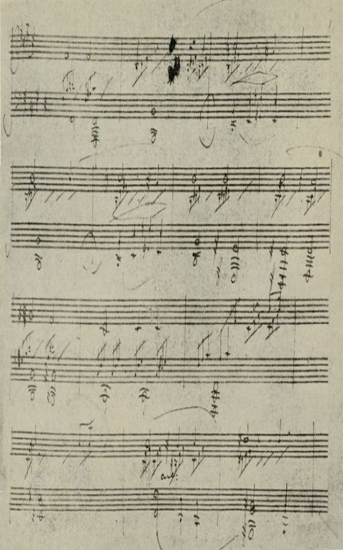

# 월광 — 베토벤이 붙인 제목은 아니었다

*달빛이라는 별명 뒤에서 세 악장을 듣기*

Culture · Music

> 출처 대조와 공개 게시 승인을 마친 이야기입니다. 실제 게시 여부는 사이트 배포 상태를 따릅니다.

*1917년 Romain Rolland, Beethoven 수록 월광 소나타 자필 악보 재현도판 · 원본 도판 전체 유지. AI 재현 이미지가 아닙니다.*

[이미지 출처·제작 근거](https://raw.githubusercontent.com/GITenberg/Beethoven_55941/master/55941-h/images/ilo_pag100.jpg) · 퍼블릭 도메인 원작의 역사적 재현 도판 · Project Gutenberg 수록본

〈월광〉을 처음 듣는 사람도 첫 악장에는 쉽게 귀를 기울인다. 낮은 음 위로 잔잔한 소리가 이어지고, 그 위에서 노래가 천천히 모습을 드러낸다. 이름을 알고 들으면 달빛이 떠오르기 쉽다. 그런데 세 악장을 모두 들으면 마지막에는 꽤 다른 풍경을 만나게 된다.

이 곡은 조용한 첫 악장으로 시작해 격렬한 끝으로 나아가는 피아노 소나타다. 별명의 유래와 작품의 실제 구조를 함께 알면, 유명한 부분만 반복해서 듣던 음악이 조금 넓어진다.

## 1. 베토벤이 붙인 이름과 후대에 불린 이름

우리가 〈월광〉이라고 부르는 곡은 베토벤의 피아노 소나타 제14번, 작품번호 27의 2번이다. 작품에는 ‘환상곡풍의 소나타’라는 뜻의 Sonata quasi una fantasia라는 표제가 있다. 달빛은 이 본래 표제에 들어 있지 않다.

로맹 롤랑의 전기 『베토벤』에 함께 실린 소나타 해설은 ‘월광’이라는 별칭을 시인 렐슈타프와 연결한다. 중요한 점은 작곡가의 표제가 아니라 다른 사람이 음악을 듣고 붙인 이름이라는 것이다. 별칭이 널리 쓰인다는 사실과 베토벤이 달빛을 묘사하려 작곡했다는 주장은 구별해야 한다.

## 2. 누구에게 바친 곡이었을까

같은 자료는 작품이 줄리에타 귀차르디에게 헌정되었다고 설명한다. 헌정은 책의 첫머리에 이름을 바치는 것과 비슷하게, 누구에게 작품을 드리는지 밝히는 방식이다. 귀차르디와의 관계는 이 작품을 둘러싼 전기적 배경의 한 부분이다.

다만 헌정 대상이 있다는 이유로 모든 선율을 특정 연애 장면의 암호라고 해독할 수는 없다. 첫 악장은 고백, 둘째는 만남, 셋째는 이별이라는 식의 이야기를 작곡가의 확정된 설명처럼 붙이지 않는 편이 좋다. 사람의 사연을 알고 들어도, 음악이 실제로 어떤 흐름을 만드는지는 따로 살필 수 있다.

## 3. 제1악장 — 세 겹의 소리를 천천히 듣기

첫 악장의 지시는 Adagio sostenuto, 느리게 지속하여 연주하라는 뜻으로 이해할 수 있다. 낮은 음이 바탕을 잡고, 중간에서는 세 음씩 이어지는 반주가 꾸준히 움직이며, 그 위에 비교적 긴 음가의 선율이 나타난다. 잔잔하다고 해서 아무 움직임도 없는 음악은 아니다.

처음에는 노래하는 가장 위쪽 소리만 들어 보자. 다음에는 그 아래에서 계속 이어지는 반주를 따라가 보자. 같은 곡 안에 멈춘 듯한 시간과 흘러가는 시간이 함께 있다는 느낌을 받을 수 있다. 소리가 조금씩 쌓이고 화음이 달라질 때 고요함에도 작은 긴장이 생긴다.

## 4. 달빛이라는 말에 가려지는 것

밤의 풍경을 떠올리며 듣는 것은 자연스러운 감상이다. 하지만 첫 악장이 편안한 배경음악으로만 들리는지, 어딘가 무거움과 기다림도 있는지 살펴보면 좋다. 특정 장면을 정답으로 삼지 않을 때 음악 안의 미묘한 변화가 더 잘 들릴 수 있다.

함께 실은 것은 1917년 전기에 수록된 자필 악보의 재현 도판이다. 현대 조판 악보처럼 반듯하지 않은 자료에서, 오늘의 유명한 별명 뒤에는 구체적인 음과 연주 지시를 적던 작곡가의 작업이 있었다는 점도 떠올릴 수 있다. 옛 인쇄 도판이 원고 실물의 상태를 모두 대신하지는 않는다.

## 5. 제2악장 — 잠시 몸을 펴는 시간

둘째 악장 Allegretto는 첫 악장보다 가볍고 걸음이 분명하게 느껴진다. 첫 악장에서 길게 머물던 시간이 짧은 움직임으로 풀리는 듯하다. 춤을 연상하며 들어도 좋지만, 실제로 어떤 사람이 춤추는 장면을 묘사한 것이라고 단정할 필요는 없다.

유명한 첫 악장과 강렬한 셋째 악장 사이에 있어 이 부분은 지나가는 다리처럼 취급되기 쉽다. 그러나 이 짧은 전환이 있기 때문에 작품 전체의 대비가 더 선명해진다. 둘째 악장이 끝나기 전 잠깐의 가벼움을 기억해 두면 마지막 악장의 첫 움직임이 한층 크게 다가온다.

## 6. 제3악장 — 조용한 곡이라는 기억이 뒤집히다

마지막 지시는 Presto agitato, 매우 빠르고 격하게라는 뜻이다. 음들이 빠르게 솟아오르고, 강한 화음이 박히며, 쉬지 않고 밀어붙이는 듯한 에너지가 나온다. 첫 악장의 표정만 알고 있었다면 같은 소나타의 마지막이라는 사실이 놀라울 수 있다.

한편 앞선 소나타 해설은 첫 악장과 마지막 악장의 음형 사이에 연결을 짚기도 한다. 서로 다른 곡 세 편을 임의로 붙여 놓았다기보다, 다른 속도와 힘으로 이어지는 한 작품으로 들을 여지가 있다는 뜻이다. 처음부터 악보의 대응 관계를 찾지 못해도 괜찮다. 고요하게 시작한 음악이 어디까지 움직이는지만 따라가 보자.

## 7. 왜 ‘환상곡풍’이라고 했을까

환상곡풍이라는 말은 아무렇게나 연주해도 된다는 뜻이 아니다. 통상적인 틀을 의식하면서도 악장들의 성격과 연결을 자유롭게 구성하려는 표제로 이해할 수 있다. 이 소나타에서는 빠르고 화려한 첫머리로 청중을 붙잡기보다 느린 첫 악장으로 시간을 열고, 끝에서 큰 힘을 터뜨린다.

‘월광’이 풍경을 떠올리게 하는 이름이라면 ‘환상곡풍의 소나타’는 작품의 짜임을 생각하게 하는 이름이다. 두 이름을 함께 알아 두면 하나는 상상에, 다른 하나는 듣는 방법에 도움이 된다. 유명한 별명을 버릴 이유도, 그것 하나로 전부를 설명할 이유도 없다.

## 8. 한 번은 세 악장을 이어 들어 보자

처음에는 첫 악장에서 반복되는 반주를 찾아보고, 둘째에서는 걸음의 변화를, 셋째에서는 솟구치는 에너지를 느껴 보자. 연주자마다 빠르기와 소리의 무게가 다르므로 재생 시간 하나를 정답으로 생각할 필요도 없다.

마지막 음을 듣고 처음을 떠올리면 달빛이라는 제목과는 조금 다른 기억이 남을 수 있다. 이 곡의 매력은 조용함만도 격렬함만도 아니다. 서로 다른 표정이 한 작품의 시간 안에 놓이는 경험이다. 익숙한 첫 악장을 출발점으로 삼되, 끝까지 걸어가 보면 소나타 전체가 보이기 시작한다.

## 이야기의 바탕이 된 자료

- [Mutopia — Sonata Op.27 No.2, 제1악장 공개 악보](https://raw.githubusercontent.com/MutopiaProject/MutopiaProject/master/ftp/BeethovenLv/O27/moonlight/moonlight-lys/moonlight1-a4.ly) · 확인일 2026-10-29
  - 확인 내용: Sonata No.14·Op.27 No.2·제1악장 Adagio sostenuto라는 악보 표기
- [로맹 롤랑 — Beethoven(영문판 1917), 소나타 해설](https://raw.githubusercontent.com/GITenberg/Beethoven_55941/master/55941-0.txt) · 확인일 2026-10-29
  - 확인 내용: 월광 별칭과 렐슈타프를 연결한 해설·작곡가 본래 표제로 보지 않는 설명 / Sonata quasi una Fantasia·세 악장 이름과 Presto agitato / 1917년 판본의 자필 악보 도판 캡션 / 귀차르디 헌정·환상곡풍 표제·작곡가의 표제가 아닌 별칭 / 세 악장 지시·지속되는 반주와 선율·악장 대비 및 첫 악장과 피날레 음형 연결

---

[같은 소주제의 이야기](README.md) · [전체 서가](../../README.md)
