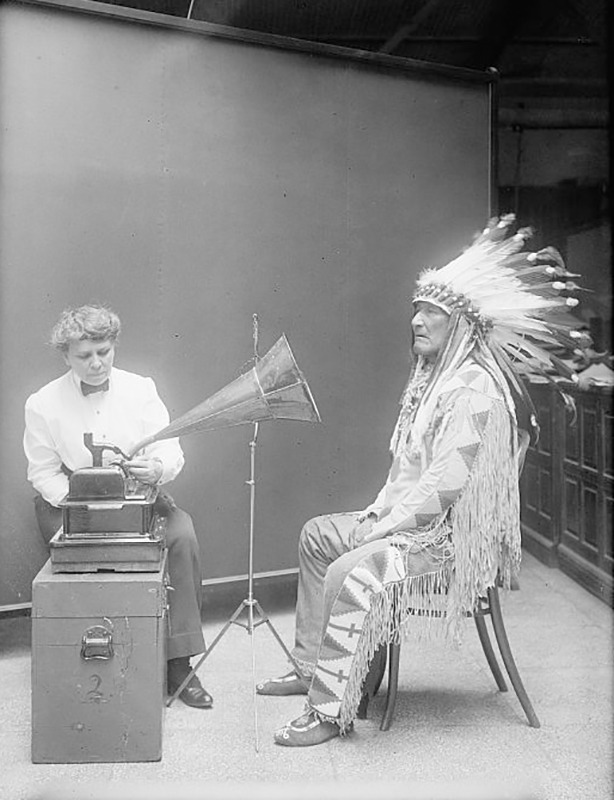

# 옛 녹음 사진에서 그는 노래를 듣고 있었다

*1916년의 나팔과 사람 사이에 놓인 설명*

Culture · Music

> 출처 대조와 공개 게시 승인을 마친 이야기입니다. 실제 게시 여부는 사이트 배포 상태를 따릅니다.

*“Piegan Indian, Mountain Chief, Listening to Recording with Ethnologist Frances Densmore” by National Photo Company/Library of Congress, Public Domain · OpenStax 수록본. 원본 전체 사진을 자르지 않고 사용했습니다.*

[이미지 출처·제작 근거](https://raw.githubusercontent.com/openstax/osbooks-introduction-anthropology/main/media/ANTHRO_Figure_16_02_015.jpg) · 퍼블릭 도메인 · 공개 교재의 개별 사진 표기

흑백 사진 속에 커다란 나팔 모양의 장치가 있다. 오른쪽에는 한 사람이 앉아 있고 왼쪽에는 다른 사람이 자리한다. 오래된 녹음 장면이라고만 생각하면 누군가 노래하는 순간을 떠올리기 쉽다.

하지만 OpenStax가 소개하는 이 1916년 사진에서 마운틴 치프는 녹음된 노래를 듣고 있었다. 그 곁에는 북미 원주민 음악을 연구한 프랜시스 덴스모어가 있다.

## 1. 소리를 듣고 뜻을 전하기

교재의 캡션에 따르면 마운틴 치프는 덴스모어가 녹음한 노래를 들으며 북미 평원 지역의 수화로 해석해 주었다. 사진을 단순히 소리를 저장하는 기계의 기록으로만 읽기 어려워지는 대목이다.

노래가 장치 안에 담겨 있다고 그 노래의 맥락까지 저절로 전달되지는 않는다. 듣는 사람과 설명하는 사람, 서로 의미를 나누는 과정도 그 곁에 있다. 이것은 이 장면에서 생각해 볼 수 있는 점이다.

## 2. 박물관 사진의 동사를 바꾸면

녹음한다고 설명할 때와 녹음을 듣는다고 설명할 때 사진의 시간이 달라진다. 누가 무엇을 하고 있었는지 알려 주는 짧은 캡션이 보는 방향을 바꾸는 것이다.

이 사진에서 실제로 어떤 가사의 어느 부분을 설명했는지까지 새로 만들어 붙이지는 않는다. 자료가 알려 주는 행동을 먼저 읽으면, 고개와 손의 위치도 그 장면 안에서 다시 살펴보게 된다.

## 3. 장치를 향한 자세만으로 행동을 정하지 않기

사진 속에 녹음 장치가 보이면 우리는 누군가 노래를 녹음하는 순간이라고 짐작하기 쉽다. 그러나 캡션은 이미 녹음한 노래를 듣고 해석하는 장면이라고 알려 준다. 같은 물건 앞에 앉아 있어도 보내는 소리와 받아 듣는 소리의 시간은 다르다. 사진의 외형과 남은 설명을 함께 읽어야 하는 이유다.

사진을 보자마자 떠올린 첫 이야기를 지워야 할 때에도 관찰이 실패한 것은 아니다. 설명을 읽고 손의 동작과 몸의 방향을 다시 보게 되기 때문이다. 다만 어떤 가사에 맞추어 어떤 뜻을 전달했는지까지는 이 자료의 캡션으로 알 수 없다. 확인되는 행동이 무엇인지부터 정확히 세우면 오히려 더 많은 질문이 가능해진다.

## 4. 소리와 몸짓이 같은 해석의 자리에 있다

자료는 마운틴 치프가 북미 평원 지역의 수화로 노래를 해석했다고 설명한다. 한 장면에서 듣기와 몸짓, 의미를 전하는 일이 함께 이루어졌다. 소리가 녹음 장치 안에 있다는 사실만으로 그 문화의 지식이 전부 저장된 것은 아니었다. 맥락을 알고 설명하는 사람의 역할이 그 곁에 남아 있다.

여기의 수화를 오늘의 특정 수어 체계와 설명 없이 같다고 놓거나, 인물의 청각 상태를 추측해서도 안 된다. 사진의 행동은 자료가 밝힌 지역적 맥락에서 읽을 부분이다. 몸짓을 단순한 장식처럼 보는 대신 뜻을 나누는 활동으로 바라보면 노래와 언어의 관계를 생각할 수 있다.

## 5. 연구자의 이름과 설명하는 사람의 이름

덴스모어는 북미 원주민 음악을 연구한 인물이다. 그 역할만 강조하면 마운틴 치프는 기록의 대상처럼 보일 수 있다. 그러나 캡션에는 그가 듣고 해석하는 행동이 분명히 나온다. 연구에 쓰이는 지식은 장치를 준비한 사람에게만 있었던 것이 아니다. 누가 무엇을 알고 전해 주었는지 함께 보아야 한다.

이 관점은 사진 속 모든 관계가 평등했다고 쉽게 단정하는 것과도 다르다. 당시 연구가 이루어진 사회적 조건은 별도로 확인할 문제다. 여기서는 한 장면을 설명할 때 지식을 제공하는 사람의 행동과 이름을 지우지 않는 데 초점을 맞춘다. 자료를 만들 때의 관계를 묻는 일도 사진 읽기의 일부다.

## 6. 재생한 소리에 설명이 더해지는 순간

음악을 듣는 사람은 소리의 높낮이와 리듬을 느낄 수 있지만 언어와 관습을 모르면 놓치는 맥락이 있을 수 있다. 이 사진은 그 사이에 설명과 해석의 시간이 있었다는 점을 보여 준다. 기록은 혼자 모든 뜻을 말해 주는 물건이 아니라 다시 듣고 서로 확인하는 활동을 가능하게 하는 매체이기도 하다.

실제 사진은 새로 만든 역사 삽화와 달리 촬영 당시의 인물과 물건을 전한다. 그렇지만 한 장의 사진이 앞뒤의 대화 전체를 알려 주지는 않는다. 보이는 것과 전해지는 설명을 오가며 누가 무엇을 하는지 살펴보자. 오래된 장치보다 그 앞에서 의미를 나누던 사람들의 행동이 더 또렷해질 수 있다.

## 7. 기록은 함께 이해하는 일

함께 실은 것은 실제 역사 사진이다. 당시의 자세와 장치, 사람 사이의 거리를 상상으로 재배치하지 않고 자료가 남긴 모습을 보도록 했다. 오래된 장비에 시선을 빼앗기다가도 사람 쪽으로 다시 돌아오게 된다.

소리를 남기는 기술은 중요하지만 소리의 뜻을 아는 사람도 중요하다. 이 작은 만남을 통해 노래를 기록한다는 것이 기계의 일로만 끝나지 않는다는 사실을 생각해 볼 수 있다. 사진 속에는 듣는 시간과 설명하는 시간이 함께 있다.

## 이야기의 바탕이 된 자료

- [OpenStax — Introduction to Anthropology: Anthropology of Music](https://raw.githubusercontent.com/openstax/osbooks-introduction-anthropology/main/modules/m00097/index.cnxml) · 확인일 2026-10-29
  - 확인 내용: 1916년 마운틴 치프와 프랜시스 덴스모어의 실제 사진 / 녹음한 노래 청취와 북미 평원 수화로 해석했다는 캡션 / 덴스모어의 북미 원주민 음악 연구

---

[같은 소주제의 이야기](README.md) · [전체 서가](../../README.md)
