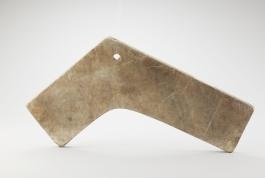

# 이 돌은 두드리면 음이 된다

*편경 한 조각에서 시작하는 음악 이야기*

Culture · Music

> 출처 대조와 공개 게시 승인을 마친 이야기입니다. 실제 게시 여부는 사이트 배포 상태를 따릅니다.

*편경 · 국립고궁박물관 소장·제공. 전체 사진을 자르지 않고 사용했습니다.*

[이미지 출처·제작 근거](https://www.gogung.go.kr/gogung/pgm/psgudMng/view.do?menuNo=800065&psgudSn=371659) · 공공누리 제1유형(출처표시)

사진 속 돌은 한쪽이 꺾여 있다. 끝부분에 구멍도 하나 보인다. 따로 놓으면 무엇을 만들다 남긴 조각처럼 보일 수 있지만, 이것은 소리를 내는 악기의 한 부분이다. 이름은 편경이다.

피아노의 건반이나 바이올린의 줄처럼 이 악기에서는 돌이 음을 맡는다. 무대 위 악기를 떠올리다가 갑자기 돌을 만나니 음악의 재료가 생각보다 넓게 느껴진다.

## 열여섯 개를 두 줄로

국립고궁박물관은 옥석을 깎아 만든 경 열여섯 개를 두 단의 틀에 여덟 개씩 매달아 연주했다고 설명한다. 사진의 한 조각을 보는 것과 전체 악기를 상상하는 일 사이에 작은 간격이 있다.

구멍은 그 조각이 혼자 놓이는 물건이 아니라 매달리는 물건이라는 사실을 떠올리게 한다. 이름 모를 돌이 줄지어 소리를 내는 악기의 한 자리로 옮겨 가는 순간이다.

## 음높이는 두께에서

이 악기에서 재미있는 부분은 음높이를 돌의 두께로 조절했다는 점이다. 줄을 팽팽하게 당기거나 관의 구멍을 막는 방식과는 다르다. 깎아 만든 돌의 두께가 음악을 준비하는 일이 되는 것이다.

연주할 때는 소뿔로 만든 도구인 각퇴로 경의 아랫부분을 쳤다고 한다. 돌이라고 아무 막대나 가져와 두드리는 방식은 아니다. 소리를 낼 물건과 그것을 치는 도구가 함께 갖추어진다.

## 오래된 무대의 한 자리

박물관은 편경이 조선시대의 여러 제례와 연례에 사용되었다고 소개한다. 오늘 사진에서 보이는 것은 조용한 돌 한 장이지만, 원래는 다른 악기와 함께 소리를 내던 자리의 일부였던 셈이다.

사진을 다시 볼 때 모든 음의 이름을 외울 필요는 없다. 구멍 하나와 꺾인 모양, 두께를 떠올리는 것으로 충분하다. 악기는 꼭 줄이 있거나 속이 빈 관이어야 한다는 생각도 잠시 내려놓을 수 있다. 돌에도 음악을 맡긴 사람들이 있었다.

## 이야기의 바탕이 된 자료

- [국립고궁박물관 — 편경](https://www.gogung.go.kr/gogung/pgm/psgudMng/view.do?menuNo=800065&psgudSn=371659) · 확인일 2026-10-28
  - 확인 내용: 옥석 제작 편경과 열여섯 경을 두 단에 여덟 개씩 거는 구성 / 두께로 음높이 조절 / 각퇴 재료와 타격 위치 / 조선시대 제례·연례 사용

---

[같은 소주제의 이야기](README.md) · [전체 서가](../../README.md)
