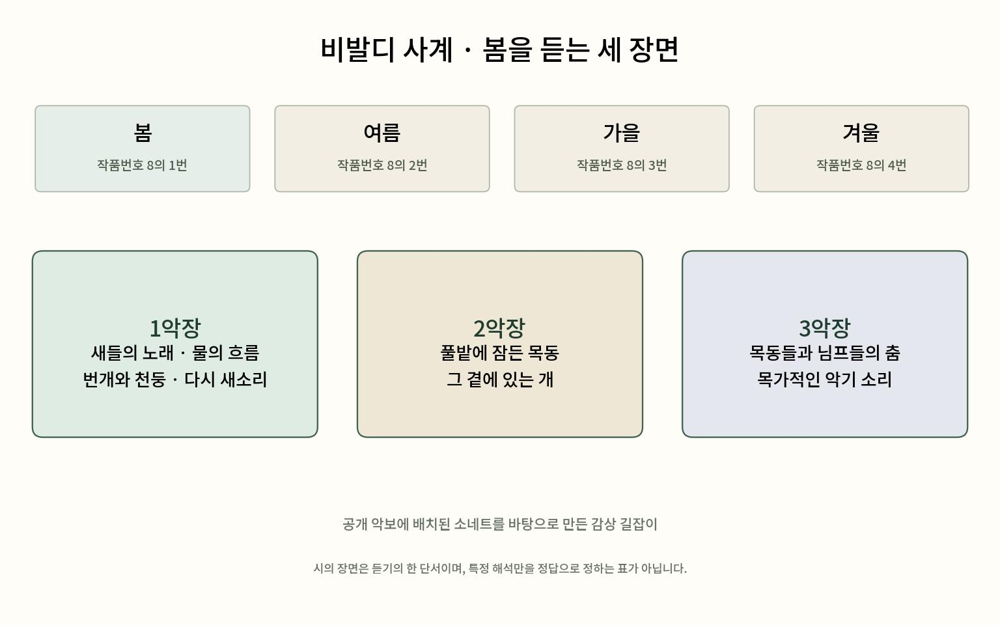

# 비발디 사계 — 봄에는 새소리만 있는 것이 아니다

*시와 함께 따라가는 세 악장의 풍경*

Culture · Music

> 자료 대조를 마친 검토용 이야기입니다. 공개 게시 승인은 아직 받지 않았습니다.

*KnowledgeWalk 제작 · 작품 원문·악보에 근거한 읽기·감상 길잡이. 원본 표지·역사적 자료·완전한 연주용 악보를 복제한 이미지가 아닙니다.*

[이미지 출처·제작 근거](https://raw.githubusercontent.com/MutopiaProject/MutopiaProject/master/ftp/VivaldiA/O8/spring/spring-lys/spring-header.ly) · KnowledgeWalk 직접 제작 설명도

비발디의 「사계」라고 하면 밝고 경쾌한 바이올린 선율이 먼저 떠오를 수 있다. 그중에서도 「봄」은 처음 듣는 사람에게 비교적 가까이 다가오는 음악이다. 하지만 봄이라는 제목만 보고 처음부터 끝까지 따뜻한 햇살만 생각하면 놓치는 장면이 있다.

이 작품에는 계절을 말해 주는 시가 음악과 함께 전해진다. 새와 시냇물뿐 아니라 번개와 천둥, 잠자는 목동도 등장한다. 제목은 한 단어지만 그 안의 풍경은 제법 다채롭다.

## 사계는 하나의 긴 곡일까

공개 악보를 나란히 보면 봄은 작품번호 8의 1번, 여름은 2번, 가을은 3번, 겨울은 4번으로 표기된다. 각각 바이올린과 현악을 중심으로 한 협주곡이며, 봄은 세 악장으로 이어진다. 사계라는 이름 안에 네 계절의 별도 작품이 묶여 있다고 생각하면 찾기 쉽다.

여기서 협주곡은 독주 악기와 합주가 관계를 맺으며 진행하는 음악이라고 가볍게 이해해도 좋다. 바이올린 하나의 움직임과 여러 현악기가 함께 움직이는 때가 어떻게 다른지 듣는 데서 시작할 수 있다.

## 첫 악장에는 날씨가 바뀐다

봄의 첫 악장과 함께 배치된 소네트는 봄이 왔음을 알리고 새들의 노래와 물의 흐름을 이야기한다. 이어 하늘이 어두워지고 번개와 천둥이 나타난 뒤 새들이 다시 노래하는 장면으로 돌아간다.

이런 순서를 알고 들으면 음악의 밝은 부분과 갑자기 긴장되는 부분을 다른 귀로 맞게 된다. 꼭 실제 새와 물의 소리를 정확하게 흉내 냈는지 판정할 필요는 없다. 소리로 풍경을 떠올리도록 짜인 관계를 따라가 보는 것이다.

## 느린 악장에는 쉬는 사람이 있다

둘째 악장에 놓인 시는 풀과 나무가 내는 소리 곁에서 잠든 목동과 그 옆의 개를 그린다. 첫 악장처럼 바깥에서 여러 일이 벌어지는 장면보다, 머물고 쉬는 쪽으로 시선이 가까워진다.

셋째 악장의 시에는 목동들과 님프들의 춤, 즐거운 목가적 악기 소리가 등장한다. 이 글의 듣기 지도는 이 세 장면을 간단히 정리한 설명도다. 연주용 악보나 당시의 실제 풍경화로 오해하지 않도록 별도로 표시했다.

## 시가 감상의 정답은 아니다

이 소네트의 모든 구절을 작곡가가 직접 썼다고 여기서 단정하지는 않는다. 확인한 것은 공개 악보 자료가 시의 구절을 음악의 각 부분에 대응해 배치한다는 점이다. 시는 감상으로 들어가는 좋은 길잡이가 될 수 있다.

처음에는 시의 장면을 떠올리며 듣고, 다음에는 시를 잠시 덮고 독주와 합주의 변화만 들어 보아도 좋다. 비발디는 1678년에 태어나 1741년에 세상을 떠난 작곡가이며, 사계 악보 자료는 1725년을 제시한다. 오래된 봄이지만 듣는 길은 한 가지로 고정되어 있지 않다.

## 이야기의 바탕이 된 자료

- [Mutopia — Vivaldi Op.8 No.1 Spring, 악보 정보](https://raw.githubusercontent.com/MutopiaProject/MutopiaProject/master/ftp/VivaldiA/O8/spring/spring-lys/spring-header.ly) · 확인일 2026-10-29
  - 확인 내용: La Primavera·Op.8 No.1·Violin, Strings·1725·작곡가 생몰년이라는 악보 머리말
- [Mutopia — Spring, 악장별 소네트 배치](https://raw.githubusercontent.com/MutopiaProject/MutopiaProject/master/ftp/VivaldiA/O8/spring/spring-lys/spring-sonnet.ly) · 확인일 2026-10-29
  - 확인 내용: 봄 소네트의 새·시냇물·번개·천둥·새들의 복귀 장면과 제1악장 배치 / 제2악장의 잠든 목동과 개·제3악장의 춤 장면
- [Mutopia — Vivaldi Op.8 No.2 Summer](https://raw.githubusercontent.com/MutopiaProject/MutopiaProject/master/ftp/VivaldiA/O8/summer/summer-lys/summer-header.ly) · 확인일 2026-10-29
  - 확인 내용: 여름은 Op.8 No.2
- [Mutopia — Vivaldi Op.8 No.3 Autumn](https://raw.githubusercontent.com/MutopiaProject/MutopiaProject/master/ftp/VivaldiA/O8/autumn/autumn-lys/autumn-header.ly) · 확인일 2026-10-29
  - 확인 내용: 가을은 Op.8 No.3
- [Mutopia — Vivaldi Op.8 No.4 Winter](https://raw.githubusercontent.com/MutopiaProject/MutopiaProject/master/ftp/VivaldiA/O8/winter/winter-lys/winter-header.ly) · 확인일 2026-10-29
  - 확인 내용: 겨울은 Op.8 No.4

---

[같은 소주제의 이야기](README.md) · [전체 서가](../../README.md)
