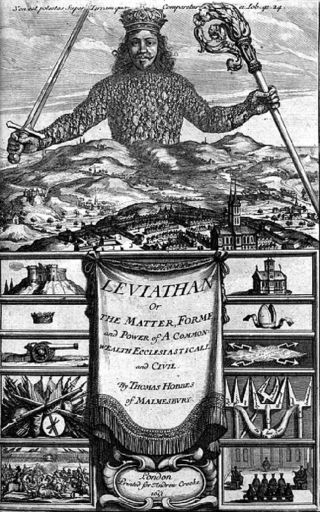

# 리바이어던 — 거인의 몸 안에는 왜 작은 사람들이 들어 있을까

*1651년 홉스의 국가론과 불안, 계약을 지킬 공동 권력이라는 생각*

생각과 지식 · 철학과 사상

> 자료 대조를 마친 검토용 이야기입니다. 공개 게시 승인은 아직 받지 않았습니다.

*Abraham Bosse/Thomas Hobbes, Leviathan frontispiece (1651), Library of Congress/Wikimedia Commons · OpenStax 수록. 실제 역사 출판 도판.*

[이미지 출처·제작 근거](https://raw.githubusercontent.com/openstax/osbooks-world-history/main/media/OSX_WorldHist_B07_01_Leviathan.png) · Public Domain

1651년 『리바이어던』의 표지에는 도시 위로 거대한 인물이 솟아 있다. 자세히 보면 몸은 수많은 작은 사람으로 이루어져 있다. 손에는 칼과 종교적 권위를 나타내는 지팡이가 들려 있다. 이 그림은 단순히 강한 왕을 찬양하는 장식이 아니다. 서로 다른 사람들이 어떻게 하나의 공적 권력을 만드는지에 대한 토머스 홉스의 질문을 눈에 보이게 만든 것이다.

## 01. 불안은 서로 비슷한 힘에서도 생길 수 있었다

홉스는 인간 사이에 힘과 능력의 차이가 있어도 누구도 완전히 안전하지는 않다고 보았다. 가장 강한 사람도 다른 사람들의 연합이나 기습을 두려워할 수 있다. 각자가 자기 생존을 지키려 할 때 오히려 서로를 경계하게 된다는 설명이었다.

따라서 그의 논의를 인간은 태어날 때부터 모두 잔인하다는 한 문장으로 줄이면 핵심을 놓친다. 상대가 무엇을 할지 모르고 공통의 보호도 없다면, 평화를 원하는 사람조차 먼저 힘을 늘리려 할 수 있다. 개인의 합리적인 조심이 공동의 불안을 키우는 셈이다.

책이 나온 시기의 잉글랜드는 내전과 왕권의 붕괴를 겪었다. 1649년에는 찰스 1세가 처형되었다. 이런 역사적 배경에서 공동의 권위가 무너질 때 무엇이 벌어지는지라는 질문은 추상적인 퍼즐만이 아니었다. 다만 시대의 공포 하나가 책의 모든 논증을 대신하지는 않는다.

## 02. 전쟁 상태는 매일 싸운다는 뜻이 아니었다

홉스가 말한 전쟁 상태는 누구나 늘 주먹을 휘두르는 장면만을 뜻하지 않는다. 상대가 공격할 수 있고 이를 막아 줄 공통의 힘이 없는 지속적인 불확실성도 포함한다. 실제 전투가 없는 날에도 사람은 안심하고 일하기 어렵다.

애써 만든 물건을 빼앗길지 모르고 계약의 이행을 믿을 수 없다면 장기적인 계획이 약해진다. 농사와 상업, 집을 짓는 일에도 안전에 대한 예상이 필요하다. 국가를 다루는 논의가 일상의 생산과 연결되는 이유다.

## 03. 약속만으로는 약속을 지키게 할 수 없었다

서로 공격하지 말자고 약속해도 상대가 먼저 깨면 자신만 손해를 볼 수 있다. 누구도 안전을 확신하지 못하면 좋은 규칙을 알고 있어도 따르기 어렵다. 홉스에게 계약의 문제는 선한 말의 부족보다 그것을 지킬 조건의 부족이었다.

그는 약속을 집행할 공통의 힘이 필요하다고 주장했다. 사람들은 각자의 판단과 힘을 그대로 충돌시키는 대신 하나의 권위를 세워야 한다. 처벌할 능력이 없는 약속과 위반에 책임을 물을 수 있는 규칙은 다르게 작동한다는 것이다.

## 04. 여러 사람은 하나의 대표를 만들 수 있었다

홉스는 사람들이 한 사람이나 합의체에 권한을 맡겨 공동의 행동을 이루는 구상을 설명했다. 많은 사람이 함께 서 있다는 사실만으로 하나의 국가가 되는 것은 아니다. 누가 공동의 결정을 대표하는지 정해야 했다.

표지의 거인 안에 들어 있는 작은 사람들은 이 관계를 떠올리게 한다. 국가는 사람들과 무관하게 하늘에서 내려온 존재가 아니라, 그들의 힘을 모아 하나의 공적 인격으로 나타난다. 이것은 실제 역사에서 모든 국가가 평등한 계약으로 탄생했다는 실증적 기록과는 다른 정치철학적 설명이다.

권한을 맡긴다는 말은 단지 마음속으로 찬성하는 것보다 무겁다. 대표가 한 결정을 공동의 행동으로 인정하면 개인은 그 결과에 얽힌다. 홉스의 구성에서 대표의 문제가 중요한 까닭은 여러 사람의 힘을 모으는 것과 그 힘을 누구의 행위로 볼지를 함께 정하기 때문이다.

## 05. 강한 권력은 분열을 막으려는 답이었다

홉스는 경쟁하는 권위가 서로 최종 결정권을 주장하면 갈등이 반복될 수 있다고 걱정했다. 종교와 정치의 권한도 그의 국가론에서 중요한 문제였다. 칼과 지팡이를 함께 든 그림은 그런 통일된 권위의 요구를 시각적으로 보여 준다.

이 주장은 오늘날 권력을 나누어 서로 견제하게 하는 정치관과 긴장된다. 홉스가 왜 그렇게 강한 권력을 원했는지를 이해하는 일과 그 해법에 동의하는 일은 다르다. 안전을 지키려는 권력이 사람을 지배할 위험은 여전히 질문으로 남는다.

## 06. 보호가 목적이라는 말은 권력에도 질문을 던진다

홉스에게 국가를 세우는 중요한 목적은 사람들이 스스로를 보전하고 더 안정적으로 살게 하는 데 있었다. 단지 권력자가 더 큰 힘을 갖기 위해 국가가 존재한다고 설명한 것은 아니다. 강제력은 공통의 안전을 확보한다는 논리와 연결되었다.

그렇기 때문에 국가론을 읽는 독자는 강한 권력만 기억해서는 안 된다. 무엇으로부터 누구를 보호하며 그 대가로 어떤 자유를 제한하는지 물어야 한다. 안전을 앞세운 모든 조치를 자동으로 옳다고 인정하는 것은 책을 이해한 뒤의 정치적 판단과도 별개다.

## 07. 그림의 거인은 독자에게 되묻고 있다

『리바이어던』이라는 이름은 거대한 존재를 떠올리게 하지만, 그림의 몸을 이루는 것은 작은 사람들이다. 이 시각적 장치는 국가의 힘과 그것을 구성하는 사람을 한 장면에 놓는다. 거인을 두려워하는 시선과 거인을 만든 까닭을 묻는 시선을 함께 요구한다.

홉스가 던진 문제는 사람들이 착해지면 모두 해결된다는 기대보다 어렵다. 서로를 믿을 수 없는 조건에서 어떻게 협력할 것인가. 그리고 협력을 가능하게 만든 힘을 어떻게 평가할 것인가. 17세기의 표지 한 장은 국가가 필요한 이유와 그 힘을 걱정해야 할 이유를 나란히 남긴다.

## 이야기의 바탕이 된 자료

- [Thomas Hobbes, Leviathan (1651), Chapters XIII, XVI–XVII](https://raw.githubusercontent.com/GITenberg/Leviathan_3207/master/3207.txt) · 확인일 2026-11-11
  - 확인 내용: 13장 평등·불신·전쟁 상태/16~17장 공적 인격과 한 사람 또는 합의체·공동 권력·계약과 안전. 현대 국가 탄생의 실제 기록이나 인간 본성에 대한 실험적 증명으로 제시하지 않음.
- [OpenStax, World History Volume 2 — The Enlightenment](https://raw.githubusercontent.com/openstax/osbooks-world-history/main/modules/m00017/index.cnxml) · 확인일 2026-11-11
  - 확인 내용: 홉스의 강한 권력과 권리·사회계약의 역사적 논의, 1651표지 해설.
- [OpenStax, World History Volume 2 — The Protestant Reformation](https://raw.githubusercontent.com/openstax/osbooks-world-history/main/modules/m00063/index.cnxml) · 확인일 2026-11-11
  - 확인 내용: 잉글랜드 내전과 1649년 찰스 1세 처형의 역사적 배경.

---

[같은 소주제의 이야기](README.md) · [전체 서가](../../README.md)
