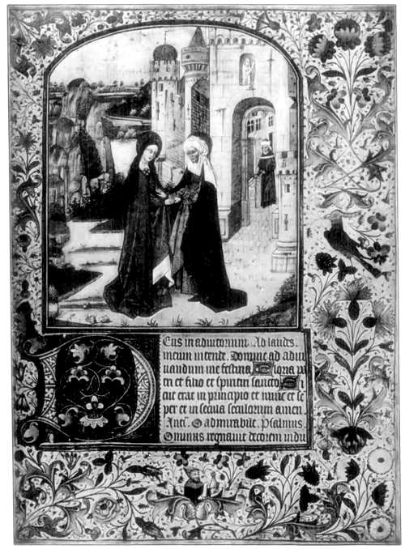

# 중세 대학 — 학교 건물보다 먼저 생긴 것은 무엇이었을까

*파리와 볼로냐, 가르치는 사람과 배우는 사람의 조직*

생각과 지식 · 교육과 배움

> 출처 대조와 공개 게시 승인을 마친 이야기입니다. 실제 게시 여부는 사이트 배포 상태를 따릅니다.

*James Harvey Robinson, An Introduction to the History of Western Europe, Page from an Illuminated Manuscript. 대학 강의 현장이나 특정 대학 교과서로 확인한 자료는 아닙니다. · Public Domain.*

[이미지 출처·제작 근거](https://raw.githubusercontent.com/GITenberg/An-Introduction-to-the-History-of-Western-Europe_26042/master/26042-h/images/frontis.jpg) · Public Domain · 역사 출판 자료

대학이라고 하면 정문과 강의동, 도서관을 먼저 떠올리기 쉽다. 그러나 중세 유럽 대학의 출발을 이해하려면 건물보다 사람들의 조직을 보아야 한다. 파리에서는 교사들이, 볼로냐에서는 학생들이 서로의 권리를 지키기 위해 힘을 모았다. 대학을 뜻하는 말의 뿌리인 우니베르시타스는 원래 그런 결합체를 가리키는 표현이었다. 배움의 공동체가 하나의 제도가 되는 과정에는 도시의 장사와 교회의 권위도 얽혀 있었다.

## 01. 사람이 모이면서 규칙이 필요해졌다

12세기 유럽에서는 도시가 성장하고 법과 신학을 공부하려는 수요가 늘었다. 유명한 교사의 강의를 듣기 위해 다른 지역에서 온 학생들이 모였다. 하지만 사람이 많아진다고 안정된 교육 기관이 저절로 생기는 것은 아니었다.

누가 가르칠 자격을 갖는지, 학생의 신분을 누가 보호하는지, 어떤 교재를 공부하는지 정해야 했다. 배움은 지식을 전달하는 관계이면서 임대료와 생활비, 법적 분쟁까지 동반하는 도시의 활동이었다.

## 02. 파리에서는 교사들의 결합이 중요했다

파리의 여러 학교와 교사들은 신학과 논리학 등을 중심으로 학생들을 끌어들였다. 아벨라르 같은 교사의 명성은 이런 학문적 열기를 보여 준다. 그렇다고 한 유명 교사가 혼자 파리 대학을 창립했다고 설명하는 것은 지나치게 단순하다.

교사들은 서로 결합해 교육 활동과 자격을 관리하려 했다. 왕과 교황이 부여한 특권도 중요했다. 도시나 교회와 아무 관계 없이 자율적으로 생긴 조직이 아니라, 여러 권위와 협상하며 자기 위치를 만든 공동체였다.

## 03. 볼로냐에서는 학생들의 힘이 컸다

볼로냐는 로마법과 교회법 공부로 이름을 얻었다. 먼 곳에서 온 학생들은 낯선 도시에서 약한 위치에 놓일 수 있었다. 집주인이나 상인, 도시의 권력과 문제가 생겼을 때 개인으로 대응하는 데에는 한계가 있었다.

학생들은 출신 지역 등을 바탕으로 결합했고, 함께 행동하는 조직을 만들었다. 교사의 수업 조건에 영향력을 행사하기도 했다. 오늘날처럼 학교가 먼저 모든 규정을 정하고 학생을 모집하는 모습만으로 중세 대학을 이해하기 어려운 이유다.

학생 조직의 힘은 교수와의 관계를 거꾸로 보게 만든다. 학생이 단순히 수업을 제공받는 대상만은 아니었기 때문이다. 먼 도시로 공부하러 간 사람들은 학문을 배우기 위해 생활의 조건부터 협상해야 했고, 그런 필요가 교육 기관의 구조에도 흔적을 남겼다.

## 04. 학위는 원래 가르칠 자격과 이어져 있었다

일정한 공부와 시험을 마친 사람은 교사들의 공동체에 들어갈 자격을 얻었다. 석사나 박사라는 명칭의 역사에는 가르치는 사람으로 인정받는 의미가 담겨 있다. 처음부터 오늘날의 취업 자격증과 같은 역할만 한 것은 아니었다.

물론 대학이 커지면서 학위는 학문적 명예와 사회적 진출의 수단이 되었다. 법률과 의학을 배운 사람이 행정이나 전문 직업으로 나아갈 수 있었다. 교육의 자격을 인정하는 일이 더 넓은 사회의 권한과 연결되기 시작한 것이다.

## 05. 책을 읽는 수업에도 기술이 필요했다

인쇄술이 널리 퍼지기 전에는 책이 귀했고, 수업은 정해진 텍스트를 읽고 설명하는 방식이 중요했다. 라틴어는 서로 다른 지역에서 온 교사와 학생이 학문적으로 소통하는 주요 언어였다. 글의 문장을 해석하고 논점을 구분하는 훈련이 이루어졌다.

이를 모두 암기만 시키던 수업이라고 단정할 수는 없다. 질문을 세우고 반론을 검토하는 논쟁도 중세 학문의 중요한 방법이었다. 다만 오늘날 실험실이나 연구 중심 대학의 모습이 이미 그대로 존재했다고 보는 것도 시대를 거꾸로 읽는 일이다.

교재의 권위가 높다고 서로 다른 해석이 없었던 것은 아니다. 아리스토텔레스의 저술과 기독교 교리를 어떻게 조화시킬지가 중요한 질문이 되었다. 번역과 주석, 반론을 다루는 지적 노동이 쌓이면서 책 한 권은 여러 세대의 토론을 담는 출발점이 될 수 있었다.

## 06. 건물에 덜 묶인 공동체는 이동할 수 있었다

교사와 학생이 도시를 떠나면 그들의 지출에 기대던 상인과 집주인도 손해를 보았다. 큰 시설을 갖추지 않은 공동체였기에 다른 도시로 옮기는 일이 협상 수단이 될 수 있었다. 수업의 중단과 이동은 도시 경제에 실제 압력이었다.

대학의 자치는 이렇게 법적 보호와 생활 조건을 둘러싼 협상 속에서 자랐다. 왕이나 교황의 도움을 받으면 다른 권력으로부터 보호받을 수 있었지만, 그 후원자가 요구하는 질서에서도 자유롭지만은 않았다.

## 07. 배움의 공동체가 모두에게 열린 것은 아니었다

함께 실은 그림은 오래된 역사 교재에 수록된 채색 필사본의 한 면이다. 대학 강의의 현장 기록은 아니다. 손으로 책을 만들고 읽던 학문 환경을 떠올리게 하는 자료이며, 특정 대학의 교과서였다고 단정하지 않는다.

대학의 성장은 지식을 조직하는 중요한 변화였지만 입학과 학위의 기회가 누구에게나 같지는 않았다. 비용과 언어, 성별과 사회적 지위가 문턱이었다. 대학의 역사는 자율적인 배움의 공간이 자란 과정인 동시에, 그 공동체 밖에 누가 남았는지를 살펴야 하는 이야기다.

## 이야기의 바탕이 된 자료

- [James Harvey Robinson, An Introduction to the History of Western Europe](https://raw.githubusercontent.com/GITenberg/An-Introduction-to-the-History-of-Western-Europe_26042/master/26042-0.txt) · 확인일 2026-11-11
  - 확인 내용: 중세 파리 교사 조직·볼로냐 학생 조직·학위의 교수 자격·텍스트 수업과 이동·아리스토텔레스/스콜라학. 대학의 단일 창립일이나 아벨라르 단독 창립설은 쓰지 않음.
- [OpenStax, World History Volume 2 — The Exchange of Ideas in the Public Sphere](https://raw.githubusercontent.com/openstax/osbooks-world-history/main/modules/m00018/index.cnxml) · 확인일 2026-11-11
  - 확인 내용: 근세 대학의 사회적 접근 제한과 파리·볼로냐의 위상. 중세 창립의 직접 근거로 사용하지 않음.

---

[같은 소주제의 이야기](README.md) · [전체 서가](../../README.md)
