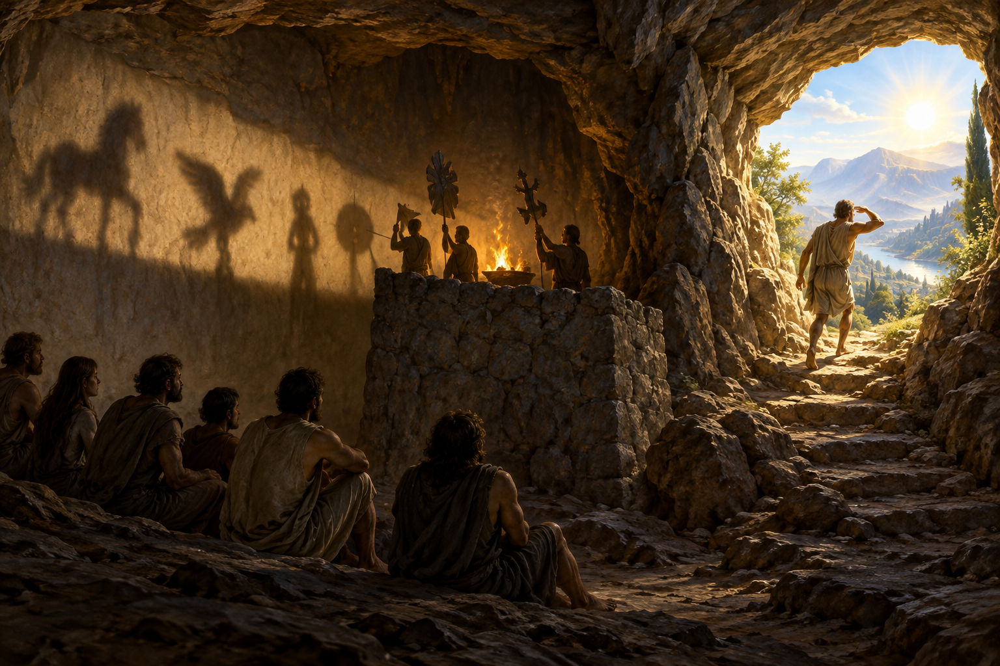

# 플라톤의 동굴 — 밖으로 나온 사람은 왜 돌아가야 할까

*그림자가 익숙한 세계에서 배우는 일이 불편해지는 순간*

Culture · Philosophy

> 자료 대조를 마친 검토용 이야기입니다. 공개 게시 승인은 아직 받지 않았습니다.

*AI 이야기 장면 삽화 · 『국가』의 비유를 떠올린 독립 삽화이며 실제 수감 장소·고대 동굴 유적을 복원한 자료가 아닙니다.*

벽의 그림자만 보며 살아온 사람들이 있다. 뒤에서 누군가 물건을 옮기고 불빛이 그것을 비춘다는 사실은 모른다. 그들에게 그림자는 실제 세계의 일부가 아니라 알고 있는 세계의 전부다. 플라톤의 동굴 비유는 그 낯선 공간을 우리와 상관없는 곳으로 두지 않는다.

『국가』 제7권에서 소크라테스는 글라우콘에게 이 장면을 들려준다. 실제 동굴 수감자의 현장 기록이 아니라 교육과 앎을 설명하는 비유다. 여기서는 밖으로 나오는 일만큼 안으로 돌아가는 일이 왜 중요한지까지 따라가 본다.

## 01. 오래 보았다는 것이 충분한 근거일까

동굴의 사람들은 어릴 때부터 묶여 앞을 볼 수밖에 없다. 뒤쪽의 불과 낮은 벽, 그 뒤를 오가는 물건을 직접 확인하지 못한다. 벽에 생기는 그림자와 들리는 소리를 바탕으로 세상을 설명한다. 그 조건 안에서라면 그림자의 순서를 잘 맞히는 사람이 유능해 보일 수 있다.

이것을 단순히 머리가 나쁜 사람들의 이야기로 읽으면 비유가 우리에게서 멀어진다. 그들에게는 비교할 다른 경험이 주어지지 않았다. 언제나 보아 온 것이어서 의심하기 어렵다는 상황이 핵심이다. 익숙함과 지식은 겹칠 수 있지만 같은 말은 아니다. 내가 확인하지 못한 조건이 내 확신을 만들 수도 있다.

## 02. 풀려났는데도 바로 행복하지 않다

한 사람이 풀려나 뒤를 돌아본다고 상상해 보자. 처음에는 움직임이 불편하고 빛이 눈을 아프게 한다. 새로 보게 된 것보다 오래 보던 그림자가 더 분명하고 믿을 만하게 느껴질 수 있다. 진실에 가까워지는 일이 즉각적인 기쁨으로만 오지 않는 것이다.

이 대목을 알면 동굴은 무지에서 지식으로 한 번에 뛰어오르는 단순한 그림이 아니다. 눈을 돌리는 데에도 시간과 저항이 있다. 자신의 판단이 틀릴 수 있다는 경험은 자존심뿐 아니라 생활의 안정감도 흔든다. 소크라테스는 배우기 싫어하는 마음을 무조건 조롱하기보다 왜 낯선 방향이 괴로운지 보여 준다.

## 03. 한 번에 태양을 볼 수는 없다

밖으로 이끌려 나온 사람은 당장 밝은 세상을 똑바로 보지 못한다. 먼저 그림자와 물에 비친 모습을 보고, 차츰 사물을 보고 하늘을 보며 마침내 태양을 생각하게 된다. 밝은 장소에 도착했다는 사실과 그 장소에서 볼 수 있게 되었다는 것은 다르다.

이 순서는 교육의 속도를 돌아보게 한다. 더 좋은 설명을 들려주었다고 상대가 바로 익숙해질 것이라고 기대하기 쉽다. 하지만 비유 속의 눈은 적응할 시간이 필요하다. 다만 이것을 특정한 현대 교육 실험의 입증 결과처럼 말할 수는 없다. 철학적 이야기가 생각할 관점을 제공하는 것이다.

## 04. 태양은 천문학의 정답만을 뜻하지 않는다

비유에서 태양은 보이는 것들을 가능하게 하는 빛과 연결된다. 플라톤은 이 장면을 좋은 것에 대한 앎으로 나아가는 과정과 이어 설명한다. 단순히 햇빛이 밝다는 자연 관찰을 말하려는 것이 아니다. 개별 사물의 뒤에서 판단을 가능하게 하는 기준을 묻고 있다.

여기서 이데아 같은 말을 외우는 데 급해질 필요는 없다. 아름다운 것들을 많이 보았다고 아름다움의 기준을 모두 아는지, 옳은 결정의 사례를 기억한다고 왜 옳은지 설명할 수 있는지 생각해 보면 입구가 된다. 플라톤은 익숙한 사례를 넘어 그 근거를 묻는 방향을 제시한다.

## 05. 밖에 머물고 싶은 사람

새 세계를 본 사람은 동굴의 생활과 그곳의 칭찬을 예전처럼 바라보기 어렵다. 그림자를 빨리 알아맞힌다는 명예가 왜 중요했는지 다시 생각한다. 그 사람에게 과거의 기준은 더 이상 당연한 성공의 척도가 아니다. 밖에 머무르고 싶다는 마음도 이해할 수 있다.

하지만 『국가』의 이야기는 개인이 깨달아 혼자 행복하게 살면 끝나는 곳에서 멈추지 않는다. 교육받은 사람과 공동체의 관계라는 정치적인 질문이 이어진다. 누구 덕분에 배울 수 있었는지, 그 앎을 함께 사는 사람들과 어떻게 나눌 것인지가 중요해진다. 동굴은 머릿속의 비유이면서 도시를 묻는 비유다.

## 06. 돌아오니 이번에는 어둠이 어렵다

밖을 보던 눈으로 동굴에 돌아오면 한동안 어둠에 적응하기 어렵다. 예전에 잘하던 그림자 맞히기에서 서툴러 보일 수도 있다. 남은 사람들은 밖에 다녀오니 눈이 나빠졌다고 여긴다. 변화의 의미가 당장 보이는 성적과 일치하지 않는 장면이다.

이 때문에 진실을 안 사람이 말하기만 하면 모두 설득된다는 기대도 흔들린다. 돌아온 사람의 경험과 남아 있던 사람의 판단 기준이 다르다. 더 많이 보았다는 확신만으로 그 간격이 사라지지는 않는다. 무엇을 어떻게 설명해야 하는지, 같은 장소에서 다시 살아갈 수 있는지의 어려움이 남는다.

## 07. 동굴 밖을 보았다는 주장도 점검해야 한다

이 비유를 읽은 뒤 나만 밖에 있고 다른 사람은 모두 그림자를 본다고 생각하면 편리하다. 그러나 그 태도는 자기 판단을 확인할 길을 닫을 수도 있다. 동굴을 말하는 사람이 항상 옳다는 보증이 비유 자체에서 주어지는 것은 아니다. 오늘 적용할 때 특히 조심할 지점이다.

플라톤의 정치적 구상 전체에 동의하지 않더라도 이 이야기를 읽을 수 있다. 누가 좋은 것을 안다고 주장하며, 그 앎을 어떻게 설명하고 검토할 것인가는 계속 물어야 한다. 이야기를 남을 낮추는 도구로만 사용하면 처음의 질문이었던 자기 확신의 조건은 다시 보이지 않게 된다.

## 08. 배움은 눈을 다른 쪽으로 돌리는 일

동굴의 중요한 동작은 새 정보를 머릿속에 쏟아 넣는 것만이 아니다. 지금까지 바라보던 방향에서 몸과 눈을 돌리는 일이다. 그 과정에는 불편함과 적응, 타인과의 마찰이 함께 있다. 그래서 이 오래된 비유는 배움을 언제나 즐겁고 즉각적인 발전으로만 말하지 않는다.

다 읽고 나면 벽의 그림자를 보는 사람들보다 자기 앞의 화면이 먼저 떠오를 수도 있다. 이것이 전부라고 믿게 만든 조건은 무엇일까. 다른 곳을 본 뒤에도 함께 사는 사람들에게 돌아와 말할 수 있을까. 동굴을 나오는 장면보다 그다음의 대화가 더 어려울 수 있다는 사실이 플라톤의 이야기를 오래 남긴다.

## 이야기의 바탕이 된 자료

- [Plato, The Republic — Book VII, Benjamin Jowett 번역](https://raw.githubusercontent.com/GITenberg/The-Republic_1497/master/1497.txt) · 확인일 2026-11-01
  - 확인 내용: 동굴의 결박/불/벽/그림자·해방 뒤 눈부심과 적응·그림자/반영/사물/태양의 순서 / 좋음에 대한 앎·귀환 뒤 어둠과 조롱·배움의 방향 전환·교육과 도시의 의무. 실제 실험/고고학 자료가 아닌 철학적 비유

---

[같은 소주제의 이야기](README.md) · [전체 서가](../../README.md)
