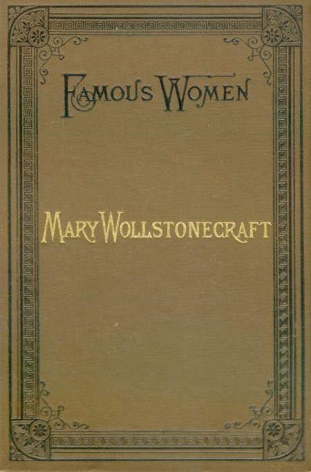

# 여성의 권리 옹호 — 배우지 못한 결과를 타고난 한계라 부를 수 있을까

*1792년 메리 울스턴크래프트가 교육과 이성에 던진 질문*

생각과 지식 · 교육과 배움

> 출처 대조와 공개 게시 승인을 마친 이야기입니다. 실제 게시 여부는 사이트 배포 상태를 따릅니다.

*Elizabeth Robins Pennell, Mary Wollstonecraft (1884), 원본 표지의 디지털 재현. 1792년 여성의 권리 옹호 초판 표지나 저자의 초상이 아닙니다.*

[이미지 출처·제작 근거](https://raw.githubusercontent.com/GITenberg/Mary-Wollstonecraft_22800/master/22800-h/images/cover01.jpg) · Public Domain

메리 울스턴크래프트의 『여성의 권리 옹호』는 권리를 요구하는 선언이면서 사람이 어떻게 길러지는지를 따지는 책이다. 1792년 그는 여성에게 주어진 제한된 교육과 의존적인 생활을 문제 삼았다. 어떤 능력을 키울 기회를 주지 않은 뒤 그 부족함을 본래의 성질로 설명해도 되는가. 이 질문은 교육의 문을 넓히는 일과 인간을 판단하는 기준을 함께 바꾸려 했다.

## 01. 권리의 언어는 누구에게 적용되는가

울스턴크래프트는 이성과 도덕적 판단을 중요한 인간의 능력으로 보았다. 그렇다면 여성에게는 그런 능력을 충분히 기를 필요가 없다고 말할 수 있는가. 권리를 논하는 언어가 남성에게만 적용되는 관행은 설명을 요구받게 되었다.

책은 탈레랑에게 보내는 헌사를 통해 공적 교육의 논의에도 말을 걸었다. 여성의 배움을 집안의 사소한 취향으로만 둘 수 없다는 입장이었다. 어떤 사람을 시민과 도덕적 행위자로 대우할 것인가가 교육의 문제에 연결되었다.

헌사의 수신자가 프랑스의 교육 논의에 관여한 인물이라는 점은 영국 저자의 책이 국경 안에서만 말을 건 것이 아님을 보여 준다. 권리와 교육을 둘러싼 논쟁은 서로 연결되어 있었다. 여성의 지위를 논하는 질문도 그 공적인 장으로 들어갔다.

## 02. 매력적으로 보이는 일만 가르치면 무엇이 남는가

그는 여성의 교육이 남성에게 호감을 얻는 몸가짐과 겉모습에 치우치는 것을 비판했다. 잠시의 매력에 기대도록 배우면 스스로 판단하고 행동하는 능력은 충분히 자라기 어렵다는 논리였다. 교육의 목표가 사람의 위치를 정했다.

여기서 문제는 장식이나 예절 자체의 존재만이 아니었다. 한 사람의 가치가 다른 사람의 호의에 얼마나 의존하도록 만들어지는가였다. 좋은 평가를 얻는 기술과 자신의 삶을 판단하는 능력은 같은 교육 결과가 아니었다.

## 03. 의존은 성격처럼 보이는 습관을 만들었다

울스턴크래프트는 여성이 보인다고 여겨진 약함과 교묘한 행동을 사회적 조건과 연결해 읽었다. 직접적인 권한이 없는 사람이 간접적인 영향력에 기대게 되는 구조를 살폈다. 결과로 생긴 습관을 타고난 본성으로 돌리는 설명에 반대한 것이다.

이 주장을 오늘날의 모든 심리 현상을 입증한 연구처럼 제시할 수는 없다. 책은 철학적이고 정치적인 논증이다. 다만 사람을 평가하기 전에 그 사람이 어떤 선택과 훈련의 기회를 가졌는지를 묻는 기준을 제시했다.

## 04. 이성의 교육은 도덕의 문제이기도 했다

그에게 교육은 유용한 기능을 많이 익히는 일만이 아니었다. 옳고 그름을 이해하고 책임 있게 행동하려면 스스로 생각할 수 있어야 했다. 권위를 무조건 따르는 것과 이유를 알고 판단하는 것은 다르다.

이 논리는 여성에게 덕을 요구하면서 판단의 훈련은 제한하는 모순을 드러냈다. 도덕적인 사람이 되라고 요구하려면 그 능력이 자랄 조건도 마련해야 한다. 책에서 권리와 의무는 따로 떨어진 문제가 아니었다.

이성을 기르는 교육을 주장한다고 감정과 관계를 모두 없애자는 뜻은 아니었다. 책은 우정과 가정의 관계도 중요하게 다루었다. 의존과 복종만으로 관계를 유지할 것인가, 존중과 이해를 바탕으로 관계를 만들 것인가가 그 논의에 연결되었다.

## 05. 공적 학교는 함께 생각하는 장소였다

제12장에서 그는 교육을 국가적 관심사로 다루어야 한다고 주장했다. 아이가 어른의 답만 기다리기보다 또래와 함께 탐구하며 생각하는 과정을 중요하게 보았다. 배움은 정답을 받는 개인의 경험에 한정되지 않았다.

남녀가 함께 배우는 통학 학교의 구상도 제시했다. 일찍부터 서로를 다른 종류의 존재로 분리하기보다 공통의 배움과 생활을 경험하게 하려는 생각이었다. 이는 당시 실제로 전국에 실현된 제도를 보고한 것이 아니라 바꾸어야 할 교육을 제안한 것이다.

아이들이 함께 활동하며 배우게 한다는 구상에는 가정에서 어른의 지시에만 기대는 교육에 대한 비판도 있다. 또래와 의견을 나누는 과정에서 스스로 생각할 여지를 찾았다. 공적 학교는 지식을 전달하는 장소이면서 사회적 관계를 연습하는 장소였다.

## 06. 급진적인 주장 안에도 시대의 경계가 있었다

책에는 계층과 직업에 따라 이후의 교육 경로를 나누는 구상도 있다. 오늘날의 평등 교육을 그대로 완성한 설계도라고 읽기 어렵다. 여성의 이성적 능력을 옹호한 논증과 당시 사회적 구분을 받아들인 부분이 함께 존재한다.

이런 한계를 지적한다고 책의 도전을 작게 만들 필요는 없다. 반대로 선구적인 저자라는 이유로 모든 문장을 현재의 기준과 같게 바꿀 수도 없다. 무엇을 열었고 어떤 경계는 남겼는지를 함께 읽어야 사상의 실제 위치가 보인다.

## 07. 권리를 말하는 일은 능력의 원인을 묻는 일이었다

울스턴크래프트의 중요한 전환은 여성도 훌륭한 예외가 될 수 있다는 사례 수집에만 있지 않았다. 평범한 사람이 능력을 기를 조건을 바꾸어야 한다는 데 있었다. 기회의 결핍을 개인의 본질로 설명하는 논리를 뒤집으려 했다.

오늘날 이 책을 읽는 이유도 저자를 모든 문제의 최종 답으로 삼기 위해서만은 아니다. 누구에게 어떤 배움을 허락한 뒤 그 사람의 능력을 평가하는가라는 질문이 남기 때문이다. 교육의 불평등은 교실의 문제이면서 사람을 이해하는 방식의 문제였다.

## 이야기의 바탕이 된 자료

- [Mary Wollstonecraft, A Vindication of the Rights of Woman (1792), dedication and Chapters II–IV, XII](https://raw.githubusercontent.com/GITenberg/A-Vindication-of-the-Rights-of-Woman-With-Strictures-on-Political-and-Moral-Subjects_3420/master/3420.txt) · 확인일 2026-11-13
  - 확인 내용: 헌사탈레랑/여성교육·매력과 의존의 비판/이성과 도덕/12장 공적 통학 학교·함께 배우기/후속 교육의 계층 구분. 실제 시행 제도가 아닌 규범적 제안이며 현대 평등교육과 동일시하지 않음.

---

[같은 소주제의 이야기](README.md) · [전체 서가](../../README.md)
