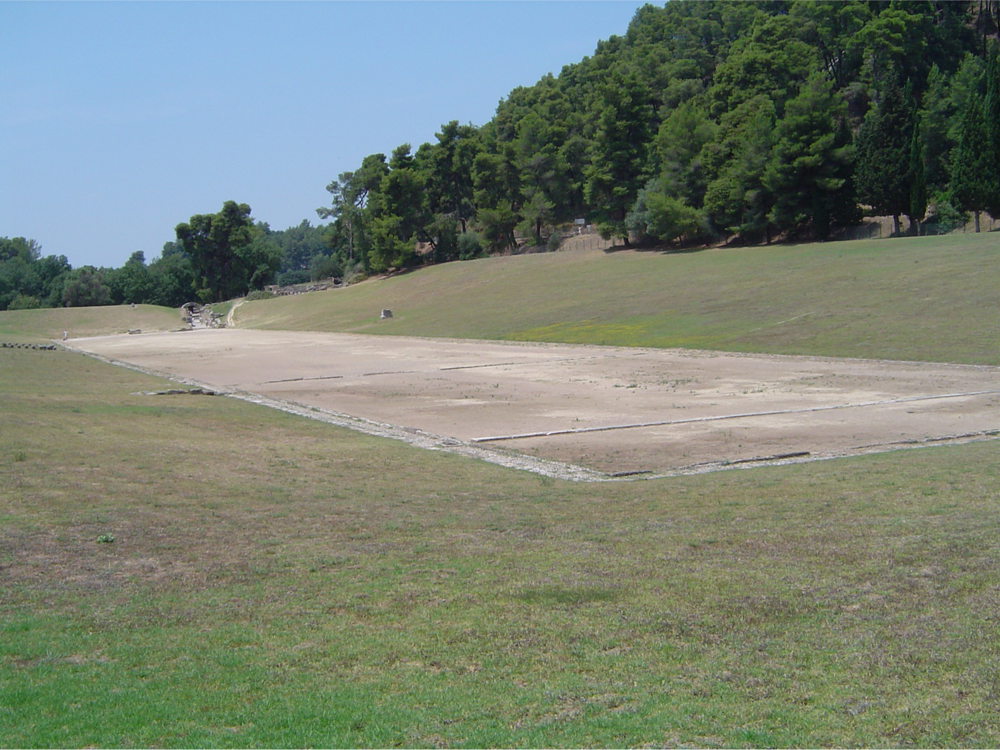

# 올림피아의 달리기 — 고대 선수들은 무엇을 위해 뛰었을까

*도시마다 달랐던 그리스인들이 한 경기장을 바라본 이유*

Culture · Sports

> 자료 대조를 마친 검토용 이야기입니다. 공개 게시 승인은 아직 받지 않았습니다.

*Dwaipayanc / Wikimedia Commons, Olympic Race Track in modern Olympia, Greece · OpenStax, Ancient Greece 재수록 · Public Domain. 현대에 촬영한 유적이며 고대 경기 당일의 모습은 아닙니다.*

[이미지 출처·제작 근거](https://raw.githubusercontent.com/openstax/osbooks-world-history/main/media/OSX_WorldHist_A06_02_Olympia.png) · Public Domain

사진 속 올림피아 경기장은 조용하다. 넓게 비어 있는 흙바닥과 완만한 주변 지형을 보면 화려한 현대 경기장의 모습을 떠올리기 어렵다. 하지만 이곳에서는 달리는 사람을 지켜보며 멀리 떨어진 도시의 이름까지 함께 기억하던 시간이 있었다.

고대 올림픽을 오늘 올림픽의 작은 옛 모습이라고 생각하면 의외의 차이를 놓친다. 오픈스택스의 고대 그리스 설명을 바탕으로, 선수 한 사람이 뛰는 일에 종교와 명예와 도시의 경쟁이 어떻게 얽혀 있었는지 살펴본다.

## 한 나라가 아니었던 그리스

고대 그리스 세계는 하나의 통일 국가로만 움직이지 않았다. 여러 도시국가가 각자의 제도와 이해관계를 가지고 경쟁했다. 바다를 건너 다른 곳에 정착한 그리스인들도 있었다. 서로를 같은 편으로 여기게 하는 장치와, 실제로 부딪치는 현실이 함께 존재했다.

그 사이에서 언어와 신들에 대한 믿음, 함께 참여하는 축제는 연결의 실마리가 되었다. 올림피아의 경기도 그런 공통의 공간이었다. 모든 갈등이 사라졌다는 뜻은 아니다. 오히려 서로 다른 도시의 사람들이 같은 규칙과 명예를 바라본다는 사실 자체가 중요했다.

## 신을 위한 축제에 모인 선수들

올림피아는 제우스와 연결된 성역이었다. 경기는 종교와 무관한 여가 행사로만 열리지 않았다. 신에게 바치는 축제의 시간에 인간의 힘과 기량이 드러났다. 운동장을 둘러싼 의미를 빼면, 왜 먼길을 와서 겨루고 승리를 기억했는지 충분히 설명하기 어렵다.

우리가 흔히 듣는 기원전 776년은 고대 올림픽의 전통적인 연대 기준이다. 그날 누군가 처음으로 달리기를 생각해 냈다는 뜻으로 받아들이지는 말아야 한다. 기록과 연대의 출발점, 그리고 실제 관습이 자라난 과정은 정확히 같은 문제는 아니다. 오래된 행사를 다룰 때 숫자는 편리하지만 모든 사정을 말해 주지는 않는다.

## 짧은 달리기가 남긴 이름

초기의 핵심 경기에는 스타디온 달리기가 있었다. 경기장의 한 구간을 전력으로 달리는 짧은 경주다. 현대의 복잡한 계측 장비나 거대한 중계 화면을 떠올리기 전에, 누가 가장 먼저 닿는지 몸으로 확인하는 장면을 생각해 보면 된다. 단순하기에 승부의 순간은 더 직접적이었을 것이다.

스타디온은 달리는 거리와 공간을 가리키는 말이었고, 오늘 경기장을 뜻하는 말에도 그 흔적이 남아 있다. 다만 옛 모든 경기장의 길이가 현대의 단일 규격과 똑같았다고 상상할 필요는 없다. 같은 종목의 이름 아래에서도 장소와 시대의 구체적인 모습은 살펴야 한다.

## 달리기 밖으로 넓어진 경쟁

시간이 지나며 달리기뿐 아니라 뛰기와 던지기, 몸을 맞대는 경기, 전차 경주 같은 종목도 축제 안에서 자리를 차지했다. 경기마다 필요한 능력은 달랐다. 빠른 몸과 강한 몸, 훈련의 기술과 비용이 많이 드는 준비가 한 행사 안에 모였다.

전차 경주까지 생각하면 승리가 개인의 근육만으로 만들어지지 않는다는 점이 선명해진다. 말과 장비와 사람을 준비할 수 있는 자원이 필요하다. 고대의 스포츠도 생활의 경제와 사회적 조건에서 따로 떨어져 있지 않았다. 모든 선수가 같은 출발 조건을 가졌다는 낭만적인 그림과는 거리가 있다.

## 상이 소박하면 욕망도 소박했을까

고대 선수들이 오직 순수한 명예만을 위해 뛰었다고 상상하기 쉽다. 그러나 교재는 전문적인 훈련과 승리 뒤의 보상, 고향 도시의 환대에 주목한다. 경기장에서 받는 상의 형태가 간소하다고 해서 우승의 사회적 가치까지 작았던 것은 아니다.

승자는 자신의 이름을 알리고 도시의 자부심이 될 수 있었다. 조각상이 세워지거나 승리를 기리는 시가 지어졌다. 핀다로스의 승리 송가가 보여 주듯, 몸으로 끝난 한순간은 말과 예술로 더 오래 이어졌다. 경주는 짧았지만 우승자가 되었다는 사실의 수명은 길었다.

## 선수 혼자와 도시의 이름 사이

한 사람이 다른 사람보다 먼저 결승에 닿는다. 결과는 개인에게 속하지만 그 이야기는 도시로 돌아간다. 도시가 선수를 자랑하는 동안 선수의 이름도 더 큰 관계 속에 놓인다. 운동의 기량이 공동체를 대표하는 자산으로 바뀌는 모습이다.

이런 연결은 오늘에도 낯설지 않다. 다만 현대의 국가대표 체계와 고대 도시의 관계를 그대로 겹치면 차이가 지워진다. 비슷한 감정이 있다고 제도까지 같지는 않다. 오래된 경기에서 익숙함을 발견하되 그 시대의 단위와 규칙도 함께 기억하는 편이 좋다.

## 올림픽이라는 이름 아래의 차이

고대 축제의 참가 자격과 사회 질서는 오늘 우리가 바라는 보편적인 참여와 같지 않았다. 여성의 관람과 참여 문제도 행사와 신분, 역할에 따른 구별을 살펴야 한다. 모든 여성이 똑같은 방식으로 금지되었다는 한 문장으로 복잡한 관습을 덮어서는 안 된다.

1896년에 시작된 근대 올림픽 역시 고대 행사를 그대로 복원한 복제품은 아니다. 옛 이름과 상징을 새 시대의 국제 경기로 바꾸어 만든 제도다. 사진의 빈 트랙을 다시 보면 그래서 두 시대가 함께 떠오른다. 오늘의 경기장을 닮아서가 아니라, 한 사람의 달리기에 얼마나 많은 사람이 의미를 얹을 수 있는지 오래전부터 보여 주었기 때문이다.

## 이야기의 바탕이 된 자료

- [OpenStax, World History — Ancient Greece: Panhellenic Games / Athletics](https://raw.githubusercontent.com/openstax/osbooks-world-history/main/modules/m00133/index.cnxml) · 확인일 2026-11-01
  - 확인 내용: 도시국가의 분립과 공통 언어/종교·제우스의 성역·전통적인 776 BCE 연대·스타디온 / 여러 경기 종목·전문 훈련과 보상·동상과 핀다로스의 승리 송가·1896 근대 경기와의 구별

---

[같은 소주제의 이야기](README.md) · [전체 서가](../../README.md)
