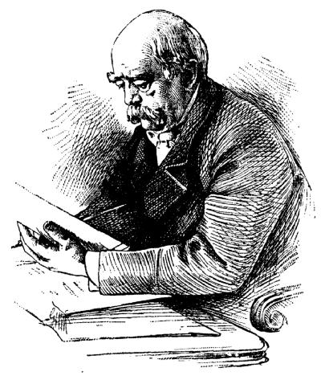

# 독일의 사회보험 — 아픈 노동자의 생활은 누가 책임져야 했을까

*1883년 건강보험과 1889년 노령·장애 보험, 구제를 권리와 부담의 제도로 바꾸기*

역사 · 법과 제도

> 출처 대조와 공개 게시 승인을 마친 이야기입니다. 실제 게시 여부는 사이트 배포 상태를 따릅니다.

*James Harvey Robinson, An Introduction to the History of Western Europe, Bismarck. 당시 독일 정치를 이끈 인물의 초상이며 보험법 제정 현장 자료는 아닙니다.*

[이미지 출처·제작 근거](https://raw.githubusercontent.com/GITenberg/An-Introduction-to-the-History-of-Western-Europe_26042/master/26042-h/images/image88.jpg) · Public Domain

공장에서 일하던 사람이 아프면 치료비만 문제가 되는 것은 아니다. 일을 쉬는 동안 가족의 생활도 흔들린다. 산업이 커지던 19세기 유럽에서는 이런 위험을 개인이나 자선에만 맡겨 둘 수 있는지에 대한 질문이 커졌다. 1880년대 독일이 만든 사회보험은 그 질문에 제도로 답하려는 시도였다. 국가가 좋은 뜻을 선언한 사건이라기보다, 누가 돈을 내고 누가 보호받는지 규칙을 정하는 변화였다.

## 01. 공장의 위험은 퇴근한다고 사라지지 않았다

산업 노동자는 임금을 받아 식량과 집세를 마련했다. 몸이 아파 일을 하지 못하면 지출이 늘어나는 순간에 수입도 줄어들 수 있었다. 오래 일했다고 해서 노년에 생활을 유지할 자산이 반드시 쌓이는 것도 아니었다.

가족의 도움과 상호부조, 자선은 이미 존재했다. 그러나 도움을 줄 사람도 함께 가난해지거나 사고와 질병이 겹치면 버티기 어려웠다. 가까운 사람의 선의에만 기대는 방식으로는 산업 사회의 위험을 넓고 안정적으로 감당하기 힘들었다.

## 02. 1883년 법은 부담을 나누도록 했다

독일은 1883년 건강보험법을 통해 일정한 노동자 집단에 대한 보험을 제도화했다. 노동자가 내는 돈에 고용주의 부담을 더하는 방식이었다. 아픈 사람을 발견한 뒤 누가 도와줄지 찾는 대신, 미리 돈을 모으는 규칙을 만들었다.

노동자의 임금에서도 보험료가 나왔다는 점이 중요하다. 국가나 고용주가 모든 비용을 대신 내 준 단순한 선물은 아니었다. 보호를 받을 가능성이 생기는 한편 오늘 쓸 수 있는 임금에서는 일정한 몫을 떼어 두어야 했다.

일정한 노동자 집단이 함께 가입하는 제도에서는 건강한 사람만 참여하거나 아픈 사람만 따로 남는 문제를 줄일 수 있다. 보험을 개인의 선택에 전적으로 맡기는 방식과는 다른 설계였다. 그 대신 누구에게 가입과 납부를 요구할지 국가가 기준을 정해야 했다.

## 03. 보험은 불행의 시점을 함께 감당하는 장치였다

누가 언제 아플지 정확히 알기 어렵더라도 여러 사람이 함께 돈을 내면 개별 위험을 나눌 수 있다. 지금 건강한 사람이 낸 보험료가 먼저 아픈 사람을 돕는다. 각자의 형편과 지출의 시점이 다르기 때문에 가능한 구조다.

모든 가입자가 같은 날 같은 만큼 돌려받아야 공정한 제도는 아니다. 보험료를 낸 동안 사고가 없었다고 아무 가치도 얻지 못한 것은 아니다. 생활을 무너뜨릴 수 있는 비용을 혼자 감당하지 않아도 된다는 보장이 제도의 핵심이었다.

## 04. 1889년에는 늙고 일하기 어려운 위험도 다루었다

1889년 독일은 노령과 장애에 대한 보험을 도입했다. 짧게 아픈 때뿐 아니라 장기간 노동 능력이 줄거나 나이가 들어 임금 생활을 이어 가기 어려운 문제로 보호의 범위를 넓힌 것이다.

노후의 소득을 마련하는 일에는 오랜 기간의 부담과 지급 규칙이 필요했다. 제도를 만든 해에 모든 노인이 충분한 생활비를 보장받았다는 뜻은 아니다. 누가 가입하고 어떤 조건에서 얼마를 받는지에 따라 실제 보호의 크기는 달라졌다.

## 05. 사회보험은 노동자의 정치와도 연결되었다

당시 노동자들은 노동조합과 정치 조직을 통해 임금과 노동시간, 안전과 생활의 보호를 요구했다. 사회주의와 사회민주주의의 성장도 정부가 노동 문제를 외면하기 어렵게 만들었다. 사회보험의 역사는 이런 압력과 논쟁의 일부였다.

정부는 노동자의 불안을 줄이고 사회 질서를 안정시키려 했다. 노동자는 생활의 안전을 얻으려 했다. 같은 제도를 지지해도 서로의 목적은 완전히 같지 않았다. 보험이 생겼다는 사실이 노동자의 정치적 요구까지 충족했다는 뜻도 아니었다.

## 06. 법이 만들어지면 자선과는 다른 질문이 생긴다

자선은 주는 사람의 판단과 자원에 크게 의존한다. 보험은 정해진 자격과 절차, 부담과 지급의 규칙을 갖는다. 도움을 요청할 때 어떤 권리를 주장할 수 있는지가 달라진다. 선의를 기다리는 일과 규정에 따라 보장을 청구하는 일은 같지 않다.

그만큼 가입 대상과 제외된 사람의 문제가 중요해졌다. 초기 제도는 오늘날의 모든 주민을 포괄하는 보장과 달랐다. 공장 노동자를 위한 규칙이 있다고 해서 농촌이나 비공식적인 일자리의 모든 위험이 같은 방식으로 다루어진 것은 아니었다.

지급받을 자격을 증명하려면 기록도 필요하다. 어떤 일을 했고 보험료를 냈는지 확인할 수 있어야 규칙이 실제 권리로 이어진다. 제도의 역사를 법률 제목만으로 읽으면 청구와 심사, 행정에 들어간 사람들의 시간과 노력은 보이지 않는다.

## 07. 좋은 제도라는 평가에는 장부가 필요했다

다른 유럽 국가들도 서로 다른 시기에 건강과 산업재해 등에 대한 보험을 마련했다. 독일에서 시작된 제도를 그대로 복사한 것은 아니었다. 각국의 노동시장과 재정, 정치적 협상에 맞추어 부담과 보호의 경계가 달라졌다.

사회보험을 읽는 가장 구체적인 방법은 세 가지를 묻는 것이다. 누가 비용을 내는가, 누가 어느 위험에서 보호받는가, 지급을 요구할 권리는 어떻게 보장되는가. 아픈 노동자를 돕자는 마음이 지속되는 제도가 되려면, 그 마음을 지탱할 돈과 규칙도 함께 마련되어야 했다.

## 이야기의 바탕이 된 자료

- [OpenStax, World History Volume 2 — Regulation, Reform, and Revolutionary Ideologies](https://raw.githubusercontent.com/openstax/osbooks-world-history/main/modules/m00006/index.cnxml) · 확인일 2026-11-11
  - 확인 내용: 1883독일 건강보험·노동자/고용주 부담/1889노령·장애 보험·다른 국가의 확대/노동조합·사회민주주의와 제도 변화. 특정 기금의 보험료율·수급 연령·모든 주민 적용 여부를 만들어 쓰지 않음.

---

[같은 소주제의 이야기](README.md) · [전체 서가](../../README.md)
