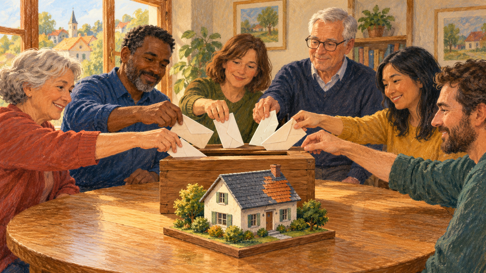

# 보험 — 사고가 없으면 낸 돈이 아까운 걸까

*큰 손실의 불확실성을 여러 사람이 나누는 방법*

Finance · Insurance

> 자료 대조를 마친 검토용 이야기입니다. 공개 게시 승인은 아직 받지 않았습니다.

*AI 개념 삽화 · 위험에 함께 대비한다는 구상을 표현했습니다. 실제 보험회사의 운영·보험금 지급 절차를 그린 자료는 아닙니다.*

한 해 동안 사고가 없었다. 다행한 일인데 보험료를 떠올리면 조금 다른 생각도 든다. 아무것도 돌려받지 못했으니 손해였을까. 물건을 사면 손에 남는 것이 있는데 보험은 눈에 보이는 결과가 없을 때가 많다.

이 질문을 풀려면 보험이 무엇을 바꾸는지부터 보아야 한다. 사고 자체를 없애 주는 것과 사고 뒤의 큰 금전 부담을 나누는 것은 다른 일이다. 보험의 기본 구상은 불확실한 큰 손실을 여러 사람의 비교적 작은 부담으로 다루는 데 있다.

## 1. 누가 당할지는 모르지만 비용은 생길 수 있다

가상의 마을에 100가구가 있고, 한 해에 한 집에서 1,000만 원의 피해가 생긴다고 단순하게 가정하자. 어느 집일지는 미리 모른다. 각 가구가 10만 원씩 모으면 합계는 1,000만 원이 된다. 피해가 난 집의 큰 부담을 함께 마련한 돈으로 감당하는 모형이다.

실제로 화재가 반드시 한 건만 발생한다는 뜻은 아니다. 운영비와 이익, 재난의 동시 발생도 생략한 계산이다. 이 예의 목적은 사고를 당하지 않은 사람이 돌려받는 돈만으로 참여의 가치를 판단하기 어렵다는 점을 보이는 데 있다. 시작할 때는 누구도 피해 가구를 확실히 알지 못했다.

## 2. 보험료는 무엇을 위한 돈일까

OpenStax는 보험 가입자가 보험료를 내고, 정해진 손실을 겪은 사람이 공동의 자금에서 지급받는 구조를 설명한다. 보험회사는 집단에서 사건이 일어날 가능성과 비용을 추정한다. 한 개인의 미래를 맞히는 일과 집단의 위험을 계산하는 일은 다르다.

그래서 보험을 내가 낸 돈을 모두 돌려받는 저축과 똑같이 볼 수는 없다. 물론 실제 상품에는 여러 기능이 결합될 수 있다. 여기서는 위험을 나누는 기본 기능을 살펴보는 것이다. 사고가 없는 동안에도 큰 손실에 대비하는 약속은 일정한 기간 유지되었다.

## 3. 모두가 같은 위험을 가진 것은 아니다

집의 위치와 구조, 차량의 사용 조건처럼 위험에 영향을 주는 요소는 다를 수 있다. 교재는 보험회사가 비슷한 위험의 집단을 구분하려 한다고 설명한다. 같은 금액을 보장한다고 모두에게 같은 보험료가 적용되는 것은 아닌 이유다.

하지만 집단을 구분하는 기준은 정확성과 공정성의 질문을 함께 만든다. 관찰한 특징이 실제 위험을 얼마나 잘 설명하는지, 어떤 구분을 허용할지 따져야 한다. 간단한 확률표만으로 모든 제도의 선택이 자동으로 정해지지는 않는다. 계산과 규칙이 함께 작용하는 영역이다.

## 4. 자기부담금은 왜 남겨 둘까

보험이 있어도 손실의 일부를 가입자가 부담하는 계약이 있다. 자기부담금이나 일정 비율의 분담 같은 방식이다. 교재는 이런 조건이 위험을 줄이려는 유인을 유지하는 한 방법이라고 설명한다. 보험이 있다고 모든 비용이 무조건 전액 지급되는 것은 아니다.

가령 보장 대상 손실 200만 원 가운데 첫 20만 원을 본인이 내는 단순한 가상 조건이라면 나머지는 180만 원이다. 실제 상품에서는 한도와 제외 사항 등 다른 조건도 적용될 수 있다. 지급액을 알려면 보험료의 액수뿐 아니라 어떤 약속에 가입했는지 읽어야 한다.

## 5. 대비할수록 행동도 달라질 수 있다

위험의 결과를 누군가 나누어 준다는 사실이 사람의 행동에 영향을 줄 수도 있다. 교재는 이를 도덕적 해이라는 개념으로 설명한다. 중요한 것은 모든 가입자가 나쁘게 행동한다고 낙인찍는 일이 아니라 비용을 부담하는 방식이 선택을 바꿀 수 있다는 점이다.

안전 시설을 갖추면 조건을 달리하거나 일부 비용을 남기는 설계는 이런 문제와 연결된다. 다만 비용 분담을 높이면 필요한 이용까지 줄어들 수 있다는 질문도 생긴다. 제도는 한 가지 목표만 크게 하면 끝나는 문제가 아니다. 보호와 부담, 예방 사이의 균형을 함께 보아야 한다.

## 6. 한꺼번에 큰 피해가 나면

가상의 마을 계산에서 어려운 경우는 여러 집이 동시에 피해를 입는 상황이다. 큰 재난은 위험들이 서로 무관하지 않을 수 있음을 보여 준다. 사람이 많다는 사실만으로 어떤 손실도 감당할 수 있는 것은 아니다. 손실의 규모와 서로 연결되는 방식이 중요하다.

보험회사는 지급을 위한 준비와 운영 비용도 마련해야 한다. 교재는 보험료와 운용 수입, 보험금과 비용이 함께 작용한다고 설명한다. 보험의 자금을 단지 잠시 모아 두었다가 그대로 나누는 상자로만 생각하면 실제 운영의 조건은 보이지 않는다.

## 7. 무엇을 보장하는지부터 읽기

보험이라는 이름만으로 보장 내용을 다 알 수는 없다. 어떤 사건이 대상이고 무엇이 제외되며 어느 범위까지 지급되는지 확인해야 한다. 같은 이름의 상품이라도 약속의 내용이 다를 수 있다. 낸 금액이 적당한지 묻는 일보다 먼저 계약이 다루는 위험을 알아야 한다.

함께 실은 AI 삽화는 이웃들이 공동의 대비를 생각하는 상상 속 장면이다. 실제 보험회사의 운영이나 보험금 지급 과정을 재현한 도표는 아니다. 이 글의 두 계산도 가상 모형이며 특정 계약의 지급액을 안내하지 않는다.

## 8. 아무 일도 없던 한 해의 의미

사고가 없었다면 큰 손실이 생기지 않았다는 점에서 먼저 다행한 일이다. 그동안 보험이 제공한 가치는 나중에 받은 금액과 정확히 같은 항목은 아니다. 불확실한 비용의 일부를 미리 정한 부담으로 바꾸는 약속이 있었다.

보험을 이해하면 무조건 많이 가입하거나 모두 없애자는 답보다 구체적인 질문이 생긴다. 내가 감당하기 어려운 위험은 무엇이며 계약은 그 부분을 어떻게 나누는가. 아무 일도 없던 해를 돌아보는 질문은 결국 큰일이 생겼을 때 누가 어떤 조건으로 부담할지를 생각하는 질문과 이어진다.

## 이야기의 바탕이 된 자료

- [OpenStax Principles of Microeconomics — 보험과 불완전한 정보](https://raw.githubusercontent.com/openstax/osbooks-principles-economics-bundle/main/modules/m63685/index.cnxml) · 확인일 2026-10-31
  - 확인 내용: 보험료와 집단의 손실 분담·위험 집단 / 자기부담금·비용 분담·유인과 필요한 이용 감소의 문제 / 보험금과 운영비·준비금 운용의 구분

---

[같은 소주제의 이야기](README.md) · [전체 서가](../../README.md)
