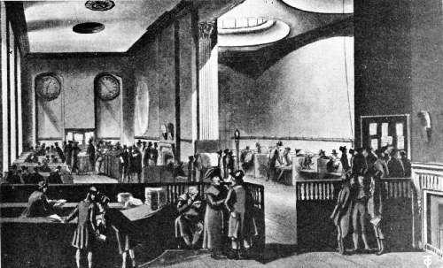

# 로이즈 — 커피하우스에서 자라난 해상보험

*배의 소식이 돈의 약속으로 이어지던 런던*

Finance · Insurance

> 자료 대조를 마친 검토용 이야기입니다. 공개 게시 승인은 아직 받지 않았습니다.

*William H. Ukers, All About Coffee (1922), “Lloyd’s Coffee House in the Royal Exchange, Showing the Subscription Room” · Project Gutenberg 공개 도판 · Public Domain. 후대 로열 익스체인지의 구독자실이며 1688년 최초 가게의 내부가 아닙니다.*

[이미지 출처·제작 근거](https://raw.githubusercontent.com/GITenberg/All-About-Coffee_28500/master/28500-h/images/image51.jpg) · Public Domain

17세기 말 런던의 한 커피하우스에 배와 화물에 관심을 가진 사람들이 모였다. 어느 배가 떠났고 어느 항구에 도착했는지, 바다에서 무슨 일이 있었는지를 알고 싶어 하는 사람들이었다. 따뜻한 음료를 마시는 자리에서 다음 거래를 바꿀 소식이 오갔다.

가게 주인의 이름은 에드워드 로이드였다. 그의 이름을 딴 로이즈의 역사는 커피가 특별한 금융 상품이어서 시작된 것이 아니다. 같은 정보를 필요로 하는 사람들이 같은 장소에서 만났고, 그 만남이 해상 위험을 나누는 거래와 이어졌다.

## 1. 타워 스트리트의 작은 가게

윌리엄 유커스의 1922년 책 『커피의 모든 것』은 로이드가 1688년 무렵 런던 타워 스트리트에서 커피하우스를 운영했다고 설명한다. 이후 가게는 롬바드 스트리트로 옮겨 갔다. 처음부터 오늘의 큰 금융기관 같은 모습으로 문을 연 것은 아니었다.

이곳의 손님에는 선원과 상인들이 있었다. 뱃길과 거래의 상황에 관한 정보가 일과 연결된 사람들이었다. 어떤 커피하우스가 문학가의 모임으로 알려지고 다른 곳이 정치적 대화의 장소가 된 것처럼, 로이드의 가게에는 바다에 관한 관심이 모였다.

## 2. 손으로 적은 배의 목록

유커스는 로이드가 손님을 위해 선박 목록을 준비했다고 소개한다. 초기에는 손으로 쓴 정보였다. 해상보험을 다루는 사람들에게 제시될 수 있는 배가 어떤 것인지 알아보는 데 쓰였다. 가게는 단순히 대화를 듣는 공간에서 정리된 정보를 제공하는 자리로도 기능했다.

오늘은 선박의 위치를 화면에서 보는 일이 가능하지만 당시에는 소식이 어디서 와서 누구에게 모이는지가 중요했다. 멀리서 배가 사라진 것인지, 늦게 도착하는 것인지 구분하기 어려운 상황도 있었다. 정보가 빠르게 모이는 장소에는 사람들이 다시 찾아올 이유가 생겼다.

## 3. 바다의 위험을 누가 부담할까

배를 보내는 사람에게는 도착 뒤의 수익뿐 아니라 항해 중의 손실도 문제였다. 해상보험을 맡는 사람은 정해진 조건 아래 위험의 일부를 부담하는 대가를 받는다. 따라서 어떤 배와 항로인지에 관한 정보는 돈의 약속과 직접 연결된다.

로이드의 가게가 흥미로운 것은 음료와 보험을 단순히 한 세트로 팔았다는 데 있지 않다. 정보를 주고받을 사람과 거래를 논의할 사람이 한곳에 있었다는 점이다. 커피하우스의 대화가 실제 위험을 평가하고 계약을 맺는 관계와 만날 수 있었다.

## 4. 소문과 기록을 나누는 자리

항구에서 들려온 말이 언제나 정확한 것은 아니다. 거래를 판단하려면 어떤 배의 어떤 사건인지 구분해 기록할 필요가 있다. 한곳에 소식이 모인다는 사실과 그 소식을 사용할 수 있게 정리한다는 사실은 다른 종류의 일이다.

로이즈의 역사에서 선박 목록과 장부가 함께 등장하는 이유도 여기에 있다. 해상보험의 발전은 멋진 계약 문구만의 역사가 아니었다. 배의 출항과 도착, 사고와 구조에 관한 지식이 축적되고 공유되는 과정이 함께 있었다.

## 5. 커피하우스에서 전문적인 정보실로

시간이 흐르며 로이즈와 관련된 거래와 정보의 공간은 더 조직적인 형태로 발전했다. 유커스의 책에는 후대 로열 익스체인지의 방들이 소개된다. 보험을 맡는 사람들, 상인들, 선장들이 이용하는 공간과 선박 정보의 전시가 설명된다.

함께 실은 역사 도판도 이 후대의 구독자실을 보여 준다. 1688년 타워 스트리트의 첫 가게 내부를 직접 그린 그림은 아니다. 최초의 커피하우스와 뒤에 마련된 큰 정보실 사이에는 시간과 조직의 변화가 있었다. 그림을 볼 때 그 간격을 기억하면 좋다.

## 6. 두 장부에 나뉜 항해의 소식

책은 1848년 자료를 인용해 로이즈의 큰 장부들을 설명한다. 한쪽에는 도착했거나 항해 중 소식이 전해진 배들이, 다른 쪽에는 난파와 화재, 심한 충돌 같은 사건들이 기록되었다. 바다의 이야기가 서로 다른 종류의 정보로 분류되어 남은 것이다.

방 안에는 바람과 비를 살피는 기구도 있었다고 소개한다. 이는 17세기 최초의 가게에 그런 장비가 모두 있었다는 뜻은 아니다. 후대의 전문 공간에서는 선박 소식뿐 아니라 항해와 관련된 조건도 함께 관찰했다는 설명으로 읽어야 한다.

## 7. 오래된 책의 찬사와 오늘의 독자

유커스는 로이즈를 매우 중요한 기관으로 높이 평가한다. 다만 1922년의 책에 적힌 규모와 활동량을 오늘의 수치처럼 받아들일 수는 없다. 그가 바라본 시점과, 그가 다시 인용한 19세기 자료의 시점도 구분해야 한다.

로이즈의 현재 구조와 개별 보험 계약의 조건을 이 글에서 설명하는 것은 아니다. 여기서는 바다의 정보를 공유하던 사람들이 거래를 위한 전문적인 관계를 만들어 간 역사를 살펴본다. 커피하우스가 금융의 이름으로 남은 이유를 이해하는 데 초점을 맞추면 된다.

## 8. 커피보다 오래 남은 정보의 자리

로이즈의 이름을 듣고 거대한 건물만 떠올렸다면 작은 가게와 손으로 쓴 선박 목록도 함께 놓아 보자. 위험을 나누는 약속 뒤에는 무엇이 일어났는지 알기 위한 기록이 있었다. 금융은 보이지 않는 숫자뿐 아니라 사람이 모여 소식을 확인하는 장소에서도 자라났다.

이 이야기는 보험이 커피 한 잔에서 갑자기 발명되었다는 전설이 아니다. 바다에 대한 오래된 거래가 특정한 만남의 장소를 통해 더 조직적으로 연결된 과정이다. 런던의 커피하우스는 누가 어떤 소식을 함께 읽는지가 새로운 시장의 기반이 될 수 있음을 보여 준다.

## 이야기의 바탕이 된 자료

- [William H. Ukers, All About Coffee (1922) — 런던 커피하우스의 로이즈 절](https://raw.githubusercontent.com/GITenberg/All-About-Coffee_28500/master/28500-8.txt) · 확인일 2026-10-31
  - 확인 내용: 1688년 무렵 Edward Lloyd의 가게·선원과 상인·수기 선박 목록 / 후대 Royal Exchange 구독자실과 1848년 The City 인용 / 선박 도착과 사고 장부·후대 방의 풍향·강우 관측 기구. 현재 기관 규모 자료로 사용하지 않음

---

[같은 소주제의 이야기](README.md) · [전체 서가](../../README.md)
