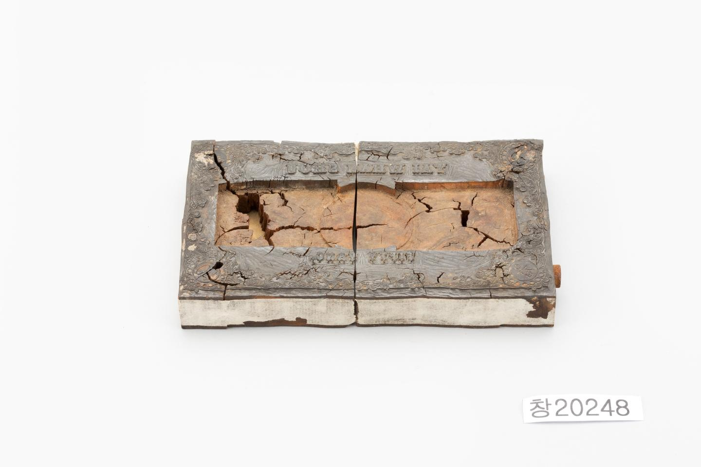

# 돈을 만들던 나무판에는 무엇이 남았을까

*지폐 한 장보다 앞에 있었던 물건*

Finance · Money

> 출처 대조와 공개 게시 승인을 마친 이야기입니다. 실제 게시 여부는 사이트 배포 상태를 따릅니다.

*지폐원판 · 국립고궁박물관 소장·제공. 전체 사진을 자르지 않고 사용했습니다.*

[이미지 출처와 소장품 안내](https://www.gogung.go.kr/gogung/pgm/psgudMng/view.do?menuNo=800065&psgudSn=437871) · 공공누리 제1유형(출처표시)

낡은 직사각형 나무판이 있다. 가운데는 길게 파였고 가장자리에는 작은 글자와 무늬가 남아 있다. 처음 보면 상자의 부품 같기도 하다. 그런데 박물관이 붙인 이름은 지폐원판이다.

돈이라고 하면 지갑 속 종이나 동전을 떠올리지만, 이것은 그 돈을 만드는 쪽에 있던 물건이다. 완성된 지폐에서 한 걸음 뒤로 물러서니 평소에는 보지 못하던 물건이 나온다.

## 한쪽에는 숫자, 한쪽에는 글자

국립고궁박물관의 설명에 따르면 원판 위쪽에는 TAI WHAN SHOU, 아래쪽에는 FIFTY YANG이라는 글자가 있다. 아래 문구에는 오십 양이라는 액면을 영어로 나타낸 표현이 들어 있다.

네 귀퉁이에는 둥근 구멍 안에 오십과 50이라는 글자도 남아 있다고 한다. 같은 수가 글자와 숫자로 거듭 나타나는 것이다. 작은 장식으로만 보이던 자리에 돈의 금액을 가리키는 정보가 들어 있었다.

## 가운데가 비어 있는 까닭은

사진에서 먼저 눈에 들어오는 부분은 가운데의 길쭉한 홈이다. 박물관은 그 주변으로 덩굴 모양의 당초문이 둘러져 있다고 설명한다. 비어 있는 공간과 촘촘한 무늬가 한 판 안에서 나뉜다.

다만 이 홈에 어떤 부품이 들어갔는지, 이 원판으로 실제 얼마만큼의 지폐를 만들었는지까지는 해당 설명으로 알 수 없다. 익숙한 인쇄 과정을 가져와 빈칸을 채우기보다, 지금 남아 있는 모양에서 이야기를 시작해 보자.

## 돈의 얼굴 뒤편 보기

소장품 정보에 적힌 가로 길이는 16.3센티미터다. 화면에서 크게 보면 묵직한 판처럼 느껴져도 실제 크기를 가늠하면 손 가까운 물건이 된다. 돈의 역사가 꼭 거대한 금고에서만 시작되는 것은 아닌 셈이다.

이 원판을 보고 나면 지폐 위 숫자도 조금 다르게 보인다. 종이에 나타난 결과만 있었던 것이 아니라, 그보다 앞서 글자와 무늬를 마련하는 물건이 있었다. 오늘은 돈을 쓰는 대신 돈이 만들어지기 전의 한 장면을 들여다본 것이다.

## 이야기의 바탕이 된 자료

- [국립고궁박물관 — 지폐원판](https://www.gogung.go.kr/gogung/pgm/psgudMng/view.do?menuNo=800065&psgudSn=437871) · 확인일 2026-10-28
  - 확인 내용: 목제 지폐원판과 가로 16.3cm / 상부 TAI WHAN SHOU·하부 FIFTY YANG 표기 / 중앙 장방형 홈·당초문·귀퉁이 오십 및 50 표기

---

[같은 소주제의 이야기](README.md) · [전체 서가](../../README.md)
