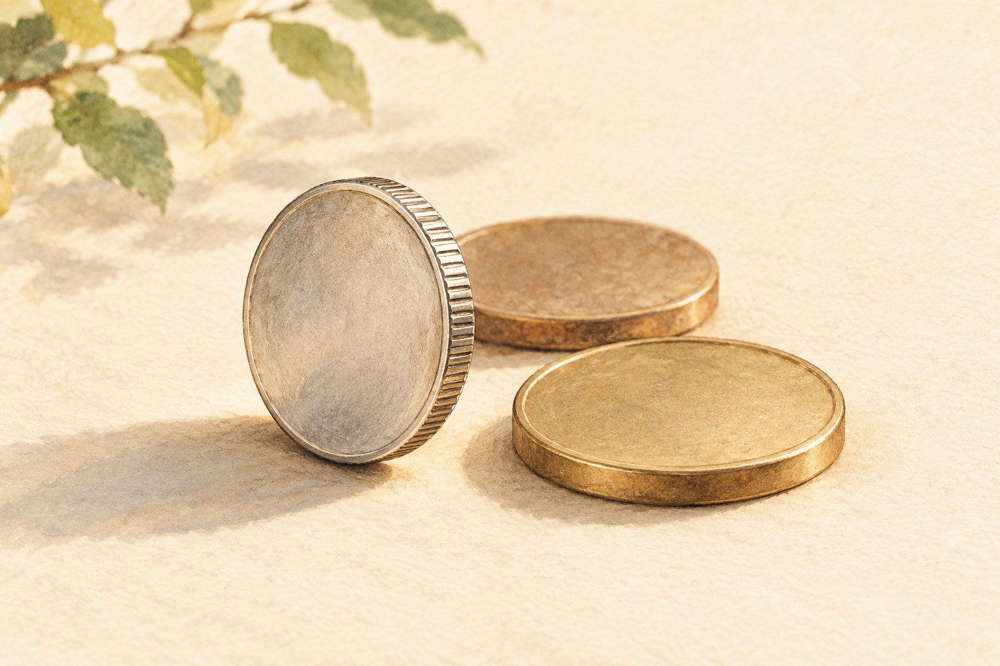

# 동전 가장자리에는 왜 작은 톱니가 있을까

*손끝에 닿는 줄무늬와 동전의 오래된 걱정*

Finance · Money

> 편집 검토용 이야기입니다. 게시 전 출처 확인이 남아 있습니다.

*AI 설명용 삽화 · 특정 유물·제품·장소의 실제 모습을 재현한 사진이 아닙니다.*

동전을 보면 보통 숫자부터 확인한다. 얼마짜리인지 알아야 쓸 수 있기 때문이다. 앞면의 인물이나 뒷면의 그림을 구경할 때도 있지만, 옆면은 좀처럼 주인공이 되지 못한다.

한번 손가락 사이에 끼워 옆으로 돌려 보자. 동전에 따라 가장자리에 촘촘한 줄이 나 있거나, 매끈한 면에 글자가 들어 있기도 하다. 아무 표시 없이 부드러운 동전도 있다.

이 작은 옆면에는 한때 동전이 겪었던 꽤 현실적인 걱정이 담겨 있다. 가장자리에서 금속을 조금씩 덜어내는 일이었다.

## 1. 아주 조금씩 떼어 가면

금이나 은처럼 값나가는 금속으로 동전을 만들던 시절에는 동전 자체의 금속도 중요했다. 동전의 가장자리를 조금 깎고, 깎아 낸 금속을 모으려는 사람이 있을 수 있었다. 이런 행위는 흔히 클리핑, 즉 동전의 가장자리를 잘라내는 일로 설명된다.

아주 조금씩 사라졌다면 받은 사람이 바로 알아채기 어려울 수도 있다. 동전에 찍힌 그림과 이름은 그대로인데 무게는 줄어드는 셈이다. 손에서 손으로 돈이 오갈 때마다 모든 동전을 정밀하게 검사하기도 번거로웠을 것이다.

그래서 가장자리에 일정한 무늬나 글자를 넣는 방법이 의미를 갖는다. 금속을 덜어내면 표시도 함께 훼손되므로, 매끈한 테두리보다 이상을 알아보기 쉬워진다.

그렇다고 줄무늬 하나가 모든 위조와 훼손을 막았다는 뜻은 아니다. 동전을 일정하게 만드는 기술, 무게와 품질을 관리하는 일도 함께 필요했다. 작은 홈은 그 여러 방법 가운데 하나로 보아야 한다.

## 2. 지금의 동전에도 같은 이유만 남아 있을까

오늘 우리가 쓰는 모든 동전이 귀금속의 가치만으로 통용되는 것은 아니다. 그러니 현재의 줄무늬를 볼 때마다 누군가 은을 깎아 가려 한다고 생각할 필요는 없다.

가장자리의 모양은 동전을 구분하는 데에도 도움이 된다. 비슷한 크기의 동전이라도 손끝에 닿는 느낌이 다를 수 있다. 지폐에 여러 구별 요소가 있듯, 동전도 앞뒷면의 그림만으로 자신을 설명하지는 않는다.

다만 어느 나라의 어떤 동전에 왜 특정한 테두리가 쓰였는지는 따로 확인해야 한다. 톱니가 있는 동전이 언제나 더 비싸다거나, 매끈한 동전은 덜 중요한 돈이라고 나누는 규칙은 아니다.

동전 가장자리를 하나의 세계 공통 암호표처럼 외우기보다는, 나라와 시대에 따라 쓰임이 달라진 작은 설계로 보는 편이 좋다. 같은 물건도 오래 사용되면 원래의 이유와 새로운 편의가 함께 남는다.

## 3. 동전에는 앞면과 뒷면만 있는 것이 아니다

책상 위에 동전을 놓으면 한 면이 먼저 보인다. 손가락 사이에 세워 보면 두 면을 잇는 얇은 가장자리가 나타난다. 평소 이름과 숫자를 찾던 시선을 옆으로 옮기는 셈이다. 줄무늬나 글자가 있든 매끈하든, 이 자리도 물건을 구별하는 설계의 일부로 볼 수 있다.

그렇다고 어떤 가장자리 모양 하나가 어느 나라에서나 같은 뜻을 가진 것은 아니다. 나라와 시대, 동전의 종류를 함께 알아야 한다. 이 원고는 그 구체적인 역사 설명의 출처를 더 확인하고 있는 검토본이다. 눈앞에서 관찰할 수 있는 차이와 도입 이유를 확정하는 주장은 구분해 두어야 한다.

## 4. 금속의 양과 표시된 가치는 다를 수 있다

귀금속으로 만든 돈을 생각하면 동전의 금속량이 줄어드는 일이 왜 문제가 되었는지 이해하기 쉽다. 하지만 오늘의 모든 동전이 그 안에 든 금속을 저울에 달아 가치가 정해지는 것은 아니다. 시대의 통화 제도가 다르므로 옛 훼손 사례의 설명을 현재의 모든 화폐에 그대로 적용해서는 안 된다.

이 구분은 가장자리의 목적을 묻는 질문도 더 정확하게 만든다. 과거의 특정한 위험에 대응한 설계와 지금 물건을 구별하는 데 생기는 편의는 함께 존재할 수 있다. 처음의 이유가 무엇인지와 현재 어떤 효과가 있는지를 같은 자료 한 줄로 끝내기 어려운 까닭이다. 원고의 사실 대조도 그 둘을 나누어 진행해야 한다.

## 5. 비슷한 무늬에서도 확인할 것은 남는다

사진을 통해 톱니처럼 보이는 부분을 찾을 수 있어도 제작 기계와 공정의 세부를 모두 알아낼 수는 없다. 같은 형태를 만드는 방법이 무엇이었는지는 해당 조폐 기록이나 기술 설명이 필요한 문제다. 익숙한 금속 가공 장면을 가져와 그 동전의 제작 과정처럼 그리지 않는 편이 정확하다.

도입 시기와 목적을 확인하지 못한 부분은 정답처럼 외우지 않아도 된다. 오히려 어떤 동전인지 먼저 정하고 그 자료를 찾는 질문으로 남겨 둘 수 있다. 작은 가장자리는 하나의 유명한 발명담보다 여러 제도와 제작의 시간을 만날 가능성이 있는 자리다. 이 검토본은 그 가능성과 확인된 사실을 나누어 보관한다.

## 6. 앞뒤가 아닌 세 번째 면

동전 이야기를 할 때 우리는 앞면과 뒷면을 떠올린다. 그런데 손에 쥐면 얇은 옆면도 분명히 존재한다. 크기는 작아도 동전의 생김새를 완성하는 부분이다.

집에 여러 동전이 있다면 잠깐 나란히 놓아 보자. 줄이 촘촘한 것, 간격이 다른 것, 매끈한 것을 구분할 수 있다. 무늬뿐 아니라 두께와 손끝의 느낌도 다르다.

이 정도 관찰에 동전 수집가의 지식까지 필요한 것은 아니다. 쓰기 전에 잠깐 구경하는 것만으로 충분하다. 평소 숫자 하나로 지나치던 물건에 생각보다 많은 선택이 들어 있다는 것을 발견할 수 있다.

다음에 주머니에서 동전을 꺼낸다면 앞뒤를 확인한 뒤 한 번 더 돌려 보자. 값을 알려주는 숫자 옆에, 동전이 자기 몸을 지키려고 마련했던 작은 흔적이 남아 있을지도 모른다.

## 이야기의 바탕이 된 자료

- [The Royal Mint — Sir Isaac Newton and The Royal Mint](https://www.royalmint.com/stories/commemorate/sir-isaac-newton-and-the-royal-mint/) · 확인일 2026-10-27
  - 확인 내용: 클리핑과 위조 범죄가 존재했고 단속 대상이었다는 역사; 테두리 무늬의 도입 이유는 추가 확인 중

아직 대조하지 못한 내용이 남아 있습니다. 위 자료가 모든 문장의 확인 완료를 뜻하지는 않습니다.

## 검토할 참고 자료 후보

아래는 원문 대조 전 후보입니다. 사실 확인 완료를 뜻하지 않습니다.

- [The Royal Mint Museum — 동전 가장자리 관련 추가 조사 후보](https://www.royalmintmuseum.org.uk/)

---

[같은 소주제의 이야기](README.md) · [전체 서가](../../README.md)
