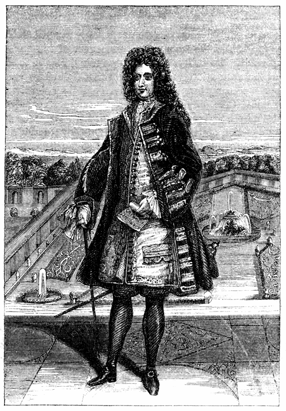

# 존 로 — 종이돈과 미시시피의 꿈은 어떻게 엮였을까

*18세기 프랑스에서 은행, 국채, 회사 주식이 만난 이야기*

Finance · Money

> 자료 대조를 마친 검토용 이야기입니다. 공개 게시 승인은 아직 받지 않았습니다.

*Leon Schenk의 1720년 판화로 소개된 John Law 도판 · Charles Mackay, Memoirs of Extraordinary Popular Delusions, 제1권 1852년판 수록 · Project Gutenberg · Public Domain. 실제 사진이 아닌 역사 판화입니다.*

[이미지 출처·제작 근거](https://raw.githubusercontent.com/GITenberg/Memoirs-of-Extraordinary-Popular-Delusions-and-the-Madness-of-Crowds_24518/master/24518-h/images/image03.png) · Public Domain

은행이 발행한 지폐, 나라가 갚아야 할 빚, 바다 건너 무역회사의 주식. 서로 다른 약속들이 하나의 큰 계획 안에 묶인 적이 있다. 18세기 초 프랑스에서 존 로가 추진한 제도가 그 사례다.

미시시피의 부를 기대한 열풍과 뒤이은 붕괴 때문에 흔히 허황된 꿈의 이야기로 기억된다. 그러나 처음부터 모든 것이 단순한 사기는 아니었다. 돈이 잘 돌지 않고 국가 재정이 어려운 상황에서 새로운 방법이 매력적으로 보인 이유부터 살펴보자.

## 1. 금속 돈이 부족하면 거래도 막힐까

스코틀랜드 출신의 로는 돈의 유통을 늘리면 상업과 생산에 도움이 될 수 있다고 생각했다. 손에 쥔 동전만으로 거래해야 한다면 필요한 활동이 막힐 수 있다는 문제의식이었다. 은행과 종이돈을 그 해법으로 보았다.

종이에 적힌 약속을 사람들이 받아 주면 무거운 금속을 매번 옮기지 않아도 된다. 다만 편리함이 유지되려면 약속의 내용과 발행 기관을 믿을 수 있어야 한다. 돈을 늘리는 기술과 신뢰를 지키는 일은 함께 필요했다.

## 2. 1716년 은행이 출발했다

로는 프랑스에서 은행을 세울 허가를 얻었다. 은행권을 세금 납부에 사용할 수 있다는 조건은 사람들이 그것을 받아들이는 데 도움이 되었다. 국가가 요구하는 납부에 쓸 수 있는 종이는 거래에서도 쓰일 이유가 생긴다.

초기의 은행을 나중의 붕괴를 이미 품은 실패작으로만 볼 필요는 없다. 신용과 유통을 개선하려는 시도였고 실제로 관심과 신뢰를 얻었다. 문제는 그 신뢰를 바탕으로 얼마나 많은 다른 약속을 더 얹었느냐에 있었다.

## 3. 다음에는 미시시피 회사가 나타났다

1717년에는 미시시피와 루이지애나 지역의 무역 권리를 내세운 회사가 등장했다. 사람들은 멀리 있는 땅에서 큰 이익이 나리라고 기대했다. 그곳의 실제 생산과 비용을 눈앞에서 확인하기는 어려웠다.

미래의 수익은 아직 벌어들인 현금이 아니다. 하지만 기대가 주식 가격에 반영되면 지금의 재산처럼 보일 수 있다. 소식을 전하는 사람과 그것을 믿는 사람 사이의 거리가 클수록 이야기의 힘도 커지기 쉬웠다.

## 4. 국가의 빚이 회사의 주식과 만나다

회사의 자본을 마련하는 과정에서 정부가 진 빚의 증서도 사용되었다. 국가에 받을 돈을 회사의 주식으로 바꾸는 길이 생겼다. 국가의 재정 문제와 회사의 성공 가능성이 서로 얽히기 시작한 것이다.

은행도 왕립은행으로 바뀌고 회사의 특권은 확대되었다. 이를 서로 독립된 작은 사업 몇 개로 보면 전체의 위험을 놓친다. 은행권과 주식, 세입과 공공 부채에 대한 기대가 같은 방향으로 움직이는 체계가 되어 갔다.

## 5. 오르는 가격이 다시 기대를 만들었다

사람들이 주식을 원하면 가격이 오르고 오른 가격은 더 많은 관심을 부른다. 무역이 실제로 얼마나 이익을 냈는지와 별개로 주식을 보유했다는 사실이 부자가 된 증거처럼 느껴질 수 있다.

회사 수익에 대한 기대와 가격 상승에 대한 기대는 다르다. 지금 비싸게 팔 수 있으리라는 믿음이 강해지면 나중의 사업 성과를 기다릴 이유는 작아진다. 멀리 있는 강의 이름은 가까운 시장의 열기를 끌어올리는 상징이 되었다.

## 6. 1720년, 약속들이 함께 흔들렸다

은행권과 주식에 대한 신뢰가 흔들리자 금속 돈을 확보하려는 요구와 가격 하락이 맞물렸다. 발행과 지급, 교환 조건을 바꾸는 조치도 혼란을 더했다. 한쪽의 불안이 다른 쪽으로 번질 수 있는 구조였다.

회사의 미래 이익이 곧바로 모두의 현재 지급 요구를 감당해 주지는 못했다. 국가가 관여했다고 해서 기대와 실제 자원의 간격이 사라지는 것도 아니었다. 결국 체계는 무너졌고 로는 프랑스를 떠났다.

## 7. 종이로 만든 돈이 모두 문제였을까

이 사건을 종이는 가짜이고 금속만 진짜라는 교훈으로 줄이면 이후 화폐의 역사와도 맞지 않는다. 종이돈을 사용한다는 사실 자체보다 무엇을 약속하고 어떻게 발행하며 어떤 제도가 그것을 지탱하는지 살펴야 한다.

미래 수익과 신용은 경제 활동에 중요하다. 하지만 그것들이 서로를 근거로 끝없이 커질 수 있다고 여기면 위험하다. 미시시피의 위기는 여러 약속이 결합된 체계에서 신뢰가 함께 무너질 수 있음을 보여 준다.

## 8. 유명한 광기의 이야기를 걸러 읽기

후대의 저자 찰스 매케이는 이 사건을 집단적 열풍의 대표로 서술했다. 그의 책에는 극적인 장면과 인물 평가가 많다. 사건 당시의 모든 사람이 똑같은 생각을 했다는 증언으로 읽어서는 안 된다.

애덤 스미스도 뒤에 이 계획을 비판했지만 그 역시 붕괴 이후의 논평자다. 이 글은 확인할 수 있는 제도의 연결과 주요 흐름을 중심으로 썼다. 정확한 주가나 군중의 대화, 기막힌 일화를 더하지 않아도 구조 자체가 충분히 흥미롭다.

## 9. 종이 한 장에 무엇을 기대했는지

함께 실은 존 로의 판화는 1720년의 작품으로 소개되는 도판을 후대 책이 재수록한 것이다. 얼굴 하나가 복잡한 제도 전체를 대신하지는 못한다. 그의 구상이 받아들여진 배경과 권력을 함께 보아야 한다.

미시시피라는 이름을 기억할 때 탐욕스러운 군중만 떠올리지 않아도 좋다. 사람들은 새로운 거래의 편리함과 국가의 재정 개선, 자신의 부를 한꺼번에 기대했다. 서로 다른 희망이 하나의 가격에 실렸을 때 무엇이 생기는지가 이 역사의 질문이다.

## 이야기의 바탕이 된 자료

- [Charles Mackay, Memoirs of Extraordinary Popular Delusions, 제1권 1852년판 — The Mississippi Scheme](https://raw.githubusercontent.com/GITenberg/Memoirs-of-Extraordinary-Popular-Delusions-and-the-Madness-of-Crowds_24518/master/24518-8.txt) · 확인일 2026-10-31
  - 확인 내용: 1716년 은행과 은행권의 조세 납부 수용·1717년 무역회사 / 국가 부채·회사 주식·왕립은행과 특권 확대·1720년 위기 / 존 로 판화의 1720년 Leon Schenk 출처. 군중 심리와 극적 일화는 증거와 구별
- [Adam Smith, An Inquiry into the Nature and Causes of the Wealth of Nations — 제2편의 존 로 논평](https://raw.githubusercontent.com/GITenberg/An-Inquiry-into-the-Nature-and-Causes-of-the-Wealth-of-Nations_3300/master/3300-8.txt) · 확인일 2026-10-31
  - 확인 내용: 존 로의 통화 확대 구상·섭정 아래 도입·미시시피 계획에 대한 후대 비판 / 스미스의 평가를 사건 당시 직접 목격이나 현대 통화 일반의 법칙으로 사용하지 않음

---

[같은 소주제의 이야기](README.md) · [전체 서가](../../README.md)
