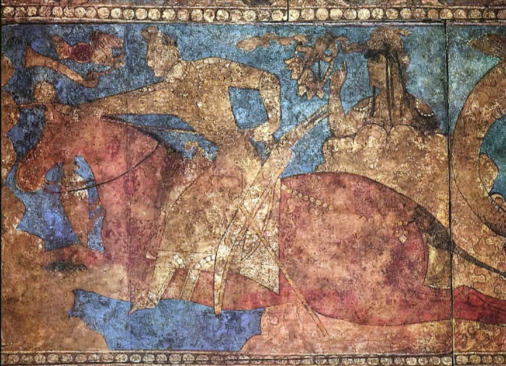

# 소그드 상인 — 큰 제국 없이도 교역로의 중심이 될 수 있었을까

*사마르칸트와 부하라에서 이어진 언어·정착·상업의 관계망*

경제·산업·금융 · 무역과 시장

> 자료 대조를 마친 검토용 이야기입니다. 공개 게시 승인은 아직 받지 않았습니다.

*Pendjikent, Panjikent mural (6th–7th century CE), Wikimedia Commons · OpenStax 수록. 오늘날 타지키스탄의 유적에서 나온 벽화이며 상인 한 사람의 신원을 보여 주는 초상이 아닙니다.*

[이미지 출처·제작 근거](https://raw.githubusercontent.com/openstax/osbooks-world-history/main/media/OSX_WorldHist_A12_03_PanjWar.jpg) · Public Domain

실크로드의 지도를 보면 거대한 제국들 사이를 긴 선이 연결한다. 그러나 물건과 정보가 실제로 이동하려면 그 길에서 일하는 사람이 필요했다. 중앙아시아의 소그드 상인들은 여러 언어와 문화에 익숙한 능력을 바탕으로 중요한 역할을 했다. 소그디아나가 언제나 하나의 강한 통일 국가였던 것은 아니다. 정치적 지배의 크기와 상업적 영향력의 크기는 일치하지 않았다.

## 01. 오아시스는 쉬어 가는 점 이상이었다

사마르칸트와 부하라 같은 도시들은 오늘날 우즈베키스탄에 있다. 그 주변의 소그드 지역은 타지키스탄으로도 이어졌다. 사막과 초원 사이의 도시들은 단순한 통과 지점이 아니라 생활과 거래가 모이는 장소였다.

오아시스의 연결망은 여러 도시를 경유하며 형성되었다. 하나의 상품이 처음부터 끝까지 같은 사람과 함께 여행했다고 상상할 필요는 없다. 중간의 정착지와 교환이 이어져야 먼 곳 사이의 거래도 지속될 수 있었다.

이 글에서 소그디아나는 오늘날의 우즈베키스탄만을 뜻하지 않는다. 타지키스탄의 판지켄트 같은 도시도 중요한 거점이었다. 현재의 국가별 메뉴는 출발점을 제공하지만, 당시 사람의 활동 범위는 그 경계에 맞추어 나뉘어 있지 않았다.

## 02. 여러 지배를 거친 경험은 문화의 층을 남겼다

이 지역은 페르시아와 알렉산드로스의 정복, 헬레니즘 왕국과 쿠샨 등 여러 권력의 영향을 받았다. 하나의 제국에 영원히 속한 고정된 공간은 아니었다. 정치적 변화 속에서 다른 문화와 지식이 겹쳤다.

그런 경험은 다양한 언어를 쓰는 사람과 숙련된 장인이 활동하는 환경으로 이어졌다. 다만 여러 문화가 만났다는 말이 갈등 없는 평화를 뜻하지는 않는다. 교역의 능력은 권력의 경쟁과 이동이 있는 세계 안에서 형성되었다.

판지켄트의 유적에는 기마 전사를 그린 벽화가 남았다. 상업으로 알려진 지역에서도 무력과 귀족의 문화가 중요한 위치를 차지했음을 보여 준다. 상인의 세계를 평화로운 교환만의 공간으로 상상하면 그들을 둘러싼 정치적 질서가 보이지 않는다.

## 03. 말이 통하는 능력은 거래의 자산이었다

물건을 사고파는 데에는 그 이름과 양을 아는 것 외에도 상대의 표현과 관습을 이해하는 능력이 필요했다. 소그드 상인들의 다언어적 환경은 서로 다른 공동체 사이에서 거래할 때 힘이 되었다.

언어를 안다고 모든 위험이 사라지는 것은 아니다. 그래도 협상하고 관계를 이어 갈 수 있는 기반은 넓어졌다. 교역로의 중요한 자원은 운반되는 비단과 금속만이 아니라 그 사이에서 뜻을 옮기는 사람의 지식이기도 했다.

## 04. 먼 곳의 정착 공동체가 연결을 지탱했다

소그드인들은 고향의 도시 안에만 머물지 않았다. 중국의 둔황과 장안 등에도 공동체를 이루었다. 잠깐 방문하는 상인과 오래 거주하는 사람의 역할은 달랐다. 정착은 거래를 다시 시작하고 관계를 지속할 기반이 되었다.

동물성 생산물과 가죽, 중국의 비단과 제조품 등 여러 물건이 이 연결 속에서 오갔다. 서로 다른 지역의 수요가 만나는 곳에서 상인은 물건의 차이와 기회를 알아야 했다. 지도에 그은 선은 이런 생활의 거점 없이는 유지되지 않았다.

4세기에서 8세기 사이 소그드의 영향은 여러 오아시스와 해외 공동체를 통해 넓어졌다. 그 힘은 하나의 수도가 모든 일을 명령하는 구조와 달랐다. 서로 떨어진 거점이 연결될 때 정치적으로 분산된 사회도 넓은 범위에서 활동할 수 있었다.

## 05. 신앙과 이야기도 함께 움직였다

소그드 상인과 여행자는 불교와 마니교 등 종교가 이동하는 데에도 관여했다. 교역의 길을 경제의 길로만 좁히기 어려운 이유다. 새로운 신앙을 접하는 일은 상품을 바꾸는 사람의 이동과 겹칠 수 있었다.

하지만 모든 상인이 같은 종교를 믿거나 전파를 자신의 주된 임무로 삼았던 것은 아니다. 하나의 집단 이름 아래에서도 신앙은 다양했다. 물건을 팔기 위해 떠난 여행이 뜻하지 않게 다른 지식과 관습을 전달할 수도 있었다.

## 06. 지배자가 바뀌면 거래의 조건도 달라졌다

8세기 이슬람 세력이 중앙아시아로 확대되면서 소그드 도시의 정치적 환경도 바뀌었다. 새로운 통치와 신앙의 질서는 상인의 계약과 관계에도 영향을 주었다. 교역망은 정치와 분리된 독립 공간이 아니었다.

일부 상인은 새 신앙 공동체가 제공하는 연결과 계약의 이점을 보았다. 그러나 개종의 이유를 모두 계산 하나로 설명할 수는 없다. 지배의 변화와 신앙, 생활의 선택이 얽혔다는 점을 확인하는 편이 더 정확하다.

## 07. 제국의 지도 바깥에도 중심이 있었다

소그드 공동체는 시간이 지나며 다른 사회에 동화되었지만 상업적 활동의 흔적은 여러 지역의 기록과 언어에 남았다. 강한 통일 왕조의 이름으로만 세계사를 정리하면 이런 영향력은 잘 드러나지 않는다.

오늘날 사마르칸트의 위치를 지도에서 찾는 일은 출발점일 뿐이다. 그 도시를 다른 오아시스와 연결한 사람의 언어와 정착, 관계를 함께 보아야 한다. 소그드의 역사는 세계의 중심이 언제나 가장 큰 군대를 가진 곳에만 있지 않았음을 보여 준다.

다른 지역에 남은 소그드어의 흔적과 상인에 대한 기록은 이런 연결을 추적하는 단서다. 남은 자료가 전체 거래량을 정확히 알려 주는 것은 아니지만 사람들이 실제로 이동하고 관계를 맺었다는 사실은 보여 준다. 문헌과 유물을 함께 읽어야 길 위의 활동이 보인다.

## 이야기의 바탕이 된 자료

- [OpenStax, World History Volume 1 — Border States: Sogdiana, Korea, and Japan](https://raw.githubusercontent.com/openstax/osbooks-world-history/main/modules/m00155/index.cnxml) · 확인일 2026-11-13
  - 확인 내용: 사마르칸트·부하라·판지켄트/분산된 도시·다언어 상인/정착공동체·상품·종교전달/8세기 이슬람 통치와 계약/문헌·언어 흔적. 원문의 부정확한 지형표현(장안/둔황을 강항구로 단정)과 당의 철수·탈라스 단일인과는 제외.

---

[같은 소주제의 이야기](README.md) · [전체 서가](../../README.md)
