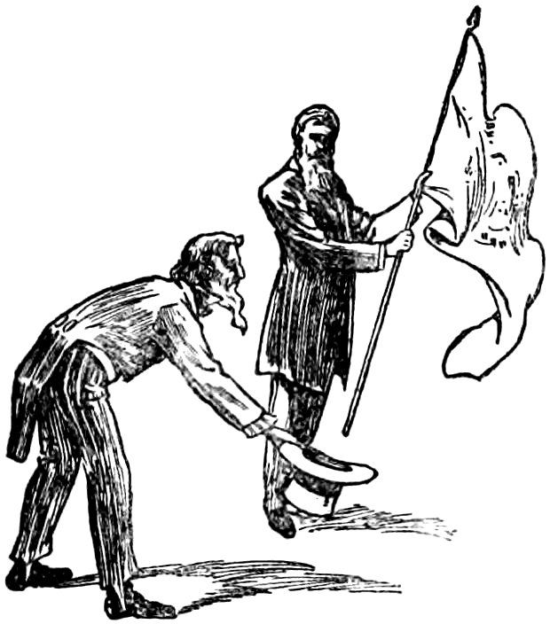

# 콩고의 고무 — 세계의 수요는 어떻게 강제노동의 명령이 되었을까

*레오폴드 2세의 지배와 고무 채취, 비판과 1908년의 변화*

경제·산업·금융 · 산업과 생산

> 출처 대조와 공개 게시 승인을 마친 이야기입니다. 실제 게시 여부는 사이트 배포 상태를 따릅니다.

*Mark Twain, King Leopold’s Soliloquy (1905), “They were the first to salute it.” 풍자 작품의 역사 삽화이며 사실을 직접 입증하는 현장 사진이 아닙니다.*

[이미지 출처·제작 근거](https://raw.githubusercontent.com/GITenberg/King-Leopold-s-Soliloquy-A-Defense-of-His-Congo-Rule_62739/master/62739-h/images/i_007.jpg) · Public Domain

산업에서 고무의 쓰임이 커질 때 생산지의 사람들에게 같은 번영이 돌아간 것은 아니었다. 19세기 말 콩고 자유국에서는 고무를 거두는 일이 강제노동과 폭력으로 이어졌다. 세계 시장의 수요가 현장의 명령으로 바뀌는 사이에는 통치 권력과 회사, 무장한 집행자가 있었다. 상품의 가격만으로는 그 상품이 만들어진 관계를 알 수 없다는 사실이 여기에서 선명해진다.

## 01. 자유국이라는 이름은 주민의 자유를 뜻하지 않았다

콩고 자유국은 벨기에 국왕 레오폴드 2세가 개인적 지배 아래 둔 국가였다. 처음부터 벨기에 정부가 직접 운영한 식민지였다고 설명하면 이후의 변화를 구별할 수 없다. 왕 개인의 지배와 벨기에 국가의 통치는 같은 구조가 아니었다.

왕은 아프리카 주민의 생활을 개선한다는 명분을 내세웠다. 그러나 명분과 실제 운영은 달랐다. 국가의 이름이나 공식 설명보다 누가 권한을 행사하고 이익을 얻었는지를 살펴야 지배의 성격을 알 수 있다.

## 02. 토지의 권한은 회사의 수익과 연결되었다

레오폴드는 지역을 회사와 개인에게 맡겨 부를 끌어냈다. 이 구조에서 현지 주민은 동등한 계약 상대가 아니었다. 자원에 대한 권한을 얻은 집단은 강한 권력의 보호 아래 생산을 요구할 수 있었다.

세계 시장에서 상품을 판다는 사실이 생산지에서도 자유로운 거래가 이루어졌음을 뜻하지는 않는다. 시장의 끝에 도착한 물건이 매매되었더라도 그 앞의 노동은 강제될 수 있다. 교역의 외형과 노동의 조건을 분리해 보아야 하는 이유다.

개인에게 맡겨진 수익 사업도 더 큰 지배 구조와 떨어져 있지 않았다. 현장에서 권한을 가진 집행자가 주민에게 요구를 전달했다. 폭력을 몇몇 잔인한 사람의 성격으로만 설명하면 그 행동을 가능하게 한 권리와 보상의 체계가 가려진다.

## 03. 고무의 할당량은 생활을 통제했다

고무를 모으는 사람에게는 정해진 양을 채우라는 압력이 가해졌다. 할당량은 숫자의 형태를 띠었지만 이를 맞추는 일은 숲에서 보낸 시간과 몸의 노동에 달려 있었다. 생산의 요구가 생활의 리듬을 바꾸었다.

지배하는 쪽은 필요한 노동력을 얻기 위해 주민의 선택을 제한했다. 다른 일을 하고 싶거나 요구에 응하지 않겠다는 의사는 존중되지 않았다. 생산량의 증가를 효율의 성과라고만 부르면 그 수치를 가능하게 한 강압이 사라진다.

## 04. 가족을 붙잡는 방식은 강제를 마을로 넓혔다

여성과 아이를 인질로 붙잡아 고무를 가져오도록 압박하는 일도 있었다. 강제는 일하는 개인에게만 가해진 것이 아니었다. 가족의 안전이 걸리면 노동을 거부할 여지는 더욱 줄어들었다.

이 사실을 설명하기 위해 폭력의 장면을 자극적으로 재현할 필요는 없다. 중요한 것은 공포가 우발적인 일탈만이 아니라 생산 요구를 관철하는 수단으로 작동했다는 점이다. 노동의 통제는 마을의 관계와 생활 전체를 침범했다.

## 05. 고무를 거두는 시간은 먹거리를 빼앗았다

강제로 고무 채취에 동원되면 식량을 생산하고 공동체의 생활을 유지할 시간이 줄어들었다. 피해는 작업 중의 고통에만 있지 않았다. 먹거리와 가족의 돌봄, 다음 계절을 준비하는 능력에도 영향을 주었다.

현금 수입이나 수출량 같은 지표는 이런 손실을 모두 보여 주지 못한다. 어떤 생산이 늘었다는 말에는 다른 생산과 생활이 밀려났다는 사실이 숨어 있을 수 있다. 콩고의 역사는 성장의 수치가 누구의 관점에서 만들어졌는지를 묻게 한다.

## 06. 기록과 비판은 지배의 명분에 도전했다

보고와 증언, 문학적 비판은 콩고의 상황을 바깥에 알리는 데 기여했다. 콩고 개혁 협회와 여러 비판자는 왕의 명분과 현실의 차이를 문제 삼았다. 지배자가 자신을 설명하는 말이 유일한 이야기가 되지 않도록 다른 기록이 등장했다.

마크 트웨인의 1905년 『레오폴드 왕의 독백』도 이런 비판의 하나였다. 다만 풍자 작품은 사건을 중립적으로 조사한 보고서와 다르다. 왕을 대신해 말하는 장치는 권력을 조롱하는 문학적 방법이며 실제 왕의 발언록으로 읽어서는 안 된다.

조지프 콘래드의 『어둠의 심연』도 1899년에 발표되었다. 작품이 비판의 흐름에 포함된다는 점과 그 안의 모든 인물과 장면이 실제 사건의 기록이라는 주장은 다르다. 문학과 조사 보고를 구분해 읽으면 자료의 목적이 더 분명해진다.

## 07. 1908년의 변화는 식민 지배의 끝이 아니었다

1908년 벨기에 의회는 콩고를 레오폴드의 개인 지배에서 가져와 벨기에령 콩고로 만들었다. 지배 주체의 변화는 중요했지만 주민이 독립을 얻은 사건은 아니었다. 왕 개인의 착취를 끝내는 일과 식민 통치 자체를 끝내는 일은 구별해야 한다.

오늘의 콩고민주공화국을 소개하는 이 역사에서 고무는 하나의 원료 이상이다. 먼 소비자의 필요와 생산지의 강제 사이를 제도와 권력이 이어 주었다. 상품이 어디서 왔는지 묻는 질문에는 어떤 관계 속에서 만들어졌는지도 포함되어야 한다.

벨기에 국가가 운영하게 된 뒤에도 외부 권력이 지역을 통치한다는 구조는 남았다. 그래서 1908년을 모든 문제의 해결로 닫을 수 없다. 역사의 전환점에는 바뀐 것과 계속된 것을 따로 묻는 작업이 필요하다.

## 이야기의 바탕이 된 자료

- [OpenStax, World History Volume 2 — Exploitation and Resistance](https://raw.githubusercontent.com/openstax/osbooks-world-history/main/modules/m00071/index.cnxml) · 확인일 2026-11-13
  - 확인 내용: 레오폴드 개인국가·회사 권한/고무할당·가족 인질·강제노동·먹거리 타격/콘래드와 개혁협회/1908벨기에 국가통치. 트웨인풍자는 별도 삽화 맥락만, 실제 왕의 말·중립 조사증거로 사용하지 않음.

---

[같은 소주제의 이야기](README.md) · [전체 서가](../../README.md)
