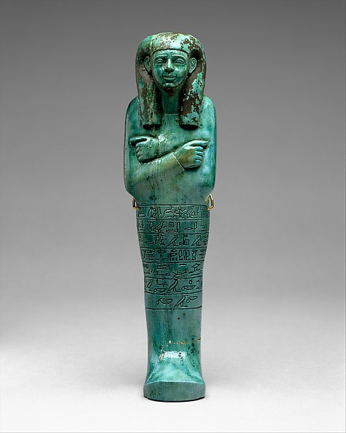

# 고대 이집트 사람들은 왜 무덤에 작은 일꾼을 두었을까

*샤브티 인형에 새긴 주문과 농기구에서 고대 이집트의 내세 관념을 읽습니다.*

History · Africa

> 출처 대조와 공개 게시 승인을 마친 이야기입니다. 실제 게시 여부는 사이트 배포 상태를 따릅니다.

*메트로폴리탄 미술관 소장 《세니우의 샤브티》, 기원전 약 1525~1425년, 19.3.206.*

[이미지 출처·제작 근거](https://www.metmuseum.org/art/collection/search/544876) · Public Domain

고대 이집트 무덤에서 나온 작은 인형 중에는 몸을 천으로 감싼 사람처럼 보이면서 손에 괭이를 든 것이 있다. 무덤에 넣은 물건이라면 죽은 사람의 생전 모습을 기리기 위한 것이라고 생각하기 쉽다. 하지만 이 인형에 적힌 글을 읽으면 다른 일이 나타난다. 죽은 사람에게 내세에서 밭을 갈거나 물길을 돌보라는 요구가 오면 인형이 그 일을 대신 맡으라는 것이다. 샤브티라고 불리는 이 작은 유물을 통해, 고대 이집트 사람들이 죽음 너머의 생활을 어떤 모습으로 그렸는지 살펴보자.

## 01. 손에 들어오는 무덤의 인형

메트로폴리탄 미술관은 샤브티를 무덤에 두어 죽은 이를 대신하게 한 작은 인형이라고 설명한다. 사람의 몸을 본뜬 물건이지만 생전에 입던 옷과 자세를 자세히 묘사한 초상과는 거리가 있는 예가 많다. 몸이 미라처럼 싸여 있고 양팔이 몸 가까이에 놓인 모습을 흔히 볼 수 있다. 같은 인물 모양이라도 무엇을 들고 있는지, 몸통에 글이 있는지에 따라 살펴볼 곳이 달라진다. 무덤 안에서 죽은 사람과 함께 있도록 만든 물건이라는 사실을 먼저 기억하면 그 형태가 조금 덜 낯설다.

## 02. 머리와 가슴만 남은 돌조각

메트에는 머리와 가슴 부분이 남은 중왕국 샤브티가 있다. 박물관이 제시하는 연대는 기원전 약 1850~1650년이다. 높이는 5.8센티미터이고, 재료는 동석 또는 사문석으로 추정한다. 손바닥에 들어오는 크기의 이 파편에서도 얼굴과 몸이 이어지는 방식은 볼 수 있다. 다만 아래쪽이 남아 있지 않으므로 원래 인형 전체의 높이나 손에 있던 물건을 이 파편 하나로 정할 수는 없다. 작은 유물을 읽을 때는 남은 부분에서 볼 수 있는 것과 다른 예를 참고해 짐작하는 부분을 나눠야 한다.

## 03. 몸통에 적힌 글은 제각기 달랐다

모든 샤브티가 같은 글을 갖고 있었던 것은 아니다. 메트는 주인의 이름과 직함이 새겨진 것, 봉헌물을 청하는 글이 있는 것, 아무 글도 없는 것을 함께 소개한다. 후대의 예 가운데는 흔히 《사자의 서》 제6장과 관련된 주문을 적었다. 죽은 이에게 일이 주어지면 인형이 나서게 하는 내용이다. 인형의 겉모양이 비슷해도 글을 남겼는지와 그 글이 무슨 일을 맡기는지는 따로 살펴볼 문제다. 어느 한 인형의 주문을 수백 년에 걸친 모든 무덤의 관습으로 읽을 수는 없다.

## 04. 밭을 가는 일과 물길을 손보는 일

메트가 소장한 세니우의 샤브티에는 내세에서 주인에게 돌아올 수 있는 일을 대신한다는 주문이 있다. 미술관은 세니우를 고위 관리이자 서기관으로 소개한다. 그렇다고 주문을 읽어 당시 세니우가 생전에 직접 밭을 갈았다고 결론 낼 수는 없다. 주문에 등장하는 것은 내세에서 맡으리라고 상상한 일이다. 신왕국 초기의 이 유물에서 박물관이 소개하는 일은 밭을 일구고 관개 수로를 손보는 것이다. 농사를 짓는 데에는 땅을 가는 일과 물을 필요한 곳에 보내는 일이 이어진다. 그처럼 구체적인 작업이 무덤의 물건에 기록됐다는 점이 흥미롭다. 죽음 뒤의 세계를 설명하는 글에서 사람들의 일상과 동떨어진 일만 나오는 것은 아니었다. 익숙한 노동이 내세의 상상에도 들어가 있었다.

## 05. 인형 손에 있는 작은 괭이

메트의 어린이용 전시 안내는 상자에 담긴 푸른 샤브티의 손에서 작은 괭이를 찾아보도록 한다. 농기구는 크기가 작아도 무슨 일을 맡았는지 짐작하게 하는 단서다. 글을 읽기 어려울 때도 손과 몸통을 살피면 인형이 어떻게 만들어졌는지 조금 더 구체적으로 볼 수 있다. 반대로 손이 잘 보이지 않는 사진만으로 농기구가 없다고 확정하기는 어렵다. 작은 인형의 표면은 한 번에 다 들어오지 않는다. 얼굴을 본 뒤 손으로 눈을 옮기고, 마지막으로 몸에 남은 글을 찾는 순서로 보면 좋다. 메트 안내가 소개하는 주문의 예에서는 밭에서 먹을 것을 기르는 일과 곡식에 물을 주는 일, 모래를 옮기는 일이 이어진다. 글의 마지막에서 누가 부름에 답하는지 살피면, 도구를 든 모습이 주문과 어떤 관계인지 이해할 수 있다.

## 06. 하나의 인형과 한 상자에 든 인형들

유물 사진에서는 인형 한 점을 따로 보는 경우가 많다. 메트 안내에 나오는 사례처럼 여러 샤브티가 한 상자에 든 모습은 인형이 무덤에 놓이는 방식을 함께 생각하게 한다. 앞서 본 중왕국의 돌 파편과 푸른 인형들이 담긴 상자는 서로 다른 자료다. 두 유물을 나란히 보면 샤브티를 부르는 이름은 같아도 재료와 보관 형태에는 차이가 있음을 알 수 있다. 박물관이 발굴 장소나 함께 나온 물건을 기록하는 이유도 여기에 있다. 그것을 알아야 지금 전시된 한 점이 원래 놓였던 자리와 맺는 관계를 살필 수 있다.

## 07. 작은 몸에 맡겨 둔 응답

샤브티를 처음 보면 사람 모습이 먼저 눈에 들어온다. 그러나 세니우의 인형은 거기에 남은 글까지 읽어야 무덤 안에서 어떤 역할을 기대받았는지 알 수 있다. 주인이 밭을 갈고 물길을 손보라는 부름을 받으면, 작은 인형이 그 부름에 응한다는 생각이었다. 이집트의 내세 관념 전체를 한 인형으로 설명할 수는 없다. 다만 밭과 물길처럼 살아 있는 사람들이 잘 알던 일이 죽음 뒤의 세계를 그리는 데에도 쓰였다는 점은 선명하다. 무덤 속의 작은 일꾼은 그 구체적인 상상을 전해 준다.

## 이야기의 바탕이 된 자료

- [메트로폴리탄 미술관 · 중왕국 샤브티 파편](https://www.metmuseum.org/art/collection/search/329774) · 확인일 2026-11-10
- [메트로폴리탄 미술관 · 세니우의 샤브티](https://www.metmuseum.org/art/collection/search/544876) · 확인일 2026-11-10
- [메트로폴리탄 미술관 · 샤브티 상자 전시 해설](https://www.metmuseum.org/audio-guide/1149) · 확인일 2026-11-10

---

[같은 소주제의 이야기](README.md) · [전체 서가](../../README.md)
