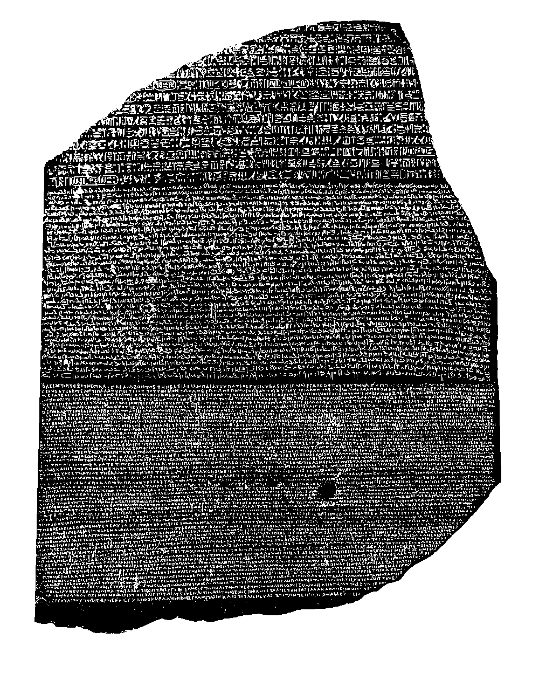

# 로제타석 — 왜 같은 말을 세 가지 문자로 새겼을까

*돌 한 조각에서 시작된 비교와 해독의 긴 시간*

History · Africa

> 자료 대조를 마친 검토용 이야기입니다. 공개 게시 승인은 아직 받지 않았습니다.

*E. A. Wallis Budge, The Rosetta Stone, 1913 · 서두 비문 도판 · Project Gutenberg*

[이미지 출처·제작 근거](https://raw.githubusercontent.com/GITenberg/The-Rosetta-Stone_48649/master/48649-h/images/af04.png) · 퍼블릭 도메인 원작 및 옛 출판물의 재현 도판 · Project Gutenberg 수록본

글자가 빽빽한 돌 한 조각이 있다. 맨 위와 가운데, 아래쪽의 글자 모양이 서로 다르다. 세 종류의 비밀을 따로 적은 것 같지만, 로제타석의 중요한 점은 서로 관계있는 내용을 다른 문자로 새겼다는 데 있다. 읽을 수 있던 부분이 읽기 어려웠던 부분을 알아보는 실마리가 되었다.

돌 자체가 고대 이집트의 모든 비밀을 한꺼번에 설명해 준 것은 아니다. 여러 사람이 사본과 다른 자료를 비교하며 오랫동안 연구했다. 해독의 이야기를 천재가 단번에 암호를 푼 장면보다, 반복되는 모양에 질문을 던지는 과정으로 읽어 보자.

## 1. 세 문자와 세 언어는 다르다

로제타석에는 고대 이집트어와 그리스어가 쓰였다. 이집트어는 상형문자와 데모틱이라는 두 문자 형태로 표현되었다. 그리스어 부분까지 합하면 언어는 둘, 문자 체계는 셋이다. 눈에 보이는 구역이 세 개라고 언어도 세 개라고 말하면 구분을 놓치게 된다.

같은 언어도 다른 글자 체계로 적을 수 있다는 점을 떠올리면 조금 쉬워진다. 다만 현대의 표기 사례와 고대 문자가 완전히 같은 관계인 것은 아니다. 여기서는 말의 체계인 언어와 그 말을 적는 문자라는 서로 다른 층을 나누어 보는 것이 중요하다.

## 2. 원래부터 해독용 교재는 아니었다

비문은 기원전 196년 프톨레마이오스 5세와 관련된 포고의 내용이다. 후대 연구자들에게 문자를 가르쳐 주려고 만든 비교표가 아니다. 당시의 권력과 종교적 관계 속에서 왕을 기리는 문서가 여러 문자로 새겨진 것이다.

하나의 내용을 여러 독자와 관습에 맞춰 표현한 결과가 훗날 전혀 다른 용도로 중요해졌다. 자료의 원래 목적과 나중에 얻은 의미는 같지 않을 수 있다. 어떤 물건이 유명해졌는지 이해하려면 만들어진 때의 쓰임과 뒤에 일어난 일을 나누어 살필 필요가 있다.

## 3. 돌은 온전하게 남아 있지 않다

상단과 가장자리는 깨져 있고 글도 모두 같은 정도로 보존되지 않았다. 특히 위쪽 상형문자 구역은 원래 전체의 일부만 남아 있다. 눈앞의 모습이 처음 제작된 비석의 완전한 형태라고 생각해서는 안 된다.

따라서 같은 내용이 있다고 해서 위에서 한 줄, 아래에서 한 줄을 그대로 맞추면 끝나는 문제는 아니었다. 빠진 부분과 문장의 차이, 각 문자가 쓰이는 방식을 고려해야 했다. 실제 연구는 간단한 세 칸짜리 대조표보다 훨씬 복잡한 작업이었다.

## 4. 발견과 이동에는 전쟁의 시간이 있다

이 돌은 1799년 이집트의 로제타, 곧 라시드 부근에서 프랑스군의 공사 중 발견되었다. 이후 군사적 충돌과 항복 협정의 과정에서 영국 측으로 넘어갔고 1802년 영국에 도착했다. 나중에는 대영박물관에 놓여 관람과 연구의 대상이 되었다.

이 이동을 지식이 자연스럽게 유럽으로 모여들었다는 이야기로만 설명할 수는 없다. 군대와 권력이 유물의 이동에 작용했다. 해독에 기여한 연구의 역사와 유물을 누가 소유하고 전시하는가의 질문은 구별하면서도 함께 생각할 수 있다.

## 5. 반복되는 이름이 발판이 되었다

읽을 수 있는 그리스어 내용을 통해 비문이 누구와 어떤 일에 관한 것인지 알 수 있었다. 다른 문자 구역에서도 왕의 이름처럼 반복될 만한 부분을 찾으면 비교할 출발점이 생긴다. 낯선 글자를 무작정 하나씩 추측하는 것과는 다른 접근이다.

타원형 테두리에 싸인 왕명인 카르투슈도 중요한 단서였다. 연구자들은 프톨레마이오스의 이름과 다른 비문 자료의 이름을 비교했다. 예를 들어 클레오파트라 이름의 비교에는 필라이의 오벨리스크 같은 다른 자료가 쓰였다. 두 이름이 모두 로제타석에 있다고 생각하지 않도록 구분해야 한다.

## 6. 상형문자는 그림 뜻만 나타낼까

새나 눈, 사람처럼 보이는 모양이 있다고 해서 모든 기호를 사물의 그림 뜻 하나로 바꿀 수는 없다. 소리를 나타내는 기능을 이해하는 것이 중요했다. 글자처럼 생긴 그림이 아니라 언어를 표현하는 복잡한 문자 체계를 읽어야 했던 것이다.

토머스 영과 장프랑수아 샹폴리옹을 비롯한 여러 연구자의 기여가 이어졌다. 같은 자료를 두고 앞선 해석을 고치고 다른 언어 지식을 연결하는 과정이 있었다. 이집트어를 연구할 때 콥트어를 아는 일도 중요했다. 돌 한 조각과 한 사람의 재능만으로 끝난 이야기가 아니다.

## 7. 사본이 있었기에 멀리서도 비교했다

로제타석을 직접 볼 수 있는 사람은 제한되어 있었다. 인쇄한 복사와 탁본, 석고 모형 같은 자료가 여러 곳으로 전해지면서 다른 연구자들도 내용을 비교할 수 있었다. 원본을 보존하는 일과 정확하게 복제해 나누는 일이 연구에서 연결되었다.

이 글의 근거로 읽은 1913년 박물관 해설서는 그런 과정을 기록하지만 시대의 설명과 한계도 있다. 예를 들어 돌의 재질에 대한 옛 분류를 여기서 그대로 반복하지는 않는다. 오래된 자료는 유용한 원전이면서 이후 연구와 구분해 읽어야 할 대상이다.

## 8. 읽을 수 있다는 일의 바깥을 보기

함께 실은 이미지는 그 해설서의 실제 비문 도판이다. AI가 상형문자를 만들어 넣은 그림이 아니다. 세 구역의 글자 모양과 깨진 가장자리를 보고 나면, 익숙하게 읽는 글에도 어떤 문자와 언어의 약속이 놓여 있는지 떠올릴 수 있다.

로제타석이 흥미로운 이유는 비밀스러운 돌이라는 이름 때문만이 아니다. 알던 부분에서 모르던 부분으로 넘어가고, 하나의 추측을 다른 자료와 대조해 고쳐 간 과정이 담겨 있기 때문이다. 읽기의 역사는 혼자 떠올린 정답보다 함께 확인한 연결 속에서 넓어지기도 한다.

## 이야기의 바탕이 된 자료

- [E. A. Wallis Budge — The Rosetta Stone, 1913년 해설서](https://raw.githubusercontent.com/GITenberg/The-Rosetta-Stone_48649/master/48649-0.txt) · 확인일 2026-10-30
  - 확인 내용: 고대 이집트어와 그리스어의 두 언어·상형문자·데모틱·그리스문자 / 기원전 196년 왕 관련 포고·1799년 발견·협정과 1802년 영국 도착 / 영·샹폴리옹 등의 해독·이름 비교·필라이의 클레오파트라·콥트어·사본과 모형
- [The Rosetta Stone — 1913년 실제 비문 도판과 본문](https://raw.githubusercontent.com/GITenberg/The-Rosetta-Stone_48649/master/48649-h/48649-h.htm) · 확인일 2026-10-30
  - 확인 내용: 서두의 af04.png 비문 도판 식별·1913년 표기

---

[같은 소주제의 이야기](README.md) · [전체 서가](../../README.md)
