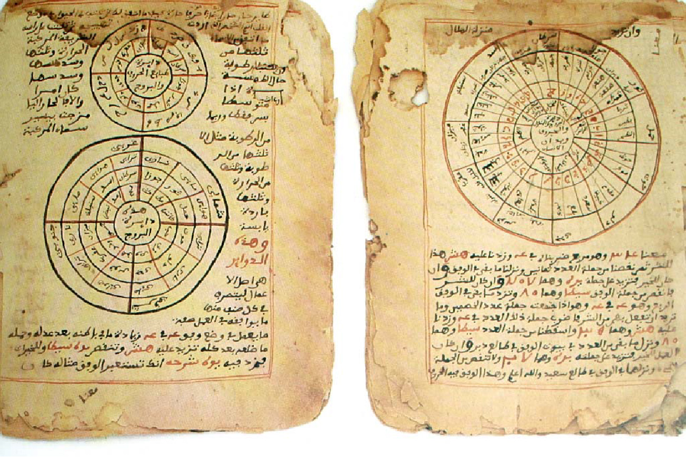

# 송가이 1591 — 더 큰 군대는 왜 제국을 지키지 못했을까

*톤디비 전투와 모로코의 원정, 무기와 내분을 함께 보는 제국의 위기*

역사 · 전쟁과 외교

> 자료 대조를 마친 검토용 이야기입니다. 공개 게시 승인은 아직 받지 않았습니다.

*EurAstro/Elias Altmimi, Timbuktu manuscripts, Wikimedia Commons · OpenStax 수록. 후대의 자료 사진이며 1591년 전투 현장을 보여 주지 않습니다.*

[이미지 출처·제작 근거](https://raw.githubusercontent.com/openstax/osbooks-world-history/main/media/OSX_WorldHist_B03_02_TimbManu.jpg) · Public Domain

1591년 서아프리카의 송가이 제국은 모로코에서 사막을 건너온 군대에 패했다. 톤디비 전투에서 수가 더 많았던 쪽은 송가이였다. 그래서 이 사건은 흔히 총을 가진 소수가 거대한 군대를 무너뜨린 이야기로 소개된다. 그러나 전투의 무기만 보면 제국이 왜 그 패배에서 회복하기 어려웠는지는 설명되지 않는다. 교역과 세금으로 성장한 국가의 내부 사정, 공격자의 재정과 목적까지 함께 보아야 한다.

## 01. 강과 사막의 길을 묶은 국가였다

송가이의 중심 가오는 니제르강의 교역과 연결되어 있었다. 사하라를 넘는 길에는 금과 소금, 직물과 여러 물품이 오갔다. 농업 생산과 교역에서 거둔 세금은 지배자와 군대, 행정의 중요한 기반이었다.

제국의 부는 곳곳에 흩어진 사람과 길을 묶는 능력에서 나왔다. 넓은 영토를 지닌다는 것은 많은 자원을 얻을 기회인 동시에 멀리 떨어진 지역을 계속 관리해야 하는 부담이었다. 지도에서 같은 색으로 칠한 땅이 하나의 명령에 항상 똑같이 움직이지는 않았다.

## 02. 군사적 확대 뒤에는 행정의 재편이 있었다

수니 알리의 정복으로 세력을 넓힌 송가이는 아스키아 무함마드 시대에 더 커졌다. 아스키아는 지방의 지배를 왕실과 가까운 관리에게 맡기며 중앙의 통제를 강화했다. 세금을 거두고 군대를 움직이는 권한을 누구에게 줄지가 중요했다.

왕이 임명한 관리가 많아지면 전통적인 지방 지배자의 독자적 행동을 줄일 수 있다. 반면 권력의 중심에서 문제가 생겼을 때 관리가 누구를 따라야 할지 흔들릴 수 있다. 중앙집권은 강한 통치를 가능하게 하는 방식이면서 중심의 불안을 넓게 전달하는 구조이기도 했다.

## 03. 부는 시장과 학문을 함께 키웠다

교역의 수입과 왕실의 지원은 팀북투와 젠네 같은 도시의 학문 활동에도 도움이 되었다. 책과 학자, 학생이 오갔고 문서를 베끼는 작업도 이루어졌다. 송가이는 단지 금을 많이 가진 국가가 아니라 지식을 모으고 유지한 사회였다.

그 풍요가 모든 주민에게 고르게 돌아갔다는 뜻은 아니다. 시장에는 노예의 거래도 있었고 세금의 부담도 존재했다. 유력 상인과 학자의 번영을 제국 전체 주민의 생활과 똑같이 보아서는 당시 사회의 위계가 가려진다.

아스키아 시기에는 교역 거점에 검사관을 두고 도량형을 정비하려는 조치도 있었다. 거래의 기준을 다루는 일은 군사적 정복과 다른 통치의 기술이었다. 물건이 오가는 길을 장악하는 힘과 그 길에서 안정적으로 거래하게 만드는 규칙이 함께 작용했다.

## 04. 왕실의 계승 다툼은 통치의 힘을 소모했다

1528년 아스키아 무함마드가 아들들에 의해 권력에서 밀려난 뒤, 왕실 내부의 다툼이 이어졌다. 경쟁자와 친족이 싸우는 동안 누가 정당한 지배자인지, 어느 군대에 힘을 보탤지가 흔들렸다. 통치권은 이름만 이어받는 자리가 아니었다.

이후 안정을 되찾으려는 시도가 있었으므로 수십 년을 모두 같은 혼란으로 묶을 수는 없다. 그러나 긴 계승 갈등은 제국의 행정과 군사력을 소모시켰다. 바깥의 공격이 왔을 때 이미 안쪽에서 치른 비용이 있었던 것이다.

## 05. 모로코도 새 자원이 필요했다

북쪽의 모로코를 다스린 사디 왕조는 군사적 승리 뒤에도 큰 재정 부담을 안고 있었다. 술탄 아흐마드 알만수르는 사하라 남쪽의 금과 교역로에서 새로운 수입을 찾으려 했다. 송가이의 부는 그것을 지켜야 할 자원이자 외부 세력을 부르는 유인이었다.

사막을 건너 군대를 보내는 일에는 운송과 물, 보급이 필요했다. 공격자는 무기가 있다는 이유만으로 쉽게 남쪽에 도착한 것은 아니다. 제국 사이의 거리는 군사적 장애였지만, 이익에 대한 기대가 크면 그 비용을 감수할 동기가 생겼다.

## 06. 톤디비의 패배는 무기와 조직의 문제였다

1591년 톤디비에서 송가이군은 사디 왕조의 군대에 패했다. 모로코 측은 총포를 활용했다. 송가이가 병력의 수에서 우세했어도 그 숫자가 무기의 차이와 전투의 조건을 자동으로 압도하지는 못했다.

그렇다고 총이 있는 쪽은 언제 어디서나 이긴다는 법칙을 이 전투에서 만들 수는 없다. 보급과 지휘, 훈련과 지형도 전쟁의 결과에 작용한다. 특정한 패배를 한 사회 전체의 능력이나 타고난 우열의 증거로 설명하는 것도 잘못이다.

## 07. 전투 뒤의 파괴가 회복을 더 어렵게 했다

패배 뒤 주요 도시와 교역 거점이 공격받고 물자와 농업 기반이 손상되었다. 군대가 진 전투와 국가가 다시 힘을 모을 수 없는 상황은 같은 사건이 아니다. 행정과 수입의 기반까지 흔들리면 새 병력을 마련하고 지역을 연결하기 어려워진다.

이후 송가이의 넓은 지배권은 여러 세력과 지역으로 갈라졌다. 하지만 그곳에 살던 사람들과 책, 학문과 교역의 기억까지 사라진 것은 아니다. 톤디비의 역사는 총의 위력만이 아니라 한 국가를 움직이는 관계와 기반이 어떻게 약해지고 끊어졌는지를 함께 보여 준다.

교역 도시를 차지한 원정군도 넓은 지역의 질서를 저절로 이어받지는 못했다. 정복자가 얻으려 한 수입은 도시와 농촌의 생산, 운송과 시장이 계속 움직여야 생겼다. 전쟁의 파괴는 패자만이 아니라 그 자원을 차지하려 한 쪽에도 통치의 과제를 남겼다.

## 이야기의 바탕이 된 자료

- [OpenStax, World History Volume 2 — The Songhai Empire](https://raw.githubusercontent.com/openstax/osbooks-world-history/main/modules/m00041/index.cnxml) · 확인일 2026-11-11
  - 확인 내용: 가오·세입·수니 알리·아스키아의 지방 관리/교역 검사·도량형·팀북투 학문/1528이후 계승 갈등·사디 왕조 재정/1591톤디비 패배·도시와 생산 기반 파괴/지역 분열. 정확한 병력 수와 영국이 모든 무기를 공급했다는 단정, 문화적 우열론은 제외.

---

[같은 소주제의 이야기](README.md) · [전체 서가](../../README.md)
