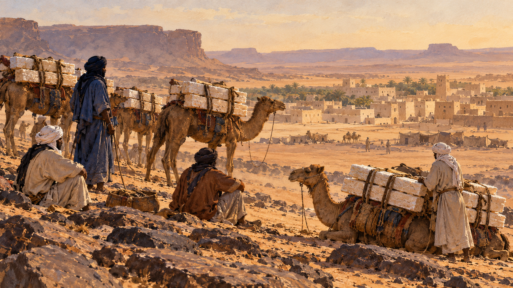

# 타가자 — 사막에서 소금은 왜 먼 길을 떠났을까

*이븐 바투타의 기록으로 만나는 소금 광산과 대상 무역*

History · Africa

> 출처 대조와 공개 게시 승인을 마친 이야기입니다. 실제 게시 여부는 사이트 배포 상태를 따릅니다.

*AI 관련 장면 삽화 · 사하라 교역의 분위기이며 실제 타가자의 건물·식생·채굴 현장이나 이븐 바투타의 초상을 복원하지 않았습니다.*

집과 모스크가 소금으로 지어져 있다는 마을. 동화 속의 과자 집처럼 들리지만 14세기 여행자 이븐 바투타가 사하라의 타가자를 설명한 대목이다. 나무가 드문 사막에서 소금은 캐서 옮기는 상품인 동시에 곁에 많은 재료였다.

그가 적은 풍경을 따라가면 금으로 가득한 왕국보다 먼저 길쭉한 소금 덩어리와 낙타의 등이 보인다. 먼 시장으로 갈 이 무거운 짐은 누가 필요로 했고, 누가 땅에서 꺼내었을까.

## 1. 여행자의 눈에 들어온 마을

이븐 바투타는 타가자에서 땅을 파면 큰 소금 판들이 겹겹이 나온다고 적었다. 집과 모스크의 벽, 낙타 가죽으로 덮은 지붕도 묘사했다. 그가 본 마을은 사막 한가운데의 채굴과 생활이 맞물린 장소였다.

이것은 오늘날의 현장 조사 보고서와는 성격이 다른 여행 기록이다. 낯선 곳의 인상과 여행자의 관심이 들어 있다. 그렇더라도 소금이 단순한 식탁 위 가루가 아니라 큰 덩어리로 채굴되었다는 사실을 구체적으로 떠올리게 한다.

## 2. 금이 많아도 소금은 필요했다

서아프리카의 금은 북아프리카와 지중해의 시장으로 이어졌다. 반대 방향으로 이동한 중요한 물품 가운데 하나가 사하라의 소금이었다. 생산되는 곳이 다르면 서로 필요한 것을 얻기 위한 길이 생긴다.

금과 소금은 모두 빛나는 사치품이라서 만난 것이 아니다. 어떤 물건의 가치는 그것이 필요한 곳까지 닿을 수 있느냐에 따라 달라진다. 금광 가까이 사는 사람도 다른 지역의 생활 물자를 필요로 했다.

## 3. 낙타 한 마리가 짊어진 거리

여행기에는 낙타가 커다란 소금 판을 싣는 모습이 나온다. 판을 캐는 데서 일이 끝나지 않았다. 무거운 짐을 묶고, 사막을 건너며, 사람과 짐승이 버틸 조건을 마련해야 했다.

길 위의 물과 쉼, 함께 이동할 사람에 대한 정보는 운송의 일부였다. 지도의 선 하나가 곧바로 편리한 길을 뜻하지는 않는다. 목적지에 도착한 소금에는 땅에서 캐낸 가치뿐 아니라 이동의 수고도 담겼다.

## 4. 교역은 두 사람이 한 번 만나는 일이 아니었다

사하라 무역은 금을 든 사람과 소금을 든 사람이 사막 한가운데서 한 번 바꾸는 장면만으로 설명하기 어렵다. 여러 지역의 상인과 중개자, 거점이 연결되어 있었다. 거래는 서로 다른 필요를 이어 주는 과정이었다.

그 경로 가까이에 자리 잡은 정치 세력은 통행과 시장을 바탕으로 힘을 얻었다. 가나와 말리의 번영에도 무역이 중요했다. 광산을 가진 것과 광산에서 나온 물품이 지나는 길을 관리하는 것은 서로 다른 권한이었다.

## 5. 금과 소금이 언제나 같은 무게였을까

사하라 무역을 설명할 때 금과 소금이 무게대로 맞바뀌었다는 이야기가 자주 따라온다. 그러나 긴 시기와 넓은 지역의 모든 거래에 똑같은 비율을 붙이면 장소와 운송 조건의 차이가 사라진다.

같은 소금도 생산지와 도착지에서 구하기 쉬운 정도가 다르다. 이 글에서 중요한 것은 놀라운 교환 비율을 외우는 일이 아니다. 평범해 보이는 물건이 멀리 이동할 이유와 그 과정에서 생긴 가치다.

## 6. 광산의 노동은 누구의 몫이었나

이븐 바투타는 타가자의 소금을 노예화된 사람들이 캤다고 기록했다. 여행기의 이 대목을 빼고 낙타 행렬만 그리면 교역의 풍경은 훨씬 낭만적으로 보인다. 그러나 물건의 이동에는 자유롭지 못한 노동도 있었다.

서아프리카의 무역망에서는 금과 소금뿐 아니라 붙잡힌 사람들까지 거래되었다. 번영한 왕국과 분주한 시장을 이야기할 때 누가 수익을 얻었고 누가 강제로 일했는지 따로 살필 필요가 있다. 무역의 규모가 곧 모두의 풍요를 뜻하지는 않았다.

## 7. 여행자가 남긴 빛과 그늘

그의 말리 기록에는 치안과 통치에 대한 칭찬도 있다. 안전한 이동은 여행자의 눈에 중요한 장점이었다. 하지만 길을 지나는 사람이 느낀 안전과 광산 노동자의 자유는 같은 기준이 아니었다.

한 기록 안에 찬탄과 가혹한 현실이 함께 담길 수 있다. 역사 자료를 읽는 재미도 여기에 있다. 여행자의 말을 전부 의심하거나 그대로 풍경으로 받아들이기보다, 그가 어떤 위치에서 무엇을 보고 있었는지 살피는 것이다.

## 8. 서로 다른 곳의 필요를 잇다

같은 소금이 어떤 곳에서는 흔하고 다른 곳에서는 멀리서 구해야 하는 물건이었다. 지리적 차이가 거래의 이유가 된다. 사막에 많은 자원이 숲과 들의 생산물과 만날 때 각 지역의 생활도 바깥의 길에 기대게 된다.

이 연결을 단순히 북쪽은 소금, 남쪽은 금이라는 그림으로만 외우면 여러 생산자와 중개자의 역할이 가려진다. 물품은 여러 거점을 거쳤고 각 거점은 주변의 다른 거래와도 이어졌다. 사하라의 길은 두 끝점만 있는 통로가 아니었다.

그런 까닭에 큰 왕국의 이름만 바뀌는 연표보다 물건 하나를 따라가는 방식도 도움이 된다. 타가자의 소금은 통치자가 아닌 채굴자와 짐승, 물을 구하는 사람에게까지 시선을 데려간다. 큰 역사를 이루는 작은 일들이 드러난다.

## 9. 한 줌이 되기 전의 소금

타가자의 이야기 끝에 남는 것은 거대한 금덩어리만이 아니다. 큰 판으로 캐어 낙타에 싣고 먼 시장으로 보냈던 소금이다. 오늘의 작은 양념통에서 떠올리기 어려운 거리와 노동이 그 물건 뒤에 있었다.

사막은 사람의 왕래가 없는 빈 공간이 아니었다. 서로 다른 환경을 이어 주는 길이었고, 그 길에는 기술과 지식, 권력과 불평등이 함께 움직였다. 소금으로 지은 집은 그 넓은 연결을 들여다보는 작은 입구다.

## 이야기의 바탕이 된 자료

- [OpenStax World History — Medieval Sub-Saharan Africa, 이븐 바투타의 타가자 기록 인용](https://raw.githubusercontent.com/openstax/osbooks-world-history/main/modules/m00150/index.cnxml) · 확인일 2026-10-31
  - 확인 내용: 사하라의 금·소금 교역망과 가나·말리의 중개 / 여행기에 묘사된 소금 판·건물·낙타·노예화된 채굴 노동자 / 여행자의 안전 평가와 노동자의 자유를 구별

---

[같은 소주제의 이야기](README.md) · [전체 서가](../../README.md)
