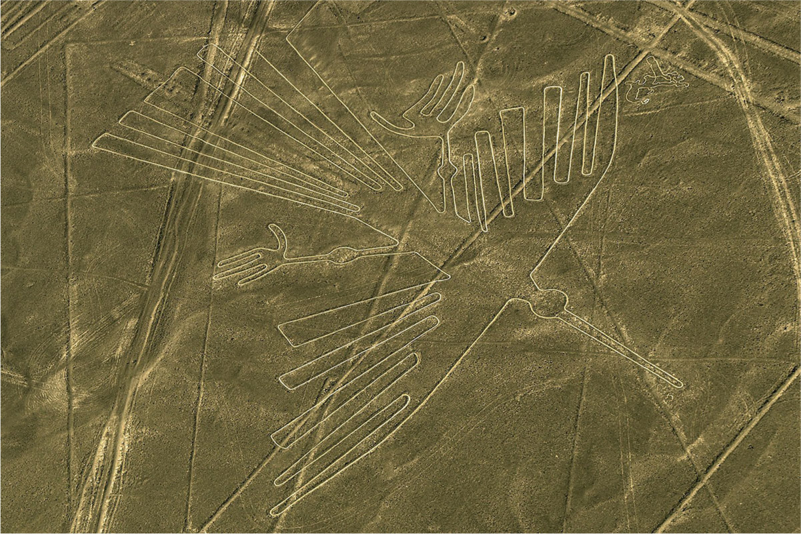

# 잉카 이전의 안데스 — 물은 지역마다 다른 사회를 만들었을까

*모체·나스카·티와나쿠의 농업과 지형, 유물로 읽는 권력*

도시와 사회 · 도시의 탄생과 성장

> 자료 대조를 마친 검토용 이야기입니다. 공개 게시 승인은 아직 받지 않았습니다.

*Roger Canals, The Condor, Wikimedia Commons · OpenStax 수록. 현대 촬영 사진이며 모체의 관개 시설을 보여 주는 사진은 아닙니다.*

[이미지 출처·제작 근거](https://raw.githubusercontent.com/openstax/osbooks-world-history/main/media/OSX_WorldHist_A08_02_Nazcaline.jpg) · CC0 1.0 · https://creativecommons.org/publicdomain/zero/1.0/

안데스의 역사를 잉카에서 시작하면 그보다 앞서 여러 지역에 형성된 도시와 농업 사회가 잘 보이지 않는다. 북부 페루의 모체, 남부 해안의 나스카, 티티카카호 주변의 티와나쿠는 같은 환경에서 살지 않았다. 물이 어디에서 오고 땅을 어떻게 쓸 수 있는지가 달랐다. 사람들은 그 조건에 대응하면서 서로 다른 정착과 권력, 의례의 공간을 만들었다.

## 01. 하나의 문명이 사라진 뒤에도 역사는 이어졌다

안데스에서는 차빈의 문화적 영향력이 약해진 뒤 여러 지역 문화가 성장했다. 이전 사회가 남긴 기술과 상징이 모두 사라지고 완전히 새 세계가 시작된 것은 아니다. 공통의 유산과 지역적 차이가 함께 이어졌다.

그래서 모체와 나스카, 티와나쿠를 잉카로 가기 전의 미완성 단계로만 부르기 어렵다. 각각의 사회는 자기 시대의 생산과 통치 문제를 다루었다. 나중에 더 큰 제국이 생겼다는 사실이 그 앞선 역사의 목적을 정하지는 않는다.

## 02. 모체는 관개 기술로 농업을 지탱했다

북부 페루의 모체 사람들은 관개를 이용해 호박과 콩, 옥수수와 고추 등을 재배했다. 물을 사용할 수 있게 만드는 지식은 먹거리를 생산하는 기반이었다. 농업의 성과에는 땅의 상태뿐 아니라 기술과 노동이 들어갔다.

주요 정착지에는 큰 피라미드형 건축물이 세워졌다. 많은 사람이 모여 사는 사회를 유지하려면 먹거리와 작업이 이어져야 했다. 거대한 건물은 정치와 종교의 상징이면서 그 아래의 생산 기반을 생각하게 하는 흔적이다.

관개가 있었다는 사실만으로 수로를 누가 소유하고 물을 어떤 순서로 나누었는지까지 모두 알 수는 없다. 기술의 존재와 운영 규칙의 구체적 모습은 다른 증거를 요구한다. 농업 생산과 권력의 연결을 살피면서도 남은 자료보다 자세한 제도를 만들어 내서는 안 된다.

## 03. 생산을 관리하는 사회에는 위계가 있었다

모체에는 왕과 귀족, 행정의 역할을 맡은 사람과 여러 노동자가 있었다. 농업 마을은 상층의 권력과 연결되었다. 관개 기술의 발달을 모든 주민이 똑같이 풍요로워진 이야기로 바꿀 수는 없다.

유물과 매장 방식에는 지위의 차이가 남아 있다. 의례와 전쟁을 표현한 미술도 권력의 모습을 보여 준다. 다만 유물에 그려진 장면을 생활의 모든 순간을 그대로 기록한 사진처럼 받아들여서는 안 된다.

## 04. 나스카에서는 메마른 해안과 산의 물이 만났다

남부 해안의 나스카는 강수량이 매우 적은 환경에 있었다. 그러나 산에서 내려오는 강물은 관개에 이용할 수 있는 자원이 되었다. 비가 적다는 사실만으로 사람이 농사를 지을 수 없었다고 결론 내릴 수는 없다.

나스카 사람들은 주로 작은 마을에서 살면서 카와치 같은 의례 중심지에 모였다. 큰 도시 하나가 모든 활동의 중심이 되는 방식과는 달랐다. 같은 농업 사회라도 일상의 정착과 사람들이 모이는 장소의 관계는 다양했다.

작은 마을에 살던 사람들이 의례 중심지에서 만났다는 점은 정착의 크기만으로 사회의 복잡성을 판단하기 어렵게 한다. 일상의 집과 공적으로 모이는 장소가 분리될 수 있었다. 중앙의 건물이 크지 않다는 이유로 사람들 사이의 연결도 약했다고 단정할 수는 없다.

## 05. 거대한 그림은 의례의 경관을 남겼다

나스카의 지상 그림은 돌을 옮겨 지표의 색 차이를 드러내는 방식으로 만들어졌다. 동물과 여러 형상이 넓은 땅에 남았다. 큰 형태가 보인다고 해서 하늘에서 온 존재가 만들었다는 설명이 필요한 것은 아니다.

그렇다고 그 의미를 모두 알아낸 것처럼 말할 수도 없다. 남아 있는 형상과 제작 방식, 주변의 의례 공간을 함께 살펴야 한다. 눈에 띄는 유적은 확실히 아는 것과 아직 해석이 필요한 것을 구별하게 하는 자료다.

## 06. 티와나쿠는 높은 지대의 다른 조건에 있었다

티와나쿠는 해안이 아니라 티티카카호 가까운 고지대에서 발전했다. 그 중심지에는 큰 석조 건축물과 조각이 세워졌다. 오늘날의 페루와 볼리비아에 걸친 지역을 함께 보아야 그 환경을 이해할 수 있다.

벽면의 여러 얼굴 조각은 조상이나 정복한 집단의 신 등을 나타낸다는 해석이 있다. 하나의 해석만을 확정할 수는 없다. 호수의 수위 변화가 농지에 영향을 주었을 가능성처럼 환경과 사회의 변화도 증거를 통해 조심스럽게 연결해야 한다.

높은 산지와 메마른 해안은 하나의 국가 지도 안에서도 크게 다른 조건을 가진다. 이런 차이를 지우고 안데스 사람은 모두 같은 방식으로 농사했다고 말하면 지역의 기술과 선택이 사라진다. 환경을 구분하는 일은 문화의 다양성을 이해하는 출발점이기도 하다.

## 07. 같은 물의 문제에도 하나의 답만 있지는 않았다

이 사회들이 쇠퇴한 뒤에도 안데스의 농업과 기술, 교역은 다른 정치 집단을 통해 이어졌다. 모든 변화의 원인을 기후 한 가지로 정리하면 전쟁과 권력, 지역의 차이가 사라진다. 환경은 중요하지만 사람들이 대응하는 방식까지 정해 주지는 않는다.

모체의 관개와 나스카의 강, 티와나쿠의 호수는 서로 다른 생활의 조건을 보여 준다. 잉카 이전의 안데스를 읽는 일은 유명한 제국의 앞부분을 채우는 일이 아니다. 물과 땅을 다루며 여러 사회가 만든 선택의 역사를 되찾는 일이다.

## 이야기의 바탕이 된 자료

- [OpenStax, World History Volume 1 — Early Cultures and Civilizations in the Americas](https://raw.githubusercontent.com/openstax/osbooks-world-history/main/modules/m00115/index.cnxml) · 확인일 2026-11-13
  - 확인 내용: 차빈 이후 지역문화/모체 관개·작물·사회위계/나스카의 산에서 내려오는강·마을·카와치·지상그림/티와나쿠 티티카카호·건축·벽면해석·수위가설/후속문화. 지역간 차이와 해석 한계. 모체·나스카 쇠퇴시기를500~600년으로 일괄확정한 원문은 채택하지 않음.

---

[같은 소주제의 이야기](README.md) · [전체 서가](../../README.md)
