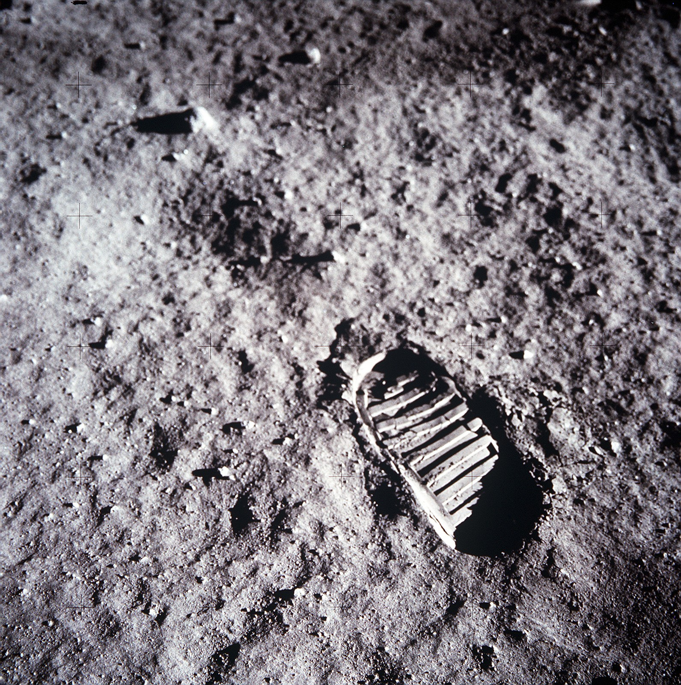

# 달에서는 신발 바닥도 기록이 되었다

*큰 탐사 이야기를 작은 발자국으로 보기*

History · America

> 출처 대조와 공개 게시 승인을 마친 이야기입니다. 실제 게시 여부는 사이트 배포 상태를 따릅니다.

*NASA / NASA 3D Resources · 실제 공개 사진. 사진 전체를 유지하고 웹 표시 크기로 줄였습니다.*

[이미지 출처·제작 근거](https://github.com/nasa/NASA-3D-Resources) · NASA 공식 저장소에서 free and without copyright로 안내한 공개 자료

달 탐사를 떠올리면 우주선과 우주복, 멀리 보이는 지구가 먼저 생각난다. 그런데 NASA의 공개 자료에는 사람의 얼굴도 우주선도 없이 발자국을 가까이 찍은 사진이 있다. 화면을 채우는 것은 바닥의 흙과 신발 밑창의 무늬다.

NASA는 이 사진을 아폴로 우주비행사의 달 발자국 자료로 소개한다. 커다란 탐사 이야기를 잠시 내려놓고 보면, 사람이 어떤 곳에 다녀갔는지를 알려 주는 아주 익숙한 흔적이 나온다.

## 1. 발보다 먼저 보이는 줄무늬

사진에는 밑창의 여러 줄이 밝고 어두운 부분으로 남아 있다. 발자국의 모양을 알아보는 데 신발 전체나 우주복을 볼 필요는 없다. 바닥에 옮겨진 무늬만으로도 사람이 디뎠던 자리를 읽게 된다.

우리는 일상에서도 비슷한 일을 한다. 젖은 바닥이나 흙길에 남은 자국을 보고 누군가 지나갔다고 짐작한다. 낯선 달 표면에서 갑자기 그런 가까운 경험을 만나는 것이다.

## 2. 이름을 아는 것과 보는 것

이 자료의 이름에는 아폴로와 달, 우주비행사의 발자국이라는 정보가 들어 있다. 덕분에 단순한 흙바닥 사진과는 다른 맥락에서 이미지를 읽을 수 있다.

하지만 사진 한 장에 붙은 익숙한 이름만으로 모든 사정을 알 수 있는 것은 아니다. 여기서는 이 자국이 최초의 발자국이라고 단정하거나 어느 우주비행사의 어느 발인지 정하지 않는다. 확인한 자료가 알려 주는 범위 안에서 사진을 보는 편이 정확하다.

## 3. 밑창의 모양이 표면으로 옮겨진다

신발이 표면을 누르면 닿은 부분과 주변의 차이가 흔적으로 남을 수 있다. 사진에서는 그 관계가 줄무늬의 밝고 어두운 부분으로 보인다. 밑창 자체는 화면에 없지만 무엇인가가 닿았던 형상을 읽게 된다. 물건이 자리를 떠난 뒤에도 그 모양의 일부가 다른 재료에 남는 것이다.

이 설명만으로 사진 속 자국의 모든 생성 조건을 새로 측정할 수 있는 것은 아니다. 압력이나 토양의 상태, 정확한 깊이를 알려면 다른 자료가 필요하다. 여기서는 실제 사진에서 볼 수 있는 무늬와 명암을 따라간다. 익숙한 신발의 형태가 낯선 장소의 표면과 만난다는 점만으로도 충분히 눈길을 끈다.

## 4. 빛의 방향도 흔적을 보이게 한다

같은 물건도 빛을 어디에서 받는지에 따라 표면의 높낮이가 달리 느껴질 수 있다. 발자국 사진의 어두운 선과 밝은 면을 번갈아 보면 평면의 색무늬와 눌린 자국의 인상이 달라진다. 사진은 표면을 보여 주지만 그 보이는 방식에는 촬영의 조건도 들어 있다. 명암은 정보를 전하는 한 통로다.

그렇다고 그림자만으로 실제 수치를 계산해 확정할 필요는 없다. 이 글은 사진 감상의 관찰을 음영으로 정밀 측량한 결과처럼 제시하지 않는다. 무엇이 보이는지 정확히 설명하는 일만으로도 충분히 흥미롭다. 무늬를 알아본 뒤 빛을 살피면 한 장의 사진 안에서 새로운 정보가 생긴다.

## 5. 자료의 이름을 사진과 함께 보관하기

발자국이라는 형상만으로 이곳이 달인지 다른 곳인지 사진 밖의 맥락을 모두 알 수는 없다. NASA가 붙인 자료명과 제공 정보를 함께 읽어야 아폴로 활동과 연결된다. 사진과 캡션은 서로 다른 역할을 맡으며 함께 기록을 이룬다. 잘 알려진 이미지를 다시 만날 때에도 그 설명을 확인할 이유가 있다.

특히 최초라는 단어는 조심해서 붙여야 한다. 유명한 사진이라고 인류의 첫 발자국을 직접 찍은 장면이라고 정할 수는 없다. 어느 우주비행사의 어느 발인지도 이 원고가 확인한 자료의 범위 밖에 있다. 이미지를 덜 극적으로 소개하더라도 기록의 가치는 줄지 않는다. 확인된 범위를 분명히 해야 다른 자료와도 정확히 연결할 수 있다.

## 6. 거대한 탐사에서 작은 행동을 보기

우주 탐사는 로켓과 기계의 큰 모습으로 기억되기 쉽다. 발자국은 그 활동에 사람의 몸이 참여했다는 사실을 일상적인 동작으로 전한다. 한 번 디디는 일은 너무 익숙하지만 장소가 달라지면 기록할 만한 행동이 된다. 큰 기술의 역사를 손과 발의 크기에서 만나는 입구다.

이것이 사진 속 모든 감정을 알려 준다는 뜻은 아니다. 당시 사람이 어떤 생각을 했는지 대사를 꾸미기보다 남은 흔적을 차분하게 볼 수 있다. 화면을 가까이 보며 줄의 간격과 표면의 다른 자국을 살펴보자. 멀리 있는 장소의 이야기가 발바닥 무늬라는 가까운 형상으로 우리에게 전달되었다는 점이 오래 남는다.

## 7. 커다란 업적 곁의 작은 물건

이 이미지는 NASA가 공개한 실제 사진이다. 삽화로 밑창을 다시 그리지 않고 원래 사진을 함께 실은 이유도 여기에 있다. 어떤 무늬가 어떻게 남았는지는 실제 자료를 보는 편이 훨씬 빠르다.

우주 탐사는 거대한 기계만의 이야기가 아니다. 사람의 몸을 감싼 옷과 발을 디딘 신발도 함께 움직였다. 달을 보고 고개를 들던 시선을 이번에는 아래로 내려 보자. 작은 밑창의 흔적에서도 탐사의 다른 얼굴을 만날 수 있다.

## 이야기의 바탕이 된 자료

- [NASA — Moon: Apollo Astronaut Bootprint](https://raw.githubusercontent.com/nasa/NASA-3D-Resources/master/Images%20and%20Textures/Moon%20-%20Apollo%20Astronaut%20Bootprint/Moon%20-%20Apollo%20Astronaut%20Bootprint.jpg) · 확인일 2026-10-28
  - 확인 내용: 아폴로 우주비행사의 달 발자국이라는 NASA 자료명 / 실제 사진에 남은 밑창의 줄무늬와 표면의 명암
- [NASA 3D Resources — 공개 자료 이용 안내](https://raw.githubusercontent.com/nasa/NASA-3D-Resources/master/README.md) · 확인일 2026-10-28
  - 확인 내용: NASA가 공개하는 이미지·텍스처 자료의 성격과 이용 안내

---

[같은 소주제의 이야기](README.md) · [전체 서가](../../README.md)
