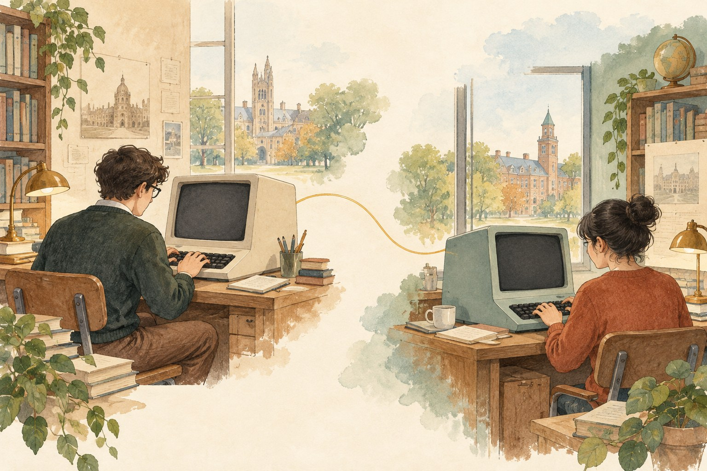

# 인터넷에도 첫 번째 정거장이 있었다

*1969년, 연구실의 컴퓨터가 연결되던 때*

History · America

> 출처 대조와 공개 게시 승인을 마친 이야기입니다. 실제 게시 여부는 사이트 배포 상태를 따릅니다.

*KnowledgeWalk 제작 · AI 설명용 삽화. 실제 인물·유물·제품·장소를 정확하게 재현한 자료가 아닙니다.*

인터넷은 눈에 보이는 건물 하나가 아니어서 출발점을 상상하기 어렵다. 휴대전화의 화면을 열면 이미 그 안에 있고, 다른 나라의 소식도 금세 도착한다.

그런데 오늘의 인터넷으로 이어진 초기 네트워크에는 실제 컴퓨터가 놓인 연구실들이 있었다. 그중 첫 번째 지점은 미국 UCLA의 레너드 클라인록 연구실이었다.

인터넷 명예의 전당은 그 연구실의 컴퓨터가 1969년 9월 ARPANET의 첫 노드가 되었다고 소개한다. 노드는 여기서 네트워크에 연결되는 지점이라고 생각하면 된다. 보이지 않는 길의 첫 정거장에 주소지가 있었던 셈이다.

## 1. 먼저 컴퓨터를 이어야 했다

ARPANET은 오늘의 인터넷으로 이어진 초기 네트워크다. 지금의 웹사이트와 메신저가 모두 갖추어진 상태로 시작한 것은 아니었다. 우선 서로 떨어진 컴퓨터가 정보를 주고받을 수 있어야 했다.

클라인록의 연구실에서는 첫 연결 지점을 마련한 다음 달, 네트워크를 통한 첫 전송이 이루어졌다. 다른 끝에는 캘리포니아 SRI의 연구팀이 있었다.

인터넷 명예의 전당은 더글러스 엥겔바트가 이끌던 연구소가 두 번째 호스트가 되어 UCLA와 초기 전송을 주고받았다고 설명한다. 서로 다른 장소의 연구가 하나의 연결 안에서 만난 것이다.

오늘의 감각으로 보면 컴퓨터 두 곳이 대화하는 일은 작은 성과처럼 느껴질 수 있다. 하지만 연결이 당연하지 않았던 시점에는, 그 대화가 이루어지도록 조건을 만드는 일부터 필요했다.

## 2. 한 사람의 발명품으로 줄이기 어려운 이유

인터넷의 시작을 한 사람의 사진으로 설명하려 하면 금세 다른 이름들이 등장한다. 연결의 원리를 연구한 사람, 컴퓨터를 준비한 사람, 소프트웨어와 통신 규칙을 만든 사람들이 있었다.

클라인록은 패킷 네트워크의 수학적 연구로도 소개된다. 정보를 일정한 단위로 나누어 보내는 방식이 네트워크를 이해하는 중요한 바탕이 되었다는 것이다. 여기서 어려운 수식을 따라갈 필요는 없다. 컴퓨터를 연결하는 데에도 연구가 필요했다는 정도면 충분하다.

첫 번째 지점에 관심을 두는 것은 그 한 곳이 모든 것을 만들었다는 뜻이 아니다. 연결은 상대가 있어야 성립한다. 첫 정거장이라는 표현도 두 번째 정거장이 생겼을 때 비로소 실감이 난다.

## 3. 연결의 첫 지점은 아직 혼자 있는 지점이다

한 장소에 장비를 마련하는 일과 다른 장소와 정보를 주고받는 일은 이어지지만 다르다. 연구실의 첫 노드라는 기록은 그곳만으로 네트워크가 완성되었다는 뜻이 아니다. 상대편의 장비와 소프트웨어, 서로 이해할 통신 방식도 필요했다. 첫 정거장이라는 비유는 함께 이어지는 다른 지점이 있을 때 구체적인 의미를 얻는다.

그래서 UCLA와 SRI의 이름을 함께 기억하는 편이 좋다. 인터넷의 역사를 한 연구자의 업적으로만 줄이면 실제 연결을 가능하게 한 여러 역할이 배경으로 물러난다. 누가 처음이냐는 질문 옆에 어느 곳과 무엇을 주고받았느냐를 놓으면 사건의 성격이 더 분명해진다. 네트워크는 관계를 만드는 기술이기도 하다.

## 4. 정보를 작은 단위로 다룬다는 발상

패킷이라는 말은 정보를 전송할 때 일정한 단위로 나누어 다루는 개념과 연결된다. 긴 내용을 하나의 덩어리로만 생각하지 않고 전달할 단위와 규칙을 준비하는 것이다. 우편의 봉투에 빗대면 이해를 도울 수 있지만 실제 컴퓨터의 통신이 종이 운반과 똑같은 원리로 이루어진다는 뜻은 아니다.

어려운 수학을 몰라도 연구가 필요한 이유는 생각할 수 있다. 여러 장치가 정보를 보내려 할 때 무엇을 어떤 순서와 규칙으로 다룰지 정해야 한다. 선을 연결하는 일만으로 끝나지 않는 문제다. 클라인록의 패킷 네트워크 연구가 함께 소개되는 것은 장비 뒤에 이런 이론과 설계의 질문이 있었음을 보여 준다.

## 5. 웹이 없던 때의 네트워크를 상상하기

오늘은 인터넷을 열었다고 말하며 브라우저부터 떠올리기 쉽다. 그러나 초기 연결의 시기에는 현재의 웹 환경이 갖추어져 있지 않았다. 서로 다른 컴퓨터가 자료를 주고받는 기반의 역사와 그 위에서 문서를 읽는 웹의 역사는 구분할 수 있다. 한 기술이 나온 날 모든 서비스가 함께 생긴 것은 아니다.

옛 연구실을 볼 때 오늘의 화면을 그대로 덧씌우지 않으면 작은 성취가 다르게 느껴진다. 익숙한 그림이나 검색창이 없더라도 정보를 보내고 받는 일이 가능해지면 다음의 실험을 할 수 있었다. 기술의 시작을 읽는 재미는 지금보다 부족한 것을 찾는 데보다, 당시 무엇을 새로 할 수 있었는지 알아보는 데 있다.

## 6. 처음의 규모로 잠깐 돌아가기

이 초기 실험과 지금 우리가 사용하는 인터넷 사이에는 오랜 개발 과정이 있다. 그 사이를 한 번의 전송으로 건너뛰면 작은 시작이 오히려 잘 보이지 않는다.

네트워크가 점점 넓어지기 전, 누군가는 다른 연구실까지 신호가 전달되는지 확인하고 있었다. 그때의 컴퓨터와 오늘의 휴대전화는 모습이 크게 다르지만, 떨어진 곳으로 정보를 보낸다는 일은 이어져 있다.

다음에 멀리 있는 사람에게 메시지를 보낸다면 잠깐 옛 연구실을 떠올려 보아도 좋겠다. 우리가 장소를 의식하지 않고 건너가는 길도, 처음에는 컴퓨터가 놓인 구체적인 장소에서 시작되었다.

## 이야기의 바탕이 된 자료

- [Internet Hall of Fame — Leonard Kleinrock](https://www.internethalloffame.org/inductee/leonard-kleinrock/) · 확인일 2026-10-27
  - 확인 내용: 1969년 9월 UCLA 연구실이 ARPANET 첫 노드가 됨 / 다음 달 첫 전송과 패킷 네트워크 연구
- [Internet Hall of Fame — Douglas Engelbart](https://www.internethalloffame.org/inductee/douglas-engelbart/) · 확인일 2026-10-27
  - 확인 내용: SRI 연구소가 두 번째 ARPANET 호스트로 UCLA와 초기 전송을 주고받음

---

[같은 소주제의 이야기](README.md) · [전체 서가](../../README.md)
