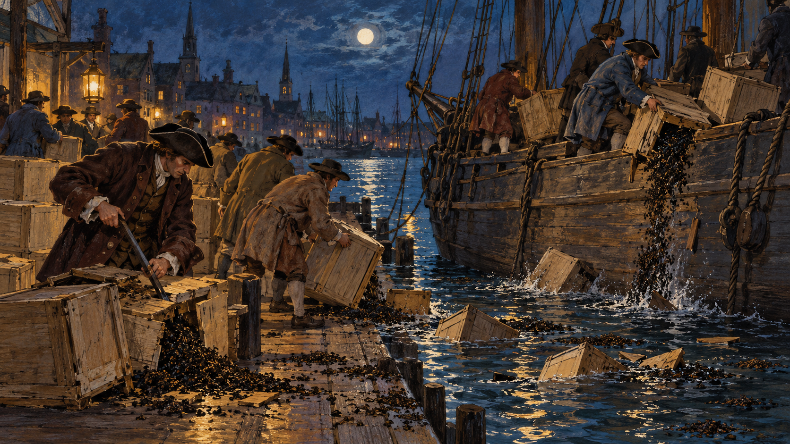

# 보스턴 — 차를 바다에 던진 날

*1773년의 찻잎과 상인, 의회의 과세 권한*

History · America

> 출처 대조와 공개 게시 승인을 마친 이야기입니다. 실제 게시 여부는 사이트 배포 상태를 따릅니다.

*AI 관련 장면 삽화 · 보스턴 차 사건을 떠올리는 밤의 부두와 차 상자의 상상 장면. 실제 인물의 초상·현장·문서·장치의 정확한 복원 자료가 아닙니다.*

차는 마시려고 배에 실었다. 그런데 보스턴 항구에서는 그 차가 찻잔이 아니라 바닷물로 들어갔다. 1773년 12월 16일 밤의 일이었다. 값나가는 상품을 일부러 버리는 행동은 왜 많은 사람에게 저항의 상징이 되었을까.

흔히 차에 세금을 매겨서 생긴 사건이라고 기억하지만 그 말만으로는 부족하다. 누가 세금을 정할 수 있는지, 어떤 회사가 차를 팔고 누구의 거래가 바뀌는지가 함께 걸려 있었다. 찻잎을 따라가 보면 제국의 권한과 사람들의 생활이 만나는 자리가 보인다.

## 1. 이미 식민지에서 많이 마시던 음료

차는 영국의 북아메리카 식민지에서 낯선 물건이 아니었다. 『Tea Leaves』에 묶인 당시의 편지들은 차의 소비와 가격, 어떤 경로로 들여오는지에 관심을 보인다. 정치적 상징이 되기 전에 실제로 사람들이 사고 마시던 상품이었다.

밀수로 들어오는 차도 거래의 일부였다. 영국 동인도회사를 통한 정식 거래와 다른 경로 사이에는 가격과 세금의 차이가 있었다. 같은 차를 사는 일에도 국가가 정한 규칙과 상인들의 이익이 겹쳐 있었다. 찻잔은 멀리 있는 제도와 무관한 생활용품이 아니었다.

## 2. 1773년의 차법은 무엇을 바꾸려 했을까

영국 동인도회사는 쌓인 차와 재정 문제를 안고 있었다. 1773년 차법은 회사가 아메리카로 보내는 차에 대해 영국 쪽 관세를 돌려받도록 하고, 식민지에서 내는 차 세금은 남겨 두는 구조였다. 회사가 정식 차를 더 경쟁력 있게 팔 수 있도록 하려는 선택이었다.

따라서 차값을 무조건 더 비싸게 만들려고 새 세금을 얹었다는 한 문장으로 설명하기 어렵다. 법을 추진한 쪽은 합법적인 차가 가격에서도 경쟁할 수 있다고 기대했다. 하지만 싼 물건을 제공하면 사람들의 정치적 반발도 사라질 것이라는 판단은 맞지 않았다.

## 3. 가격표보다 큰 질문

식민지의 반대자들은 자신들이 대표를 보내지 못하는 영국 의회가 세금을 정하는 권한을 문제 삼았다. 얼마를 내는지와 누가 동의했는지는 다른 질문이었다. 차를 사는 행위가 그 과세 권한을 받아들이는 행동으로 해석될 수 있었다.

상인들에게는 거래의 구조도 중요했다. 회사가 지정한 판매 관계는 기존 차 상인의 이해와 충돌할 수 있었다. 따라서 모든 반발을 순수한 원칙 하나나 개인의 돈 욕심 하나로만 설명할 필요는 없다. 정치적 주장과 상업적 이해가 같은 사건 안에서 함께 작용했다.

## 4. 차를 실은 배가 항구에 머물다

보스턴에 도착한 차를 어떻게 처리할지를 두고 회의와 압박이 이어졌다. 반대자들은 차를 내리지 않고 돌려보내려 했고, 배의 소유자와 선장, 총독과 세관은 각기 다른 규칙과 요구 사이에 놓였다. 화물을 싣고 돌아가는 일도 간단한 선택은 아니었다.

1884년 편찬된 『Tea Leaves』는 당시 편지와 문서, 뒤에 정리된 인물 기록을 함께 담았다. 여기에는 장사와 운항을 걱정하는 목소리도 나온다. 나중에 사건의 결말을 아는 독자와 달리 당시 사람들은 아직 정해지지 않은 결과 앞에서 판단해야 했다.

## 5. 12월 16일 밤의 파괴

그날 밤 사람들은 배에 올라 차 상자를 깨고 내용물을 물에 버렸다. 편찬 자료에 인용된 기록은 세 배의 차 상자 342개를 서술한다. 상징적인 몸짓 몇 번으로 끝난 것이 아니라 실제 화물을 훼손하는 집단 행동이었다.

일부 참가자가 원주민 차림을 흉내 낸 모습으로 묘사되지만, 이를 원주민이 주도한 공격으로 읽어서는 안 된다. 식민지 저항자들의 변장과 행동에 관한 서술이다. 오늘 익숙한 이름인 보스턴 차 사건 뒤에는 누가 어떤 모습으로 행동했는지를 구분할 역사적 맥락이 있다.

## 6. 무엇을 버리고 무엇은 남기려 했을까

자료에는 차를 개인적으로 가져가려는 행동을 막았고 다른 화물을 함부로 훼손하지 않으려 했다는 서술도 있다. 저항자들은 자신의 행위를 단순한 약탈과 다르게 보이게 하려 했다. 행동의 대상과 그것을 설명하는 방식이 함께 중요했던 것이다.

그러나 이 설명을 손해를 본 모든 사람이 동의한 공정한 평가로 받아들일 수는 없다. 선박과 화물, 회사와 식민지의 이해는 같지 않았다. 사건의 당사자와 후대의 기념 서술이 무엇을 강조하는지 나누어 읽으면 같은 밤이 여러 관점에서 보인다.

## 7. 한 사건이 독립 전쟁의 전부는 아니었다

차의 파괴 뒤 영국과 식민지의 갈등은 더 커졌고 1775년에는 무력 충돌로 이어졌다. 1776년 독립선언도 나왔다. 하지만 차 상자를 버린 한 행동이 모든 원인과 과정을 대신한 것은 아니다. 앞선 과세와 대표권의 갈등, 여러 지역의 선택이 쌓여 있었다.

자유를 주장한 식민지 사회 안에도 권리의 차이가 남아 있었다. 교재는 노예제와 여성, 원주민의 배제를 함께 설명한다. 제국의 권한에 반대한 역사적 의미를 읽으면서 그들이 주장한 자유가 실제로 누구에게 적용되었는지도 물을 수 있다.

## 8. 찻잎이 보여 주는 제국의 관계

함께 실은 AI 삽화는 1770년대 항구에서 차 상자를 다루는 상황을 떠올리는 상상 속 장면이다. 실제 참가자와 선박, 그날 밤의 배치를 고증해 복원하지 않았다. 인물의 차림이나 자세를 사료처럼 해석할 자료는 아니다.

보스턴의 차를 따라가면 소비자의 가격표와 회사의 장부, 의회의 권한이 한 물건에 모인다. 평범한 음료는 어떤 조건에서 정치적 선택이 되는가. 바다에 버려진 찻잎은 일상의 상품이 세계사의 큰 갈등을 드러내는 순간을 보여 준다.

## 이야기의 바탕이 된 자료

- [Tea Leaves (1884), Francis S. Drake의 서론·자료 편집](https://raw.githubusercontent.com/GITenberg/Tea-Leavesnotes-and-biographical-notices-of-the-Boston-Tea-Party-_24321/master/24321-8.txt) · 확인일 2026-10-31
  - 확인 내용: 1773년 차법의 세금·동인도회사·12월 16일 차 상자 파괴·후대 편집의 시각
- [OpenStax World History — 아메리카와 프랑스, 아이티의 혁명](https://raw.githubusercontent.com/openstax/osbooks-world-history/main/modules/m00019/index.cnxml) · 확인일 2026-10-31
  - 확인 내용: 과세와 대표권·독립혁명의 배경·권리의 범위

---

[같은 소주제의 이야기](README.md) · [전체 서가](../../README.md)
