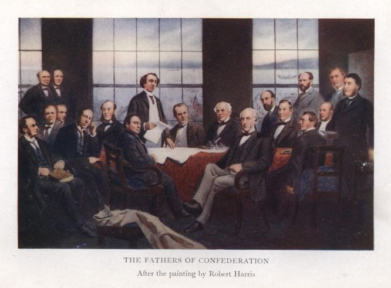

# 캐나다 1867 — 하나의 국가가 된다는 데에는 무엇이 필요했을까

*네 주의 출발과 지역의 권한, 협상 밖에 남은 사람들*

History · America

> 자료 대조를 마친 검토용 이야기입니다. 공개 게시 승인은 아직 받지 않았습니다.

*A. H. U. Colquhoun, The Fathers of Confederation, frontispiece after Robert Harris · Public Domain. 회의 지도자를 모아 그린 후대 회화의 재현이며1864년 회의 실황 사진이 아닙니다.*

[이미지 출처·제작 근거](https://raw.githubusercontent.com/GITenberg/The-Fathers-of-ConfederationA-Chronicle-of-the-Birth-of-the-Dominion_29972/master/29972-h/images/img-front.jpg) · Public Domain · 저작권 만료 작품 및 역사 출판 자료

캐나다의 탄생을 말할 때 1867년이라는 해가 등장한다. 그러나 그때 오늘날의 모든 지역이 한꺼번에 모여 완전히 독립한 것은 아니다. 서로 다른 식민지의 정치가들은 무엇을 함께 하고 무엇을 각 지역에 남길지 협상했다. 연방이라는 제도가 만들어진 과정을 회의의 탁자 너머까지 살펴보자.

## 01. 가까운 식민지들이 모두 같은 처지는 아니었다

영국령 북아메리카의 여러 지역은 언어와 종교, 경제와 정치의 조건이 달랐다. 오늘의 온타리오와 퀘벡에 해당하는 지역도 당시에는 하나의 캐나다주로 묶여 있었으며 그 안의 정치적 교착이 문제였다.

동쪽의 해양 식민지들에는 자기들끼리 결합하려는 논의가 있었다. 내륙과 해안의 이해가 처음부터 같은 것은 아니었다. 교통과 방위, 무역과 재정의 문제를 함께 해결하려는 기대와 자기 지역의 권한을 잃을 수 있다는 걱정이 공존했다.

미국과의 관계 역시 논의의 배경이었다. 남북전쟁 전후의 정세와 방위에 대한 걱정은 식민지들이 협력할 이유가 되었다. 그렇다고 외부의 위협 하나가 모든 결정을 설명하지는 않는다. 각 지역의 정치적 교착과 경제적 기대가 만나야 실제 결합의 조건이 만들어질 수 있었다.

## 02. 샬럿타운에서 논의의 범위가 넓어지다

1864년 샬럿타운 회의는 해양 식민지의 결합 논의에서 출발했다. 캐나다주의 대표들이 참여하면서 더 큰 연합을 검토하는 방향으로 넓어졌다. 이미 완성된 국가를 승인하려고 모인 자리는 아니었던 것이다.

회의가 열린 프린스에드워드섬이 곧바로 1867년 연방의 출범 구성원이 된 것도 아니다. 회의 장소와 가입 시점을 구분해야 한다. 좋은 구상을 듣는 것과 자기 지역이 실제로 어떤 조건에 동의할지는 다른 단계의 결정이었다.

## 03. 퀘벡에서는 함께 쓸 규칙을 논의했다

뒤이은 퀘벡 회의에서는 중앙과 지역의 권한, 의회의 구성과 대표, 재정 등 구체적인 문제가 다루어졌다. 맥도널드·카르티에·브라운을 비롯한 인물들은 다른 배경과 이해관계를 가진 세력 사이에서 타협해야 했다.

중앙을 강하게 만들어 공동의 문제를 처리하면서도 지역의 차이를 남겨 두려면 역할을 나누는 규칙이 필요했다. 연방은 모두가 완전히 같아져야만 함께 살 수 있다는 구상과 달랐다. 다름을 어떤 제도 안에 두는지가 핵심이었다.

교육과 언어, 종교처럼 지역의 생활과 깊게 연결된 문제는 단순히 효율만으로 합치기 어려웠다. 어떤 권한을 주에 남기고 어떤 권한을 중앙이 맡을지 정하는 일에는 서로의 불안을 다루는 협상이 필요했다. 연방의 설계는 차이를 관리하는 정치의 기술이기도 했다.

## 04. 반대하는 사람들도 있었다

연방 결성은 모든 지역에서 박수만 받지 않았다. 뉴브런즈윅과 노바스코샤 등에서는 추진 과정과 조건을 둘러싼 반대가 나타났다. 새로운 국가의 장점을 주장하는 정치가와 비용이나 자율성의 손실을 걱정하는 주민의 판단이 같지 않을 수 있었다.

옛 연방 탄생사가 성공한 지도자의 협상에 집중한다고 해서 그 밖의 불신이 중요하지 않았던 것은 아니다. 합의의 결과뿐 아니라 누가 언제 어떤 방식으로 의견을 냈는지 보아야 제도가 만들어지는 과정을 이해할 수 있다.

반대 의견을 뒤늦은 오해로만 처리하면 당시 사람들이 감수한 불확실성이 지워진다. 먼 중앙정부가 자기 지역의 이익을 얼마나 대변할지, 부담과 혜택이 어떻게 나뉠지는 중요한 질문이었다. 새로운 제도에 찬성하는 이유만큼 반대하는 이유도 역사적 판단의 대상이다.

## 05. 1867년에는 네 개 주가 출발했다

영국 의회가 제정한 법을 바탕으로 1867년 7월 1일 캐나다 연방이 출범했다. 온타리오·퀘벡·노바스코샤·뉴브런즈윅 네 주가 출발점이었다. 오늘의 지도를 그대로 그 위에 놓으면 뒤에 합류한 지역의 시간이 사라진다.

또한 연방의 출범이 영국과의 모든 법적·정치적 연결을 즉시 끊은 것은 아니었다. 더 넓은 자치와 주권의 변화는 이후에도 이어졌다. 건국이라는 한 단어 안에 여러 단계가 있다는 점을 구분하면 연대 하나를 외우는 것보다 역사를 정확히 읽을 수 있다.

이후의 영토 확대와 주의 가입은 저마다 협상과 갈등의 시간을 가졌다. 따라서 1867년을 완성된 현재의 시작으로만 보기보다 계속 바뀌는 정치적 틀의 출발로 보는 편이 낫다. 연방은 한 번의 서명 뒤에 멈춘 제도가 아니라 추가적인 관계를 받아들이며 달라졌다.

## 06. 협상의 탁자에 누가 앉지 못했을까

회의의 대표들은 당시의 정치 엘리트들이었다. 여성과 원주민 공동체가 동등한 협상 당사자로 참여한 자리라고 볼 수 없다. 그 위에서 결정된 국가의 확대와 통치는 회의 밖에 있던 사람들의 삶에도 영향을 주었다.

연방의 성과를 읽으면서도 이 배제를 지울 필요는 없다. 이후의 토지와 조약, 동화 정책과 권리 문제를 이해하려면 새로운 제도가 누구에게 결정권을 주었는지 물어야 한다. 국가의 출발은 모든 주민에게 똑같은 출발선이 아니었다.

## 07. 유명한 그림은 회의 사진이 아니다

이 글에 실은 이미지는 로버트 해리스의 작품을 바탕으로 한 역사 도판이다. 인물들을 한 장면에 모아 연방의 탄생을 기억하게 만든 그림이지 회의 당일을 촬영한 사진은 아니다. 누가 중심에 있고 누가 화면 밖에 남았는지 살펴볼 수 있다.

캐나다의 연방은 문서와 회의, 타협과 반대가 이어진 결과였다. 하나의 국가가 되었다는 사실만이 아니라 함께 결정할 일과 나누어 맡을 일을 어떻게 정했는지를 읽으면, 1867년은 오늘의 제도를 생각하게 하는 구체적인 역사가 된다.

## 이야기의 바탕이 된 자료

- [A. H. U. Colquhoun, The Fathers of Confederation](https://raw.githubusercontent.com/GITenberg/The-Fathers-of-ConfederationA-Chronicle-of-the-Birth-of-the-Dominion_29972/master/29972-8.txt) · 확인일 2026-11-08
  - 확인 내용: 1864샬럿타운/퀘벡 회의·해양 식민지 결합과 범위 확대·지역 반대·1867년7월1일 네 주·영국과의 법적 관계·Harris그림 재현. 지도자 찬양과 회의 참석자의 범위를 구분

---

[같은 소주제의 이야기](README.md) · [전체 서가](../../README.md)
