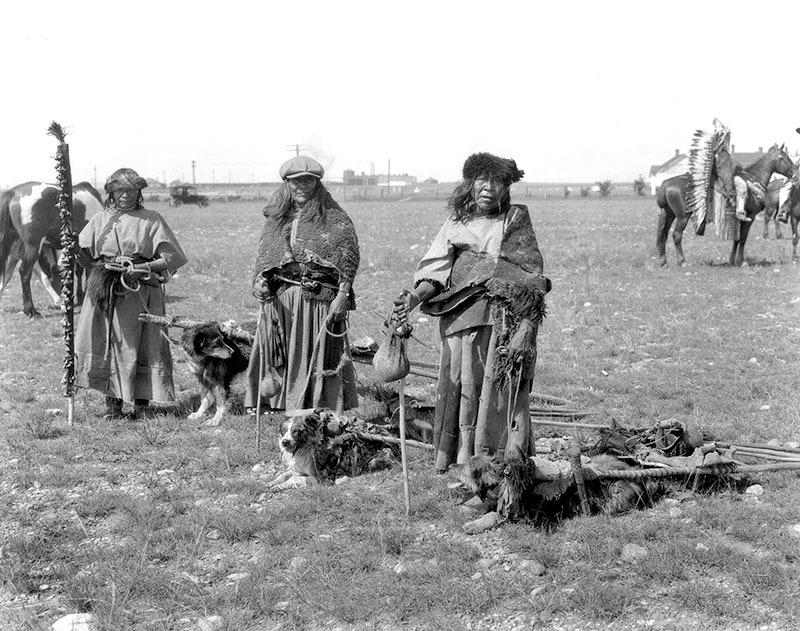

# 바퀴 없이 짐을 옮기던 긴 두 개의 막대

*캐나다의 옛 사진 속 개와 운반 도구*

History · America

> 출처 대조와 공개 게시 승인을 마친 이야기입니다. 실제 게시 여부는 사이트 배포 상태를 따릅니다.

*“Kainai Women and Dog Travois” by Provincial Archives of Alberta/Wikimedia Commons, Public Domain · OpenStax 수록본. 원본 전체 사진을 자르지 않고 사용했습니다.*

[이미지 출처·제작 근거](https://raw.githubusercontent.com/openstax/osbooks-introduction-anthropology/main/media/ANTHRO_Figure_18_01_005.jpg) · 퍼블릭 도메인 · 공개 교재의 개별 사진 표기

사진 속 사람들 곁에 개들이 서 있다. 눈길을 아래로 옮기면 개의 몸에서 뒤쪽으로 길게 이어지는 막대가 보인다. 바퀴 달린 수레도, 겨울 눈 위의 썰매도 아닌 모양이다.

OpenStax는 이를 카이나이 여성들과 개가 끄는 트래보이의 모습으로 소개한다. 사진은 오늘날 캐나다 남부 앨버타에 해당하는 지역에서 1910년 무렵 촬영된 자료다.

## 1. 두 막대와 짐 놓을 자리

트래보이는 두 개의 긴 막대를 짐을 얹는 부분과 연결한 운반 도구다. 사진에서도 길게 뻗은 선들과 그 사이에 놓인 짐의 자리를 찾아볼 수 있다.

바퀴가 보여야 운반 도구라고 생각하면 처음에는 기능을 놓칠 수 있다. 어떤 것을 어떻게 연결해 함께 움직이게 했는지를 보면 모양이 다시 읽힌다. 복잡한 기계 부품이 있어야만 짐을 옮길 수 있는 것은 아니었다.

## 2. 개를 보는 다른 장면

이 사진의 개는 사람 곁에서 이동과 운반에 참여하는 동물이다. 반려동물의 초상으로만 보았을 때와는 다른 관계가 들어 있다.

교재는 개가 사람의 여러 활동에서 맡은 역할 가운데 운반도 함께 소개한다. 다만 이 한 장을 보고 개가 얼마나 무거운 짐을 어떤 거리까지 옮겼는지 계산할 수는 없다. 실제 보이는 장치와 기록된 쓰임을 구분해 읽는 편이 좋다.

## 3. 두 막대가 만드는 운반의 구조

넓은 갈돌처럼 보이는 장치가 아니라 길게 뻗은 두 선과 그 사이의 적재 공간을 보아야 한다. 앞쪽에서 끌고 뒤쪽이 땅을 따라 움직이면 짐을 나르는 길이 생긴다. 바퀴와 축이 없는 형태라도 연결된 막대와 짐의 자리를 통해 역할을 이해할 수 있다. 운반 도구를 알아보는 기준을 조금 넓혀 주는 물건이다.

다만 사진만으로 어떤 재료가 얼마나 강하고 어느 지형에 가장 적합했는지 수치로 평가하지는 않는다. 장치를 이루는 형태와 자료가 알려 주는 쓰임을 먼저 보는 것이다. 익숙한 수레가 없다는 이유로 부족한 도구라고 정하기보다 어떤 행동을 가능하게 했는지 묻는 편이 이해에 도움이 된다.

## 4. 개는 풍경의 장식이 아니다

사진 속 개는 단순히 사람 곁에 있는 동물이 아니라 운반 도구와 관계를 맺고 있다. 교재는 이 장면을 사람과 개가 나누어 온 활동의 사례로 소개한다. 동물의 역할을 오늘의 반려 경험 하나로만 생각하면 놓칠 관계다. 함께 산다는 말에는 시대와 장소에 따라 다른 일이 들어 있었다.

그렇다고 이 사진을 개와 사람의 모든 관계를 대표하는 장면으로 넓힐 수는 없다. 얼마나 자주 어떤 무게를 나르고 어떻게 길렀는지는 별도 정보가 필요하다. 하나의 장치를 본 뒤 여러 집단의 생활을 같은 방식으로 묶어서는 안 된다. 구체적인 사람과 장소를 자료의 설명대로 남겨 두는 것이 중요하다.

## 5. 캡션 속 카이나이와 앨버타

교재는 사진의 인물을 카이나이 여성으로, 장소를 현재 캐나다 남부 앨버타에 해당하는 지역으로 소개하며 촬영 시기를 1910년 무렵으로 적는다. 이 단서들은 사진을 이름 없는 옛 북미의 장면으로 만들지 않게 한다. 사람과 도구에는 구체적인 공동체와 시간의 맥락이 있었다.

현재의 국가 이름은 위치를 찾게 도와주지만 당시 사람들의 모든 정체성을 설명하는 것은 아니다. 지도 위의 명칭과 공동체의 이름을 함께 읽으면 조금 더 정확해진다. 오래된 사진은 시대의 복장만 구경하는 이미지가 아니라 누가 어떤 환경에서 무엇을 했는지 묻는 기록으로 만날 수 있다.

## 6. 남은 한 장에서 질문을 늘리는 법

먼저 막대의 끝과 짐을 놓는 부분을 살피고, 다음에 그 장치와 개의 몸이 어떻게 연결되는지 눈으로 따라가 보자. 물건의 전체 기능을 한눈에 알기 어려울 때에는 접점을 찾는 것이 도움이 된다. 사람이 서 있는 자리와 도구의 방향을 함께 보면 이동의 가능성이 조금 구체적으로 느껴진다.

사진이 정지한 상태를 보여 준다고 해서 그 물건도 원래 가만히 놓여 있던 것만은 아니다. 운반이라는 행동을 위해 만들었으나 화면에는 한순간만 남았다. 그 앞뒤를 상상하되 기록되지 않은 거리와 노동량을 사실처럼 쓰지는 않는다. 바퀴 없이 움직이는 긴 두 막대는 익숙하지 않은 기술을 낮추어 보지 않고 읽는 연습이 된다.

## 7. 과거의 도구를 현재의 눈으로 보기

함께 실은 사진은 특정 시기의 자료다. 오늘날 카이나이 공동체의 생활 전체를 이 모습 하나로 대신할 수는 없다. 오래된 사진을 볼 때는 그때의 장면이라는 자리를 함께 남겨 두어야 한다.

그 안에서도 작은 발견은 가능하다. 늘 보던 바퀴가 없는데도 짐을 놓을 자리와 끌고 갈 방법이 있다. 긴 두 개의 막대를 알아보는 순간 사진 속 선들이 단순한 배경에서 생활의 도구로 바뀐다.

## 이야기의 바탕이 된 자료

- [OpenStax — Introduction to Anthropology: Humans and Animals](https://raw.githubusercontent.com/openstax/osbooks-introduction-anthropology/main/modules/m00106/index.cnxml) · 확인일 2026-10-29
  - 확인 내용: 카이나이 여성과 개의 트래보이 사진·1910년 무렵·현 캐나다 남부 앨버타라는 캡션 / 두 막대와 짐 플랫폼이라는 구조·운반 용도 / 교재가 소개하는 인간과 개의 운반 관계

---

[같은 소주제의 이야기](README.md) · [전체 서가](../../README.md)
