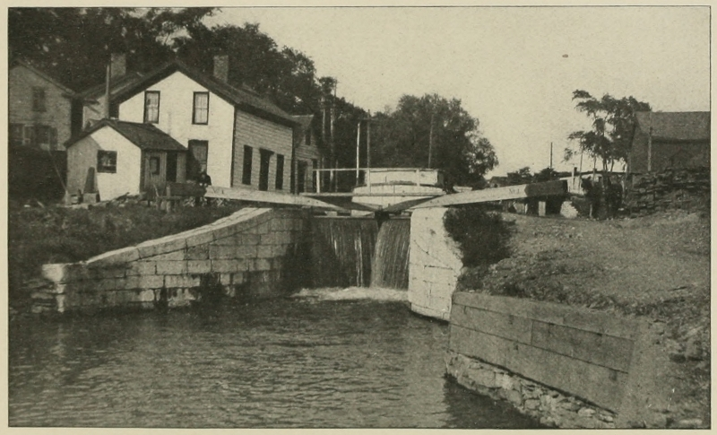

# 에리 운하 — 내륙의 곡물이 뉴욕항으로 가는 길

*갑문과 통행료, 노동과 항구를 연결한 공공사업*

History · America

> 출처 대조와 공개 게시 승인을 마친 이야기입니다. 실제 게시 여부는 사이트 배포 상태를 따릅니다.

*Archer Butler Hulbert, The Erie Canal, Canal Lock at Rome · Public Domain. 뉴욕주 롬의 갑문 역사 사진이며1825년 개통 당일 사진이 아닙니다.*

[이미지 출처·제작 근거](https://raw.githubusercontent.com/GITenberg/Historic-Highways-of-America--Vol.-14-The-Great-American-Canals--Volume-II-The-Erie-Canal-_41008/master/41008-h/images/ill117.jpg) · Public Domain · 저작권 만료 작품 및 역사 출판 자료

대서양 항구가 번성하려면 바다 쪽 항로만 좋아서는 부족하다. 내륙에서 생산한 물건이 항구까지 도착할 길도 필요하다. 1825년 완성된 에리 운하는 오대호와 허드슨강을 연결해 뉴욕의 배후를 넓혔다. 긴 물길을 판다는 일이 도시와 농장, 노동과 재정을 어떻게 바꾸었는지 살펴보자.

## 01. 강이 없는 구간을 어떻게 이어 줄까

허드슨강을 따라 올라오면 올버니에 닿지만 거기서 서쪽 내륙까지 물길이 저절로 이어지는 것은 아니었다. 육로로 무거운 짐을 나르는 데에는 많은 비용과 시간이 들었다. 오대호와 동쪽의 항구를 잇고 싶다는 생각이 운하 구상의 배경이었다.

운하는 자연의 강을 그대로 따라가는 길과 다르다. 물을 넣고 유지할 통로를 만들며 지형의 높낮이도 넘어야 한다. 지도에서 두 지점을 선 하나로 잇는 것과 실제 배가 그 사이를 지나가는 일의 차이가 큰 사업이었다.

물길로 실을 수 있는 무게와 육상으로 옮길 때의 부담은 상품의 판매 범위를 바꾼다. 길이 없어서가 아니라 운송비를 감당하기 어려워 닿지 못하던 시장이 있었다. 운하는 거리 자체를 없애지는 않아도 생산자와 구매자가 계산하는 비용을 바꾸려는 시도였다.

## 02. 뉴욕주는 왜 직접 큰 사업을 맡았을까

드윗 클린턴은 운하 추진의 중요한 인물이었지만 혼자 생각해 낸 발명으로 설명할 수는 없다. 앞선 구상과 조사, 지역의 요구와 여러 정치인의 활동이 있었다. 돈을 어떻게 모으고 위험을 누가 질지에 대한 논쟁도 길었다.

연방의 지원을 기대하기 어려운 상황에서 뉴욕주가 중심이 되었다. 성공이 확실한 완성품을 사는 일이 아니라 앞으로의 통행과 수입을 예상하며 돈을 들이는 선택이었다. 지역의 성장과 공공사업의 역할을 둘러싼 정치적 판단이 필요했다.

통행료는 배가 지나가는 순간에 내는 돈이지만 그 배후에는 공사비와 유지비의 부담이 있었다. 얼마나 많은 화물이 다닐지, 수입으로 의무를 감당할 수 있을지는 개통 전에 확실하지 않았다. 성공한 결과를 알고 읽을수록 착공 당시의 불확실성을 놓치지 않아야 한다.

## 03. 갑문은 배를 물과 함께 올리고 내린다

서로 높이가 다른 물길을 연결하려면 갑문이 필요했다. 배가 구획 안으로 들어오면 문을 닫고 물의 높이를 바꾸어 다음 구간으로 이동하게 한다. 배를 통째로 산 위로 끌어 올리는 대신 물을 조절해 높이 차를 넘는 방식이다.

갑문과 수로, 물을 공급하는 시설은 함께 작동해야 했다. 물을 너무 적게 확보하거나 새는 곳을 관리하지 못하면 긴 운하도 쓸 수 없다. 완공한 날의 지도보다 반복되는 점검과 수선이 실제 운송을 가능하게 했던 셈이다.

수로의 문을 여닫는 순서와 수위를 관리하는 일은 배 한 척의 편의만을 위한 것이 아니었다. 한 구간에서 물이 부족해지면 뒤의 이동도 영향을 받는다. 긴 운하를 한꺼번에 움직이는 조직은 작은 시설마다 반복되는 절차에 의존했다.

## 04. 기계보다 먼저 사람의 몸이 길을 만들었다

1817년 시작된 공사는 땅을 파고 나무와 뿌리를 제거하며 흙과 돌을 옮기는 작업이었다. 지금의 대형 건설기계가 있는 현장을 상상하면 당시의 속도와 고생을 놓친다. 측량과 기술적 고안에 더해 수많은 노동이 필요했다.

노동자의 출신과 고용 조건, 병과 사고의 위험도 공공사업의 역사다. 어떤 집단이 모든 구간을 만들었다고 하나로 묶을 수는 없다. 특정 정치인의 이름으로 남은 운하 뒤에서 누가 어떤 조건으로 일했는지 묻는 것이 중요하다.

## 05. 1825년, 오대호에서 대서양까지

운하는 버펄로에서 올버니까지 이어졌고 허드슨강과 뉴욕항으로 연결되었다. 1825년의 개통은 오대호 연안의 생산물과 대서양의 시장 사이에 새로운 운송 경로를 만들었다. 내륙과 항구의 관계가 달라질 수 있었다.

한 번의 항해와 기념행사는 그 연결을 눈에 보이는 사건으로 보여 주었다. 하지만 개통식을 치렀다고 모든 배가 같은 시간과 비용으로 움직이는 것은 아니었다. 계절과 날씨, 적재와 대기, 구간별 운영 조건도 남아 있었다.

## 06. 곡물과 사람이 움직이자 도시의 위치가 달라졌다

운하의 통행은 농산물과 자재가 옮겨 가는 길을 넓혔고 주변의 상업과 정착에도 영향을 주었다. 뉴욕항은 더 넓은 내륙과 연결되는 이점을 얻었다. 항구의 힘은 도시 안의 건물뿐 아니라 먼 곳에서 들어오는 경로에서 생기기도 한다.

그 혜택이 모든 사람에게 같은 것은 아니었다. 새로운 이동과 정착의 확대는 원주민 공동체의 토지와 생활에도 압박을 주었다. 개척과 번영이라는 말만으로 변화를 평가하면 누구의 이동이 자유로워졌고 누가 밀려났는지가 보이지 않는다.

화물이 머무는 곳에는 창고와 숙박, 수리와 중개업이 필요했다. 운하 주변 도시의 성장은 배가 단순히 지나갔기 때문만이 아니라 이런 서비스가 모인 결과였다. 운송망의 변화는 어느 장소에서 사람이 일하고 돈을 버는지도 다시 배열했다.

## 07. 성공한 운하도 계속 바뀌어야 했다

초기의 성공 뒤에는 확대와 개선, 철도와의 경쟁이 이어졌다. 1825년의 모습이 오늘까지 그대로 유지된 것은 아니다. 한 번 좋은 길을 만들면 영원히 같은 방식으로 쓴다는 생각은 교통의 역사와 맞지 않는다.

이 글에 실은 것은 뉴욕주 롬의 운하 갑문을 보여 주는 역사 사진이다. 전체 공사 과정이나 개통 당일의 모습을 찍은 사진은 아니다. 배 한 척이 기다리는 갑문을 보면 거대한 연결망이 물과 문, 사람의 매일의 작업에 기대고 있었음을 생각할 수 있다.

## 이야기의 바탕이 된 자료

- [Archer Butler Hulbert, Historic Highways of America, Vol.14: The Erie Canal](https://raw.githubusercontent.com/GITenberg/Historic-Highways-of-America--Vol.-14-The-Great-American-Canals--Volume-II-The-Erie-Canal-_41008/master/41008-8.txt) · 확인일 2026-11-08
  - 확인 내용: 뉴욕주 계획/클린턴·주 재정/통행료·1817착공·갑문/노동·1825버펄로~올버니와 허드슨 연결·도시/상업 변화·확장과 철도 경쟁·롬의 갑문 사진. 개척을 빈 땅의 개발로 표현하지 않음

---

[같은 소주제의 이야기](README.md) · [전체 서가](../../README.md)
