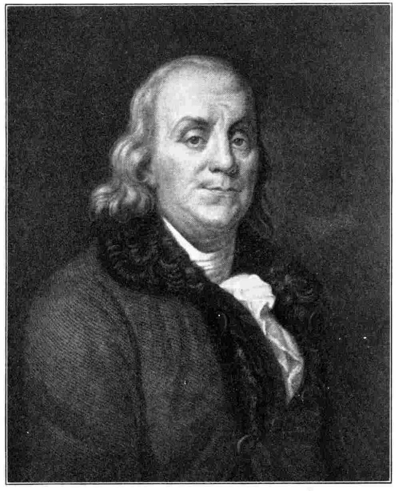

# 벤저민 프랭클린 — 인쇄공은 왜 함께 읽을 책을 모았을까

*자서전에서 만나는 배움의 모임과 도서관, 완벽하지 못한 습관*

History · America

> 자료 대조를 마친 검토용 이야기입니다. 공개 게시 승인은 아직 받지 않았습니다.

*J. A. Duplessis의 초상을 바탕으로 J. Thomson이 제작한 판화 · Autobiography of Benjamin Franklin, 1916년 편집판(1922년 인쇄) 수록 · Project Gutenberg · Public Domain. 노년의 초상이며 도서관을 만들던 청년 시절의 현장 자료가 아닙니다.*

[이미지 출처·제작 근거](https://raw.githubusercontent.com/GITenberg/Autobiography-of-Benjamin-Franklin_20203/master/20203-h/images/illus-005-red.jpg) · Public Domain

사람들이 각자 가진 책을 한 방에 모아 두면 토론할 때 찾아볼 수 있다. 다른 회원의 책도 읽을 수 있으니 적은 책으로 더 넓게 배울 수 있다. 프랭클린의 자서전에 나오는 도서관의 출발은 이렇게 소박하다.

그는 독립과 외교, 과학으로 널리 알려졌지만 한때는 인쇄 기술로 살아갈 길을 찾던 청년이었다. 그의 책을 따라가면 혼자 열심히 읽는 사람이 다른 사람과 함께 배울 장치를 만드는 과정이 보인다.

## 1. 글을 읽는 일과 찍는 일

1706년 보스턴에서 태어난 프랭클린은 젊어서 인쇄 일을 배웠다. 글자를 종이 위에 놓고 책과 신문을 만들어 내는 기술은 생계의 수단이었다. 읽고 쓰기를 좋아한 그에게는 생각이 사람에게 전달되는 과정을 만나는 일이기도 했다.

자서전에는 책을 구해 읽고 문장을 연습한 이야기가 이어진다. 처음부터 모든 분야를 아는 현자가 등장하는 것은 아니다. 일하고 돈을 마련하고 다른 사람의 도움을 얻으며 자기 능력을 늘려 가는 사람이 나온다.

## 2. 필라델피아에서 자리를 잡다

고향을 떠난 뒤 그는 필라델피아에 도착해 일을 찾았다. 이후 영국 생활과 귀환, 여러 시행착오를 거쳐 인쇄업에서 자리를 잡는다. 자서전은 빵을 들고 낯선 거리를 걷는 초라한 모습도 남겨 놓는다.

나중의 명성을 먼저 아는 독자에게는 이런 장면이 더 인상적이다. 그러나 성공을 모두 성실함 하나의 결과로 읽기보다는 일자리와 신용, 동료와 후원 관계가 어떻게 얽혔는지 함께 보는 편이 그의 생활을 더 구체적으로 이해하게 한다.

## 3. 금요일 저녁의 모임 준토

프랭클린은 지인들과 서로의 발전을 위한 준토 모임을 만들었다. 회원들은 도덕과 정치, 자연에 관한 질문을 가져와 토론하고 정기적으로 글도 읽었다. 수공업자와 여러 직업의 사람들이 지식을 나누는 자리였다.

자서전에서 그가 강조하는 것은 상대를 꺾는 말싸움보다 함께 진실을 찾는 태도다. 확신에 찬 단정이나 직접적인 반박으로 열을 올리지 않도록 규칙도 두었다. 좋은 대화는 좋은 마음만으로 유지되지 않는다고 본 셈이다.

## 4. 한 방에 모은 책의 가능성

모임에는 참고할 책이 필요했다. 회원들이 가진 책을 한곳에 모으면 토론 중에도 살필 수 있고 서로 빌려 읽을 수도 있었다. 지식의 부족을 각자 혼자 감당하기보다 가진 것을 연결하려는 구상이었다.

하지만 책을 함께 두는 방식에는 관리와 보관의 문제가 있었다. 좋은 의도만으로 충분하지 않다는 것을 경험한 뒤 프랭클린은 구독금을 모아 책을 구입하는 더 지속적인 방법을 생각한다. 도서관은 생각보다 운영의 문제에 가까웠다.

## 5. 구독 도서관이 만든 변화

회원들이 초기 비용과 정기 회비를 내면 그 돈으로 책을 사고 규칙에 따라 이용할 수 있었다. 자주 쓰지 않을 책까지 한 사람이 모두 살 필요가 줄어든다. 읽고 싶은 사람이 자원을 모아 접근의 폭을 넓힌 것이다.

다만 이것을 오늘날 누구나 무료로 이용하는 공공도서관과 그대로 같다고 볼 수는 없다. 회원과 비용의 조건이 있었다. 공동의 배움이 넓어졌다는 의미와 그 혜택을 누릴 수 있었던 범위는 함께 살펴야 한다.

## 6. 공을 세우는 것보다 일을 이루기

구독을 부탁하던 그는 자기 명성을 높이려는 계획으로 보이면 사람들이 협력을 꺼릴 수 있음을 느꼈다고 적었다. 그래서 여러 친구의 뜻을 대신 전하는 방식으로 제안했다. 사람들의 자부심과 관계도 운영의 조건이었다.

이 대목의 프랭클린은 이상만 말하는 사람이 아니다. 좋은 제안이 실제로 받아들여지려면 어떤 말과 절차가 필요한지 관찰한다. 자기 이름을 드러내는 만족보다 일을 성사시키는 결과를 택한 경험으로 회고한다.

## 7. 열세 가지 덕목과 검은 표시

자신의 습관도 기록으로 다듬으려 했다. 절제와 침묵, 질서 등 열세 가지 덕목을 정하고 잘 지키지 못한 일을 표시했다. 마음먹었다는 사실만으로 행동이 바뀌지는 않는다고 본 것이다.

하지만 완벽한 사람이 되었다는 결론은 나오지 않는다. 특히 질서 있게 살려는 노력은 뜻대로 되지 않았다. 실패한 자리를 남기는 기록은 영웅의 자랑보다 가까이 느껴진다. 계획과 실제 생활 사이에는 계속 간격이 있었다.

## 8. 자서전은 나중에 고른 자기 모습이다

이 책은 당시의 매일을 빠짐없이 적은 일지가 아니다. 나중의 프랭클린이 자신의 경험을 골라 독자에게 설명한 글이다. 그가 중요하게 여긴 성실과 실용, 협력의 가치가 사건의 배치에도 들어 있다.

따라서 자서전의 평가를 그 시대 모든 사람의 경험으로 넓히지 않는 편이 좋다. 그의 성공과 제도가 당시에 존재한 차별과 불평등을 없앴다는 뜻도 아니다. 한 사람의 배움과 사회 전체의 기회를 구분하며 읽을 수 있다.

## 9. 책장을 혼자 채우지 않아도 된다

함께 실은 초상은 뒤플레시의 그림을 바탕으로 한 후대 판화다. 도서관을 구상하던 청년의 현장 사진은 아니다. 익숙한 노년의 얼굴 뒤에서 책을 구하고 사람을 모으던 시간을 상상해 볼 출발점이다.

프랭클린의 이야기에서 가져갈 것은 남보다 더 많이 읽으라는 압박만이 아니다. 질문을 함께 나눌 자리, 책을 함께 쓸 규칙, 실패를 돌아볼 기록을 만들 수 있다는 생각이다. 개인의 배움은 주변의 장치를 바꿀 때 더 멀리 이어질 수 있었다.

## 이야기의 바탕이 된 자료

- [Benjamin Franklin, Autobiography — 준토·도서관·덕목 기록 절 (1916년 편집판, 1922년 인쇄)](https://raw.githubusercontent.com/GITenberg/Autobiography-of-Benjamin-Franklin_20203/master/20203-8.txt) · 확인일 2026-10-31
  - 확인 내용: 인쇄업 수련·필라델피아 도착과 경력 / 준토의 질문과 토론 규칙·도서관의 책 모으기와 구독 방식 / 사업을 친구들의 제안으로 표현한 회고·열세 덕목과 질서 실천의 어려움

---

[같은 소주제의 이야기](README.md) · [전체 서가](../../README.md)
