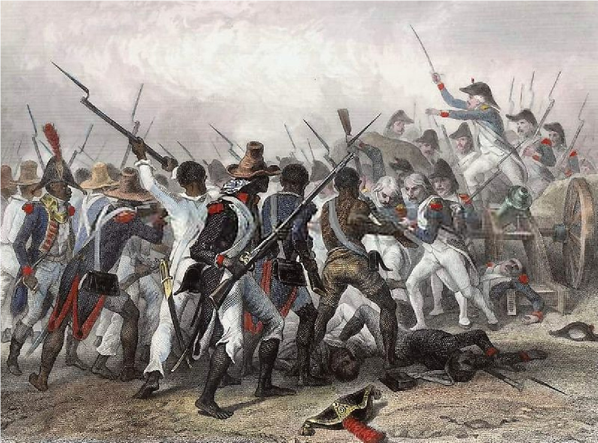

# 아이티 혁명 — 자유를 외친 제국은 왜 식민지의 자유를 두려워했을까

*1791년 봉기에서 1804년 독립까지, 노예제와 혁명 원칙의 충돌*

역사 · 혁명과 개혁

> 출처 대조와 공개 게시 승인을 마친 이야기입니다. 실제 게시 여부는 사이트 배포 상태를 따릅니다.

*Auguste Raffet/Hebert, Haitian Revolution, Library of Congress/Wikimedia Commons · OpenStax 수록. 1802년 전투의 후대 묘사이며 그해 현장 기록으로 제작된 그림이 아닙니다.*

[이미지 출처·제작 근거](https://raw.githubusercontent.com/openstax/osbooks-world-history/main/media/OSX_WorldHist_B07_03_Crete.jpg) · Public Domain

프랑스에서 자유와 평등을 외치는 혁명이 일어났을 때, 바다 건너 생도맹그의 사탕수수 농장에서는 노예 노동이 계속되었다. 오늘날 아이티에 해당하는 이 식민지는 프랑스에 큰 부를 안겨 주었다. 그 부를 생산하던 사람들은 혁명의 약속에서 제외되어 있었다. 아이티 혁명은 유럽에서 생긴 이상이 식민지에 전달된 이야기만이 아니다. 그 약속을 실제 삶에 적용하라고 요구한 사람들이 스스로 질서를 뒤집은 역사다.

## 01. 같은 자유라는 말에 서로 다른 뜻을 담았다

식민지의 백인 농장주는 프랑스의 무역 제한과 간섭에서 벗어나기를 바랐다. 가난한 백인에게도 자신의 정치적 권리를 넓힐 이유가 있었다. 하지만 이들이 자유를 원했다고 해서 노예제까지 없애려 한 것은 아니었다.

자유 유색인 가운데에는 재산과 교육을 가진 사람도 있었다. 이들은 피부색 때문에 권리가 제한되는 일에 반대했다. 다만 그중 일부 역시 노예를 소유했다. 자유인이 더 평등해지는 목표와 노예 상태 자체를 끝내는 목표는 처음부터 같지 않았다.

생도맹그가 부유하다는 말은 노예로 일한 사람도 잘살았다는 뜻이 아니었다. 수출품의 가치와 그것을 생산하는 사람의 생활은 분리되어 있었다. 식민지의 경제적 성공을 보여 주는 숫자일수록 그 이익이 어느 집단에 쌓였는지 함께 확인해야 한다.

## 02. 1791년 봉기는 식민지의 계산을 흔들었다

1791년 노예로 묶여 있던 사람들의 대규모 봉기가 일어났다. 농장의 지배 관계와 생산 질서가 흔들렸다. 그들은 단지 다른 자유인 집단의 갈등을 기다리던 사람들이 아니었다. 서로 연결하고 조직하며 행동할 능력을 가지고 있었다.

노예 공동체의 종교와 관계망도 저항을 이어 주었다. 보두 신앙은 서로 다른 배경의 사람들을 잇는 역할을 했다. 그러나 비밀리에 이루어진 의례의 정확한 대화나 장면을 후대의 이야기에 기대어 재현할 수는 없다. 봉기의 힘을 신비한 한밤의 사건 하나로 줄여서도 안 된다.

## 03. 해방은 프랑스만의 결정으로 이루어지지 않았다

유럽의 전쟁도 식민지로 번졌다. 영국과 스페인은 프랑스의 영향력을 약화시키고 노예 봉기가 자기 식민지로 퍼지는 일을 막으려 했다. 생도맹그의 사람들은 여러 군대와 정치 세력이 경쟁하는 환경에서 싸워야 했다.

프랑스는 1794년 식민지 노예제 폐지를 결정했다. 하지만 이를 파리에서 내려온 자비로운 선물로만 설명하면 현장의 봉기와 군사적 압력이 사라진다. 누가 해방을 선언했는지와 무엇이 그 결정을 불러왔는지는 함께 보아야 한다.

## 04. 루베르튀르의 질서에도 긴장이 있었다

노예였던 경험이 있는 투생 루베르튀르는 군사적 지도자로 성장했다. 그는 해방을 지키려 했고, 1801년 헌법을 통해 폭넓은 통치권을 확보했다. 그 단계에서 프랑스와의 관계를 완전히 끊은 독립국을 선포한 것은 아니었다.

한편 경제를 유지하려는 루베르튀르는 해방된 사람들에게 농장 노동을 계속하도록 강제했다. 노예가 아니라는 법적 지위와 일터를 자유롭게 떠날 수 있는 생활은 다른 문제였다. 해방을 이끈 정부 안에서도 생산의 필요와 개인의 자유가 충돌했다.

노예제의 폐지와 농장 노동의 강제는 똑같은 제도가 아니었다. 그러나 해방된 사람이 자신의 일과 이동을 결정할 수 있는지라는 질문을 남겼다. 법적 신분을 바꾼 혁명이 생산을 유지하려 할 때 어떤 충돌을 겪는지 보여 주는 대목이다.

## 05. 1802년의 원정은 독립의 길을 재촉했다

나폴레옹은 생도맹그에 대한 프랑스의 통제를 되살리려 했다. 노예제 복원에 대한 두려움은 해방을 지키려는 저항을 더욱 강하게 했다. 루베르튀르는 붙잡혀 프랑스로 보내졌고, 그곳의 감옥에서 생을 마쳤다.

그러나 지도자 한 사람을 제거했다고 저항이 끝나지는 않았다. 장자크 데살린 등이 전투를 이어 갔고 프랑스군은 지배권을 되찾지 못했다. 이미 해방을 경험한 사람들이 다시 예전의 질서로 돌아갈 수 있느냐가 싸움의 핵심이었다.

## 06. 1804년의 독립은 모든 갈등의 끝이 아니었다

1804년 1월 1일 아이티의 독립이 선언되었다. 노예 봉기가 식민 지배를 무너뜨리고 독립 국가의 탄생으로 이어졌다는 점은 대서양 세계에 큰 충격을 주었다. 다른 노예 사회의 지배층에는 위협이었고, 억압받는 사람에게는 가능성이었다.

그렇다고 새 국가에 곧바로 평등하고 평화로운 생활이 자리 잡은 것은 아니다. 전쟁의 파괴와 폭력, 기존 집단 사이의 위계가 남았다. 독립 뒤 백인 주민을 향한 학살도 일어났다. 해방의 성과를 인정하는 일과 새 권력의 폭력을 외면하는 일은 다르다.

## 07. 독립한 뒤에도 옛 지배의 청구서가 왔다

1825년 프랑스는 독립 인정과 연결해 거액의 배상금을 요구했다. 옛 식민지 지배층이 잃었다고 주장한 재산에 대한 대가였다. 노예였던 사람들의 국가가 자신들을 재산으로 다루던 질서의 손실을 떠안게 된 셈이다.

아이티의 독립은 혁명이 말한 자유를 그 원래의 주창자에게 되묻는 사건이었다. 자유를 선언하는 것과 다른 사람이 그 자유를 실제로 누리도록 인정하는 것 사이에는 큰 간격이 있었다. 혁명의 경계는 파리의 선언문만이 아니라 카리브해의 농장에서도 다시 그어졌다.

## 이야기의 바탕이 된 자료

- [OpenStax, World History Volume 2 — Revolutions: America, France, and Haiti](https://raw.githubusercontent.com/openstax/osbooks-world-history/main/modules/m00019/index.cnxml) · 확인일 2026-11-11
  - 확인 내용: 생도맹그의 계층/1791봉기·보두/1794프랑스 폐지/루베르튀르1801헌법과 강제 농장노동/1802체포·1804독립/독립 뒤 폭력·1825배상. 해방과 독립, 보편적 권리의 실현을 구분.

---

[같은 소주제의 이야기](README.md) · [전체 서가](../../README.md)
