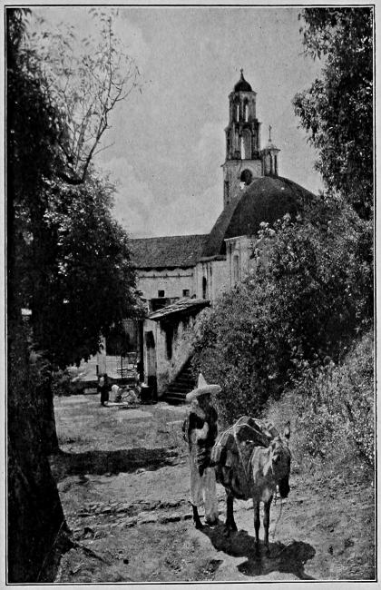

# 멕시코 제2제국 — 빚을 받으러 온 군대는 왜 황제를 세웠을까

*1860년대 외국의 개입과 막시밀리아노, 공화국의 생존*

역사 · 국가와 권력

> 자료 대조를 마친 검토용 이야기입니다. 공개 게시 승인은 아직 받지 않았습니다.

*Nevin O. Winter, Mexico and Her People of To-day, A Village Church. 후대 여행기 사진이며 제2제국 당시의 사건 현장 사진이 아닙니다. · Public Domain.*

[이미지 출처·제작 근거](https://raw.githubusercontent.com/GITenberg/Mexico-and-Her-People-of-To-day-An-Account-of-the-Customs-Characteristics-Amusements-History-__60135/master/60135-h/images/illus42.jpg) · Public Domain · 역사 출판 자료

독립한 멕시코에 유럽의 왕족이 황제로 들어왔다. 1864년의 막시밀리아노는 왜 대서양을 건넜을까. 그 배경에는 돈을 돌려받겠다는 외국 정부의 요구와 프랑스의 세력 확대, 멕시코 내부의 정치적 갈등이 겹쳐 있었다. 황제의 도착을 한 개인의 모험으로만 보면 공화국을 지키려 한 사람들과 제국을 지지한 국내 세력, 그 비용을 감당해야 한 주민이 보이지 않는다.

## 01. 내전은 국가의 재정을 약하게 만들었다

19세기 중반 멕시코에서는 국가와 교회의 관계, 재산과 법적 특권을 둘러싼 갈등이 깊었다. 자유주의자와 보수주의자의 대립은 무력 충돌로 이어졌다. 내전은 사람과 물자를 소모했고 정부가 재정을 안정시키는 일도 어렵게 했다.

후아레스 정부가 외채 지급을 유예하자 채권을 가진 외국 정부가 압력을 높였다. 하지만 빚이 존재한다는 사실과 군대를 보내 통치 체제까지 바꿀 권리가 있다는 주장은 다르다. 채무 문제는 개입의 이유가 되었지만 이후의 목표를 모두 설명하지는 못한다.

## 02. 함께 온 국가들의 목적은 같지 않았다

영국과 스페인, 프랑스는 멕시코에 공동으로 개입했다. 그러나 협상 과정에서 영국과 스페인은 물러났고 프랑스는 군사 행동을 계속했다. 채권 회수를 함께 주장했던 국가들이 모두 새로운 제국을 세우려 한 것은 아니었다.

나폴레옹 3세의 프랑스는 멕시코에서 자기 영향력을 확대하려 했다. 이를 프랑스의 일방적 계획만으로 설명하는 것도 충분하지 않다. 멕시코 안에도 군주제가 질서를 회복하고 자유주의 세력을 견제할 수 있으리라 기대한 집단이 있었다.

채권을 받겠다는 공동 행동이 체제 전환으로 바뀌는 순간에는 개입의 범위가 달라진다. 누가 재무 장부를 정리할지가 아니라 누가 법을 만들고 국가를 대표할지가 문제가 되기 때문이다. 군사적 압박을 받은 정부가 협상에 응하는 것과 외국이 새 군주를 세우는 일은 구분해야 한다.

## 03. 황제의 초청은 전체 주민의 동의가 아니었다

합스부르크 가문의 막시밀리아노는 멕시코 황제 자리를 받아들였다. 군주제를 지지한 세력은 그의 통치를 정당한 선택으로 제시하려 했다. 하지만 외국군이 주둔하고 공화국의 저항이 계속되는 상황에서 통치자의 정당성을 말하는 데에는 큰 문제가 남았다.

1864년 황제와 황후가 멕시코에 도착했어도 국가 전체가 그들을 받아들인 것은 아니었다. 황실이 수도에서 의례와 행정을 꾸리는 일과 넓은 영토에서 복종을 확보하는 일은 전혀 다른 과제였다.

## 04. 국내의 지지자와도 생각이 다를 수 있었다

막시밀리아노는 자신을 단지 옛 특권을 되살리는 군주로만 보지 않았다. 일부 자유주의적 조치를 유지하려 했고, 이는 그를 지지한 보수 세력의 기대와 어긋날 수 있었다. 같은 황제를 지지한다는 이유로 모두가 같은 정책을 원하지는 않았다.

제국의 불안정함은 공화파와의 전쟁에서만 오지 않았다. 누구의 재산과 권리를 인정하고 국가와 교회의 관계를 어떻게 정할지라는 문제도 있었다. 왕관은 갈등을 없애는 장치가 아니라 갈등 위에 세워진 새로운 권력의 중심이었다.

왕관을 받아들이면 국내의 서로 다른 기대를 조정해야 했다. 보수파가 기대한 종교적 질서와 황제가 내세운 개혁이 엇갈릴 때, 외국군의 힘만으로 안정된 지지를 만들기는 어려웠다. 제국은 외부의 지원을 얻는 일과 내부의 동의를 넓히는 일을 동시에 해결해야 했다.

## 05. 후아레스의 공화국은 수도 밖에서도 이어졌다

후아레스와 공화파는 밀려나면서도 저항을 계속했다. 수도를 잃었다고 정부의 정치적 주장이 바로 사라지는 것은 아니었다. 공화국이 정당한 국가 권력이라는 주장은 군사적 열세 속에서도 유지되었다.

옛 여행기는 후아레스의 끈기를 출신 민족의 타고난 성격으로 설명하기도 한다. 그러나 그런 설명은 인종적 고정관념이다. 정치적 조직과 지지, 지역의 저항을 살펴야 할 일을 사람의 혈통에 관한 문장으로 대신해서는 안 된다.

## 06. 외국군의 철수는 왕관의 기반을 드러냈다

미국 남북전쟁이 끝난 뒤 프랑스의 개입에 대한 미국의 압력도 커졌다. 프랑스는 병력을 철수시켰고 제국의 군사적 기반은 급격히 약해졌다. 외국군이 받쳐 준 체제가 그 지원을 잃었을 때 얼마나 버틸 수 있는지가 드러났다.

1867년 막시밀리아노는 케레타로에서 공화파에 붙잡혀 처형되었다. 포로가 된 시점과 처형된 날을 섞는 옛 책의 서술에는 주의해야 한다. 제국의 붕괴는 공화국의 복귀를 뜻했지만, 전쟁의 손실과 정치적 갈등까지 즉시 사라졌다는 뜻은 아니었다.

## 07. 짧은 제국은 무엇을 남겼을까

함께 실은 사진은 후대 여행기에 실린 멕시코 마을 교회다. 황제의 도착이나 전투를 촬영한 사진은 아니다. 교회의 재산과 국가 권한을 둘러싼 갈등이 일상의 공간과 연결되어 있었음을 떠올리게 하는 보조 자료다.

멕시코 제2제국은 외국 왕자가 왕관을 썼다가 비극을 맞은 이야기 이상이다. 빚과 내전, 국내 세력의 선택과 국제 정치가 함께 체제를 만들었다. 누가 지지하고 누가 비용을 지불하며 어떤 힘으로 통치하는지를 물을 때, 짧은 제국의 구조가 보인다.

## 이야기의 바탕이 된 자료

- [Nevin O. Winter, Mexico and Her People of To-day, Chapter XIX](https://raw.githubusercontent.com/GITenberg/Mexico-and-Her-People-of-To-day-An-Account-of-the-Customs-Characteristics-Amusements-History-__60135/master/60135-0.txt) · 확인일 2026-11-11
  - 확인 내용: 국가·교회 갈등과 내전·1861년 프랑스/영국/스페인 개입·영국/스페인 철수·1864년 황제 도착·후아레스의 저항·미국 압력과 프랑스군 철수·1867년 제국 붕괴. 인종적 성격론과 창작된 최후 대사는 제외.

---

[같은 소주제의 이야기](README.md) · [전체 서가](../../README.md)
