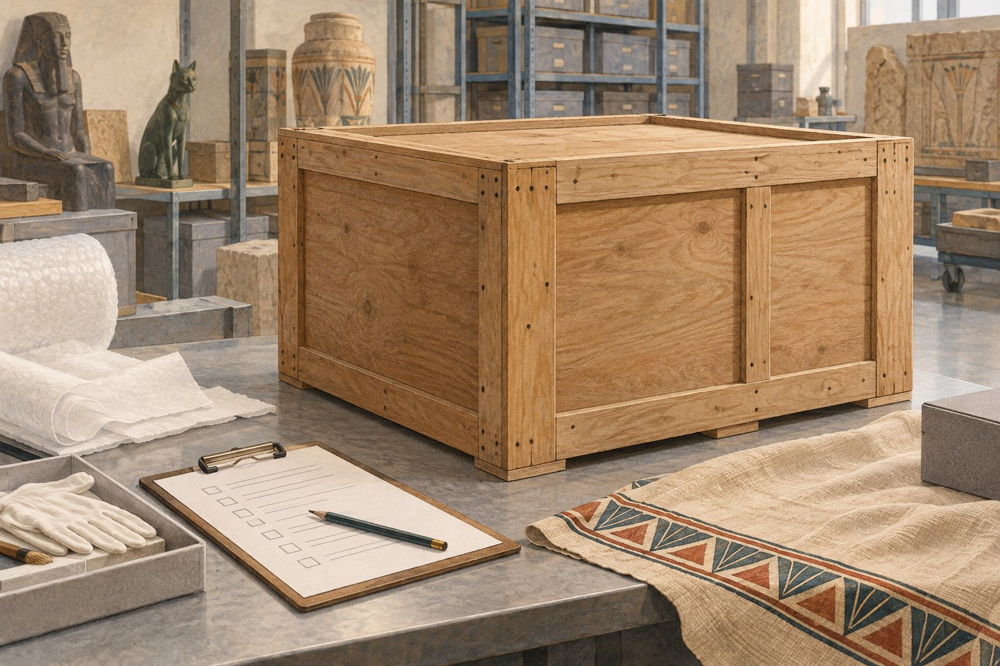

# 미라가 이사하려면 누구에게 물어봐야 할까

*오래된 유해를 옮기며 미술관이 확인한 것*

History · America

> 출처 대조와 공개 게시 승인을 마친 이야기입니다. 실제 게시 여부는 사이트 배포 상태를 따릅니다.

*KnowledgeWalk 제작 · AI 설명용 삽화. 실제 유물·작품·건축물·전시 배치를 재현한 사진이나 역사적 증거가 아닙니다.*

박물관의 미라를 다른 미술관으로 옮긴다고 해 보자. 먼저 떠오르는 것은 포장 상자와 조심스러운 운송이다. 그런데 시카고 미술관에서는 그보다 앞서 법률팀에 질문이 도착했다. 사람의 유해를 주 경계 너머로 옮길 때 알아야 할 법이 있느냐는 내용이었다.

황금이나 돌로 만든 유물과 달리 미라는 한때 살았던 사람의 몸이다. 오래되었다는 이유로 그 차이가 없어지는 것은 아니었다.

## 오랜 대여를 마치고 돌아오는 길

미술관의 공식 글에 따르면 미라와 관은 다른 주의 박물관에 50년 넘게 대여되어 있었다. 연구와 전시를 위해 다시 가져오려면서 운송 문제를 검토하게 된 것이다.

멀리서 보면 박물관 소장품은 늘 같은 자리에 있을 것 같지만 실제로는 대여와 반환, 연구를 위해 움직인다. 전시장에서 우리가 보는 한 점에도 다른 기관에서 지낸 긴 시간이 들어 있을 수 있다.

## 유물과 유해를 함께 생각하기

미술관 법률팀은 관련 규정과 다른 박물관의 사례를 검토했다. 이 사례에서는 운송에 법적인 장애가 보이지 않는다는 판단을 내렸다고 글은 설명한다. 모든 나라와 모든 미라에 그대로 적용되는 안내는 아니다.

중요한 것은 옮길 수 있겠지 하고 바로 상자에 넣지 않았다는 점이다. 물건의 재료와 상태를 확인하는 일처럼, 그것을 어떤 대상으로 다루어야 하는지 묻는 과정도 이동 준비에 들어 있었다.

## 복제품은 남고 원래 자료는 돌아오고

반환 과정에서는 빌려 간 박물관이 미라와 관의 복제품을 만들 수 있도록 합의도 했다. 한쪽에서는 연구할 원래 자료를 돌려받고, 다른 쪽에서는 복제품을 남기는 방식이었다.

공식 글은 돌아온 뒤의 연구가 기존 신원 이해에도 질문을 던졌다고 덧붙인다. 전시품 설명은 영원히 고정된 정답이 아닐 수 있는 것이다. 미라의 이사는 상자 하나를 옮기는 일을 넘어, 한 사람의 흔적을 어떻게 보관하고 이해할지 다시 묻는 일이었다.

## 이야기의 바탕이 된 자료

- [시카고 미술관 — The Mummy Returns](https://raw.githubusercontent.com/art-institute-of-chicago/api-data/main/json/articles/46.json) · 확인일 2026-10-28
  - 확인 내용: 50년 넘는 타주 박물관 대여 뒤 반환 계획 / 기관 법률팀의 유해 운송 검토와 사례별 판단 / 복제품 제작 합의 / 반환 뒤 신원 이해에 관한 추가 연구 언급

---

[같은 소주제의 이야기](README.md) · [전체 서가](../../README.md)
