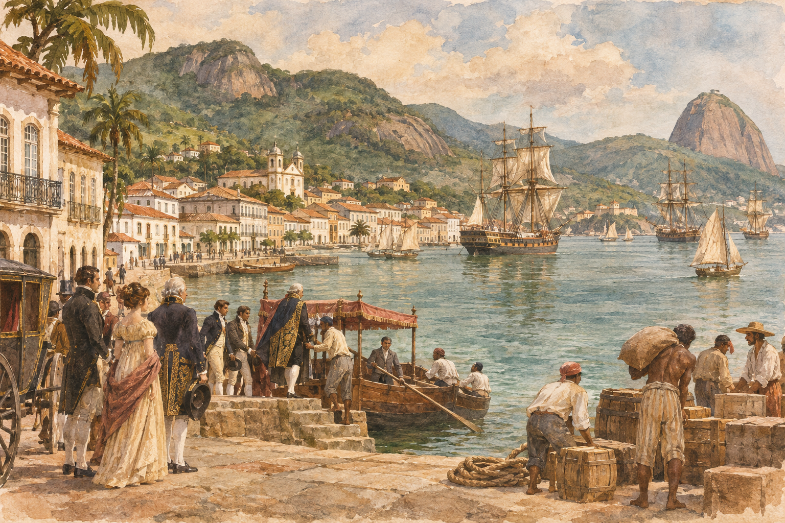

# 1808년 리우 — 유럽의 왕실이 식민지로 건너오다

*포르투갈 궁정의 대서양 이동이 항구·기관·도시의 위상을 바꾸다*

History · America

> 출처 대조와 공개 게시 승인을 마친 이야기입니다. 실제 게시 여부는 사이트 배포 상태를 따릅니다.

*AI 이야기 장면 삽화 · 작품·역사적 상황을 떠올리기 위한 그림이며 실제 사진이나 정확한 복원이 아닙니다.*

식민지를 다스리는 왕은 보통 바다 건너 본국에 있다고 생각하기 쉽다. 그런데 1808년 포르투갈 왕실은 대서양을 건너 브라질의 리우데자네이루에 자리 잡았다. 식민지가 왕실의 명령을 받는 곳에서 왕실이 직접 머무는 곳으로 달라진 것이다.

이 이동은 화려한 이사 이야기만이 아니다. 유럽의 전쟁이 항구와 무역, 행정과 일상을 바꾸었다. 왕실이 왔으니 모두에게 좋은 일이 생겼다고도 할 수 없다. 리우의 변화를 따라가면 제국의 중심이 움직일 때 어떤 기회와 부담이 함께 생기는지 보인다.

## 01. 나폴레옹의 전쟁이 대서양을 움직이다

포르투갈 왕실이 브라질로 건너간 배경에는 나폴레옹 시대의 유럽 전쟁과 침공의 위협이 있었다. 왕실의 이동은 관광이나 식민지 순방이 아니라 통치 체제를 지키기 위한 선택이었다. 바다가 멀다고 해서 아메리카가 유럽의 전쟁에서 떨어져 있었던 것은 아니다.

이 사건을 보면 제국이 단순히 한 수도와 여러 주변 지역으로 고정되어 있지 않다는 사실을 알 수 있다. 군사적 압력이 가해지자 통치의 중심을 옮기는 방안이 가능해졌다. 배는 사람과 물건뿐 아니라 궁정의 기능과 권위도 실어 날랐다.

## 02. 살바도르를 거쳐 리우에 도착하다

왕실 일행은 브라질 북동부의 살바도르에 들른 뒤 남동부의 리우데자네이루로 향했다. 긴 이동의 끝에 도착한 곳은 텅 빈 땅이 아니라 이미 항구와 상업, 행정의 기능이 있던 도시였다. 새로운 궁정은 그 기존 도시 위에 들어왔다.

왕실의 도착을 본 사람들의 경험도 같지 않았을 것이다. 왕실과 가까워질 기회를 얻은 사람, 물자와 공간을 마련해야 했던 사람, 원래의 일상을 이어 가던 사람이 함께 있었다. 한 번의 도착을 도시 전체가 같은 마음으로 맞이했다고 상상하기보다 서로 다른 자리를 떠올리는 편이 정확하다.

## 03. 항구가 열리면 거래의 방향이 달라진다

왕실이 브라질에 머물기 시작한 시기의 중요한 변화는 항구 개방이었다. 포르투갈을 중심으로 묶여 있던 식민지 교역의 조건이 달라졌고 특히 영국과의 관계가 중요해졌다. 왕실의 거처를 옮기는 일과 무역 규칙을 바꾸는 일이 서로 연결된 것이다.

항구 개방이라는 말은 추상적이지만 실제로는 누가 물건을 들여오고 누구에게 팔 수 있는지의 문제다. 새로운 거래 상대가 생기면 이익을 얻는 사람과 경쟁이 커지는 사람이 달라진다. 도시의 변화는 궁전 안의 행사뿐 아니라 부두와 창고, 상인의 계산에서도 일어났다.

## 04. 식민지의 생산을 묶었던 조건도 바뀌다

브라질의 제조업을 제한하던 조치가 풀리고 새로운 경제 기관이 만들어졌다. 브라질 은행의 설립도 이 시기의 변화 가운데 하나다. 왕실을 유지하고 거래를 운영하려면 단순히 왕족의 숙소만 마련해서는 부족했다. 돈과 행정을 움직이는 체계가 필요했다.

제도의 이름만 나열하면 이 변화가 멀게 느껴진다. 하지만 이전에는 본국의 이익에 맞춰 제한하던 활동을 브라질 현지의 통치와 경제를 위해 다시 조정했다는 뜻으로 읽을 수 있다. 식민지를 바라보는 왕실의 필요가 달라지자 허용되는 일과 필요한 기관도 달라졌다.

## 05. 도서관과 학교 곁에는 새로운 비용이 있었다

궁정의 존재는 문화와 교육 기관의 확충과 연결되었다. 책과 지식을 모으는 시설, 사람을 가르치고 돌보는 기관은 도시의 기능을 넓혔다. 다만 기관이 늘었다는 사실을 곧바로 모든 주민의 생활이 같은 정도로 나아졌다는 뜻으로 바꾸어서는 안 된다.

왕실과 관료 조직, 전쟁을 유지하는 데에는 비용이 들었다. 이를 감당하기 위한 세금은 또 다른 부담이었다. 새로운 문화 시설이 생겼다는 반가운 소식과 늘어난 지출의 무게는 같은 도시 안에 함께 존재할 수 있다. 발전의 역사는 무엇을 얻었는지와 누가 비용을 냈는지를 함께 물어야 한다.

## 06. 리우가 중심이 되는 일의 양면

브라질의 통치가 리우를 중심으로 모이면서 도시의 중요성은 커졌다. 멀리 떨어진 지역을 하나의 행정적 흐름으로 묶는 힘이 생겼지만, 다른 지역에서 보면 결정이 특정 도시에 집중되는 변화이기도 했다. 수도의 성장은 전체의 균등한 성장과 같은 말이 아니다.

그렇다고 왕실의 이동만으로 이후의 독립 과정이 모두 설명되는 것은 아니다. 지역의 이해관계와 정치적 갈등은 계속 남았다. 다만 왕실이 아메리카에서 직접 통치한 경험은 본국과 식민지라는 기존 관계를 이전과 똑같이 유지하기 어렵게 만든 중요한 조건이었다.

## 07. 유럽의 사건을 브라질의 도시사로 읽기

1808년을 나폴레옹의 전쟁 연표에서만 보면 왕실의 이동은 짧은 한 줄로 지나간다. 리우의 눈으로 보면 항구의 규칙과 기관, 도시의 위상과 주민의 부담이 바뀌는 큰 사건이다. 같은 역사를 어느 장소에서 바라보느냐에 따라 중심 장면이 달라진다.

이 사건을 읽으며 궁정의 이동과 주민의 이동을 구별해 볼 필요도 있다. 권력이 옮겨 간다는 것은 단순히 사람이 많이 도착한다는 뜻보다 넓다. 결정권과 돈의 흐름, 도시 사이의 위계가 새로운 방향으로 맞춰지는 변화다.

리우를 해변과 축제의 도시로만 기억했다면 이 오래된 궁정의 시간을 더해 보자. 도시는 유명한 풍경 이전에도 세계의 전쟁과 무역이 만나는 곳이었다. 유럽에서 시작된 위기가 바다 건너 도시의 일상을 바꾸었다는 사실이 리우의 역사를 한층 입체적으로 만든다.

## 이야기의 바탕이 된 자료

- [OpenStax World History — Portuguese South America](https://raw.githubusercontent.com/openstax/osbooks-world-history/main/modules/m00015/index.cnxml) · 확인일 2026-11-05
  - 확인 내용: 프랑스 침공 위협·1808년 왕실 이동·살바도르 경유·리우 정착·항구 개방과 영국·제조업 제한 폐지·은행·문화 기관·세금·통치 집중

---

[같은 소주제의 이야기](README.md) · [전체 서가](../../README.md)
