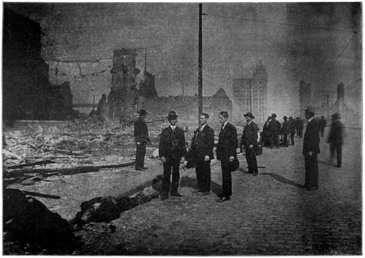

# 샌프란시스코 1906 — 땅이 멈춘 뒤에도 도시는 왜 계속 불탔을까

*1906년 지반과 수도관, 화재와 피난에서 읽는 도시의 연결*

History · America

> 출처 대조와 공개 게시 승인을 마친 이야기입니다. 실제 게시 여부는 사이트 배포 상태를 따릅니다.

*Richard Linthicum, Trumbull White and Samuel Fallows, Complete Story of the San Francisco Horror, Market Street Scene of Ruins · Public Domain.1906년 재난의 폐허를 보여 주는 역사 사진입니다.*

[이미지 출처·제작 근거](https://raw.githubusercontent.com/GITenberg/Complete-Story-of-the-San-Francisco-Horror_26380/master/26380-h/images/cssfh10.jpg) · Public Domain · 저작권 만료 작품 및 역사 출판 자료

1906년 4월 18일 아침 샌프란시스코를 강한 지진이 덮쳤다. 그러나 도시의 큰 피해는 흔들림이 지나간 뒤에도 계속 커졌다. 불이 번졌고 물이 부족했으며 사람들은 집을 떠나야 했다. 지진의 세기만으로는 설명되지 않는 재난이었다. 땅속의 배관과 거리의 통로, 피난과 구호의 조직이 어떤 역할을 했는지 따라가 보자.

## 01. 도시는 단단한 땅에만 서 있지 않았다

샌프란시스코는 항구와 상업의 성장 속에서 해안의 매립지까지 넓어졌다. 같은 도시 안에서도 지반의 조건이 달랐다. 건물의 높이와 재료뿐 아니라 그 아래 어떤 땅이 있는지도 흔들림의 피해를 좌우했다.

1906년의 기록에는 거리와 건물의 파손이 자세히 등장한다. 다만 당시의 설명을 오늘날 지진학의 확정된 분석과 똑같이 받아들일 수는 없다. 관찰한 피해와 뒤에 연구로 밝힌 원인을 구분하며 읽어야 한다.

항구와 도로, 건물은 오랫동안 쌓인 투자와 판단의 결과였다. 평소의 빠른 성장에 유리한 선택이 재난 때에는 위험을 키울 수도 있었다. 따라서 피해를 자연의 힘에만 돌리면 도시가 어떤 조건 위에 커졌는지를 검토할 기회를 잃는다.

## 02. 지진은 물을 보내는 길도 끊었다

배관이 손상되면서 소방에 필요한 물의 공급이 크게 흔들렸다. 도시는 바다 가까이에 있었지만 바닷물이 바로 모든 거리의 소화전으로 나오는 것은 아니었다. 물을 끌어오고 압력을 유지하며 필요한 곳에 보내는 시설이 있어야 했다.

평소에는 잘 보이지 않는 물 공급망이 재난 때 핵심이 되었다. 건물이 서 있어도 도시를 지탱하는 시설이 끊기면 위험은 계속된다. 피해의 지도는 무너진 벽만이 아니라 땅속에서 작동하지 않게 된 연결까지 포함해야 한다.

소화전에서 물이 나오는 일은 취수와 저장, 배관과 압력이 함께 유지되어야 가능한 서비스였다. 눈에 보이는 수도꼭지만 잘 만들어서는 충분하지 않다. 지진은 이 연결 중 여러 곳을 동시에 손상시킬 수 있었고 한 지점만 고쳐서는 전체가 회복되지 않았다.

## 03. 여러 곳의 작은 불이 거대한 화재가 되다

지진 뒤 여러 지점에서 불이 났다. 손상된 거리와 건물, 부족한 물과 바람의 조건 속에서 화재는 확산되었다. 한 곳의 불을 끄는 동안 다른 곳에서 번지는 불을 감당해야 하는 상황이었다.

소방관의 용기만으로 모든 문제를 해결할 수는 없었다. 물과 장비, 길과 지휘가 함께 작동해야 했다. 한 사람의 영웅적 행동을 강조하는 기록을 읽으면서도 그 행동이 가능하려면 어떤 시설과 조직이 필요했는지 살펴야 한다.

## 04. 건물을 폭파하는 선택도 안전한 정답은 아니었다

불길을 끊기 위해 건물을 폭파해 빈 공간을 만들려는 시도가 있었다. 그러나 폭약과 작업의 방식, 바람과 불씨의 움직임에 따라 결과는 달랐다. 막으려 한 행동이 항상 원하는 효과를 낸 것은 아니었다.

급박한 상황에서 한 선택을 뒤의 지식만으로 쉽게 비난하거나 반대로 모두 영웅적인 결단으로 칭찬할 수는 없다. 무엇을 알고 어떤 자원을 가졌으며 어떤 결과가 확인되는지 나누어 보아야 한다. 재난 대응은 의지만이 아니라 정보와 기술의 문제였다.

## 05. 피난은 집 밖으로 나오는 일에서 끝나지 않았다

많은 주민이 공원과 넓은 공간, 주변 지역으로 이동했다. 짐을 옮기고 가족을 찾으며 먹을거리와 물, 잠자리를 구해야 했다. 건물의 피해를 피한 뒤에도 생활을 유지하는 새로운 과제가 이어졌다.

군과 행정기관, 시민 조직은 구호와 통제에 관여했다. 그러나 도움을 받는 사람들의 조건은 같지 않았다. 재산과 언어, 공동체의 연결에 따라 피난과 정보 접근이 달랐다. 모든 이재민을 하나의 수동적인 군중으로 설명할 수는 없다.

피난길에서는 통행 가능한 길과 다리, 선착장에 관한 정보가 중요했다. 소문이 빠르게 퍼지는 상황에서 어느 방향이 안전한지 판단하기도 어려웠다. 재난 대응의 자원에는 음식과 장비만이 아니라 믿을 수 있는 안내와 소식의 전달도 포함된다.

## 06. 차이나타운의 피해는 편견의 문제와 만났다

중국인 공동체도 거처와 생업을 잃었다. 당시 기록 중에는 이들의 지역을 호기심과 인종적 편견으로 묘사한 내용이 있다. 낡은 거리를 사라진 풍경으로 구경하는 시각은 그곳에서 살던 주민의 권리와 회복을 가린다.

재건은 빈 땅에 무엇을 세울지 고르는 일만이 아니었다. 누가 원래의 생활 공간으로 돌아올 수 있는지도 중요했다. 도시를 새롭게 만들겠다는 계획은 이미 살던 사람들의 거처와 생업을 둘러싼 정치적 선택이 될 수 있었다.

재건의 속도를 자랑하는 사진에는 돌아오지 못한 주민의 시간이 잘 드러나지 않는다. 새 건물이 생겼다는 지표와 원래 살던 사람들이 생업을 회복했다는 지표는 다르다. 도시의 회복을 평가하려면 두 가지를 함께 살펴야 한다.

## 07. 다시 세운 건물보다 넓게 재건을 읽기

도시는 건물과 상업을 회복했지만 재난의 교훈은 외관을 복구하는 데 그치지 않았다. 물과 소방, 건축과 지반을 연결해서 생각해야 했다. 한 시설의 고장이 다른 피해를 크게 만드는 관계가 드러났기 때문이다.

1906년을 폐허에서 다시 일어난 성공담으로만 기억하면 피난과 재건에서 서로 달랐던 경험이 사라진다. 도시는 건물의 집합이 아니라 물과 길, 정보와 권리가 맞물린 생활의 기반이었다. 땅의 흔들림이 멈춘 뒤에도 재난이 계속된 이유는 바로 그 연결에 있었다.

## 이야기의 바탕이 된 자료

- [Charles Morris, editor, The San Francisco Calamity by Earthquake and Fire](https://raw.githubusercontent.com/GITenberg/The-San-Francisco-Calamity-by-Earthquake-and-Fire_1560/master/1560-0.txt) · 확인일 2026-11-08
  - 확인 내용: 1906년4월18일·지반/매립지·배관 손상과 물 부족·확산 화재·폭파 시도·피난과 구호·재건. 당시 피해 추정 수치와 현대 지진학의 분석을 구분하고 민족 비하/공포의 수사를 옮기지 않음
- [Richard Linthicum, Trumbull White and Samuel Fallows, Complete Story of the San Francisco Horror](https://raw.githubusercontent.com/GITenberg/Complete-Story-of-the-San-Francisco-Horror_26380/master/26380-8.txt) · 확인일 2026-11-08
  - 확인 내용: 당시 거리/피난/화재 기록과 Market Street 폐허 사진. 제목의 공포 서사와 검증되지 않은 총피해/사망 수, 인종적 고정관념과 극적인 개인 일화는 사실처럼 전재하지 않음

---

[같은 소주제의 이야기](README.md) · [전체 서가](../../README.md)
