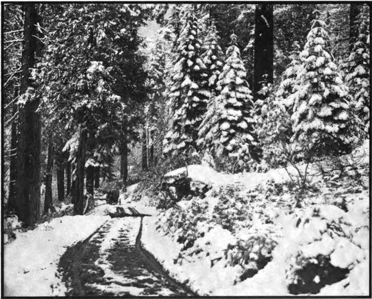

# 미국 대륙횡단철도 — 마지막 못 아래에는 누구의 일이 있었을까

*정부 지원과 두 회사의 경쟁, 노동과 토지 위에 놓인 연결*

History · America

> 출처 대조와 공개 게시 승인을 마친 이야기입니다. 실제 게시 여부는 사이트 배포 상태를 따릅니다.

*Union Pacific / Southern Pacific, The Overland Route to the Road of a Thousand Wonders, Up at Summit the Domain of King Snow · Public Domain. 후대의 산악 철도 역사 사진이며1869년 접합식이나 공사 당일 사진이 아닙니다.*

[이미지 출처·제작 근거](https://raw.githubusercontent.com/GITenberg/The-Overland-Route-to-the-Road-of-a-Thousand-Wonders-The-Route-of-the-Union-Pacific-The-South__51849/master/51849-h/images/p64.jpg) · Public Domain · 저작권 만료 작품 및 역사 출판 자료

1869년 5월 10일 미국 서부에서 두 철도가 만났다. 마지막 못을 박는 기념 장면은 대륙을 철길로 연결한 순간으로 기억된다. 그러나 사진 속의 인물들만으로 그 길이 만들어진 것은 아니다. 정부의 지원과 회사의 경쟁, 산을 뚫은 노동과 원주민의 땅이 함께 놓여 있었다. 연결의 역사에서 무엇이 빨라졌고 누가 비용을 치렀는지 살펴보자.

## 01. 서쪽으로 가는 길이 필요했다

캘리포니아의 금과 태평양 연안의 성장으로 동서 교통의 중요성이 커졌다. 육로로 긴 거리를 가거나 바다를 돌아가는 데에는 시간과 비용이 들었다. 철도는 상품과 사람을 움직이는 수단인 동시에 넓은 영토를 통제하고 연결하려는 국가의 사업이었다.

어느 길을 택할지에는 지역의 이해관계가 걸려 있었다. 지도를 보고 가장 짧은 선을 긋는 것만으로 결정되지 않았다. 출발점과 경로를 정하는 일은 어떤 도시와 토지가 혜택을 얻을지를 정하는 정치적 선택이기도 했다.

미국의 동부에는 이미 여러 철도가 있었다. 새 노선은 그 기존 교통망과 태평양 쪽의 지역을 이어 주는 사업이었다. 그래서 대륙을 연결했다는 말을 이해하려면 새로 놓은 선로뿐 아니라 그 선로가 어디에서 다른 길과 만났는지도 보아야 한다.

## 02. 민간 회사 뒤에 국가의 지원이 있었다

1862년의 법과 이후의 조치는 철도 건설에 대한 연방정부 지원의 틀을 마련했다. 채권을 통한 자금과 토지의 제공은 회사들이 큰 공사를 추진하는 기반이었다. 순수하게 개인 사업가의 돈과 결단만으로 이루어진 일은 아니었다.

지원은 공공의 목표를 위해 민간 회사를 활용하는 방식이었다. 동시에 어떤 조건으로 돈과 토지를 주며 공사 실적을 어떻게 판단할 것인지가 문제가 되었다. 국가를 연결한다는 명분과 회사의 이익이 언제나 같은 방향인 것은 아니었다.

건설을 맡는 조직과 철도를 운영하는 조직이 어떤 계약을 맺는지에 따라 이익을 얻는 방식도 달라졌다. 공사비와 정치적 영향력을 둘러싼 논란이 뒤따랐다. 정부의 지원이 컸다는 사실은 사업의 공공성을 보장하는 동시에 감시의 필요성을 키웠다.

## 03. 동쪽과 서쪽의 공사 조건은 달랐다

유니언 퍼시픽은 동쪽에서 서쪽으로, 센트럴 퍼시픽은 캘리포니아에서 동쪽으로 공사를 진행했다. 산과 평원, 자재를 구할 수 있는 거리와 날씨에 따라 작업의 난도는 달랐다. 같은 길이의 선로라고 필요한 노동과 비용이 같지는 않았다.

서쪽의 시에라네바다산맥에서는 암반과 눈, 터널이 큰 장애였다. 레일을 놓기 전에 경사를 맞추고 통로를 만들며 자재를 올려야 했다. 지도의 가는 선에는 이런 높이와 계절의 차이가 잘 드러나지 않는다.

눈을 치우고 터널을 뚫는 작업은 개통 뒤에도 끝나지 않았다. 통로를 낸 다음에는 그 통로를 열어 두어야 한다. 장거리 교통의 안정성은 기관차의 성능만이 아니라 산악 시설을 점검하고 계절의 위험을 줄이는 노동에 달려 있었다.

## 04. 중국인 노동자는 사진 밖에도 있었다

센트럴 퍼시픽의 공사에는 많은 중국인 노동자가 참여했다. 임금과 대우의 차이, 위험한 작업 조건 속에서 이들은 산악 구간을 만드는 데 중요한 역할을 했다. 유니언 퍼시픽 쪽에도 여러 출신의 노동자들이 있었다.

어떤 집단 하나만이 전체 노선을 만들었다고 설명할 수는 없지만, 기념의 중심에서 누락된 노동을 다시 보는 일은 필요하다. 마지막 의식에 누가 대표로 서 있었는지와 실제로 긴 공사를 수행한 사람들이 누구였는지는 같은 명단이 아니다.

## 05. 레일이 만났다고 모든 여행이 직통은 아니었다

두 회사의 선로는 유타의 프로먼토리 서밋에서 연결되었다. 흔히 쓰이는 프로먼토리 포인트라는 지명과는 구분할 필요가 있다. 기념행사는 멀리 떨어진 사람들에게 연결의 완성을 알리는 강력한 장면이 되었다.

그렇다고 오늘날 미국의 양쪽 바닷가를 한 열차로 끊김 없이 달리는 모든 조건이 그날 완성된 것은 아니다. 기존 철도와의 접속, 강을 건너는 교통, 시간표와 운영이 함께 필요했다. 하나의 접합점과 실제 이동망 전체의 완성은 다른 수준의 이야기다.

## 06. 열린 길은 이미 살던 사람의 땅을 지났다

철도는 빈 대륙에 처음 그은 선이 아니었다. 원주민 공동체가 생활하고 이동하던 땅을 통과했다. 군사적 압박과 정착의 확대, 자원 이용의 변화는 그 생활 기반을 크게 흔들었다. 교통의 편리함만으로 전체의 손익을 계산할 수 없는 이유다.

농장과 상업 도시에는 더 넓은 시장이 열릴 수 있었지만 그 과정은 기존의 토지 관계를 바꾸었다. 같은 노선을 누군가는 진보의 길로, 다른 누군가는 생활 공간을 잃는 경계로 경험했다. 두 경험은 같은 지도 위에 존재한다.

철도 회사가 받은 땅의 가치는 주변에 사람이 정착하고 거래가 늘면 달라질 수 있었다. 운송 수입과 토지의 이익은 서로 연결되었다. 선로 건설을 단순히 열차 한 대가 다닐 길을 만드는 일로만 보면 그 배후의 개발과 소유권 재편이 보이지 않는다.

## 07. 개통 이후에도 철길은 다시 만들어졌다

노선과 시설은 개통 이후에도 개선되었다. 산악 구간을 관리하고 우회로를 만들며 차량과 운행 체계를 바꾸는 일이 이어졌다. 함께 실은 눈 덮인 산악 철도 사진은 후대의 여행 안내서에 실린 모습이며1869년 기념식 사진이 아니다.

철도가 연결했다는 말을 읽을 때에는 누구와 누구를, 어떤 비용으로 연결했는지 덧붙여 볼 수 있다. 마지막 못은 길의 끝이 아니라 운영과 유지의 시작이었다. 화려한 하루 뒤에 남는 것은 매일 움직여야 하는 거대한 시설과 그 시설을 떠받친 사람들의 역사다.

## 이야기의 바탕이 된 자료

- [John Moody, The Railroad Builders — Linking the Oceans](https://raw.githubusercontent.com/GITenberg/The-Railroad-Builders--A-Chronicle-of-the-Welding-of-the-States_3036/master/3036.txt) · 확인일 2026-11-08
  - 확인 내용: 1862/1864법과 정부 자금/토지·두 회사의 방향과 경쟁·산악 공사·1869년5월10일 연결·이후 개선과 이익 구조. 저자의 개발 중심 평가와 Promontory Point라는 지리 표기를 그대로 따르지 않음
- [Union Pacific / Southern Pacific, The Overland Route to the Road of a Thousand Wonders — illustration source](https://raw.githubusercontent.com/GITenberg/The-Overland-Route-to-the-Road-of-a-Thousand-Wonders-The-Route-of-the-Union-Pacific-The-South__51849/master/51849-0.txt) · 확인일 2026-11-08
  - 확인 내용: 눈 덮인 Summit 철도의 후대 여행 안내서 사진. 홍보 문구와 원주민에 대한 표현, 접합 장소의 잘못된 표기를 사실 서술의 근거로 사용하지 않음

---

[같은 소주제의 이야기](README.md) · [전체 서가](../../README.md)
