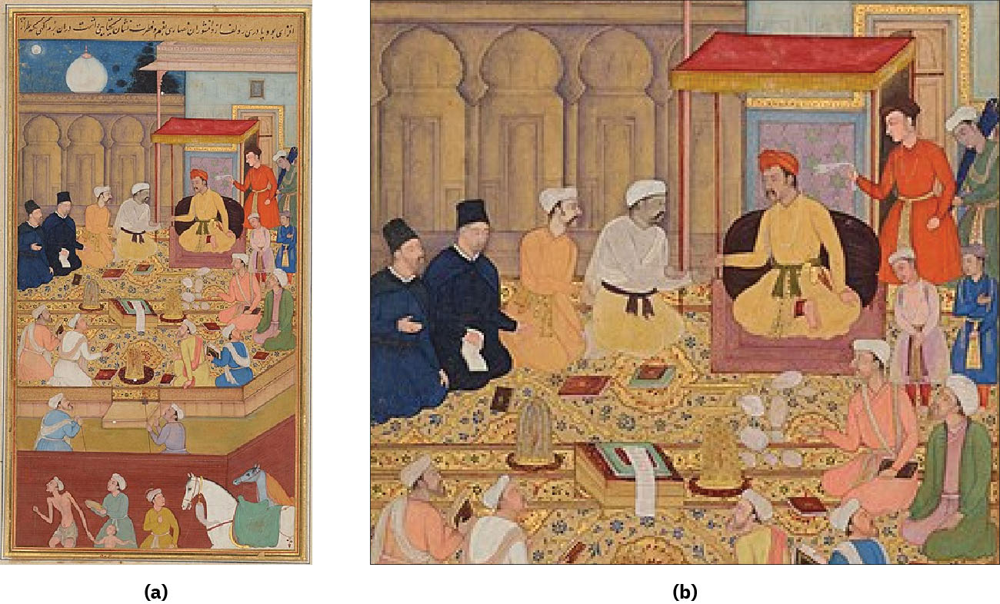

# 아크바르의 토론장 — 여러 신앙을 부른 황제는 무엇을 다스렸을까

*무굴 제국의 종교적 포용과 그 중심에 있던 황제의 권위*

생각과 지식 · 종교와 세계관

> 출처 대조와 공개 게시 승인을 마친 이야기입니다. 실제 게시 여부는 사이트 배포 상태를 따릅니다.

*Jesuits at Akbar’s court (1605), Chester Beatty/Wikimedia Commons · OpenStax 수록. 궁정 회화이며 토론의 대화를 그대로 기록한 자료가 아닙니다.*

[이미지 출처·제작 근거](https://raw.githubusercontent.com/openstax/osbooks-world-history/main/media/OSX_WorldHist_B02_01_Akbar.jpg) · Public Domain

16세기 무굴 황제 아크바르의 궁정에는 서로 다른 종교의 사람들이 토론에 참여했다. 그 장면만 보면 오늘날의 종교 간 대화가 오래전부터 같은 방식으로 열렸던 것처럼 느낄 수 있다. 그러나 토론의 문을 연 사람은 제국을 확장하고 통치하던 황제였다. 다양한 신앙을 인정하는 정책과 그 위에서 권위를 행사하는 권력은 아크바르의 통치 안에 함께 있었다.

## 01. 넓어진 제국에는 다른 신앙의 사람들이 살았다

아크바르는 군사적 정복으로 영토를 넓혔다. 그러면서 지역의 지배자들이 자신에게 복종하면 기존의 땅을 계속 다스리도록 허용하기도 했다. 새 영토를 차지하는 일과 그곳을 안정적으로 통치하는 일은 다른 과제였다.

무슬림과 힌두교도가 함께 사는 사회를 한 가지 관습으로만 묶기는 어려웠다. 황제는 군대와 행정에 서로 다른 배경의 사람을 받아들였다. 포용은 개인의 호기심일 뿐 아니라 제국의 사람과 자원을 연결하는 통치 방식이기도 했다.

아크바르의 행정에서는 지방을 나누고 여러 업무를 맡은 관리들을 두었다. 군사적 역할과 조세 수입에 연결된 관직도 운영했다. 종교 토론의 개방적인 장면만 보면 그 옆에 있던 인사와 세입의 통제가 빠진다. 대화와 행정은 모두 같은 황제의 통치 안에서 이루어졌다.

## 02. 궁정의 결혼도 정치적 연결이었다

아크바르는 여러 지역 지배자 집안의 여성과 혼인 관계를 맺었다. 힌두교 신앙을 가진 부인들에게 개종을 강요하지 않았다는 점은 종교적 차이를 다루는 태도를 보여 준다. 왕실의 관계는 제국을 묶는 정치의 일부였다.

그렇다고 왕실의 모든 사람이 동등한 권한을 가졌다는 뜻은 아니다. 궁정 여성의 활동에는 제한이 있었지만 재산과 후원, 친족 관계를 통해 영향력을 행사하기도 했다. 통치의 실제 모습은 공식 직함을 가진 남성만으로 설명되지 않는다.

## 03. 처음부터 모든 종교가 초대된 것은 아니었다

황제가 만든 토론 공간에서는 처음에 이슬람 학자들이 법과 신학을 논했다. 아크바르는 질문을 던졌고 학자들은 견해를 내놓았다. 한 신앙 안에서도 해석과 권위를 둘러싼 차이가 있었다.

이후 그는 다른 종교의 대표자들도 불렀다. 포르투갈의 예수회 선교사도 참여했다. 토론의 범위가 넓어진 것은 황제가 모든 교리에 동의해서가 아니었다. 서로 다른 답을 들으려는 태도와 어떤 답을 받아들일지 결정하는 권한은 구별해야 한다.

## 04. 관심과 개종은 같은 일이 아니었다

아크바르는 기독교의 가르침에 관심을 보였지만 예수회가 전한 교리를 그대로 받아들이지는 않았다. 선교사가 궁정에 들어갔다고 해서 황제의 개종이나 기독교의 승리가 이루어진 것은 아니다.

토론장에 참여한 사람들이 기대한 결과도 같지 않았을 것이다. 황제에게는 지식과 통치의 문제였지만 선교사에게는 신앙을 전할 기회였다. 하나의 만남을 어느 한쪽의 목적만으로 설명하면 실제로 오간 차이와 거절이 사라진다.

## 05. 다른 법과 후원을 허용하는 방식도 있었다

아크바르는 힌두교 사원의 건립과 지원을 허용했고 비무슬림에게 부과되던 인두세도 없앴다. 신앙의 차이를 세금과 법, 시설의 운영에서 어떻게 다루느냐는 사람들의 생활과 직접 연결되는 문제였다.

이런 정책을 오늘날의 종교와 국가가 분리된 제도와 같다고 볼 수는 없다. 황제가 각 공동체의 위치를 결정하는 권한은 여전히 강했다. 차이를 인정했다는 사실과 모든 주민이 평등한 정치적 권리를 가졌다는 주장은 다른 차원이다.

군대와 관직에 힌두교도를 받아들이는 정책은 서로 다른 배경의 지배층을 황제에게 연결하는 효과가 있었다. 이 관계를 단순히 신앙에 대한 선의로만 설명할 수는 없다. 다름을 허용하는 정책에는 제국을 운영할 사람을 확보하는 현실적인 필요도 함께 있었다.

## 06. 토론의 중심에는 황제 자신이 있었다

아크바르는 종교 문제에서 자신의 최종 권위를 강화하려 했다. 여러 신앙의 요소를 받아들인 개인적 신앙 공동체에서도 그 자신이 중심에 놓였다. 그 변화는 궁정의 일부 무슬림에게 불안을 주었다.

황제의 포용을 설명하려면 누구든 자유롭게 권력자를 비판할 수 있는 환경이었는지도 별도로 물어야 한다. 다양한 말을 듣는 통치자와 그 말들 위에서 결정하는 통치자는 같은 사람일 수 있다. 대화가 열렸다는 사실만으로 권력의 비대칭이 사라지지는 않는다.

## 07. 여러 목소리가 남긴 장면을 읽는 방법

아크바르 시대의 궁정에서는 여러 언어의 책을 모으고 번역과 학문을 지원하는 활동도 이루어졌다. 토론은 이런 지적 후원의 환경과 연결되어 있었다. 다만 그 번영을 말할 때 조세를 부담한 농민의 생활까지 저절로 풍요로웠다고 단정해서는 안 된다.

종교 토론을 그린 역사 회화는 다양한 인물이 황제 앞에 모인 모습을 남겼다. 그림을 대화의 정확한 속기록처럼 읽을 수는 없지만 누가 중심에 있는지는 보인다. 아크바르의 토론장은 차이에 대한 관심과 제국의 권위를 함께 보여 준다.

왕실의 후원을 받은 여성들은 종교 시설과 여행자 숙소, 예술가를 지원하기도 했다. 궁정의 지식과 교류를 황제 혼자 만들어 낸 것으로 정리하기 어려운 이유다. 다만 부유한 왕실 여성의 활동이 곧 일반 여성의 생활 조건을 보여 주는 것은 아니다.

## 이야기의 바탕이 된 자료

- [OpenStax, World History Volume 2 — India and International Connections](https://raw.githubusercontent.com/openstax/osbooks-world-history/main/modules/m00008/index.cnxml) · 확인일 2026-11-13
  - 확인 내용: 아크바르의 정복·지방 지배자 수용/무슬림·힌두교 관직/궁정 결혼·여성의 후원/종교토론·예수회/인두세 폐지/황제의 최종 권위·도서관 번역. 원문의 인두세 폐지1568년은 부정확해 채택하지 않음. 정신의학 진단·독자적인 단일 종교 창설로 단정하지 않음.

---

[같은 소주제의 이야기](README.md) · [전체 서가](../../README.md)
