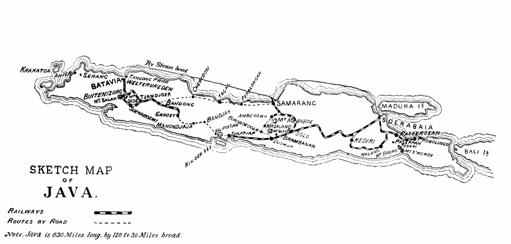

# 반둥회의 — 두 강대국 사이에서 다른 선택이 가능했을까

*1955년 아시아·아프리카의 만남과 비동맹이 던진 질문*

역사 · 전쟁과 외교

> 자료 대조를 마친 검토용 이야기입니다. 공개 게시 승인은 아직 받지 않았습니다.

*W. Basil Worsfold, A Visit to Java (1893), Sketch Map of Java. 식민 지배 시기의 지도이며 반둥이 있는 자바의 위치를 살피는 자료입니다. 1955년 회의 장면이나 독립 이후 국경의 지도가 아닙니다.*

[이미지 출처·제작 근거](https://raw.githubusercontent.com/GITenberg/A-Visit-to-JavaWith-an-Account-of-the-Founding-of-Singapore_27152/master/27152-h/images/map-big.png) · Public Domain

냉전의 세계를 미국 편과 소련 편이라는 두 색으로 칠하면 새로 독립한 국가들의 선택이 잘 보이지 않는다. 1955년 4월 인도네시아 반둥에는 아시아와 아프리카 29개 국가의 대표들이 모였다. 이들은 산업과 발전의 과제를 안고 있었지만 강대국의 영향 아래 다시 묶이기를 원하지 않았다. 반둥의 질문은 어느 편의 지원을 받을 것인가를 넘어 누가 자신의 미래를 결정할 것인가였다.

## 01. 독립 선언 뒤에도 필요한 것이 많았다

식민 지배를 벗어난 뒤에는 정부를 운영하고 경제를 발전시키는 과제가 남았다. 정치적 독립이 공장과 시설, 자금을 곧바로 만들어 주지는 않았다. 대외적인 도움을 찾을 이유가 있었고 그 도움에는 영향력이 따라올 수 있었다.

그래서 주권은 국기와 정부가 생기는 순간에 완성되는 것만은 아니었다. 외부의 자원을 이용하면서도 정책을 스스로 정할 수 있는지가 중요했다. 발전을 위한 연결과 새로운 종속의 위험을 함께 다루어야 했다.

인도네시아에서는 1945년 독립 선언 뒤에도 네덜란드와의 관계를 둘러싼 과정이 이어졌고 1949년에 독립이 공식적으로 인정되었다. 독립을 하나의 날짜로만 설명하기 어려운 배경이었다. 반둥의 만남은 이런 최근의 경험을 가진 국가에서 열렸다.

## 02. 냉전의 진영 구분은 선택을 좁혔다

미국과 소련은 여러 지역에서 동맹과 우호국을 늘리려 했다. 인구와 자원, 전략적 위치를 가진 국가는 특히 관심의 대상이 되었다. 새 국가들은 자신의 필요뿐 아니라 강대국의 기대도 마주했다.

그러나 모든 원조와 거래가 같은 성격을 가진 것은 아니었다. 지원을 받았다는 사실만으로 그 국가가 언제나 상대의 지시에 따랐다고 단정할 수는 없다. 새 국가의 지도자도 조건을 계산하고 여러 관계를 활용하려 했다.

## 03. 반둥의 만남은 서로를 협력의 대상으로 보았다

회의에 모인 대표들은 산업화를 추진하면서 유럽이나 두 초강대국에만 의존하지 않을 가능성을 찾았다. 다른 아시아·아프리카 국가들도 필요한 관계의 상대가 될 수 있다는 생각이었다. 주변부로 취급되던 국가들이 서로를 직접 바라보았다.

다만 같은 회의장에 모였다는 사실이 이해관계의 완전한 일치를 뜻하지는 않는다. 국가의 규모와 정치 체제, 외교적 관계는 서로 달랐다. 공동의 문제를 논하는 것과 하나의 정책을 계속 공유하는 것은 다른 과제였다.

반둥이 아시아와 아프리카의 만남이었다는 점은 유럽의 강대국들이 다른 지역의 질서를 논하던 방식과 다른 장면을 만들었다. 물론 대표가 참여했다고 모든 주민의 목소리가 직접 들린 것은 아니다. 정부 대표의 외교와 사회 전체의 의사는 구분해야 한다.

## 04. 인도네시아는 양쪽과의 관계를 활용하려 했다

수카르노의 인도네시아는 비동맹의 중요한 무대가 되었다. 미국과 소련 모두 이 국가를 우호적인 상대로 만들고 싶어 했다. 인도네시아는 양쪽에서 도움을 받으면서도 어느 쪽이 자국의 일을 결정하게 두지 않겠다는 입장을 내세웠다.

이 방식에서 중립은 아무 교류도 하지 않는 고립과 달랐다. 여러 관계를 맺되 결정권을 지키는 것이 목표였다. 국제적 연결이 많다는 사실과 한 진영에 속해 있다는 사실은 같지 않았다.

양쪽의 지원을 받겠다는 선택은 외부와의 관계를 끊는 것보다 복잡한 조정을 요구했다. 도움을 제공한 쪽도 대가와 기대를 가질 수 있었다. 비동맹은 아무 부담이 없는 위치가 아니라 여러 힘 사이에서 자율성을 유지하려는 계속된 협상이었다.

## 05. 인도의 선택도 단순한 등거리만은 아니었다

네루의 인도 역시 미국과 소련 양쪽에서 원조를 받았다. 사회주의에 대한 관심과 중국에 대한 외교적 판단 등에서 서방과 다른 입장을 취하면서도 서방과 모든 관계를 끊지는 않았다.

비동맹을 두 강대국과 매번 정확히 같은 거리를 유지하는 행동 규칙으로 보면 실제 외교를 설명하기 어렵다. 쟁점에 따라 판단은 달라질 수 있었다. 핵심은 외부의 진영 분류가 자국의 모든 결정을 대신하지 못하게 하려는 의도였다.

## 06. 대외적 자율성이 국내의 민주주의를 보장하지는 않았다

수카르노는 이후 권력을 대통령에게 집중하는 방향으로 인도네시아의 정치를 바꾸었다. 바깥의 간섭을 거부하는 지도자가 국내의 다양한 목소리까지 동등하게 존중하는 것은 아니었다. 주권과 민주주의는 연결되지만 같은 개념은 아니다.

인도네시아의 외교 방향도 시간이 지나며 달라졌다. 비동맹이라는 이름이 한 국가의 행동을 영원히 설명해 주지는 않았다. 1955년의 목표와 이후 정권의 선택을 구분해야 회의를 이상화하지 않고 읽을 수 있다.

## 07. 반둥은 완성된 제도보다 가능성을 열었다

반둥회의는 비동맹 운동의 중요한 기반이 되었다. 그렇다고 그해 모든 참여국이 하나의 완성된 조직과 동일한 노선을 세운 것으로 이해해서는 안 된다. 이후의 제도와 행동은 별도의 역사를 가진다.

이 만남이 남긴 힘은 세계를 설명하는 주체가 초강대국만은 아니라는 데 있었다. 발전을 원하는 국가들은 지원의 수혜자이면서 자기 결정을 지키려는 행위자였다. 두 색으로 칠한 냉전의 지도 사이에는 협상하고 협력할 다른 공간이 있었다.

## 이야기의 바탕이 된 자료

- [OpenStax, World History Volume 2 — The Non-Aligned Movement](https://raw.githubusercontent.com/openstax/osbooks-world-history/main/modules/m00036/index.cnxml) · 확인일 2026-11-13
  - 확인 내용: 1955년4월반둥29개국/산업화·초강대국의존 회피/수카르노1945선언1949독립인정/양쪽원조·자율성/네루의 원조/인도네시아 권위주의와 외교변화.1955회의와 이후 비동맹조직을 동일시하지 않음. 원문의 인도가 소련과 국경을 접했다는 설명은 채택하지 않음.

---

[같은 소주제의 이야기](README.md) · [전체 서가](../../README.md)
