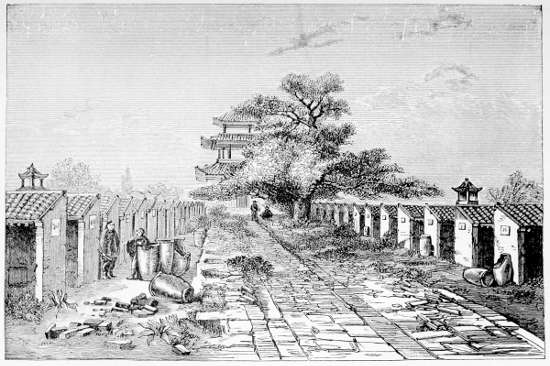

# 무술변법 — 황제의 명령만으로 국가는 바뀔 수 있었을까

*1898년 청의 개혁과 교육, 짧은 정치적 실험의 한계*

역사 · 혁명과 개혁

> 출처 대조와 공개 게시 승인을 마친 이야기입니다. 실제 게시 여부는 사이트 배포 상태를 따릅니다.

*S. Wells Williams, The Middle Kingdom, Vol. I, Interior of Kung Yuen, or Examination Hall, Peking. 기존 인재 선발 공간의 도판이며 1898년 개혁 현장 사진이 아닙니다. · Public Domain.*

[이미지 출처·제작 근거](https://raw.githubusercontent.com/GITenberg/The-Middle-Kingdom-Volume-I-of-2-A-Survey-of-the-Geography-Government-Literature-Social-Life-__57868/master/57868-h/images/zill_f550a.jpg) · Public Domain · 역사 출판 자료

황제가 개혁을 명령하면 관청과 학교가 곧바로 달라질까. 1898년 청의 광서제는 제도와 교육을 바꾸려는 조치들을 연이어 내놓았다. 흔히 무술변법 또는 백일유신이라고 부르는 시도다. 그러나 이 실험은 곧 권력의 역공에 부딪쳤다. 그 짧은 시간을 단순히 진보적인 황제와 보수적인 태후의 대결로만 보면, 명령을 실제 변화로 만들 힘이 어디에 있었는지 놓치게 된다.

## 01. 전쟁의 패배가 개혁의 긴급함을 드러냈다

청일전쟁의 패배와 1895년 시모노세키 조약은 청 조정에 큰 충격이었다. 이후 외국 세력이 항구와 지역에 대한 권리를 확대하면서 기존 방식으로 국가를 지킬 수 있는지에 대한 불안도 커졌다. 개혁은 학자의 추상적인 논의에 머물기 어려워졌다.

물론 패배가 모든 사람에게 같은 해법을 가르쳐 준 것은 아니었다. 군사 기술을 보완할지, 교육과 인재 선발을 바꿀지, 행정의 운영을 손볼지에 따라 이해가 갈렸다. 무엇을 얼마나 바꿀지를 정하는 일부터 정치적 갈등이었다.

전쟁 뒤 랴오둥반도를 둘러싼 열강의 개입과 항구에 대한 권리 확대는 바깥의 압력이 끝나지 않았음을 보여 주었다. 기술만 받아들이면 기존 질서를 그대로 지킬 수 있다는 기대가 흔들릴 수밖에 없었다. 무엇을 배울지라는 질문이 누가 결정할지라는 문제와 맞물렸다.

## 02. 개혁론자들은 황제에게 길을 찾았다

캉유웨이 등 개혁론자들은 기존 질서를 지키는 방식 자체를 바꾸어야 한다고 주장했다. 황제의 후원을 얻으면 관료의 저항을 넘어 제도를 고칠 수 있으리라는 기대가 있었다. 광서제의 명령은 개혁을 국가의 정책으로 추진할 출발점이 되었다.

하지만 명령을 내릴 지위와 그것을 집행할 실력은 같지 않았다. 관료 조직과 군사력, 황실 내부의 관계를 움직여야 했다. 황제라는 이름만으로 모든 권력이 한 사람의 손에 모여 있다고 가정해서는 실제의 취약함을 이해하기 어렵다.

## 03. 학교와 시험은 국가의 인재상을 정했다

개혁안에는 교육을 바꾸고 새로운 학문을 받아들이려는 내용이 포함되었다. 경전 지식만으로 관리의 역량을 판단하는 방식이 외부 세계의 압력에 대응하기에 충분한지 묻는 일이었다. 베이징에 새로운 교육 기관을 마련하려는 구상도 그 안에 있었다.

시험과 학교를 바꾸는 일은 교과목을 몇 개 추가하는 수준을 넘었다. 누가 유능한 사람으로 인정받고 관직에 나아갈지를 바꾸는 조치였다. 기존 방식에 오랜 시간을 투자한 사람들에게는 자신의 자격과 미래가 흔들리는 문제일 수 있었다.

새 과목이 평가 기준에 들어오면 지식을 준비하는 시간과 비용도 바뀐다. 기존 시험에 맞추어 공부한 사람은 다시 배워야 하고, 외국어와 새로운 책에 접근할 수 있는 사람은 다른 기회를 얻을 수 있다. 교육 개혁에는 인재를 뽑는 제도의 승자와 부담이 함께 생긴다.

## 04. 개혁은 종이에 적힌 순서대로 진행되지 않았다

짧은 기간 동안 여러 조치를 내놓으면 변화의 방향은 선명해 보일 수 있다. 그러나 관청마다 준비된 인력과 예산, 이해관계가 달랐다. 시행 명령이 실제 현장까지 내려가고 지속되는 일에는 협력과 시간이 필요했다.

어떤 명령이 발표되었다는 기록과 정책이 널리 정착했다는 증거는 구분해야 한다. 오래된 역사서가 개혁을 한 번에 모두 시행된 변화처럼 요약하는 경우에도 주의가 필요하다. 개혁의 계획과 결과를 같은 말로 쓰면 무엇이 좌절되었는지 오히려 흐려진다.

## 05. 서태후의 복귀는 권력의 불균형을 드러냈다

1898년 9월 서태후가 다시 전면에 나서면서 개혁은 급격히 제동이 걸렸다. 광서제는 행동의 자유를 잃었고, 개혁에 참여한 인물들은 처형되거나 망명했다. 황제의 후원을 중심으로 움직인 개혁의 정치적 기반이 얼마나 약했는지 드러났다.

다만 궁정 내부의 모든 대화와 계획을 확정적으로 복원할 수 있는 것은 아니다. 당시 사건을 다룬 옛 책의 비밀 음모와 인물의 감정에 관한 서술은 사실과 해석이 섞여 있다. 여기서는 극적인 밀담을 만들어 갈등을 설명하지 않는다.

## 06. 짧게 끝난 정책이 모든 변화를 끝내지는 않았다

무술변법의 좌절 뒤에도 청이 교육과 행정을 바꾸어야 한다는 문제는 남았다. 이후 다른 형태의 개혁이 다시 추진되었다. 1898년의 실패를 중국 사회 전체가 영원히 변화를 거부했다는 증거로 읽는 것은 맞지 않는다.

개혁에 대한 태도도 시기와 사안에 따라 달랐다. 어떤 사람은 새 학문을 받아들이면서도 권력의 재편에는 반대할 수 있었다. 모든 인물을 진보와 보수 두 칸에 고정하면 실제 선택과 이해관계의 변화를 놓치기 쉽다.

## 07. 시험장 도판으로 개혁의 크기를 가늠하기

함께 실은 그림은 베이징 과거 시험장의 응시 칸을 보여 주는 19세기 출판 도판이다. 1898년 개혁 현장이나 그때 새로 생긴 학교의 사진이 아니다. 개혁 이전 인재 선발의 물리적 공간을 떠올리는 자료로 보아야 한다.

무술변법은 좋은 계획이 있었는지만으로 국가의 변화를 설명할 수 없음을 보여 준다. 제도를 바꾸려면 누가 실행하고 누가 비용을 감당하며 누가 그 권한을 지킬지까지 마련되어야 한다. 황제의 명령과 실제 변화 사이에는 권력과 조직이라는 긴 거리가 있었다.

## 이야기의 바탕이 된 자료

- [Herbert A. Giles, China and the Manchus, Reform under Guangxu](https://raw.githubusercontent.com/GITenberg/China-and-the-Manchus_2156/master/2156-8.txt) · 확인일 2026-11-11
  - 확인 내용: 청일전쟁 뒤 열강 압력·광서제의 개혁 명령·교육/시험/베이징 교육 기관 구상·캉유웨이·서태후 재집권과 탄압·이후 개혁 재추진. 궁정 밀담·확정적 음모·민족/성별 비하 표현은 제외.

---

[같은 소주제의 이야기](README.md) · [전체 서가](../../README.md)
