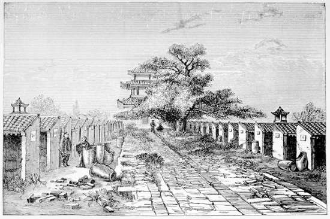

# 중국의 과거제 — 작은 칸에서 치른 시험은 누구에게 길을 열었을까

*경전과 응시 칸, 교육비와 관직 사이의 긴 시간*

History · Asia

> 출처 대조와 공개 게시 승인을 마친 이야기입니다. 실제 게시 여부는 사이트 배포 상태를 따릅니다.

*S. Wells Williams, The Middle Kingdom, Vol.I, Interior of Kung Yuen, or Examination Hall, Peking · Public Domain. 실제 시험장에 관한 역사 출판 도판.*

[이미지 출처·제작 근거](https://raw.githubusercontent.com/GITenberg/The-Middle-Kingdom-Volume-I-of-2-A-Survey-of-the-Geography-Government-Literature-Social-Life-__57868/master/57868-h/images/zill_f550a.jpg) · Public Domain · 저작권 만료 작품 및 역사 출판 자료

담장 안에 작은 칸들이 줄지어 있고 응시자는 책에서 익힌 문장을 답안으로 바꾼다. 중국의 과거제는 시험으로 관료를 뽑은 제도라는 한 줄로 자주 설명된다. 그러나 공부할 수 있는 사람과 합격 뒤의 길, 시험장의 통제까지 살펴보면 능력과 기회의 관계가 훨씬 복잡하게 보인다.

## 01. 가문만이 아니라 시험 성적을 묻다

관리를 뽑는 방법은 한 시대 내내 같지 않았다. 과거제 역시 수·당대의 전개 이후 송대와 명·청대를 거치며 형태와 중요성이 달라졌다. 오늘 시험의 규칙을 모든 왕조에 소급해서 적용할 수 없는 것과 같다.

시험을 통해 경전을 익히고 글을 쓰는 능력을 평가한다는 원칙은 가문과 추천만으로 사람을 고르는 방식과 다른 통로를 만들었다. 다만 옛 귀족이 사라지고 누구나 출발선에 선 평등한 사회가 되었다는 뜻은 아니다. 원칙과 실제 이용 조건은 구분해야 한다.

하나의 시험을 여러 지역 사람이 같은 권위의 기준으로 준비했다는 점은 국가 통합과도 연결된다. 다만 공통의 글을 공부한다고 지역의 말과 생활이 모두 같아지는 것은 아니다. 시험이 만든 연결과 그 밖에 남은 차이를 함께 보아야 한다.

## 02. 무엇을 공부했는지가 관료의 언어를 만들었다

특히 명·청대 시험에서는 유교 경전과 그 해석, 정해진 방식의 글쓰기가 중요했다. 응시자는 단순히 많은 문장을 외우는 것을 넘어 권위 있는 글을 해석하고 규범에 맞추어 논지를 구성해야 했다. 시험 형식 자체를 익히는 일도 큰 공부였다.

이 과정은 서로 다른 지역 출신의 엘리트가 공통의 글과 가치로 이야기하게 만들었다. 반면 무엇이 좋은 지식인지를 좁은 범위로 정하는 효과도 있었다. 과거의 의미를 오늘날의 상식 시험이나 특정 직업의 실무 시험과 완전히 같다고 생각하기는 어렵다.

## 03. 여러 단계는 많은 탈락과 긴 준비를 뜻했다

응시와 학위의 체계는 여러 단계로 이루어졌다. 지방에서 자격을 얻은 뒤 더 높은 지역과 수도의 시험으로 나아가는 길은 소수에게 열렸다. 한 번 시험을 잘 보면 즉시 높은 관리가 된다는 식의 단순한 사다리는 아니었다.

학위와 실제 관직의 임명도 같은 일이 아니었다. 시험을 통과한 사람 가운데 누가 언제 어떤 자리를 얻는지는 별도의 절차와 조건에 달렸다. 제도를 이해하려면 합격자를 뽑는 순간뿐 아니라 공부에서 임명까지 이어지는 긴 시간을 보아야 한다.

작은 칸과 담장, 출입 절차는 응시자의 집중을 돕는 동시에 긴 시간을 견뎌야 하는 환경이었다. 시험을 글의 우열만으로 설명하면 밤과 날씨, 음식과 피로의 조건이 빠진다. 답안은 사람의 몸과 생활에서 분리된 상태로 만들어지지 않았다.

## 04. 시험장의 작은 칸은 공정성을 지키는 장치였을까

사무엘 웰스 윌리엄스의 『중국』에는 베이징 공원, 곧 과거 시험장의 내부 도판이 실려 있다. 줄지은 응시 칸은 한 사람이 정해진 공간에서 답안을 쓰도록 나누는 구조다. 시험은 글의 내용만 아니라 몸과 물건의 이동도 관리했다.

반입물을 살피고 신원을 확인하며 답안을 처리하는 절차에는 부정행위를 막으려는 목적이 있었다. 일부 시대의 이름 가리기와 답안 옮겨 쓰기 같은 방법도 평가자와 응시자의 직접적인 관계를 줄이려 했다. 그러나 장치가 있다는 사실이 부정이 전혀 없었다는 증거는 아니다.

## 05. 가난한 사람에게 열린 길에도 비용이 있었다

형식상 혈통만으로 막히지 않는다는 것과 누구나 오래 공부할 수 있다는 것은 다르다. 책과 스승, 준비하는 동안의 생계, 시험장까지 이동하는 비용이 필요했다. 가족과 지역의 지원은 응시자의 능력이 드러날 기회 자체를 바꾸었다.

합격자 한 명이 가문의 명예를 높일 수 있었으므로 공부는 개인의 노력인 동시에 가족의 사업처럼 되기도 했다. 여성과 여러 신분 집단의 배제 역시 고려해야 한다. 과거를 공정한 경쟁의 완성으로 칭찬하거나 부패한 형식뿐이었다고 폄하하면 이런 긴장을 놓친다.

과거의 폐지는 사람을 고르는 방식의 변화이자 무엇을 배울 것인지에 관한 신호였다. 새 학교에서 어떤 지식을 가르치고 졸업을 어떻게 인정할지가 중요해졌다. 옛 시험을 없애는 결정만으로 새 인재 양성 체계가 즉시 완성되는 것은 아니었다.

## 06. 오래 공부한 사람은 관직 밖에서도 영향력을 가졌다

모든 공부가 높은 관리가 되는 결과로 이어지지는 않았다. 학위를 지닌 사람들은 고향에서 교육과 지역 사업, 문서 작성과 여러 공적 활동에 관여할 수 있었다. 시험은 관료만이 아니라 지역 엘리트의 지위와 생활 방식도 만드는 제도였다.

반대로 반복해서 낙방한 사람이 겪는 시간과 비용의 손실도 있었다. 응시자의 생애를 마지막 합격 여부 하나로만 읽으면 제도가 수많은 가정에 남긴 영향을 설명하기 어렵다. 시험장 밖에서 이어진 공부와 기대 역시 과거의 역사에 속한다.

## 07. 1905년의 폐지는 무엇을 바꾸었을까

청 말 개혁 과정에서 1905년 과거제가 폐지되었다. 새 학교와 다른 학문을 통해 인재를 기르려는 방향은 오랜 경전 공부와 관직의 연결을 흔들었다. 이미 그 길에 많은 시간을 쓴 사람에게는 삶의 계획 자체가 달라지는 일이었다.

이 글은 주로 명·청대의 운영과 19세기 기록을 중심으로 읽었으며 옛 저자의 민족별 능력에 관한 편견은 따르지 않았다. 작은 칸을 보여 주는 도판 뒤에는 시험 문제뿐 아니라 누가 배우고 어떤 지식으로 국가에 참여할 수 있는가라는 큰 질문이 들어 있다.

## 이야기의 바탕이 된 자료

- [S. Wells Williams, The Middle Kingdom, Vol.I — Education and Literary Examinations](https://raw.githubusercontent.com/GITenberg/The-Middle-Kingdom-Volume-I-of-2-A-Survey-of-the-Geography-Government-Literature-Social-Life-__57868/master/57868-0.txt) · 확인일 2026-11-07
  - 확인 내용: 명청 과거/경전과 글쓰기·응시/학위 단계·베이징 시험장·통제/부정방지·교육비와 엘리트. 민족별 능력 및 문명에 관한 저자의 편견은 배제
- [W. A. P. Martin, The Awakening of China — education reforms](https://raw.githubusercontent.com/GITenberg/The-Awakening-of-China_15125/master/15125-8.txt) · 확인일 2026-11-07
  - 확인 내용: 1905년 경쟁시험 폐지와 새 교육 제도. 책의 날짜 세부 표기는 확정하지 않고 연도만 사용하며,1904의 개별 개혁과1905폐지를 구분

---

[같은 소주제의 이야기](README.md) · [전체 서가](../../README.md)
