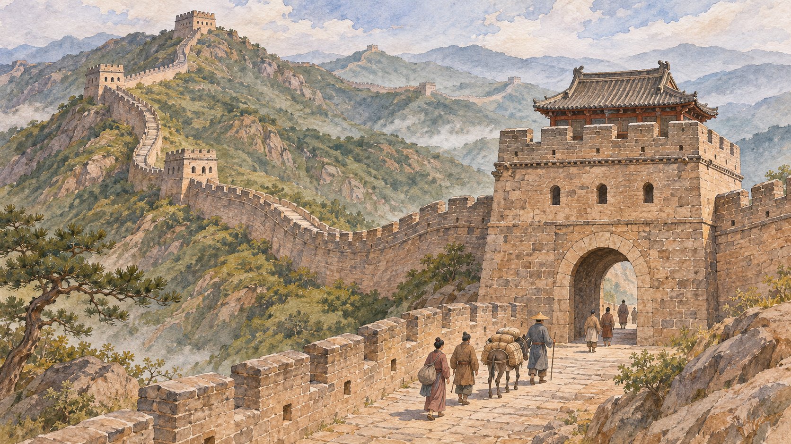

# 만리장성 — 벽이 있어도 역사는 문을 통해 움직였다

*하나의 건물이 아닌 여러 시대의 흔적에서 시작하는 역사와 작품 읽기*

History · Asia

> 자료 대조를 마친 검토용 이야기입니다. 공개 게시 승인은 아직 받지 않았습니다.

*AI 관련 장면 삽화 · 작품과 장소를 떠올리기 위한 상상 그림이며 실제 사진·배우 초상·정확한 복원이 아닙니다.*

만리장성을 한 황제가 세운 끝없는 벽으로 기억하면 중요한 역사가 사라진다. 여러 시대에 다른 목적과 재료로 만들어지고 고쳐진 방어 시설을 하나의 이름으로 부르기 때문이다. 벽의 길이뿐 아니라 문을 지킨 사람과 문을 통과한 군대, 그때 내려진 결정을 보면 장성의 의미가 달라진다.

## 01. 하나의 건물이 아닌 여러 시대의 흔적

중국의 여러 국가들은 진의 통일 이전에도 방어벽을 만들었다. 진시황의 사업은 이런 선행 시설과 북방 방어의 맥락 속에서 이해해야 한다. 지금 여행 사진에서 흔히 보는 벽돌 성벽을 모두 진시황 시대의 원형으로 생각하면 긴 시간의 차이를 놓친다.

후대에도 방어선은 세력과 환경에 따라 달라졌다. 일부 시설은 이어 쓰이고 일부는 버려졌으며 새로운 구간이 생겼다. 지도에 하나의 선을 긋는 일은 편리하지만, 그 선이 여러 왕조의 서로 다른 판단을 포개 놓은 결과라는 사실을 기억해야 한다.

## 02. 흙과 벽돌이 같은 일을 하지는 않는다

벽은 주변에서 얻을 수 있는 재료와 지형의 영향을 받는다. 흙을 다진 구조와 돌이나 벽돌을 사용한 구조는 겉모습도 보존 상태도 다르다. 남아 있는 구간이 아름답고 단단하다고 해서 모든 시대의 모든 장성이 같은 모습이었다고 추정할 수는 없다.

능선을 따라가는 벽을 볼 때에도 산 자체가 방어에 어떤 역할을 하는지 생각해 보자. 장성은 평지 위에 독립적으로 놓인 물건이 아니라 지형을 이용하는 시설이다. 자연의 높낮이와 사람이 만든 구조를 함께 읽어야 왜 그곳에 벽을 세웠는지 질문할 수 있다.

## 03. 성벽 위에 사람이 있어야 했다

어떤 벽도 스스로 경계를 살피고 소식을 전할 수 없다. 병사와 보급, 말을 돌보는 일과 시설을 수리하는 노동이 필요하다. 웅장한 유적의 사진 바깥에는 먹을 것을 운반하고 근무를 이어 가는 생활이 있었다.

장성을 지킨다는 것은 돌을 쌓는 공사와 다른 지속적인 비용을 요구했다. 시설이 완성된 뒤에도 국가가 사람과 물자를 배치할 수 있어야 했다. 건축의 규모만으로 방어 능력을 평가하기보다 그 구조를 작동시킨 조직까지 생각해야 하는 이유다.

## 04. 문은 방어선의 약점이면서 기능이었다

사람이 전혀 오가지 않는 벽만으로는 국경의 생활을 설명할 수 없다. 길과 통로가 필요했고, 문에서는 이동을 허용하거나 막는 판단이 이루어졌다. 방어선은 교류가 존재하는 세계의 한가운데에 놓여 있었다.

문을 통제하는 권한은 군사적 힘과 정치적 책임을 함께 뜻했다. 누가 들어오는지 살피는 일은 담장의 높이로 대신할 수 없다. 장성을 벽과 문이 결합한 시설로 보면, 차단과 통과가 서로 떨어진 문제가 아니었음을 알 수 있다.

지금 남아 있는 구간을 걷는 일은 과거의 병사가 보았던 환경을 그대로 되풀이하는 것은 아니다. 복구된 곳과 손상된 곳, 관광을 위해 정비한 길이 함께 존재할 수 있다. 유적을 보호하는 현재의 선택도 우리가 보는 모습에 영향을 준다. 사진의 촬영 장소와 설명이 중요해지는 이유다.

명대의 북방 방어를 읽을 때도 장성 한 줄만으로 지도를 끝내지 말자. 관문과 요새, 주변의 길을 연결하면 군대가 어느 방향으로 이동하고 어디에서 머물 수 있었는지 생각할 수 있다. 방어 시설은 단독의 벽보다 여러 거점을 이어 운영한 체계로 이해할 때 실제 기능에 가까워진다.

## 05. 산해관과 1644년의 선택

명 말기의 위기를 보여 주는 중요한 장소가 산해관이다. 1644년 이자성의 군대가 베이징을 차지하고 명 황제가 죽은 뒤, 산해관의 오삼계는 새로 형성된 권력 관계 속에서 선택을 해야 했다. 이후 청의 군대가 관문을 통과하며 중국 정치의 중심이 바뀌었다.

이 과정을 장성이 쓸모없었다는 한마디로 요약하면 지나치게 단순하다. 왕조 내부의 반란과 지휘관의 이해관계, 외부 군대의 전략이 함께 작용했다. 유명한 사적인 일화 하나만을 유일한 원인으로 삼는 설명도 복잡한 정치적 상황을 가려 버린다.

## 06. 벽 안과 밖이라는 말의 한계

장성을 문명과 야만을 영원히 나누는 선으로 묘사한 오래된 글도 있다. 그러나 그런 표현에는 글쓴이 시대의 편견이 들어 있다. 서로 다른 공동체가 전쟁을 했다는 사실이 한쪽의 삶 전체를 낮추어 부를 근거는 아니다.

경계는 고정된 두 세계 사이에만 있지 않았다. 정치적 연합과 갈등은 변했고, 사람들이 장성을 이해하는 방식도 바뀌었다. 과거의 사료를 읽을 때에는 사건의 기록과 사람을 평가하는 언어를 구별해야 유적의 역사를 더 정확히 설명할 수 있다.

## 07. 길이를 외우기 전에 묻는 질문

장성에 관한 숫자는 어떤 시대의 어떤 시설을 포함하는지에 따라 의미가 달라진다. 긴 길이를 외우는 것보다 지금 보는 구간의 시대와 재료, 주변 통로를 확인하는 일이 현장을 이해하는 데 도움이 된다. 하나의 숫자가 모든 부분의 역사를 대신할 수는 없다.

만리장성은 경계를 세우려 한 의지의 흔적이면서 그 경계를 운영해야 했던 사람들의 흔적이다. 벽이 있다고 정치가 멈추지는 않았고, 문이 있다고 방어가 포기된 것도 아니었다. 유적을 본다는 것은 사라진 조직과 생활을 질문하는 일이기도 하다. 돌의 견고함과 인간의 선택을 함께 볼 때 거대한 유적이 역사 속 시설로 돌아온다.

## 이야기의 바탕이 된 자료

- [Herbert A. Giles, China and the Manchus](https://raw.githubusercontent.com/GITenberg/China-and-the-Manchus_2156/master/2156-8.txt) · 확인일 2026-11-06
  - 확인 내용: 명 말기·이자성·오삼계·산해관·1644년 청의 진입. 인종적 평가와 사적 일화를 단일 원인으로 전재하지 않음
- [W. A. P. Martin, The Awakening of China (1907)](https://raw.githubusercontent.com/GITenberg/The-Awakening-of-China_15125/master/15125-8.txt) · 확인일 2026-11-06
  - 확인 내용: 진 이전의 방어벽과 진 통일·명청 교체. 현대 관광 구간 전체가 진대 원형이라는 설명은 쓰지 않음

---

[같은 소주제의 이야기](README.md) · [전체 서가](../../README.md)
