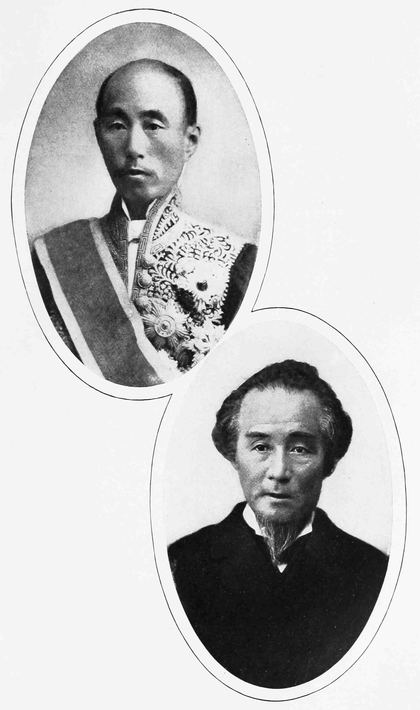

# 폐번치현 — 영주의 땅은 어떻게 중앙정부의 지도가 되었을까

*1869년의 반환에서1871년의 현 설치, 지방 권력과 재정의 재편*

History · Asia

> 출처 대조와 공개 게시 승인을 마친 이야기입니다. 실제 게시 여부는 사이트 배포 상태를 따릅니다.

*Ernest Wilson Clement, A Handbook of Modern Japan, Statesmen of New Japan: Prince Sanjō and Count Katsu · Public Domain. 역사 인물 도판이며1871년 폐번치현 결정 회의 사진이 아닙니다.*

[이미지 출처·제작 근거](https://raw.githubusercontent.com/GITenberg/A-Handbook-of-Modern-Japan_65253/master/65253-h/images/i_116f.jpg) · Public Domain · 저작권 만료 작품 및 역사 출판 자료

지도에 같은 색을 칠한다고 그 안의 세금과 군대가 저절로 하나가 되지는 않는다. 메이지 초기 일본 정부가 마주한 문제도 그랬다. 막부를 무너뜨렸지만 지역에는 여전히 번의 재정과 인맥, 무력이 남아 있었다. 1871년 번을 없애고 현을 설치한 폐번치현은 행정구역의 이름을 고친 사건인 동시에, 누가 지방을 다스리고 돈을 거둘 것인지 다시 정한 권력의 재편이었다.

## 01. 막부가 사라진 뒤에도 남은 번

에도 시대의 번은 각 영주가 지배하던 영역을 가리킨다. 영주는 막부의 질서 안에 있었지만 자신의 가신과 수입, 지역 운영 조직을 거느렸다. 농민에게 해마다 세금을 요구하는 가까운 권력은 멀리 있는 쇼군만이 아니었다.

1868년 새 정부가 등장한 뒤에도 이런 조직이 한꺼번에 사라지지는 않았다. 특히 정권 교체에 기여한 유력 번은 새 정부를 떠받치는 기반이면서 독자적인 힘을 가진 존재였다. 중앙은 그들의 협력을 필요로 했고, 동시에 그 힘을 중앙의 조직으로 옮겨야 했다.

## 02. 먼저 땅과 주민을 돌려주다

1869년에는 영주들이 토지와 주민에 대한 지배권을 천황에게 돌려준다는 형식의 조치가 이루어졌다. 이를 판적봉환이라고 부른다. 그러나 기존 영주가 해당 번의 장관으로 임명되는 경우가 많아 지역의 인적 연결까지 곧바로 끊긴 것은 아니었다.

여기에는 중요한 차이가 있다. 권력이 누구에게서 나온다고 선언하는 일과 실제로 세금 장부를 관리하고 명령을 집행하는 사람을 바꾸는 일은 서로 다르다. 첫 조치는 중앙의 원칙을 세웠지만, 지방의 운영 방식은 더 바뀌어야 했다.

영주를 같은 지역의 책임자로 남겨 두는 방식은 변화를 수용하게 하는 타협일 수 있었다. 그러나 옛 가신과 재정의 연결이 유지되면 중앙의 명령은 여전히 기존 인맥을 거쳐야 했다. 명목상의 주권과 일상의 행정 권한 사이에 생긴 이 틈이 다음 조치의 배경이었다.

## 03. 1871년의 짧은 명령

폐번치현은 그 간격을 줄이는 조치였다. 번을 폐지하고 현을 두며, 기존 영주 대신 중앙이 지방 책임자를 임명하는 체제로 나아갔다. 옛 영주들이 도쿄로 옮겨 살게 된 것도 지역 권력과의 거리를 벌리는 의미가 있었다.

정권의 주요 인물들이 이 선택을 추진할 수 있었던 배경에는 군사적 기반의 정비가 있었다. 지방에서 반대가 나왔을 때 명령만으로 해결할 수 없었기 때문이다. 행정 개혁의 문장은 짧아도 그 문장을 현실로 만드는 데에는 정치적 합의와 무력의 뒷받침이 필요했다.

## 04. 세금과 빚은 어디로 갔을까

번마다 따로 관리하던 수입과 지출을 중앙의 국가 재정으로 묶는 일은 쉽지 않았다. 기존 채무와 가신의 생계, 지역 관리 조직을 어떻게 처리할지 문제가 뒤따랐다. 번의 이름이 없어졌다고 그 번이 진 의무까지 사라지는 것은 아니었다.

중앙정부에는 전국의 자원을 파악하고 학교와 군대, 통신망 등을 운영할 기반이 필요했다. 다만 뒤이어 진행된 세제 개혁이나 군제 개편을 모두 폐번치현이라는 하나의 명령 안에 넣어서는 안 된다. 서로 이어졌지만 시기와 내용이 다른 여러 정책이었다.

## 05. 지방의 지도는 계속 바뀌었다

1871년 처음 정비한 구역이 오늘날 일본의 도도부현과 그대로 일치한 것은 아니다. 작은 행정 단위들을 합치고 경계를 조정하는 과정이 이어졌다. 현이라는 제도의 도입과 현재 지도의 완성은 구분해서 보아야 한다.

경계는 주민에게도 추상적인 선이 아니었다. 어느 관청에 문서를 내고, 어떤 길을 이용해 업무를 보며, 어느 지역과 같은 행정 단위가 되는지를 결정했다. 중앙의 지도는 지역 생활에 새로운 중심과 이동 경로를 만들어 냈다.

행정 단위의 크기를 바꾸면 관리의 수와 관청의 위치, 문서가 이동하는 시간도 달라진다. 지역 이름을 암기하는 것만으로는 보이지 않는 변화다. 현의 설치와 통합을 주민이 새로운 국가를 만나는 창구가 바뀐 사건으로 읽을 수 있다.

## 06. 무사들의 생활은 명령 뒤에도 이어졌다

번의 가신이던 무사들에게 변화는 소속과 수입의 문제였다. 국가가 새 조직을 만든다고 모든 사람이 새로운 직업을 얻는 것은 아니었다. 신분과 생계에 관한 개혁이 이어지면서 불만도 쌓였고, 일부는 뒤의 무력 충돌로 나타났다.

그러나 모든 무사가 같은 선택을 했던 것은 아니다. 관료와 군인으로 자리를 옮기는 사람도 있었고 다른 생업을 찾아야 하는 사람도 있었다. 1877년 사쓰마 반란 같은 사건도 폐번치현 하나만의 직접적 결과로 단순하게 설명할 수는 없다.

정부 안에서 일하게 된 사람에게도 과거의 인연이 완전히 없어지는 것은 아니었다. 지역 출신과 정치적 관계는 새 조직 안에서도 작용할 수 있었다. 제도를 중앙에 묶었다는 사실과 모든 인적 관계가 균일해졌다는 주장은 구분해야 한다.

## 07. 국가를 만드는 행정의 힘

폐번치현은 일본의 변화가 서양 기계를 사들이는 일만으로 이루어지지 않았음을 보여 준다. 누가 임명하고, 누가 돈을 모으며, 어느 조직이 주민과 만나는지를 바꾸는 일도 새로운 국가를 만드는 핵심이었다.

함께 실은 역사 출판물의 인물 도판은 산조 사네토미와 가쓰 가이슈를 보여 준다. 새 정부와 옛 막부라는 서로 다른 정치적 배경을 떠올리게 하지만 폐번치현을 결정한 회의의 기록 사진은 아니다. 인물의 모습과 제도가 실제로 움직인 과정을 구분하며 읽을 필요가 있다.

## 이야기의 바탕이 된 자료

- [Ernest Wilson Clement, A Handbook of Modern Japan — periods of transformation and internal development](https://raw.githubusercontent.com/GITenberg/A-Handbook-of-Modern-Japan_65253/master/65253-0.txt) · 확인일 2026-11-08
  - 확인 내용: 메이지 초기 통치 개편·1871번 폐지와 현 설치·이후 군제/교육/재정 변화와1877반란을 별개 시기로 구분·산조/가쓰 인물 도판. 신분 차별적 용어와 제국주의적 진보 서사는 배제

---

[같은 소주제의 이야기](README.md) · [전체 서가](../../README.md)
