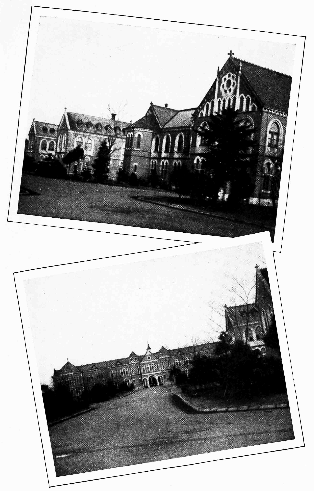

# 메이지의 학교 — 모두가 배우게 된다는 말은 어떻게 제도가 되었을까

*1872년 학제와 학교의 확대, 배움과 국가의 관계*

생각과 지식 · 교육과 배움

> 출처 대조와 공개 게시 승인을 마친 이야기입니다. 실제 게시 여부는 사이트 배포 상태를 따릅니다.

*Ernest W. Clement, A Handbook of Modern Japan (1913), Imperial University Buildings, Tokyo. 1872년의 초등학교 사진이 아닙니다. · Public Domain.*

[이미지 출처·제작 근거](https://raw.githubusercontent.com/GITenberg/A-Handbook-of-Modern-Japan_65253/master/65253-h/images/i_210f.jpg) · Public Domain · 역사 출판 자료

학교를 세우라는 명령이 내려오면 다음 날부터 모든 아이가 공부할 수 있을까. 메이지 일본은 1872년 새로운 교육 제도를 마련하며 공교육을 확대했다. 하지만 제도의 선언과 실제 등교 사이에는 교사와 교실, 비용과 생활의 문제가 놓여 있었다. 학교는 글과 계산을 배우는 기회를 넓혔고, 동시에 국가가 어떤 지식과 태도를 중요하게 여기는지 전달하는 공간이 되었다.

## 01. 새로운 정부에는 새로운 배움이 필요했다

메이지 정부는 행정과 산업, 군사 등 여러 분야를 바꾸려 했다. 넓은 지역에서 규칙을 적용하고 새로운 기술을 받아들이려면 지식과 문서를 다루는 사람이 필요했다. 교육은 개인의 수양을 넘어 국가 운영의 기반으로 여겨졌다.

그렇다고 이전 일본에 배움이 없었던 것은 아니다. 번의 학교와 민간 교육, 가정과 직업의 현장에서 이루어진 학습이 있었다. 근대 학교의 역사는 아무것도 없던 곳에 지식을 처음 들여온 이야기가 아니라, 기존 배움을 새로운 체계로 재편하는 과정이었다.

## 02. 1872년은 완성이 아니라 출발점이었다

새 학제는 학교를 지역적으로 배치하고 교육의 단계를 정비하려는 구상이었다. 여러 지역에서 서로 다른 방식으로 배우던 사람들이 공통의 제도 안으로 들어오게 하려 했다. 국가가 교육에 대해 어떤 책임과 권한을 주장하는지가 달라졌다.

그러나 법령의 목표와 주민이 겪는 현실은 달랐다. 학교를 유지할 재원과 아이가 공부할 시간, 교사를 마련해야 했다. 제도가 발표된 해를 전국의 아이들이 같은 수업을 받기 시작한 해로 읽으면, 그 뒤의 긴 확대 과정을 지워 버리게 된다.

## 03. 외국의 제도는 그대로 옮길 수 없었다

정부와 교육 관계자들은 해외의 학교와 교과, 교사 양성 방법을 살폈다. 외국인 교사를 초빙하고 학생을 유학 보내는 일도 이루어졌다. 새로운 지식의 수입에는 책의 번역뿐 아니라 가르치는 방법을 배우는 작업이 따랐다.

하지만 하나의 외국 모델이 일본 학교 전체로 그대로 복사된 것은 아니었다. 지역의 형편과 기존의 문화, 정부의 정책에 맞추어 교육 내용과 제도는 조정되었다. 유럽과 미국에서 배운다는 것과 일본 사회가 그 제도를 운영하는 것은 다른 일이었다.

## 04. 교사를 가르치는 학교도 필요했다

아이들에게 수업을 제공하려면 교사부터 준비해야 했다. 사범학교는 교사를 양성하는 역할을 맡았다. 초등 단계와 상급 학교, 전문 교육의 경로가 확대되면서 가르치는 사람에게 요구되는 지식과 자격도 달라졌다.

교육의 확장은 건물을 늘리는 문제만이 아니었다. 어떤 교재를 쓰고 학습 수준을 어떻게 판단할지도 정해야 했다. 같은 학교라는 이름 아래 수업이 이루어지더라도 지역마다 자원과 여건의 차이가 있을 수 있었다.

중앙정부가 직접 관리하는 교육 기관과 지방의 세금으로 유지하는 학교, 민간이 운영하는 학교는 재정의 기반도 달랐다. 학교가 늘어난다는 공통의 변화 안에도 책임을 나누는 여러 방식이 있었던 셈이다. 한 곳의 운영 사례를 일본 전체의 모습으로 일반화하기 어렵다.

## 05. 학교의 문은 같은 속도로 열리지 않았다

새 제도의 초기부터 모든 아이가 같은 기회를 누린 것은 아니었다. 가족이 감당할 비용과 아이의 노동이 갖는 중요성은 등교를 어렵게 만들 수 있었다. 도시와 농촌, 부유한 집과 가난한 집의 생활 조건도 같지 않았다.

시대가 지나며 취학은 넓어졌지만 남녀의 교육 기회가 언제나 대등한 것은 아니었다. 고등 교육으로 갈수록 문턱은 더욱 뚜렷했다. 학교 수나 취학 비율이 늘었다는 성과와 누구에게 어떤 진학 경로가 열렸는지는 따로 물어야 한다.

## 06. 과학과 도덕은 교실에서 함께 가르쳐졌다

근대 학교에서는 계산과 지리, 과학 같은 지식이 중요해졌다. 동시에 도덕과 충성도 강조되었다. 1890년 교육칙어는 가족과 사회의 덕목을 말하면서 국가와 황실에 대한 의무를 교육의 중요한 기준으로 제시했다.

따라서 학교의 확대를 자유로운 지식 탐구만의 역사로 볼 수는 없다. 학생에게 새로운 세계를 보여 주는 수업과 일정한 국민상을 기르려는 교육이 같은 공간에서 이루어졌다. 국가가 교육을 지원하는 이유에는 역량의 확대와 질서의 유지가 함께 있었다.

학교의 규칙은 매일 반복된다는 점에서 힘을 가졌다. 특별한 행사에서 국가의 교육 원칙을 낭독하는 행위도 단순한 문서 보관과는 달랐다. 학생은 수업 내용뿐 아니라 의례와 규율을 통해 자신과 국가의 관계를 배우도록 요구받았다.

## 07. 대학 건물 사진 뒤의 긴 시간을 보기

함께 실은 사진은 1913년판 일본 안내서에 수록된 도쿄 제국대학 건물이다. 1872년 첫 학교의 모습도, 모든 지역의 교실을 대표하는 사진도 아니다. 학교 체계가 확대된 뒤의 고등 교육 시설을 보여 주는 후대 자료다.

새로운 학교는 더 많은 사람이 지식과 기술을 만나는 길을 열었다. 그러나 공교육이 성장했다는 설명만으로 교육의 불평등과 국가의 통제를 지울 수는 없다. 메이지 교육의 변화는 누가 배우게 되었는지와 무엇을 배우도록 요구받았는지를 함께 볼 때 선명해진다.

## 이야기의 바탕이 된 자료

- [Ernest W. Clement, A Handbook of Modern Japan (1913), Education](https://raw.githubusercontent.com/GITenberg/A-Handbook-of-Modern-Japan_65253/master/65253-0.txt) · 확인일 2026-11-11
  - 확인 내용: 학교 단계와 교사 양성·해외 학습·정부/지방/민간의 재정 분담·여성 고등 교육의 제한·1890년 교육칙어. 책의 특정 시기 학년·수업료를 1872년이나 전 기간의 동일 규정으로 일반화하지 않음.
- [OpenStax, World History Volume 2 — The Second Industrial Revolution](https://raw.githubusercontent.com/openstax/osbooks-world-history/main/modules/m00068/index.cnxml) · 확인일 2026-11-11
  - 확인 내용: 1872년 일본 공교육 제도와 이후 취학 확대, 과학/유교 고전·유학. 1872년의 기회가 곧 평등했다는 뜻으로 쓰지 않음.

---

[같은 소주제의 이야기](README.md) · [전체 서가](../../README.md)
